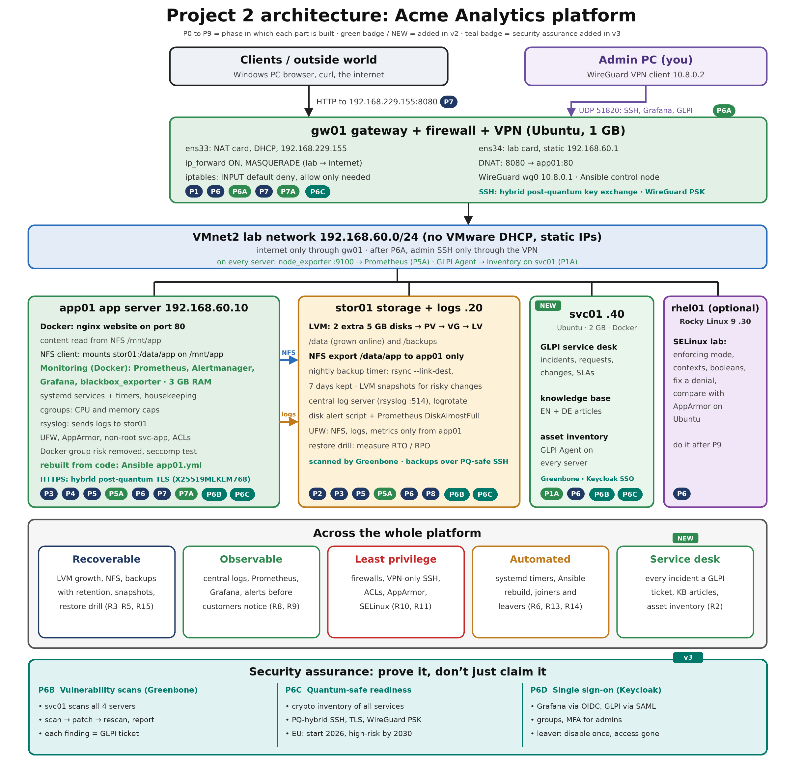

# Acme Analytics: a hardened, observable and recoverable Linux platform

> **Status: in progress.** Built step by step in VMware. Each working day is documented in [`docs/progress/`](docs/progress/) with real screenshots of every result. Every step is explained twice: technically, and in plain words for non-specialists. Unfamiliar terms: see the [glossary](docs/glossary.md).



## The problem

Acme Analytics runs a small web app on one server. Disks fill up without warning, backups depend on someone remembering, logs grow forever, admins SSH in from anywhere, nobody notices an outage until a customer emails, and nobody could rebuild the server the same way. The first enterprise customer's security questionnaire asks questions the team cannot answer.

My job as junior platform engineer: build a platform that is **recoverable, observable and least-privilege**, run it like a service desk, and document it.

## What I am building

| VM | Role (plain words) | Role (technical) | IP |
|---|---|---|---|
| gw01 | The gatekeeper – the only door to the internet | Gateway: NAT, iptables firewall, WireGuard VPN, Ansible control node | 192.168.60.1 |
| app01 | The shop window – runs the website | App server: nginx in Docker, monitoring stack (Prometheus, Alertmanager, Grafana) | 192.168.60.10 |
| stor01 | The archive room – files, backups, logs | Storage: LVM, NFS, backups, central log server | 192.168.60.20 |
| svc01 | The help desk – tickets and inventory | Service desk: GLPI tickets, knowledge base, asset inventory (Docker) | 192.168.60.40 |

## Start here

📖 **[The Day 1 story](docs/progress/day-01-story.md)** – the whole day told step by step: what I did, why, the real screenshot, and why it leads to the next step. Written so that non-specialists can follow it. Also as a document: [Project-2-Day-1-story.odt](docs/progress/Project-2-Day-1-story.odt).

## Where I am now

🧾 **Cheat sheet:** [what makes a change survive a reboot](docs/persistence-cheatsheet.md)

📄 **Complete guide (Days 1–5, printable):** [Project-2-complete-so-far.pdf](docs/progress/Project-2-complete-so-far.pdf) · ⚡ **Quick guide** – story, commands, screenshots, final understanding only: [quick-guide.md](docs/quick-guide.md) · [PDF](docs/progress/Project-2-quick-guide.pdf)

**Phase 1A done for now – GLPI service desk on svc01, automatic inventory of all servers, first Change ticket** ([Day 3](docs/progress/day-03-2026-10-16.md) · [Day 4](docs/progress/day-04-2026-10-18.md)). **Phase 2 complete ✅** – LVM pool from empty disks, `/data` grown without downtime, NFS share to app01, backups with history and a tested restore, LVM snapshot rollback ([Day 4](docs/progress/day-04-2026-10-18.md) · [Day 5](docs/progress/day-05-2026-10-20.md)). **Phase 3 complete ✅** – job control with real customer uploads over NFS, a disk-full alert as a systemd timer, socket activation, a custom target, cron vs timer and a nightly backup that runs by itself ([Day 5](docs/progress/day-05-2026-10-20.md) · [Day 6](docs/progress/day-06-2026-10-21.md)). Phase 1 complete ✅ (snapshot `20-Network`) – Steps 1.5–1.9: SSH with keys from gw01 to every server; hard links, soft links and inodes proven (groundwork for the Phase 2 backups); named users, a team group and a no-login service account on app01; [Linux NAT vs cloud NAT](docs/nat-comparison.md) diagram.

| Phase | Topic | Status | Report |
|---|---|---|---|
| 0 | Know the system: kernel, boot, targets | 🟡 gw01 done | [Day 1, part 1](docs/progress/day-01-2026-10-13.md) |
| 1 | Network foundation: static IPs, routing, NAT, names, ports | ✅ Steps 1.1–1.9, snapshot taken | [Day 1, part 2](docs/progress/day-01-2026-10-13-part2-network.md) · [Day 2](docs/progress/day-02-2026-10-15.md) |
| 1A | Service desk: GLPI tickets and inventory | ✅ GLPI in Docker, inventory of all 4 servers, defaults locked, Change #1 (SLAs and categories added with the first tickets) | [Day 3](docs/progress/day-03-2026-10-16.md) · [Day 4](docs/progress/day-04-2026-10-18.md) |
| 2 | Storage: LVM, NFS, backups, snapshots | ✅ LVM pool, /data grown live, NFS share (access tested), tar/rsync backups with hard-linked versions, restore via ticket, LVM snapshot rollback | [Day 4](docs/progress/day-04-2026-10-18.md) · [Day 5](docs/progress/day-05-2026-10-20.md) |
| 3 | Automation: systemd services and timers | ✅ job control with real uploads over NFS · disk-full alert (service + timer) · socket activation · `acme-stack.target` · cron vs timer · nightly versioned backup by timer with catch-up | [Day 5](docs/progress/day-05-2026-10-20.md) · [Day 6](docs/progress/day-06-2026-10-21.md) |
| 4 | Processes, signals, cgroups | ⏳ | |
| 5 | Logging: journald, rsyslog, logrotate | ⏳ | |
| 5A | Monitoring and alerting | ⏳ | |
| 6 | Security hardening | ⏳ | |
| 6A | WireGuard VPN | ⏳ | |
| 7 | Publish the web service (DNAT) | ⏳ | |
| 7A | Ansible: rebuild and joiner/leaver | ⏳ | |
| 8 | Acceptance tests and disaster drill | ⏳ | |

### Achieved so far

- Baseline of kernel, drivers, memory and boot recorded; gw01 switched to server mode (`multi-user.target`).
- Static addressing on all three servers with netplan, verified after reboot.
- app01 and stor01 have **no direct internet connection**; all traffic goes through gw01 (IP forwarding + NAT + stateful firewall rule).
- Name resolution order (`/etc/hosts` before DNS) demonstrated.
- 10 issues found and documented with cause and fix (wrong file name, keyboard-layout paste corruption, adapter still connected, missing disks, …).

## Roadmap – what the finished project will show

| Area | Phase | Evidence planned |
|---|---|---|
| Service desk (ITIL): incidents, requests, changes, KB, inventory | 1A | Real GLPI tickets for every lab incident |
| Storage and tested backups | 2 | Restore drill, LVM snapshot rollback |
| Monitoring and alerting | 5A | Time from failure to alert, measured |
| Security hardening and VPN | 6, 6A | Firewall rules, SSH hardening, WireGuard access |
| Automation | 7A | Ansible rebuild of a server, timed; joiner/leaver playbook |
| Acceptance tests and disaster drill | 8 | Results table with measured numbers |

## Repository layout

```text
linux-platform/
  README.md                     this page
  docs/
    project2-architecture.png   architecture diagram
    glossary.md                 plain-language explanation of every term
    progress/                   one technical report per working day
    images/day-01/              screenshots of every result
```

## Results

*Filled in with measured numbers after Phase 8: time to detect each alert, rebuild time, RTO/RPO, tickets handled.*
