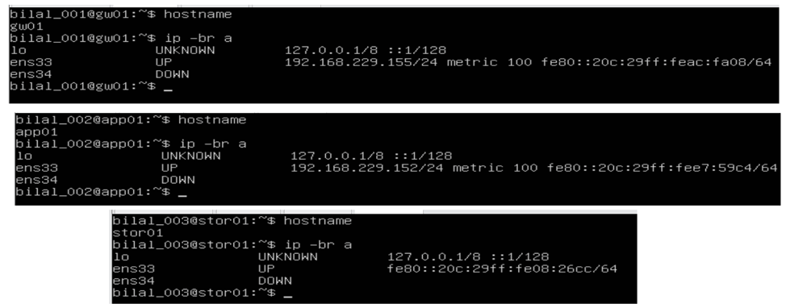
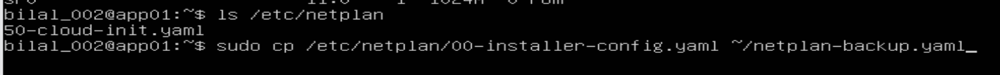
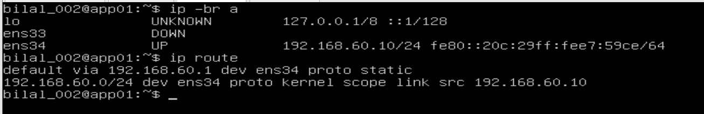

# Day 1 (part 2) – 2026-10-13: Phase 1, network foundation

| | |
|---|---|
| **Project** | Acme Analytics – hardened, observable and recoverable Linux platform |
| **Phase** | 1 – Network foundation: Steps 1.1–1.4 |
| **Hosts worked on** | gw01, app01, stor01 |
| **Status** | 1.1 static IPs ✅ · 1.2 routing ✅ · 1.3 NAT ✅ · 1.4 name resolution 🟡 (break test pending) |
| **Author** | Muhammad Bilal Javed |

> **How to read this report.** Every step has three layers:
> 💡 **In plain words** – the idea, for any reader.
> 🔧 **Technical** – the exact commands, with a comment on every line.
> 📸 **Evidence** – the real screenshot from my lab.
> Unfamiliar words are explained in the [glossary](../glossary.md).

---

## 1. Objective

💡 **In plain words:** at the end of Phase 0 the three servers were like three new employees with no desk phones: they could not reliably reach each other, and two of them had their own uncontrolled line to the outside world. In this phase I:

1. give every server a **fixed address** (like a permanent desk-phone number),
2. **cut the private internet lines** of app01 and stor01,
3. turn gw01 into the **company switchboard** – the one and only way out to the internet,
4. teach the servers to find each other **by name** instead of by number.

🔧 **Technical:** static IPv4 addressing with netplan, IP forwarding and source NAT (MASQUERADE) with stateful forwarding on gw01, and name resolution via `/etc/hosts` and DNS.

## 2. Target network design

```text
                 Internet
                    │
          Windows host / home router
                    │   VMware NAT network (VMnet8, 192.168.229.0/24)
        ┌───────────┴───────────┐
        │ gw01                  │  ens33 = 192.168.229.155 (DHCP)  ← the ONLY internet door
        │ router + NAT          │  ens34 = 192.168.60.1  (static)
        └───────────┬───────────┘
                    │   lab network (VMnet2, 192.168.60.0/24, isolated)
          ┌─────────┴─────────┐
   ┌──────┴──────┐     ┌──────┴──────┐
   │ app01       │     │ stor01      │
   │ .60.10      │     │ .60.20      │
   │ no internet │     │ no internet │
   │ adapter     │     │ adapter     │
   └─────────────┘     └─────────────┘
```

| Host | External card (ens33) | Lab card (ens34) | Way to the internet ("default gateway") |
|---|---|---|---|
| gw01 | DHCP, 192.168.229.155 | 192.168.60.1/24 | VMware NAT, directly |
| app01 | disconnected | 192.168.60.10/24 | through gw01 (192.168.60.1) |
| stor01 | disconnected | 192.168.60.20/24 | through gw01 (192.168.60.1) |

💡 **Why this design?** One door is easier to guard than three. All firewall rules, logs and later the VPN live on gw01. The internet can never start a connection to app01 or stor01 directly.

---

## 3. Step 1.1 – Fixed (static) addresses with netplan

### 3.1 Look before you change: which network cards exist?

💡 **In plain words:** each VM has two "network sockets" (cards). Before configuring them I check their names and current addresses.

🔧 **Commands:**

```bash
hostname          # confirm which machine I am on
ip -br a          # list all network cards, brief (-br) form: name, state, address
```

📸 **Evidence – starting point on all three VMs:**



| Card | Meaning |
|---|---|
| `lo` | loopback – the machine talking to itself (127.0.0.1). Always present |
| `ens33` | 1st card = VMware NAT network. gw01 and app01 had internet addresses (192.168.229.x) from VMware's DHCP |
| `ens34` | 2nd card = lab network (VMnet2). **DOWN with no address** – nothing configured yet |

### 3.2 Find the configuration file and make a backup

💡 **In plain words:** on Ubuntu, network settings live in a small text file in the folder `/etc/netplan/`. Before editing any config file, I make a copy – so I can always go back.

🔧 **Commands:**

```bash
ls /etc/netplan                                               # which netplan file exists?
sudo cp /etc/netplan/50-cloud-init.yaml ~/netplan-backup.yaml # backup copy into my home folder
```

📸 **Evidence:** the file is called `50-cloud-init.yaml`, not `00-installer-config.yaml` as my guide assumed (issue 1):



### 3.3 Stop cloud-init from overwriting my settings

💡 **In plain words:** `cloud-init` is a helper program that sets up the network automatically at first boot – and it may **rewrite my file** on a later boot, silently undoing my work. I leave it a note saying "network: hands off".

🔧 **Command:**

```bash
# write the line "network: {config: disabled}" into a new cloud-init config file
# (tee writes to the file AND shows the line on screen so I can check it)
echo "network: {config: disabled}" | sudo tee /etc/cloud/cloud.cfg.d/99-disable-network-config.cfg
```

📸 **Evidence – gw01: backup, current file, cloud-init disabled:**


### 3.4 Write the new network settings

💡 **In plain words:** the netplan file is written in **YAML**, a format where **indentation (spaces) is part of the meaning** – like an outline where sub-points must be indented under their heading. One wrong space and the file is invalid.

🔧 **gw01** (`sudo nano /etc/netplan/50-cloud-init.yaml`):

```yaml
network:
  version: 2
  ethernets:
    ens33:                         # card 1: internet side
      dhcp4: true                  #   get its address automatically from VMware
    ens34:                         # card 2: lab side
      addresses: [192.168.60.1/24] #   fixed address; no gateway – gw01 IS the gateway
```

📸 **Evidence – typed by hand in nano on gw01:**


🔧 **app01** (stor01 identical, with `192.168.60.20/24`):

```yaml
network:
  version: 2
  ethernets:
    ens34:                          # only the lab card is configured
      addresses: [192.168.60.10/24] # fixed address; "/24" = network size (192.168.60.0–255)
      routes:
        - to: default               # for every destination I don't know …
          via: 192.168.60.1         # … send it to gw01 (the "default gateway")
      nameservers:
        addresses: [1.1.1.1, 8.8.8.8]  # public DNS servers: translate names like google.com into IPs
```

### 3.5 Apply safely – with an automatic "undo"

💡 **In plain words:** changing network settings on a server is like changing the lock on the only door while you are inside: if it goes wrong, you may lock yourself out. `netplan try` applies the change but **automatically undoes it after 120 seconds** unless I press Enter to confirm. If I can still type, the change works – I press Enter.

🔧 **Commands:**

```bash
sudo chmod 600 /etc/netplan/50-cloud-init.yaml  # only root may read/write the file (netplan warns otherwise)
sudo netplan try                                # apply with auto-rollback; press ENTER to keep
ip -br a                                        # check the new addresses
```

📸 **Evidence – gw01:** ens34 now has `192.168.60.1/24`. The Open vSwitch warning is harmless (issue 4):


📸 **Evidence – app01:** file content and `netplan try`:


### 3.6 Problem found: app01 still had its own internet line

📸 After applying, app01 could reach gw01 – **but ens33 still had an internet address (192.168.229.152)**. That breaks the design: app01 must not have its own way out.


💡 **In plain words:** turning off the setting inside Linux is not enough – the **virtual cable** was still plugged in. The real fix is to unplug it in VMware itself.

🔧 **Fix – VMware → VM → Settings → Network Adapter (NAT):** untick **Connected** and **Connect at power on**, then reboot.


### 3.7 Proof after reboot

💡 **In plain words:** a setting that disappears after a restart is worthless. I reboot and check that everything is still correct.

🔧 **Commands:**

```bash
sudo reboot        # restart the VM
ip -br a           # addresses after the restart
ip route           # the routing table: where traffic is sent
```

📸 **Evidence – app01 after reboot:**



| Line | Meaning |
|---|---|
| `ens33 DOWN` | internet card unplugged ✅ |
| `ens34 UP 192.168.60.10/24` | fixed lab address survived the reboot ✅ |
| `default via 192.168.60.1 dev ens34` | "anything not local → send to gw01" ✅ |
| `192.168.60.0/24 dev ens34 … src 192.168.60.10` | lab neighbours are reached directly on ens34 ✅ |

📸 **Evidence – stor01: same method, file written and permissions set, internet adapter unplugged in VMware:**


📸 **Evidence – stor01 after the same steps:** ens33 DOWN, `192.168.60.20/24`, default via gw01, ping to gw01 3/3 received:


### 3.8 Problem found: stor01's data disks were missing

💡 **In plain words:** `lsblk` lists the disks of a machine. stor01 should have two extra empty 5 GB disks for the storage phase – but only the system disk `sda` was there. I powered it off, added two 5 GB disks in VMware, and checked again.

🔧 **Command:**

```bash
lsblk     # list block devices (disks and partitions)
```

📸 **Evidence – after adding the disks:** `sdb` and `sdc`, 5 GB each, empty (no partitions), ready for Phase 2:


### 3.9 Note: VMnet2 does not appear in the Virtual Network Editor

📸 The editor lists only VMnet1 and VMnet8:


💡 **In plain words:** this is correct. VMnet2 is used as a **private switch** with no connection to Windows and no automatic address service. The lab is completely closed – only gw01 connects it to the outside.

---

## 4. Step 1.2 – Turn gw01 into a router (IP forwarding)

💡 **In plain words:** by default a Linux machine **refuses to pass on** traffic that is not meant for itself – like a receptionist who only takes calls for herself. Switching on **IP forwarding** turns gw01 into a switchboard that passes calls between the lab and the internet. In Phase 0 this was `0` (off).

🔧 **Commands (gw01):**

```bash
# save the setting in a config file so it survives reboots
echo "net.ipv4.ip_forward=1" | sudo tee /etc/sysctl.d/99-forward.conf
sudo sysctl --system            # load all sysctl config files now (no reboot needed)
sysctl net.ipv4.ip_forward      # verify: must say 1
```

📸 **Evidence:** `net.ipv4.ip_forward = 1` (was `0` in the Phase 0 baseline):


---

## 5. Step 1.3 – NAT: share gw01's internet with the lab

💡 **In plain words:** addresses like 192.168.60.10 are **private** – the internet cannot send replies to them, just like a letter addressed to "Room 10" cannot be delivered without the building's street address. **NAT (Network Address Translation)** works like a company mailroom: when app01 sends something out, gw01 replaces the sender address with **its own** address; when the reply comes back, gw01 remembers who asked and hands it to app01.

The firewall rules decide **who may pass**: the lab may go out, and replies come back in. (Strictly blocking everything else needs a DROP default policy, which follows in Phase 6; today the lab is protected because its private addresses cannot be reached from the internet.)

🔧 **Commands (gw01):**

```bash
# NAT: traffic from the lab leaving via ens33 gets gw01's address as sender
sudo iptables -t nat -A POSTROUTING -o ens33 -s 192.168.60.0/24 -j MASQUERADE
# allow: lab (ens34) → internet (ens33)
sudo iptables -A FORWARD -i ens34 -o ens33 -j ACCEPT
# allow back in ONLY replies to connections the lab started
sudo iptables -A FORWARD -i ens33 -o ens34 -m state --state ESTABLISHED,RELATED -j ACCEPT
# make the rules survive a reboot
sudo apt install -y iptables-persistent
sudo netfilter-persistent save
```

| Rule | Plain words | Technical |
|---|---|---|
| `MASQUERADE` | "write my return address on outgoing mail" | Source NAT to the current address of ens33; chosen over SNAT because ens33 gets its address via DHCP and may change |
| `FORWARD ens34 → ens33 ACCEPT` | "staff may make outgoing calls" | Allows new outbound connections from the lab |
| `FORWARD ens33 → ens34 ESTABLISHED,RELATED` | "only call-backs are put through" | Stateful rule: inbound traffic allowed only if it belongs to a connection the lab started |

### Test from app01 (which has **no** internet card of its own)

🔧 **Commands (app01):**

```bash
ping -c 3 8.8.8.8      # can I reach a server on the internet? (-c 3 = send 3 packets)
curl -s ifconfig.me    # ask a website: "which address do you see me coming from?"
```

📸 **Evidence** (my home public IP is hidden for privacy):


| Test | Result | What it proves |
|---|---|---|
| `ping 8.8.8.8` | ✅ 3/3 received, 0 % loss, avg 35.5 ms | app01 reaches the internet – **only possible through gw01** |
| `curl ifconfig.me` | ✅ shows the home network's public address, **not** 192.168.60.10 | NAT replaced app01's private address |
| TTL 127 (instead of 128) | each router lowers TTL by 1 | the packets passed through one extra router: gw01 |

🔧 **Proof on gw01's side** – the NAT rule's packet counter:

```bash
sudo iptables -t nat -L -n -v --line-numbers   # list NAT rules with packet/byte counters
```

📸 **Evidence:** the MASQUERADE rule translated **34 packets (2443 bytes)** from 192.168.60.0/24 out through ens33 ("Sorry, try again" = mistyped sudo password):


> Note: `curl` prints the address without a line break, so the prompt appears glued to it (`…bilal_002@app01`). `curl -s ifconfig.me; echo` adds the line break.

---

## 6. Step 1.4 – Names instead of numbers (`/etc/hosts` and DNS)

💡 **In plain words:** computers only connect to **numbers** (IP addresses), but people – and tools like SSH, Ansible or file shares – prefer **names** like `stor01`. Before connecting, Linux has to look the name up, like a phone looking up a contact before dialing. It looks in two places, in this order:

1. **`/etc/hosts`** – a small **personal contact list** on each machine. Checked **first**.
2. **DNS** – the **public phone book** of the internet. Used only if the name is not in the contact list.

`getent` (= "get entry") asks the system exactly that question: *"what is the address for this name?"*

🔧 **Commands (app01):**

```bash
getent hosts stor01                                   # look up "stor01" → nothing yet (unknown name)
echo "192.168.60.20 stor01" | sudo tee -a /etc/hosts  # add stor01 to app01's contact list (-a = append, don't overwrite)
getent hosts stor01                                   # look up again → now 192.168.60.20
ping -c 1 stor01                                      # use the NAME to reach the server
```

📸 **Evidence:** first lookup empty → entry added → lookup answers → ping by name works (`pinc` was a typo):


🔧 **Commands (app01) – lookup order and DNS:**

```bash
grep '^hosts' /etc/nsswitch.conf   # show the lookup ORDER for host names
resolvectl status | head -5        # show the DNS resolver status
sudo apt install -y dnsutils       # install dig (was already installed)
dig +short google.com              # ask DNS directly for google.com's addresses
```

📸 **Evidence:**


| Result | Meaning |
|---|---|
| `hosts: files dns` | `/etc/hosts` ("files") is checked first, then DNS |
| `dig` → six `142.251.110.x` addresses | DNS works from app01 **through gw01's NAT** |

**Still to do:** the "break it" test – put a wrong IP for stor01 in `/etc/hosts`, show that `ping stor01` then fails although stor01 is healthy, and restore the entry. This demonstrates a classic real-world fault: a stale `/etc/hosts` entry overrides correct DNS.

---

## 7. Results summary

| Requirement | Status | Evidence |
|---|---|---|
| Fixed lab IPs on all servers, survive reboot | ✅ | sections 3.5–3.7 |
| app01 / stor01 have no direct internet adapter | ✅ | ens33 DOWN on both |
| gw01 routes between networks | ✅ | `ip_forward = 1` |
| Lab reaches internet only via gw01 (NAT) | ✅ | ping 8.8.8.8 + ifconfig.me from app01 |
| Inbound connections from the internet blocked | 🟡 | ESTABLISHED,RELATED rule in place; default FORWARD policy still ACCEPT – strict DROP follows in Phase 6. Lab currently unreachable from outside because of double NAT |
| Servers resolve each other by name | 🟡 | app01 → stor01 done; break test pending |
| stor01 data disks present for Phase 2 | ✅ | `sdb`, `sdc` 5 GB |

## 8. Issues encountered

| # | Symptom | Cause | Resolution |
|---|---|---|---|
| 1 | Netplan file named in the guide did not exist | Ubuntu 22.04 installer names it `50-cloud-init.yaml` | Checked with `ls /etc/netplan`, edited the real file, disabled cloud-init network management |
| 2 | YAML pasted into the VMware console arrived garbled (`Ö` instead of `:`, `ü` instead of `[`, staircase indentation) – see screenshot below | VM keyboard layout differs from the host layout; vim auto-indents pasted text | Left vim without saving (`Esc`, `:q!`) and typed the file by hand in nano, using spaces |
| 3 | `netplan` warned that file permissions are too open | File readable by all users | `sudo chmod 600 /etc/netplan/50-cloud-init.yaml` |
| 4 | `netplan try` printed `Cannot call Open vSwitch` | netplan checks for Open vSwitch, which is not installed | Harmless, ignored – no OVS interfaces are used |
| 5 | app01 still had a 192.168.229.x address on ens33 | NAT adapter still connected in VMware | Unticked *Connected* and *Connect at power on*, rebooted; ens33 now DOWN |
| 6 | VMnet2 not visible in the Virtual Network Editor | It is an isolated custom switch, not a host-only network | Confirmed as correct for the design |
| 7 | `lsblk` on stor01 showed only `sda` | The two planned 5 GB data disks had never been added | Powered off, added 2 × 5 GB SCSI disks; `sdb` and `sdc` now present |
| 8 | `curl -s if config` / `curl -s ifconfig` printed nothing | Typo / incomplete hostname; `-s` (silent) hides the error | Used the full name `ifconfig.me`; drop `-s` when troubleshooting |
| 9 | `ssh bilal_001@192.168.229.155` from Windows PowerShell timed out, although `sshd` was running and listening on port 22 – see screenshots below | Not investigated further: direct SSH from the Windows host is not part of the design (admin access comes through the WireGuard VPN in Phase 6A) | Deferred; console access used meanwhile |
| 10 | On app01 the `tee` output of the cloud-init line appeared as `#network: …` | A `#` makes the line a comment (ignored) – a typing slip | Rewrote the file; `cat` confirms `network: {config: disabled}` (screenshot below) |

📸 **Issue 10 – cloud-init file verified on app01 after the fix:**


📸 **Issue 2 – garbled paste:**


📸 **Issue 9 – SSH timeout from Windows, while sshd is listening on gw01:**


## 9. Key understanding (in my own words)

These are the conclusions I reached by questioning each step until it made sense. They are written so I can explain them in an interview.

### 1. The network file and cloud-init

- `/etc/netplan/50-cloud-init.yaml` is the main network settings file: IP address, gateway and DNS. It was written once by **cloud-init** when Ubuntu was installed. At every boot **netplan reads it** and configures the network cards.
- cloud-init is the **writer**, netplan is the **reader**. cloud-init could rewrite the file on a later boot and erase my settings.
- So I created `/etc/cloud/cloud.cfg.d/99-disable-network-config.cfg` with `network: {config: disabled}`. This only stops **cloud-init from managing the network** – the network itself and netplan keep working.
- Files in a `.d` folder are read in alphabetical order and **the last one wins**, so a `99-` file has the final word. The numbers only matter between files in the **same folder** – 50 (netplan) and 99 (cloud-init) are never compared.
- In Proxmox or the cloud, cloud-init is used the other way round: the admin enters IP, user and SSH key in the hypervisor, and cloud-init writes them into the server at first boot – ideal for cloned templates. In my VMware lab nothing feeds cloud-init, so I configure netplan by hand and keep cloud-init away from the network.

### 2. What the network file says

- `addresses: [192.168.60.10/24]` – **I am** 192.168.60.10; `/24` means 192.168.60.0–255 are my direct neighbours.
- `routes: - to: default via: 192.168.60.1` – "default" is not a machine, it means **everything I don't know**; `via` names who to hand it to: gw01.
- `nameservers: [1.1.1.1, 8.8.8.8]` – the internet's phone books. A name is first looked up in `/etc/hosts` (my own contact list – that is how `stor01` is found), and only then asked from DNS (that is how `google.com` is found).
- netplan only sets **addresses, gateway and DNS**. Being a router (ip_forward), NAT and firewall (iptables) and VPN (WireGuard) are set elsewhere.

### 3. The path to the internet

> app01 is 192.168.60.10 and has no internet adapter. For anything outside the lab it goes via gw01 (192.168.60.1), its default gateway. gw01 translates app01's private address into its own (NAT) and passes the traffic on through VMware and the home router to the internet. stor01 works the same way with 192.168.60.20.

### 4. NAT, forwarding and conntrack

> NAT recognises lab traffic by its IP range (`-s 192.168.60.0/24`) and changes the sender address as it leaves via `-o ens33`. Forwarding decides who may pass using the cards (`-i ens34 -o ens33`). Replies are let back in only if conntrack – gw01's memory of every conversation – confirms they are ESTABLISHED or RELATED to a conversation the lab started. conntrack also remembers which lab machine asked, so NAT can return each reply to the right one.

- **Two jobs, two tables:** the NAT table *changes the address* (`-j MASQUERADE`); the filter table's FORWARD chain *gives permission* (`-j ACCEPT`). A packet is checked by FORWARD first and rewritten in POSTROUTING just before it leaves – whatever order the commands were typed in.
- **`-s`/`-d` take IP addresses, `-i`/`-o` take card names.** `-s ens34` is always wrong. In POSTROUTING only the exit card is known, so `-i` is not allowed there – the lab must be identified by its IP range.
- **States:** NEW = someone starts a conversation; ESTABLISHED = a reply in a conversation the lab started; RELATED = a helper message (e.g. an error) belonging to it. `sudo conntrack -L` on gw01 shows the live list.
- **Honest limit today:** Ubuntu's default FORWARD policy is still ACCEPT, so the "only replies come back" rule is not yet enforced strictly. Right now the lab is protected because its private addresses sit behind two layers of NAT and cannot be reached from the internet. The strict version comes in Phase 6, when the default policy becomes DROP.
- `netfilter-persistent save` must run **last** – it saves only the rules that exist at that moment.

## 10. Lessons learned

- **Check, don't assume:** the real file name (`ls /etc/netplan`) differed from the documentation.
- **Back up before editing** any configuration file.
- cloud-init can silently undo manual network changes; disabling its network module makes the admin the owner of the configuration.
- `netplan try` + a reboot test = safe change: automatic undo if wrong, proof of persistence if right.
- Network isolation is enforced at the **hypervisor** (unplugged virtual cable), not only inside the OS.
- Verify hardware against the plan early (`lsblk`) – a missing disk found now costs one minute; found in Phase 2 it blocks the whole storage phase.
- `ip_forward` + MASQUERADE + a stateful FORWARD rule is the minimal recipe for a Linux NAT gateway; the replies-only rule keeps the lab closed to inbound connections.
- Name resolution order (`files` before `dns`) explains why a stale `/etc/hosts` entry can break a healthy service.
- Pasting into a VM console is unreliable across keyboard layouts; typing short config files is faster than debugging garbled input.

## 11. Next steps

1. Finish Step 1.4: break test with a wrong `/etc/hosts` entry, then restore.
2. **Step 1.5:** ports and sockets – who is listening where (`ss`, `lsof`, `nc`).
3. **Step 1.6:** SSH key login from gw01 to app01 and stor01 (gw01 later becomes the Ansible control node).
