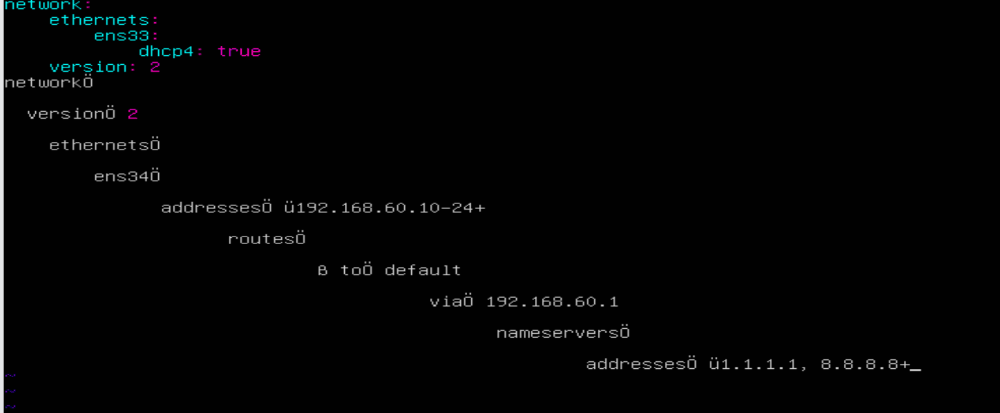
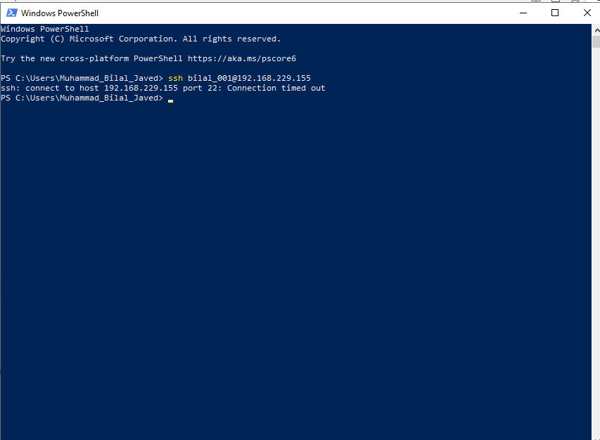
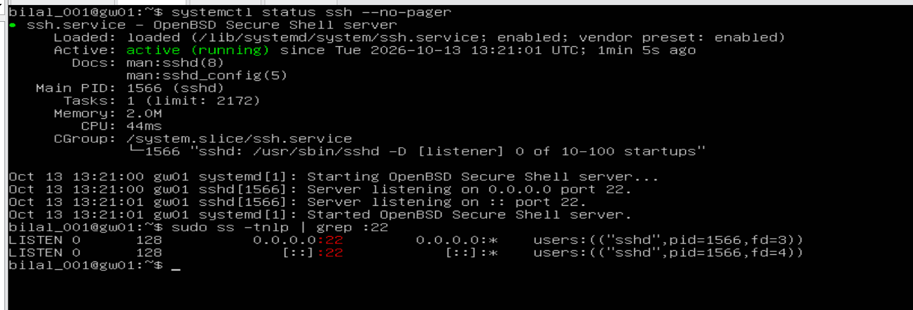

# Project 2 – Acme Analytics Linux Platform: the Day 1 story

**Build story and history · Day 1 · 13 October 2026** · Muhammad Bilal Javed

> The same story as a document to download: [Project-2-Day-1-story.odt](Project-2-Day-1-story.odt). The detailed technical reports are [part 1](day-01-2026-10-13.md) and [part 2](day-01-2026-10-13-part2-network.md).

## How to read this document

This is the story of the first day of building a small company's Linux platform in a home lab. It follows the order in which the work really happened, including the mistakes. Every chapter answers four questions:

- **Where are we?** The situation before the step.
- **What did I do, and why?** The commands, with a plain-language explanation.
- **What does the screenshot prove?** The real output from my lab.
- **Why do we go to the next step?** What this step made possible, or what problem it revealed.

You do not need to know Linux to follow it. Technical words are explained when they first appear, and a short glossary is at the end.

## The story in one paragraph

Acme Analytics is a small company whose server setup has grown messily: nobody controls what reaches the internet, nothing is documented, and nobody could rebuild a server the same way twice. My job is to build a clean, controlled platform. On Day 1 I first **recorded how the servers looked** before touching anything. Then I built the **network foundation**: every server got a fixed address, the two internal servers lost their own internet connection, and the gateway server gw01 became the **one and only door** to the internet. At the end of the day, app01 – a server with no internet card of its own – could reach the internet through gw01, the outside world saw only gw01's address, and the servers could find each other by name. Along the way I hit and solved ten real problems.

## Chapter 0 – The plan and the machines

### Where are we?

The goal is the platform shown below. It is built in phases (P0, P1, …); Day 1 covers Phase 0 and most of Phase 1 – the boxes **gw01**, the **VMnet2 lab network**, **app01** and **stor01**.


*Figure 1 – Target architecture of the whole project. Day 1 builds the gateway, the lab network and the addresses of app01 and stor01.*

Instead of buying servers, I run three **virtual machines** (computers simulated by software) in VMware. Think of them as three employees with different jobs:

| Server | Job in plain words | Job in technical words |
|---|---|---|
| **gw01** | The gatekeeper – the only door to the internet | Gateway: router, NAT, firewall, later VPN |
| **app01** | The shop window – will run the website | Application server |
| **stor01** | The archive room – files, backups, logs | Storage and log server |


*Figure 2 – The three VMs in VMware. Each has two network cards: "Network Adapter" (NAT = internet through Windows) and "Network Adapter 2" (VMnet2 = the private lab network).*

### Why do we go to the next step?

Before changing anything, a good engineer writes down how the system looks *now*. Otherwise, when something breaks later, there is nothing to compare against.

## Chapter 1 – Know the system (Phase 0)

### Step 0.1 – Engine, drivers and memory

**What I did and why.** The **kernel** is the engine of Linux. **Modules** are drivers – small add-ons that let the engine use hardware. I recorded the engine version, the loaded drivers, the memory, and one important switch: whether gw01 may pass traffic between networks.

```
uname -r                     # kernel version only
uname -a                     # everything: name, kernel, build date, CPU type
cat /proc/version            # the kernel's own description (compiler, build)
lsmod | head                 # first 10 loaded drivers
free -h                      # memory and swap, in human-readable units
sysctl net.ipv4.ip_forward   # may this machine route traffic? (0 = no, 1 = yes)
```


*Figure 3 – Baseline of gw01: kernel 5.15.0-198, VMware drivers loaded, 1.9 GiB memory, and ip_forward = 0.*

**What the screenshot proves.**

- Kernel `5.15.0-198-generic` – the standard Ubuntu 22.04 engine.
- Drivers `vmw_vsock`, `vmw_balloon` – the system knows it is a VMware virtual machine.
- Memory: 1.9 GiB, only 299 MiB used – plenty for a gateway.
- **`ip_forward = 0`** – gw01 is still an ordinary computer, *not* a router. Remember this number: changing it to 1 is the turning point of the afternoon.

### Step 0.2 – How the machine starts

**What I did and why.** Starting a computer is a relay race: firmware → bootloader (GRUB) → kernel → systemd (the manager) → services → login. I measured how long it takes and saved the details to files as evidence.

```
systemd-analyze                               # total boot time
systemd-analyze blame >> boot-gw01.txt        # time per service, saved to a file
journalctl -b | head -15 >> journal-gw01.txt  # first log lines of this boot, saved
ls /boot                                      # the files used to start Linux
```


*Figure 4 – Boot takes 38.1 s (17.0 s kernel + 21.1 s services). /boot holds the current kernel and the previous one as a fallback.*

**What the screenshot proves.** The machine boots in **38.1 seconds** and ends in `graphical.target` (desktop mode). `/boot` keeps an **older kernel (`vmlinuz.old`) as a safety net** if an update fails.

### Step 0.3 – Server mode instead of desktop mode

**What I did and why.** Linux can start in different modes, called **targets**. A desktop (`graphical.target`) is wasted on a server nobody sits in front of. Server mode (`multi-user.target`) runs everything needed – network, services, logins – without the desktop: faster, lighter and with fewer things an attacker could abuse.

```
systemctl get-default                          # which mode now?
sudo systemctl set-default multi-user.target   # switch to server mode
systemctl get-default                          # check
```


*Figure 5 – gw01 switched from graphical.target to multi-user.target. The first line shows my typo "get default" (the command is get-default).*

### Why do we go to the next step?

I now know how gw01 looks. The next question is: **how are the three machines connected?** That is the network – and without a working network nothing else in the project (storage, monitoring, VPN, automation) can work.

## Chapter 2 – The starting point of the network

### Where are we?

Before configuring anything, I looked at each machine's network cards (`ip -br a`) and disks (`lsblk`).

```
hostname    # which machine am I on?
ip -br a    # network cards: name, state, address (brief form)
lsblk       # disks and partitions
```


*Figure 6 – gw01 at the start: ens33 (internet side) has 192.168.229.155; ens34 (lab side) is DOWN with no address.*


*Figure 7 – app01 at the start: it ALSO has its own internet address (192.168.229.152) on ens33; the lab card ens34 is DOWN.*


*Figure 8 – stor01 at the start: its own internet address (192.168.229.153), lab card DOWN, and only one disk (sda) – the two extra data disks are missing.*

### What the screenshots reveal – three problems

| What I saw | Why it is a problem |
|---|---|
| `ens34` is **DOWN** on all three machines | The lab network is unused – the servers cannot talk to each other |
| app01 and stor01 have their **own internet address** on `ens33` | Breaks the design: every server has its own uncontrolled door to the internet |
| stor01 has only **`sda`** | The storage phase needs two extra empty disks |

`lo` (loopback) is the machine talking to itself and is always there – it can be ignored.

### Why do we go to the next step?

The servers need **fixed addresses** on the lab network, like permanent desk-phone numbers. Every later part of the project – firewall rules, file sharing, monitoring, automation – refers to these numbers. If they changed, everything would break.

## Chapter 3 – Fixed addresses for every server (Step 1.1)

### The method (same on every server)

On Ubuntu, network settings are stored in a small text file in `/etc/netplan/`. The safe method has six moves:

1. **Find the file** – `ls /etc/netplan`
2. **Back it up** – `sudo cp … ~/netplan-backup.yaml`, so I can always go back.
3. **Stop cloud-init from overwriting it.** `cloud-init` is a helper that configures the network at first boot – and may silently *rewrite my file* at a later boot. I tell it "network: hands off".
4. **Write the new settings** in the file. The format is **YAML**, where indentation (spaces) is part of the meaning.
5. **Apply with an automatic undo** – `sudo netplan try`. It applies the change and **undoes it after 120 seconds** unless I press Enter. If I can still type, the change works.
6. **Reboot and check** – a setting that disappears after a restart is worthless.

### 3.1 gw01 – the gatekeeper gets its inside address

```
ls /etc/netplan                                                # -> 50-cloud-init.yaml
sudo cp /etc/netplan/50-cloud-init.yaml ~/netplan-backup.yaml  # backup
echo "network: {config: disabled}" | sudo tee /etc/cloud/cloud.cfg.d/99-disable-network-config.cfg
```


*Figure 9 – gw01: the real file is 50-cloud-init.yaml, backed up, and cloud-init's network handling disabled.*

**First surprise:** my guide expected a file called `00-installer-config.yaml`. The real file is `50-cloud-init.yaml`. Lesson: *check, don't assume.*

The new settings for gw01: the internet card keeps getting its address automatically; the lab card gets the fixed address **192.168.60.1**. gw01 needs no gateway on the lab side – it *is* the gateway.


*Figure 10 – gw01's netplan file, typed by hand in the nano editor.*

**Second surprise – why "typed by hand"?** My first attempt was to paste the file into the VMware window. It arrived scrambled: `:` became `Ö`, `[` became `ü`, and every line was indented further than the last. The keyboard layout inside the VM was different from Windows, and the vim editor added its own indentation. I quit without saving (`Esc`, `:q!`) and typed the file in nano.


*Figure 11 – The garbled paste: colons turned into Ö, opening brackets into ü, and a staircase of indentation.*

```
sudo chmod 600 /etc/netplan/50-cloud-init.yaml   # only the administrator may read/write it
sudo netplan try                                 # apply with automatic undo; Enter = keep
ip -br a                                         # check
```


*Figure 12 – netplan try accepted; ens34 on gw01 now has 192.168.60.1/24. The Open vSwitch warning is harmless (that software is not installed).*

**Result:** gw01 now has two addresses – one facing the internet, one facing the lab.

### 3.2 app01 – the shop window, and an unplugged cable

app01 gets the fixed address **192.168.60.10**, and a **default route**: "for any address you don't know, ask gw01 (192.168.60.1)". It also gets DNS servers (1.1.1.1 and 8.8.8.8) – the internet's phone book, which turns names into numbers.


*Figure 13 – app01 also uses 50-cloud-init.yaml.*


*Figure 14 – app01: backup, cloud-init line, the new settings (192.168.60.10, default route via gw01, DNS servers) and netplan try. Note the "#" at the start of the cloud-init line – a typing slip that turns the line into a comment.*


*Figure 15 – app01 can now reach gw01 (3 of 3 replies) – the lab network works. BUT ens33 still has its own internet address 192.168.229.152.*

**Third surprise.** The lab network worked, but app01 still had its own internet line. Configuring Linux alone was not enough: the **virtual cable was still plugged in** in VMware. The real fix is to unplug it in the VM's settings – untick **Connected** and **Connect at power on**.


*Figure 16 – Unplugging app01's internet adapter in VMware (Connected unticked).*

Before rebooting I also checked the cloud-init file, because of the `#` seen in Figure 14. It now reads correctly, without the `#`:


*Figure 17 – The cloud-init file is correct: "network: {config: disabled}", no "#".*


*Figure 18 – app01 after reboot: ens33 DOWN (unplugged), ens34 = 192.168.60.10, default route via gw01, cloud-init file still correct.*

**What Figure 18 proves:**

| Line | Meaning |
|---|---|
| `ens33 DOWN` | The private internet line is gone |
| `ens34 UP 192.168.60.10/24` | The fixed address survived the reboot |
| `default via 192.168.60.1` | Everything not local is sent to gw01 |

**A note on VMnet2.** The lab network VMnet2 does not appear in VMware's Virtual Network Editor (only VMnet1 and VMnet8 are listed). That is correct: VMnet2 is used as a **private, isolated switch** – no connection to Windows and no automatic address service. The lab is closed; only gw01 connects it to the outside.


*Figure 19 – VMware's Virtual Network Editor lists only VMnet1 and VMnet8 – VMnet2 is an isolated switch, as intended.*

### 3.3 stor01 – the archive room, and the missing disks

stor01 got the same treatment, now done in the right order from the start – lesson learned from app01.


*Figure 20 – stor01: file found, backed up, cloud-init disabled (correctly this time), settings with 192.168.60.20, permissions set.*


*Figure 21 – stor01: netplan try accepted.*


*Figure 22 – stor01's internet adapter unplugged in VMware: both "Connected" and "Connect at power on" unticked.*


*Figure 23 – stor01 after reboot: ens33 DOWN, 192.168.60.20, default via gw01, 3/3 pings to gw01 – but lsblk still shows only sda.*

**Fourth surprise.** The network was perfect, but `lsblk` showed that the two extra data disks planned for the storage phase had never been added. I powered stor01 off, added two 5 GB disks in VMware, and checked again:


*Figure 24 – After adding them: sdb and sdc, 5 GB each, empty and ready for Phase 2 (LVM).*

### Why do we go to the next step?

All three servers now have fixed addresses and can reach gw01. app01 and stor01 have **no internet line of their own** – so right now they have **no internet at all**. They know they should ask gw01, but gw01 does not pass anything on yet (`ip_forward = 0`, Figure 3). That is the next step.

## Chapter 4 – gw01 becomes a router (Step 1.2)

**What I did and why.** By default, Linux refuses to pass on traffic that is not meant for itself – like a receptionist who only answers her own calls. Switching **IP forwarding** on turns gw01 into a switchboard between the lab and the internet.

```
echo "net.ipv4.ip_forward=1" | sudo tee /etc/sysctl.d/99-forward.conf  # permanent setting
sudo sysctl --system                                                   # load it now
sysctl net.ipv4.ip_forward                                             # check: must be 1
```


*Figure 25 – ip_forward = 1. In the Phase 0 baseline (Figure 3) it was 0.*

### Why do we go to the next step?

gw01 now *passes traffic on*, but the internet still cannot answer app01. Addresses like 192.168.60.10 are **private**: they are not valid on the internet, so replies would have nowhere to go. gw01 must translate them – that is NAT.

## Chapter 5 – Sharing the internet safely: NAT (Step 1.3)

**What I did and why.** **NAT (Network Address Translation)** works like a company mailroom. When app01 sends a letter out, gw01 crosses out the sender "Room 10" and writes the **company's street address** – its own. When the reply arrives, gw01 remembers who asked and delivers it to app01. The firewall rules decide **who may pass**: the lab may go out, and replies come back in. (Strictly blocking everything else needs a DROP default policy, which follows in Phase 6; today the lab is protected because its private addresses cannot be reached from the internet.)

```
# NAT: lab traffic leaving through ens33 gets gw01's address as sender
sudo iptables -t nat -A POSTROUTING -o ens33 -s 192.168.60.0/24 -j MASQUERADE
# allow: lab -> internet
sudo iptables -A FORWARD -i ens34 -o ens33 -j ACCEPT
# allow back in ONLY replies to conversations the lab started
sudo iptables -A FORWARD -i ens33 -o ens34 -m state --state ESTABLISHED,RELATED -j ACCEPT
# keep the rules after a reboot
sudo apt install -y iptables-persistent
sudo netfilter-persistent save
```

| Rule | Plain words |
|---|---|
| MASQUERADE | "Write the company's return address on outgoing mail" |
| FORWARD lab → internet | "Staff may make outgoing calls" |
| FORWARD internet → lab, only ESTABLISHED,RELATED | "Only call-backs are put through" |

### The proof – from a server that has no internet card

```
ping -c 3 8.8.8.8      # can app01 reach a server on the internet?
curl -s ifconfig.me    # ask a website: which address do you see me coming from?
```


*Figure 26 – app01 reaches the internet (3/3 replies from 8.8.8.8), and the website sees the home public address (hidden here), not 192.168.60.10. The two empty curl lines before were typos.*

**What Figure 26 proves.**

- app01 has no internet card (Figure 18), yet it reaches 8.8.8.8 – **the only possible path is through gw01**.
- The website sees the public address, **not** 192.168.60.10 – NAT replaced the sender address.
- The reply TTL is 127 instead of 128. TTL is a counter that drops by one at every router – **the packets passed through one extra router: gw01**.

And from gw01's side – the NAT rule's counter shows the traffic it translated:

```
sudo iptables -t nat -L -n -v --line-numbers   # list NAT rules with packet counters
```


*Figure 27 – On gw01 the MASQUERADE rule has translated 34 packets (2443 bytes) from 192.168.60.0/24 out through ens33. ("Sorry, try again" = mistyped sudo password.)*

### Why do we go to the next step?

The servers can now talk to each other and to the internet – but only by **number**. People and tools (SSH, file sharing, automation) use **names** like `stor01`. The next step teaches the servers to find each other by name.

## Chapter 6 – Names instead of numbers (Step 1.4)

**What I did and why.** Computers connect only to numbers. Before connecting to a name, Linux looks it up – like a phone looking up a contact before dialing. It checks two places, in this order:

1. **`/etc/hosts`** – a small **personal contact list** on each machine. Checked first.
2. **DNS** – the internet's **public phone book**. Used only if the name is not in the contact list.

`getent` ("get entry") asks the system exactly this: *what is the address for this name?*

```
getent hosts stor01                                   # unknown -> prints nothing
echo "192.168.60.20 stor01" | sudo tee -a /etc/hosts  # add stor01 to app01's contact list
getent hosts stor01                                   # now: 192.168.60.20
ping -c 1 stor01                                      # reach the server BY NAME
```


*Figure 28 – On app01: the first lookup is empty; after adding the entry the name resolves and "ping stor01" works. ("pinc" was a typo.)*

```
grep '^hosts' /etc/nsswitch.conf   # the lookup ORDER
dig +short google.com              # ask DNS directly
```


*Figure 29 – "hosts: files dns" – the contact list is checked before DNS. dig returns Google's addresses, so DNS works through gw01.*

**Still to do:** the "break it" test – write a wrong address for stor01 in `/etc/hosts`, watch `ping stor01` fail although stor01 is healthy, then fix it. It demonstrates a classic real-world fault: a stale contact-list entry beats the correct phone book.

## Chapter 7 – Problems I met and how I solved them

| # | What happened | Why | How I solved it |
|---|---|---|---|
| 1 | `systemctl get default` failed | Typo – the command is `get-default` | Retyped |
| 2 | Unsure whether `>> tee file` saves output | `>>` writes to a file; a pipe sends output to a program | Pipe into `tee file` (screen + file), or `>> file` (file only) |
| 3 | The netplan file in the guide did not exist | Ubuntu names it `50-cloud-init.yaml` | Checked with `ls`, used the real file |
| 4 | Pasted YAML arrived scrambled | Different keyboard layout in the VM; vim auto-indent | Quit without saving, typed by hand in nano |
| 5 | Warning "Cannot call Open vSwitch" | netplan checks for software that is not installed | Harmless – ignored |
| 6 | app01 still had its own internet address | Virtual cable still plugged in | Unplugged in VMware settings, rebooted |
| 7 | cloud-init line started with `#` on app01 | Typing slip – `#` makes it a comment | Rewrote the file, verified with `cat` |
| 8 | stor01 had no data disks | Never added at VM creation | Added 2 × 5 GB disks |
| 9 | `curl ifconfig` printed nothing | Incomplete name; `-s` hides errors | Used `ifconfig.me` |
| 10 | SSH from Windows to gw01 timed out, although SSH was running | Not needed for the design – admin access comes through a VPN later | Deferred; worked in the VMware console |


*Figure 30 – Problem 10: SSH from Windows PowerShell timed out …*


*Figure 31 – … although gw01's SSH service was running and listening on port 22.*

## Chapter 8 – Where we stand at the end of Day 1

| Goal | Status |
|---|---|
| Baseline of gw01 recorded (kernel, memory, boot) | Done |
| gw01 in server mode | Done (app01, stor01 to follow) |
| Fixed addresses on all three servers, surviving reboot | Done |
| app01 and stor01 without their own internet line | Done |
| gw01 routes and translates (IP forwarding + NAT) | Done – 34 packets translated |
| Only replies allowed back into the lab | Rule in place; strict enforcement (DROP policy) in Phase 6 |
| Servers find each other by name | app01 → stor01 done; break test pending |
| Data disks ready for storage | Done (sdb, sdc) |

**The journey in one picture:**

```
Morning:   3 separate machines, each with its own internet line, lab network unused
              |
Step 1.1:  fixed addresses  ->  gw01 .1   app01 .10   stor01 .20
           internet cables of app01 and stor01 unplugged
              |
Step 1.2:  gw01 becomes a router (ip_forward 0 -> 1)
              |
Step 1.3:  gw01 translates addresses (NAT) and lets only replies back in
              |
Step 1.4:  servers find each other by name
              |
Evening:   one controlled door to the internet - gw01
```

**How I would explain it in an interview:**
*"I built the network foundation of a three-server Linux lab: static addressing with netplan, internal servers with no direct internet access, and a Linux gateway doing NAT with stateful forwarding, so all outbound traffic passes one controlled point. I verified every change after reboot and documented ten issues with their root causes."*

**Next steps:** finish the break test of Step 1.4; then Step 1.5 (ports – which programs listen on which "door") and Step 1.6 (SSH key login from gw01 to the other servers, the basis for automation later).

## Chapter 9 – Key understanding (in my own words)

These are the conclusions I reached by questioning each step until it made sense. They are written so I can explain them in an interview.

### 1. The network file and cloud-init

- `/etc/netplan/50-cloud-init.yaml` is the main network settings file: IP address, gateway and DNS. It was written once by **cloud-init** when Ubuntu was installed. At every boot **netplan reads it** and configures the network cards.
- cloud-init is the **writer**, netplan is the **reader**. cloud-init could rewrite the file on a later boot and erase my settings.
- So I created `/etc/cloud/cloud.cfg.d/99-disable-network-config.cfg` with `network: {config: disabled}`. This only stops **cloud-init from managing the network** – the network itself and netplan keep working.
- Files in a `.d` folder are read in alphabetical order and **the last one wins**, so a `99-` file has the final word. The numbers only matter between files in the **same folder** – 50 (netplan) and 99 (cloud-init) are never compared.
- In Proxmox or the cloud, cloud-init is used the other way round: the admin enters IP, user and SSH key in the hypervisor, and cloud-init writes them into the server at first boot – ideal for cloned templates. In my VMware lab nothing feeds cloud-init, so I configure netplan by hand and keep cloud-init away from the network.

### 2. What the network file says

- `addresses: [192.168.60.10/24]` – **I am** 192.168.60.10; `/24` means 192.168.60.0–255 are my direct neighbours.
- `routes: - to: default via: 192.168.60.1` – "default" is not a machine, it means **everything I don't know**; `via` names who to hand it to: gw01.
- `nameservers: [1.1.1.1, 8.8.8.8]` – the internet's phone books. A name is first looked up in `/etc/hosts` (my own contact list – that is how `stor01` is found), and only then asked from DNS (that is how `google.com` is found).
- netplan only sets **addresses, gateway and DNS**. Being a router (ip_forward), NAT and firewall (iptables) and VPN (WireGuard) are set elsewhere.

### 3. The path to the internet

> app01 is 192.168.60.10 and has no internet adapter. For anything outside the lab it goes via gw01 (192.168.60.1), its default gateway. gw01 translates app01's private address into its own (NAT) and passes the traffic on through VMware and the home router to the internet. stor01 works the same way with 192.168.60.20.

### 4. NAT, forwarding and conntrack

> NAT recognises lab traffic by its IP range (`-s 192.168.60.0/24`) and changes the sender address as it leaves via `-o ens33`. Forwarding decides who may pass using the cards (`-i ens34 -o ens33`). Replies are let back in only if conntrack – gw01's memory of every conversation – confirms they are ESTABLISHED or RELATED to a conversation the lab started. conntrack also remembers which lab machine asked, so NAT can return each reply to the right one.

- **Two jobs, two tables:** the NAT table *changes the address* (`-j MASQUERADE`); the filter table's FORWARD chain *gives permission* (`-j ACCEPT`). A packet is checked by FORWARD first and rewritten in POSTROUTING just before it leaves – whatever order the commands were typed in.
- **`-s`/`-d` take IP addresses, `-i`/`-o` take card names.** `-s ens34` is always wrong. In POSTROUTING only the exit card is known, so `-i` is not allowed there – the lab must be identified by its IP range.
- **States:** NEW = someone starts a conversation; ESTABLISHED = a reply in a conversation the lab started; RELATED = a helper message (e.g. an error) belonging to it. `sudo conntrack -L` on gw01 shows the live list.
- **Honest limit today:** Ubuntu's default FORWARD policy is still ACCEPT, so the "only replies come back" rule is not yet enforced strictly. Right now the lab is protected because its private addresses sit behind two layers of NAT and cannot be reached from the internet. The strict version comes in Phase 6, when the default policy becomes DROP.
- `netfilter-persistent save` must run **last** – it saves only the rules that exist at that moment.

### 5. Names: /etc/hosts, DNS, getent and ping

> **getent** ("get entries") is like searching the phone book. It looks up a name or IP first in `/etc/hosts`, then in **DNS** if one is configured. It works both ways: name → IP (forward lookup) and IP → name (reverse lookup, e.g. `getent hosts 192.168.60.20` → `stor01`). It only **reads** – it never contacts the machine.
>
> **ping** is like calling. It uses the **same lookup** (`/etc/hosts`, then DNS) to find the number, then really contacts the machine with **ICMP** messages – "are you there?" (echo request) and "yes, I'm here" (echo reply). ICMP has **no ports**. So getent can succeed while ping fails – if the machine is off, the network is broken, or a **firewall blocks ICMP**.
>
> In our lab there is no internal DNS server, so we put the names in `/etc/hosts`. The servers could already reach each other **by IP**; `/etc/hosts` lets them reach each other **by name**.

- **Phone picture:** the contacts app inside the phone = the system resolver (`/etc/hosts` → DNS); getent = opening the contacts and reading a number; ping = pressing *call* – it looks up the same contact, then dials; ICMP = the phone network that carries the call.
- **Troubleshooting rule:** getent fails → a **name** problem (missing/wrong entry or DNS). getent works but ping fails → a **network** problem (machine off, cabling, firewall).
- `/etc/hosts` is a file on **each** machine – fine for a small lab, but 100 servers means 100 files to edit. Companies use an **internal DNS server** for their own names (as the Windows Server does in Project 1) and **public DNS** (1.1.1.1, 8.8.8.8) for internet names.
- **The DNS helper and loopback:** on Ubuntu, programs do not ask 1.1.1.1 directly – they ask a small helper on the same machine, **systemd-resolved**, at **127.0.0.53**. Every **127.x.x.x** address is **loopback** – the machine talking to itself, like putting a note in your own pocket: the traffic never leaves the machine (`lo` in `ip -br a`). The helper answers from its **DNS cache** – short-term memory of name lookups for the whole machine – or asks the real DNS servers through gw01. The cache speeds things up, expires by itself (**TTL**), and can be cleared with `sudo resolvectl flush-caches`. `resolvectl status` shows which DNS servers are in use.
- **DNS troubleshooting in three commands:** `getent hosts <name>` (does the name resolve at all?) → `resolvectl status` (which DNS servers?) → `dig +short <name>` (does DNS itself answer? dig skips `/etc/hosts`).
- `hostname` shows the machine's own name; `getent hosts <name>` asks what address a name has; `tee -a /etc/hosts` appends a new entry.

## Glossary

| Word | Meaning |
|---|---|
| Virtual machine (VM) | A computer simulated by software inside a real computer |
| Kernel | The engine of Linux that talks to the hardware |
| Module / driver | Add-on that lets the kernel use specific hardware |
| systemd / target | The manager that starts services / the start-up mode (desktop or server) |
| IP address | A machine's "phone number" on a network |
| Private address | Valid only inside a home or company network (e.g. 192.168.x.x) |
| /24 | Network size: 256 addresses sharing the first three number blocks |
| Network card (ens33, ens34) | The socket a network cable plugs into; `lo` = the machine talking to itself |
| netplan / YAML | Ubuntu's network settings / the file format where indentation matters |
| cloud-init | Helper that sets up a new server and may overwrite manual settings |
| Default route / gateway | "Where to send traffic for unknown destinations" – here gw01 |
| IP forwarding | The switch that lets Linux act as a router |
| NAT / MASQUERADE | Replacing private sender addresses with the gateway's own address |
| Firewall / iptables | Rules that decide which traffic may pass |
| TTL | Counter in each packet, lowered by 1 at every router |
| DNS | The internet's phone book: names to numbers |
| /etc/hosts | A machine's personal contact list, checked before DNS |
| getent | Asks the system what a name resolves to |
| lsblk / sda, sdb, sdc | Lists disks / the system disk and two data disks |
| SSH | Secure remote login to a server's command line |
