# Day 8 – 2026-10-25: Phase 4 – signals, lock, trap, a real queue system with a worker, and an L1 → L2 escalation

| | |
|---|---|
| **Project** | Acme Analytics – hardened, observable and recoverable Linux platform |
| **Phase** | 4 – Processes, signals and limits |
| **Hosts worked on** | stor01, svc01 (GLPI) |
| **Status** | Phase 4 🟡 – Steps 4.1, 4.2 ✅ (Day 7) · Step 4.3 🟡 – concept ✅, archive queue system Steps 1–7 ✅ (queue, producer, worker service, FIFO, request at any time, stop mid-job, L1 → L2 escalation with GLPI ticket #3); Step 8 (L3 Problem) and clean-up next |
| **Print copy** | [Project-2-Day-8-study.pdf](Project-2-Day-8-study.pdf) |
| **Author** | Muhammad Bilal Javed |

> **How to read this report.** 💡 **In plain words** – the idea for any reader. 🔧 **Technical** – the settings and commands. 📸 **Evidence** – the real screenshot. Terms are explained in the [glossary](../glossary.md). Previous day: [Day 7](day-07-2026-10-24.md).

---

## 1. Step 4.3 – the concept: two copies, signals, lock and trap

💡 **In plain words:** jobs that run by themselves – nightly backups, exports – must never run **twice at the same time**, and when they are stopped they must not leave broken files behind. Three tools solve this: a **lock**, **signals** and **trap**.

| Concept | Question it answers | Key line |
|---|---|---|
| **Lock** | Can a second copy start while the first is running? | `if [ -e "$LOCK" ]` · `flock -n` · a systemd service runs only once |
| **Signal** | How is a process stopped? | `kill -15` (SIGTERM) · Ctrl+C (SIGINT) · `kill -9` (SIGKILL) |
| **trap** | What is cleaned up when it is stopped? | `trap cleanup SIGINT SIGTERM` |
| **`.part` file** | How do I avoid a broken file that looks finished? | write to `file.part`, then `mv` when complete |

### Key understanding (in my own words)

> A nightly backup or export started by a **timer or cron** must never run **twice at the same time**: if the timer's backup runs from 02:00 to 03:00 and I start it by hand at 02:05, two copies would write to the same place and produce a broken result. The protection is a **lock** – a "someone is working on this right now" sign. Some programs have a lock **built in** (apt and dpkg – which is why a second apt, often Ubuntu's automatic updates running in the background, answers *"Could not get lock"*), but simple tools like `cp` or `rsync` and my own scripts have **none**, so I add it myself: a lock file checked at the start, `flock -n` (a kernel lock released automatically even after `kill -9`), or simply a systemd service, which never runs twice. A lock only stops a **second copy from starting**; it never stops anyone from terminating the job, and once the first copy has finished and removed its lock, the job can run again normally. A job is stopped by a **signal** from the kernel: **SIGTERM** (`kill -15`, "please stop"; `systemctl stop` sends it), **SIGINT** (Ctrl+C) or **SIGKILL** (`kill -9`, "stop now"). Stopping affects resources in two ways: **CPU and memory** are freed by the kernel whichever signal is used, but files the job created on **disk** – its lock, temporary files, a half-written archive – stay behind unless clean-up code removes them. **Linux processes have no clean-up by default**: the default action of SIGTERM is "die immediately", and SIGTERM only **gives the program a chance** to clean up. rsync, apt and databases have that code built in, while `cp`, `scp` and a plain Bash script do not – stopping a 20 GB `cp` halfway leaves a broken half-file that looks complete. **`trap`** adds clean-up code to a script: `trap cleanup SIGINT SIGTERM` means "on SIGTERM or Ctrl+C, first run my `cleanup` steps, then exit", and it runs only the steps I write. Trap does not stop or restart the process – the signal stops it, the trap cleans the disk before it ends, so the next start begins clean. **SIGKILL cannot be trapped**, so after `kill -9` the leftovers stay; a leftover lock is a **stale lock**, and the fix is always: prove nothing is running (`pgrep -af <job>`), remove the lock by hand, start the job again. Good jobs also write into a temporary **`.part` file** and rename it only when it is complete and verified, so a half-written file never looks finished.

## 2. Step 4.3 – the concept: queue systems, producers and workers

💡 **In plain words:** a **lock** says "busy, go away". A **queue with a worker** says "wait in line, I'll do it for you": everyone drops a request and leaves at once, and one program works through the requests one by one, at low priority, without losing any.

📸 **Architecture – a queue system has four parts; Linux already has several (print, mail, `at`), and the same pattern runs online shops and Jenkins:**


| Concept | Question it answers |
|---|---|
| **Scheduler** (timer, cron) | **When** does a fixed job start? – driven by time |
| **Socket** | Start a service **live** for each connection – the caller waits for the answer |
| **Queue** | In **what order** do waiting jobs run? – FIFO, first in, first out |
| **Producer** | Who **puts** a job ticket in the queue? – a person, a script or an application |
| **Worker** | Who **does** the jobs, one by one, any time? – a program that runs all the time |
| **nice / ionice** | How much **CPU / disk** may it use? – a different question from the order |

### Key understanding (in my own words)

> A **queue system** has four parts working together. A **producer** – a person, a script or an application – creates a **job ticket**, a small instruction such as *"archive /etc"*, places it in the **queue** and **gets control back at once**: it never waits for the job to be finished. The queue is a waiting room on disk called a **spool** folder; Linux keeps its own under **`/var/spool/`** – print jobs from `lp` wait in `/var/spool/cups/` for the worker `cupsd`, emails wait in `/var/spool/postfix/` for Postfix, `at` jobs wait in `/var/spool/cron/atjobs/` for `atd`. A **worker**, a program that runs all the time (usually a systemd service), takes the tickets **in order of arrival** – the oldest first, **FIFO**, first in, first out – does the work, stores the result in the agreed **output** place, and only then deletes the ticket (the **ack**, "done"), so if it fails or is stopped halfway the ticket stays and nothing is lost. Linux does not build a queue by itself: someone must place the tickets, and the worker must be written to take them out. Developers write workers; admins run and manage them – a systemd service with `Restart=on-failure`, more copies (a **worker pool**) when the load grows, logs in the journal, a safe stop with SIGTERM. Workers exist for three reasons: **nobody waits**, **the load stays under control**, **nothing is lost**. The same pattern runs a web shop (the shop puts *"send the confirmation email for order 501"* into RabbitMQ or AWS SQS and an email worker sends it) and **Jenkins** (the controller keeps the build queue, *"Waiting for next available executor"*, and agents are the workers). A **timer** is driven by **time** – one fixed job at a fixed time; a **socket** answers each **live connection** at once while the caller waits; a **worker** is driven by **stored requests** – any job, any time, one by one, while the requester has already left. Real automation grows step by step: do it by hand, script it, schedule it, and finally let a worker do it for everyone – repeating the same proven steps like a tireless user, without deciding anything new as an AI agent would. **`nice`** answers a different question from the queue: the queue decides the **order**, nice (-20 most important … 19 politest) decides **how much CPU** a running job gets.

## 3. Lab – the Acme archive queue system on stor01

💡 **The story:** at Acme, admins and scripts request archives ("archive /etc before I change the config", "archive the uploads"). Instead of running heavy `tar` jobs by hand, they drop a **ticket** into a queue, and one **archive worker** turns the tickets into verified archives one by one, at low priority, so the customer application is never slowed down.

📸 **Architecture – one request from start to finish, the names, the journal and the built-in spool folders:**


| Part | Path |
|---|---|
| Producer's tool | `/usr/local/bin/archive-enqueue` |
| Queue (spool folder) | `/var/spool/acme-archive/` – tickets like `1761390912345678901-etc.job`, content `/etc` |
| Worker | `/usr/local/bin/archive-worker.sh`, run as `archive-worker.service` |
| Output | `/backups/archive/` – `etc-2026-10-25-234228.tar.gz` + `.sha256` |
| Messages | the journal – `journalctl -u archive-worker` |

### 3.1 Step 1 – the queue and the producer

```bash
# stor01
sudo mkdir -p /var/spool/acme-archive /backups/archive
sudo tee /usr/local/bin/archive-enqueue > /dev/null <<'EOF'
#!/bin/bash
[ -d "$1" ] || { echo "usage: archive-enqueue <folder>"; exit 1; }
JOB=/var/spool/acme-archive/$(date +%s%N)-$(basename "$1").job
echo "$1" > "$JOB"
echo "queued: $1"
EOF
sudo chmod +x /usr/local/bin/archive-enqueue
```

| Line | Meaning |
|---|---|
| `[ -d "$1" ] \|\| { echo "usage: …"; exit 1; }` | `$1` = the first word typed after the command (the folder); `-d` asks "is it a folder?"; if not, `\|\|` prints the help (`<folder>` describes `$1`) and `exit 1` stops – no ticket |
| `JOB=/var/spool/acme-archive/$(date +%s%N)-$(basename "$1").job` | `JOB=` fills a box with the ticket's path: queue folder + time of the request (seconds since 1970 + nanoseconds – unique, sets the order) + folder name (`basename` keeps the last part) + `.job` |
| `echo "$1" > "$JOB"` | Write the folder path into the ticket file (`$JOB` = the value in the box) – the instruction for the worker |
| `echo "queued: $1"` | Tell the producer at once – the prompt is back immediately |

📸 **Evidence:**


**Lesson:** my first version had `data` instead of `date`. `bash -n` did not catch it – it checks only the grammar of a script, not whether its commands exist. Only a test run proves a script works.

### 3.2 Step 2 – the worker

The full script is in the screenshot below. The lines that carry the concept:

```bash
QUEUE=/var/spool/acme-archive                             # WHERE – the agreed queue folder (same path as the producer)
DEST=/backups/archive                                     # OUTPUT
trap cleanup SIGINT SIGTERM                               # TRAP – on SIGTERM/Ctrl+C: stop tar, delete the .part file
while true; do                                            # WORKER – runs forever
  JOB=$(ls -tr "$QUEUE"/*.job 2>/dev/null | head -1)      # WHICH – the oldest ticket first (FIFO)
  SRC=$(cat "$JOB")                                       # WHAT – read the folder from the ticket
  TMP="$DEST/.$NAME.tar.gz.part"                          # SAFE FILE – work into a .part file
  logger -t $TAG "start job: $SRC"                        # JOURNAL – message only
  mv "$TMP" "$DEST/$NAME.tar.gz"                          # OUTPUT – only a complete, verified archive gets the real name
  logger -t $TAG "OK $SRC -> $NAME.tar.gz"                # JOURNAL – "OK" only after the archive is stored
  rm -f "$JOB"                                            # ACK – delete the ticket
done
```

📸 **Evidence – the worker script:**


📸 **Evidence – manual test: worker running in one terminal; in the other `queued: /etc` at once, the queue empty again (ack), `etc-2026-10-25-234228.tar.gz` (566 K) + `.sha256` in the output, the journal *worker started → start job → OK* within 2 seconds; Ctrl+C → the trap's *"stop signal"* message:**


**Lessons:** I first typed the worker by hand with five mistakes – `backups/archive` without the leading `/`, `[ -n "$CHILD"]` without the space before `]`, `SIGNIT`, `sha56sum` and, worst, **`*.JOB` instead of `*.job`**: Linux is case-sensitive, so the worker would have waited forever without any error. Long scripts are pasted, not retyped. The number in `archive-worker[4513]` is the PID of each `logger` call; the worker's own PID is the one in the message (4292).

### 3.3 Step 3 – the worker as a service, at low priority

```bash
sudo tee /etc/systemd/system/archive-worker.service > /dev/null <<'EOF'
[Unit]
Description=Acme archive worker (processes the archive queue)
After=local-fs.target
[Service]
ExecStart=/usr/local/bin/archive-worker.sh
Restart=on-failure
Nice=19
IOSchedulingClass=idle
[Install]
WantedBy=multi-user.target
EOF
sudo systemd-analyze verify /etc/systemd/system/archive-worker.service
sudo systemctl daemon-reload
sudo systemctl enable --now archive-worker
systemctl status archive-worker --no-pager
ps -o pid,ni,cmd -C archive-worker.sh
```

| Setting | Meaning |
|---|---|
| `ExecStart=` | The worker program |
| `Restart=on-failure` | Restart it automatically if it crashes |
| `Nice=19` / `IOSchedulingClass=idle` | Lowest CPU priority / use the disk only when nobody else needs it (= `nice -n 19`, `ionice -c3`) |
| `WantedBy=multi-user.target` + `enable` | Start at every boot – a link in `multi-user.target.wants/` |

📸 **Evidence – the unit; `verify` finds nothing in my file (the yellow line is Ubuntu's own `snapd.service`):**


📸 **Evidence – `active (running)`, Main PID 4839, 1.6 MB; the cgroup holds the worker and its child `sleep 5` (empty queue, waiting); NI 19:**


### Key understanding – the lab so far (in my own words)

> On stor01 I built the **Acme archive queue system**. In **Step 1** I created the **queue** `/var/spool/acme-archive/` (the waiting room for job tickets), the **output** `/backups/archive/` and the **producer's tool** `archive-enqueue` in `/usr/local/bin`, the folder for an admin's own commands. When I type `sudo archive-enqueue /etc`, `$1` – a box filled with the first word after the command – becomes `/etc`; `[ -d "$1" ]` checks it is a folder (otherwise `||` prints the help and `exit 1` stops); `JOB=` builds the ticket's path from the queue folder, the time of the request (`date +%s%N`) and the folder name (`basename`); `echo "$1" > "$JOB"` writes the folder into that ticket file, and *"queued: /etc"* comes back at once. The tool's name is only a label for humans – "enqueue" is the standard word for "put into a queue" – and what it does is decided only by its code. In **Step 2** I created the **worker** `archive-worker.sh`. It knows where to look because the **same queue path** is written at its top – producer and worker simply agree on it, as `cupsd` reads its spool folder from its settings file – and it reads the folder from the ticket with `cat`, because `$1` exists only for the split second the producer runs. In a manual test it turned my ticket into `etc-2026-10-25-234228.tar.gz` with a `.sha256` checksum within 2 seconds, wrote *start job* and *OK* to the **journal** (the server's central diary, which holds only messages, never the archive itself), deleted the ticket (the ack), and on Ctrl+C its trap logged *"stop signal"* before exiting. In **Step 3** I made it a **systemd service** with `Restart=on-failure`, `Nice=19` and `IOSchedulingClass=idle`; it now runs all the time as PID 4839 at **NI 19**, its cgroup showing it waiting (`sleep 5`) for the next ticket. Because a service runs only once, systemd itself is the lock – no second worker can start.

### 3.4 Step 4 – three jobs in the queue

```bash
# Terminal 1 (stor01 console): journalctl -u archive-worker -f
# Terminal 2 (ssh stor01 from gw01):
df -h /backups
sudo archive-enqueue /data/app/uploads
sudo archive-enqueue /etc
sudo archive-enqueue /var/log
ls /var/spool/acme-archive/
journalctl -t archive-worker -n 10
```

📸 **Evidence – three tickets waiting, named by request time so the oldest comes first:**

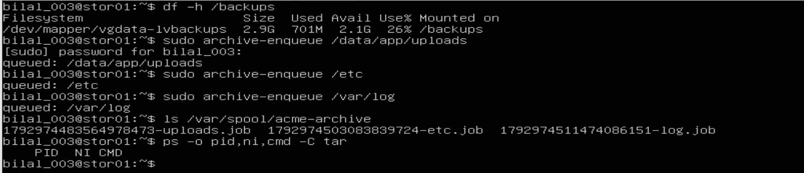

📸 **Evidence – the live `-u` view shows *start job: /data/app/uploads* but not its *OK*:**

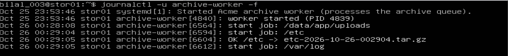

📸 **Evidence – `journalctl -t` (by tag) shows every message: uploads 00:28:08 → OK 00:29:04 (56 s), `/etc` 1 s, `/var/log` 11 s – strictly in arrival order (FIFO), one at a time:**

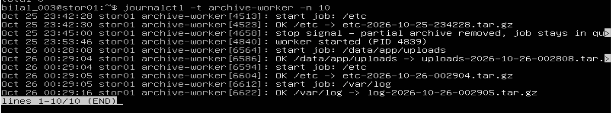

**Lesson:** `logger` runs as a very short-lived process; sometimes it ends before the journal can link the message to the **service**, so `journalctl -u archive-worker` can miss a line. **`journalctl -t archive-worker`** filters by the **tag** set with `logger -t` and always shows them all.

### 3.5 Step 5 – a request at any time: worker vs timer

```bash
sudo archive-enqueue /etc        # "archive /etc NOW – before I change the config"
journalctl -t archive-worker -n 2
```

📸 **Evidence – queued, started and finished in the same second (00:34:12) – no waiting for a 02:00 timer:**

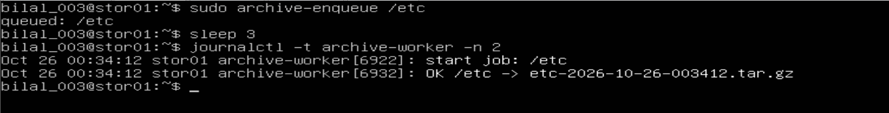

### 3.6 Step 6 – stop the worker in the middle of a job (the trap test)

```bash
sudo archive-enqueue /data/app/uploads
sleep 5
sudo systemctl stop archive-worker          # SIGTERM while tar is compressing 700 MB
ls -la /backups/archive/                    # no .part file
ls /var/spool/acme-archive/                 # the ticket is still there
sudo systemctl start archive-worker
```

📸 **Evidence – after the stop: only complete archives in the output, no `.part` file:**

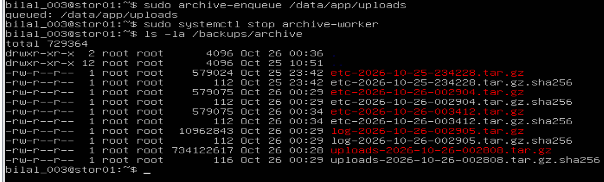

📸 **Evidence – the ticket stayed in the queue; the journal shows the trap's message:**

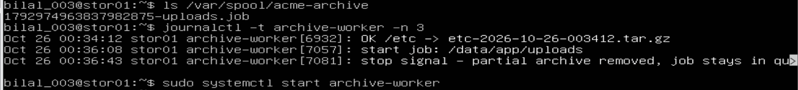

📸 **Evidence – the full story in the journal: start 00:36:08 → *Stopping…* → *stop signal – partial archive removed, job stays in queue* → *Deactivated successfully* (clean exit) → restart 00:38:24 (new PID 7094) → the same job → *OK* 00:39:32:**

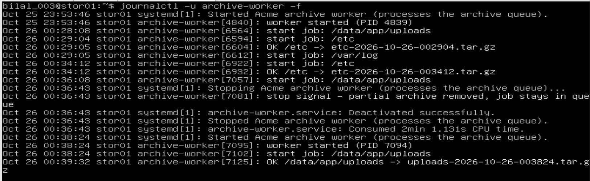

📸 **Evidence – the queue empty again after the restart:**

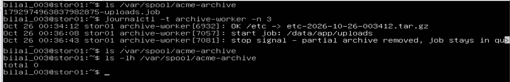

### 3.7 Step 7 – a deliberate escalation: L1 finds it, L2 fixes it

💡 **The story:** a colleague left manual database dumps in `/backups`, filling it. The archive worker fails. As **L1** I find the cause and collect evidence, but I am not allowed to delete someone else's data or resize volumes – so I **escalate**. Then, as **L2 – Linux Storage**, I get the owner's approval, fix it and close the ticket.

```bash
# create the problem
sudo fallocate -l $(df --output=avail -B1 /backups | tail -1) /backups/db-dump-manual.sql
sudo archive-enqueue /etc                          # still OK – see the lesson below
sudo fallocate -l $(( $(stat -f -c '%f' /backups) * $(stat -f -c '%S' /backups) )) /backups/db-dump-manual-2.sql
sudo archive-enqueue /var/log                      # now FAILED

# L1 – look, identify, do not fix outside the role
journalctl -t archive-worker -n 3
df -h /backups
sudo du -sh /backups/* | sort -h | tail -3
ls -l /backups/db-dump-manual*.sql
```

📸 **Evidence – L1: `FAILED /var/log`, `/backups` 100 %, the two dump files (owner root, 00:44 and 00:52):**

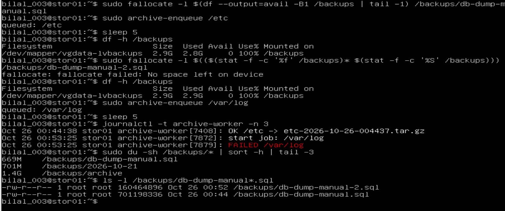

**Lesson – the 5 % root reserve:** after the first dump `df` already showed **Avail 0 / 100 %**, yet the `/etc` archive still succeeded. ext4 keeps about **5 % reserved for root**; `df`'s "Avail" and "Use%" count only the space normal users can have, and the worker runs as root. Only after the second file filled **all** free blocks (`stat -f`) did the job fail. In a real incident this is why root services often keep working a little longer while users already see *"No space left on device"*.

**L1 in GLPI:** a new group **L2 – Linux Storage**, and an **Incident** with Urgency **High**, Item **stor01**, the evidence, the L1 actions (*"did NOT delete anything – not authorized"*), a note that the 02:00 nightly backup would also fail, and **Assigned to: group L2 – Linux Storage**.

📸 **Evidence – the L2 group:**

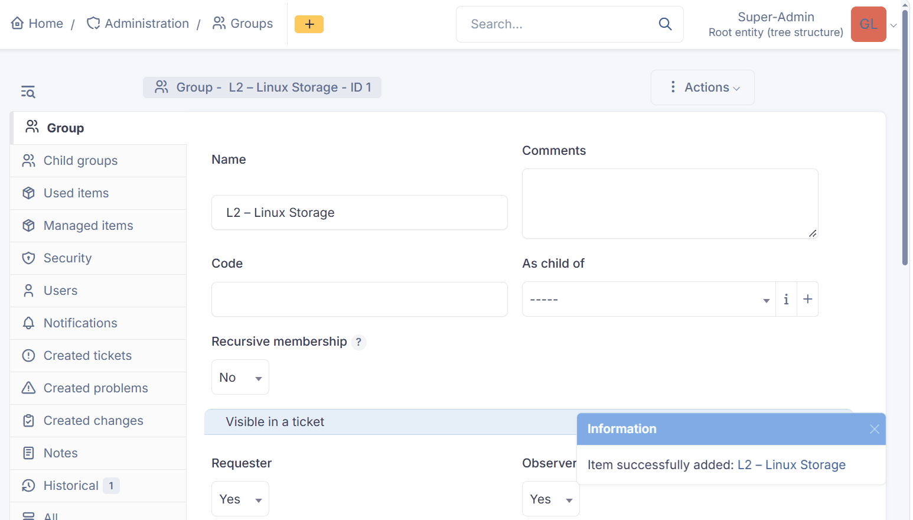

📸 **Evidence – ticket #3 escalated: Incident · Urgency High · Item stor01 · Processing (assigned) to the L2 group:**

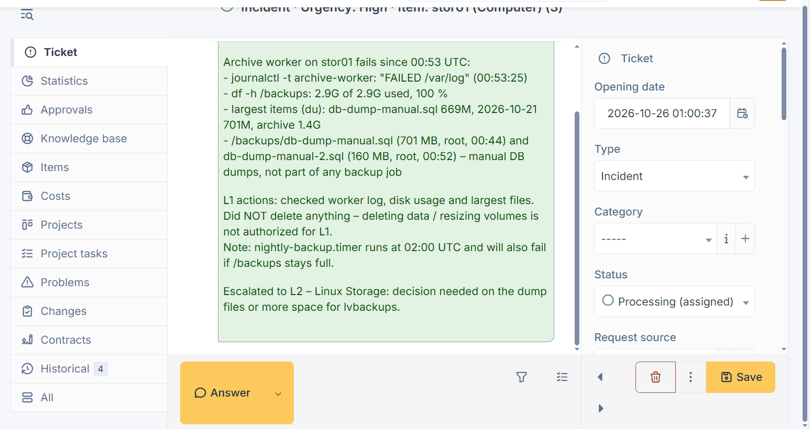

**L2:** a followup recording the owner's approval (*"both dumps are leftovers from a manual test – deletion approved"*), then the fix:

```bash
sudo rm /backups/db-dump-manual.sql /backups/db-dump-manual-2.sql
df -h /backups                         # 76 %, 669 MB free
sudo archive-enqueue /var/log          # re-queue the failed job
journalctl -t archive-worker -n 3
```

📸 **Evidence – space back, the failed job re-queued and `OK /var/log` at 01:13:23:**

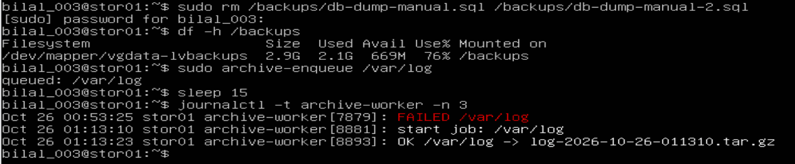

Then the **solution** in ticket #3 – cause, decision, fix, verification, prevention – and the ticket was closed.

| Role | Did | Did not |
|---|---|---|
| **L1** – service desk | Found the cause (journal, `df`, `du`, `ls`), wrote the evidence, escalated to the right group | Delete data or change storage – not authorized |
| **L2** – Linux Storage | Got the owner's approval in writing, removed the dumps, re-ran the job, verified, documented and closed | Fix the root cause in the design – that is L3's work (next) |

**Lesson – a lost job:** the `/var/log` ticket disappeared after `FAILED`, because the worker deletes the ticket after a failure too. Real queue systems move failed jobs to a **failed queue** (a *dead-letter queue*) so they can be retried. That is a design improvement for **L3**.

### Key understanding – Steps 4 to 7 (in my own words)

> With the worker running as a service, I queued three requests – `/data/app/uploads` (about 700 MB), `/etc` and `/var/log`. Each `archive-enqueue` answered *"queued"* at once, and the worker processed them strictly **in arrival order (FIFO)** and **one at a time**: uploads in 56 seconds, `/etc` the moment it finished, then `/var/log`; the later tickets simply waited. `journalctl -u archive-worker` missed one *OK* line, because a message from a very short-lived `logger` process cannot always be linked to the service, while `journalctl -t archive-worker` – filtering by the tag – showed every message. A request at any time (*"archive /etc now"*) was queued, started and finished within the same second, something a 02:00 timer cannot do. Then the real test: I stopped the worker with `systemctl stop` while it was compressing 700 MB. systemd sent SIGTERM, the worker's **trap** logged *"stop signal – partial archive removed, job stays in queue"*, the service was *Deactivated successfully*, `/backups/archive/` contained **no `.part` file**, and the uploads ticket was **still in the queue** – because the ticket is deleted only after success. After `systemctl start`, the new worker took that same ticket and finished it: nothing broken, nothing lost. Finally I practised a deliberate **escalation**. Two forgotten manual database dumps filled `/backups` – the first only up to the **5 % root reserve**, so `df` showed 100 % while the root-run worker could still write, and only the second made the job fail with *FAILED /var/log*. As **L1** I found the cause with `journalctl`, `df`, `du` and `ls`, did **not** delete someone else's data or resize the volume, and opened a High-urgency GLPI incident with all evidence, assigned to the group **L2 – Linux Storage**. As **L2** I recorded the owner's approval as a followup, removed the dumps (76 % used again), re-queued the failed job (*OK /var/log*), and wrote the solution – cause, decision, fix, verification, prevention – before closing the ticket. The failed `/var/log` ticket had been deleted by the worker, which showed a real design gap: production queues keep failed jobs in a **dead-letter queue** for retry. **L1's job is not to fix everything, but to find the cause, collect clear evidence, stay within its authority and hand over well; L2 fixes on the servers; L3 removes the root cause.**

## 4. Next steps

1. Step 4.3 Step 8: **L2 → L3** – a GLPI **Problem** for the root cause (dumps stored on the backup volume, no space monitoring on `/backups`, failed jobs deleted instead of kept), linked to incident #3, assigned to **L3 – Engineering**, status **Pending** with a workaround. Then Step 9: clean up `/backups/archive`.
2. Step 4.4 zombie processes (optional) · Step 4.5 cgroups (`MemoryMax`, `CPUQuota`) · the first incident drill · VMware snapshot `50-processes`.
3. Phase 2 tickets in GLPI.
4. At the end of the project: VMware ESXi / vCenter and Workstation's *Connect to Server*.
