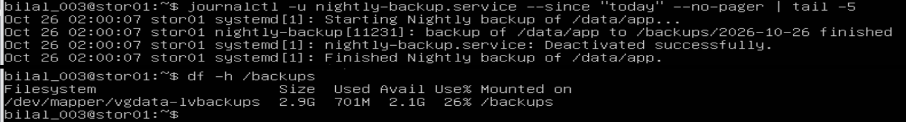
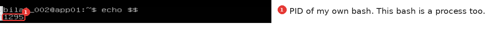
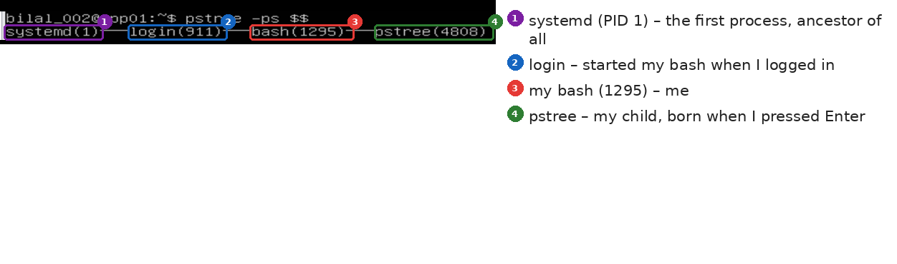
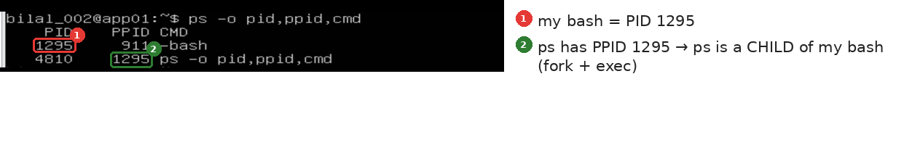
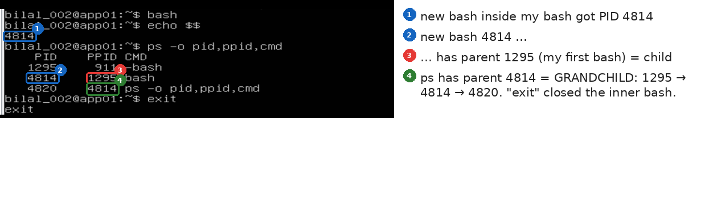
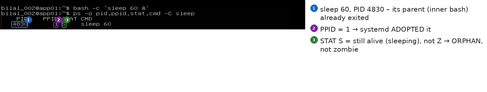

# Day 9 – 2026-10-26: Phase 4 – Step 4.3 clean-up, and Step 4.4 part 1: how processes are born (PID, fork, exec, wait, orphan, zombie)

| | |
|---|---|
| **Project** | Acme Analytics – hardened, observable and recoverable Linux platform |
| **Phase** | 4 – Processes, signals and limits |
| **Hosts worked on** | stor01 (clean-up), app01 (process lab) |
| **Status** | Phase 4 🟡 – Steps 4.1, 4.2 ✅ · Step 4.3 ✅ Steps 1–7 and Step 9 clean-up (Step 8, the L3 Problem in GLPI, still open) · Step 4.4 🟡 part 1 ✅ how processes are born; part 2 (zombie lab) next |
| **Print copy** | [Project-2-Day-9-study.pdf](Project-2-Day-9-study.pdf) |
| **Author** | Muhammad Bilal Javed |

> **How to read this report.** 💡 **In plain words** – the idea for any reader. 🔧 **Technical** – the settings and commands. 📸 **Evidence** – the real screenshot. Terms are explained in the [glossary](../glossary.md). Previous day: [Day 8](day-08-2026-10-25.md).

---

## 1. Step 4.3 Step 9 – clean-up after the queue lab (stor01)

💡 **In plain words:** after the escalation drill of Day 8 the backup volume must be back to normal, and the real nightly backup must still work.

🔧 **Technical:** the nightly backup timer ran by itself at **02:00:07** and finished successfully; the test archives in `/backups/archive/` were removed; `/backups` is back to **26 %**.

```bash
# stor01
journalctl -u nightly-backup.service --since "today" --no-pager | tail -5
sudo rm -r /backups/archive/*
df -h /backups
```

📸 **Evidence:**



---

## 2. Step 4.4 – the concept: where processes and PIDs come from

### 2.1 What is a process and a PID?

💡 **In plain words:** a **process** is a program that is running right now – my bash, `ls`, `tar`, sshd, the archive worker. Every process gets a **PID** (its own number) and a **PPID** (the number of its parent, the process that started it). **Every process has a parent**, all the way up to **systemd, PID 1**.

### 2.2 The PID pool

The **kernel** hands out PIDs like a **ticket machine**: the next free number goes to whatever starts – systemd, kernel threads, services, my shell, every command. There is **one pool for everything**, up to `/proc/sys/kernel/pid_max` (about 4 million on Ubuntu); when the counter reaches the end it starts again from low numbers and skips the ones in use.

```bash
cat /proc/sys/kernel/pid_max      # size of the pool
cat /proc/loadavg                 # last number = the PID given most recently
ps -e --no-headers | wc -l        # how many PIDs are in use right now
```

### 2.3 How a process is born – fork, exec, wait

| Word | Meaning | Picture |
|---|---|---|
| **fork** | the parent makes a **copy of itself** – a new process with a **new PID** | a cell divides in two |
| **exec** | "**replace me**" – the process turns into another program, **same PID**, no new process | same person, new clothes |
| **wait** | the parent **reads the child's exit note** when it finishes → the **PID is freed** | collecting the receipt |

When I type `ls`, bash **forks**, the copy **execs** into `ls`, `ls` finishes and leaves an exit note, bash **waits** (reads it) – that is why the prompt only returns after `ls` has ended.

### 2.4 From boot to my shell on app01

```
kernel → systemd (1) → getty@tty1 ─exec─► login (911) ─fork─► bash (1295) → my commands
```

**tty1 is not a process** – it is the terminal (the VMware console screen and keyboard). systemd starts the service **getty@tty1**, which shows "app01 login:". When I type my name, getty **execs into login** – the same process (911) changes its program. After the correct password, login **forks** and the copy becomes **my bash (1295)**.

---

## 3. Hands-on on app01 – watching processes being born

### 3.1 Who am I?

```bash
echo $$                    # $$ = the PID of this shell
```

📸 **Evidence:**



### 3.2 My family tree

```bash
pstree -ps $$              # -p = show PIDs, -s = show all parents
```

📸 **Evidence:**



Every command I run is a **child of my shell**.

### 3.3 Watch a birth

```bash
ps -o pid,ppid,cmd         # ps = process status, -o = which columns
```

📸 **Evidence:**



`1295 911 -bash` = "process 1295 is bash, its **parent** is 911 (login)"; the minus marks a **login shell**. `ps` has PPID **1295** – bash forked, the copy exec'd into `ps`.

### 3.4 A child in the background – and a good parent

```bash
sleep 30 &                 # & = run in the background, prompt comes back at once
ps -o pid,ppid,stat,cmd
```

📸 **Evidence:**

![sleep 4812 in the background; [1]+ Done – no zombie](../images/day-09/04-background-child.png)

`[1]+ Done` (job 1, `+` = most recent) means bash **read the child's exit note** – the PID was freed at the moment sleep finished (Linux tells bash with **SIGCHLD**); "Done" is only bash's report at the next prompt. **No zombie: bash is a good parent.**

| STAT | R | S | T | Z | + | s |
|---|---|---|---|---|---|---|
| meaning | running | sleeping (normal) | paused (Ctrl+Z) | zombie | foreground | session leader |

### 3.5 A child of a child

```bash
bash                       # a new bash inside my bash – waits for me until exit
echo $$
ps -o pid,ppid,cmd
exit
```

📸 **Evidence:**



Chain of three generations: **1295 → 4814 → 4820**.

### 3.6 exec – the copy turns into another program (reference)

```bash
bash -c 'echo "my PID is $$"; exec sleep 30' &     # -c = run these commands, then end
ps -o pid,ppid,cmd                                 # sleep has the SAME PID that echo printed
```

`bash -c` starts a new child bash that runs the commands in the quotes and ends by itself; `;` separates the two commands; `exec sleep 30` turns that bash into `sleep` **without a new PID**. The same trick is used by getty → login, and by Docker start scripts (`exec python app.py`) so the app becomes PID 1 and receives SIGTERM directly.

### 3.7 Orphan – the parent dies, the child keeps running

```bash
bash -c 'sleep 60 &'       # the inner bash starts sleep, then ends at once
ps -o pid,ppid,stat,cmd -C sleep
```

📸 **Evidence:**



**PPID 1** – systemd adopted it; **STAT S** – still alive. That is an **orphan, not a zombie**.

---

## 4. When is a PID freed – and when does it stay?

| Case | Child | Parent | What I see | Fix |
|---|---|---|---|---|
| **Normal** | finished | read the exit note | `[1]+ Done`, gone | nothing |
| **Orphan** | **alive**, keeps working | died → **systemd adopts** | PPID **1**, STAT S/R | nothing |
| **Zombie** | **dead** (finished) | alive, **never read the note** | STAT **Z**, `<defunct>` | **restart the parent** – `kill -9` does nothing |

| | Services (sshd, cron, archive-worker) | Commands (ls, cp, tar) |
|---|---|---|
| **When the PID is taken** | at boot, first → usually small numbers | later → bigger numbers |
| **Parent** | systemd, PPID 1 | my bash |
| **How long** | days, until stopped; a restart gives a new PID | seconds or minutes; a new PID every run |

**When do zombies happen in real life?** Any process can become a zombie – but only **after it has finished**, and it depends on the **parent**, never the child: (1) a badly written program that forgot `wait()`, (2) a parent that is stuck (e.g. waiting on a dead NFS share), (3) a container without an init process (fix: `docker run --init`). Every zombie keeps its PID, so thousands of them can empty the pool → `fork: Resource temporarily unavailable`.

---

## 5. Key understanding (in my own words)

> When app01 boots, the kernel starts **systemd**, which gets **PID 1** and is the forefather of every process. systemd starts **getty** on the console terminal **tty1** (tty1 is the screen and keyboard, not a process); when I type my name, getty **execs into login** – the same process **911** changes its program – and after the correct password login **forks** a copy with a new PID that becomes **my bash (1295)**. **exec = same process, same PID, new program; fork = a new process with a new PID.** All PIDs come from **one pool managed by the kernel**, which gives the next free number to whatever starts; a service and a command get the same kind of number – the difference is **when** (services at boot, small numbers), **who** is the parent (systemd vs my bash) and **how long** they keep it. `echo $$` prints the PID of my shell, `pstree -ps $$` shows the whole family line, and `ps -o pid,ppid,cmd` shows each process with its parent – every command I type is a child of my bash. When a command is completely done and **its parent has read its exit note (wait)**, it has **no PID any more**; `[1]+ Done` is only bash's report. A PID stays only while the process is **still running** (R/S), when it is **paused with Ctrl+Z** (T), or when it is a **zombie** (Z, `<defunct>` = "dead") whose living parent never read the note. An **orphan** is the opposite: alive, its parent gone, adopted by **PID 1**. A zombie uses no CPU or memory, only its PID; it cannot be killed with `kill -9` – the fix is always **the parent**. In industry, engineers find the responsible parent through **PPID** or **pstree**, restart that service, and open a ticket for the developers.

---

## 6. Next

1. Step 4.4 part 2 – the zombie lab on app01 (`zombie.py`: fork without wait, STAT Z, `kill -9` fails, stop the parent).
2. Step 4.3 Step 8 – the L3 Problem in GLPI, linked to ticket #3.
3. Step 4.5 – cgroups (MemoryMax, CPUQuota) · first incident drill · snapshot `50-processes`.
