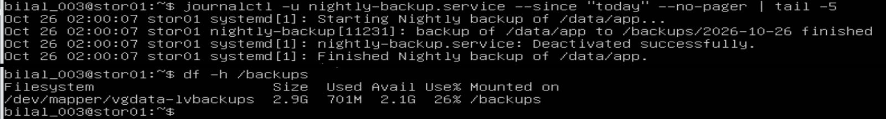
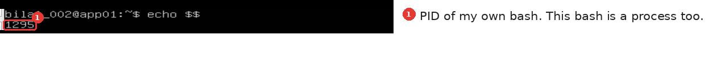
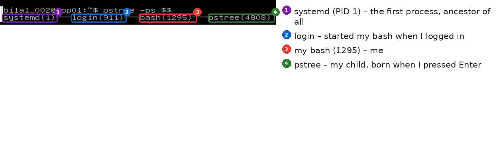
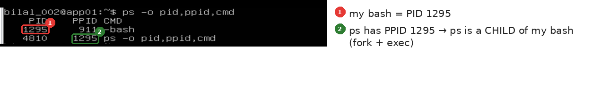
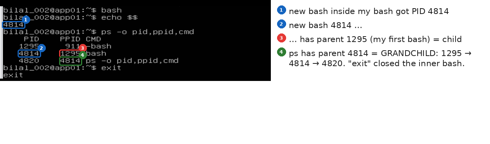
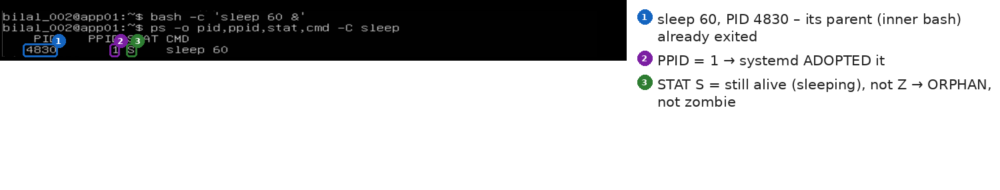
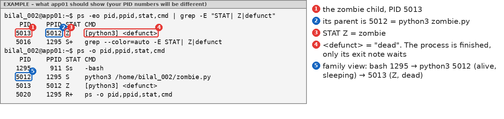
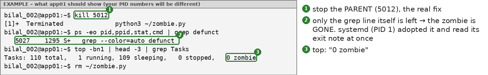

# Day 9 – 2026-10-26: Phase 4 – Step 4.3 clean-up, and Step 4.4 part 1: how processes are born (PID, fork, exec, wait, orphan, zombie)

| | |
|---|---|
| **Project** | Acme Analytics – hardened, observable and recoverable Linux platform |
| **Phase** | 4 – Processes, signals and limits |
| **Hosts worked on** | stor01 (clean-up), app01 (process lab) |
| **Status** | Phase 4 🟡 – Steps 4.1, 4.2 ✅ · Step 4.3 ✅ Steps 1–7 and Step 9 clean-up (Step 8, the L3 Problem in GLPI, still open) · Step 4.4 ✅ how processes are born (hands-on) + zombies (concept and reference – rare in practice, so no separate lab) · next: Step 4.5 cgroups |
| **Print copy** | [Project-2-Day-9-study.pdf](Project-2-Day-9-study.pdf) |
| **Author** | Muhammad Bilal Javed |

> **How to read this report.** 💡 **In plain words** – the idea for any reader. 🔧 **Technical** – the settings and commands. 📸 **Evidence** – the real screenshot. Terms are explained in the [glossary](../glossary.md). Previous day: [Day 8](day-08-2026-10-25.md).

---

## 1. Step 4.3 Step 9 – clean-up after the queue lab (stor01)

💡 **In plain words:** after the escalation drill of Day 8 the backup volume must be back to normal, and the real nightly backup must still work.

🔧 **Technical:** the nightly backup timer ran by itself at **02:00:07** and finished successfully; the test archives in `/backups/archive/` were removed; `/backups` is back to **26 %**.

```bash
# stor01
journalctl -u nightly-backup.service --since "today" --no-pager | tail -5
sudo rm -r /backups/archive/*
df -h /backups
```

📸 **Evidence:**



---

## 2. Step 4.4 – the concept: where processes and PIDs come from

### 2.1 What is a process and a PID?

💡 **In plain words:** a **process** is a program that is running right now – my bash, `ls`, `tar`, sshd, the archive worker. Every process gets a **PID** (its own number) and a **PPID** (the number of its parent, the process that started it). **Every process has a parent**, all the way up to **systemd, PID 1**.

### 2.2 The PID pool

The **kernel** hands out PIDs like a **ticket machine**: the next number goes to whatever starts – systemd, kernel threads, services, my shell, every command. There is **one pool for everything**, up to `/proc/sys/kernel/pid_max` (about 4 million on Ubuntu, 32,768 on older systems). Numbers are given in **increasing order**; a freed number is **not reused straight away** – only when the counter reaches pid_max does it wrap around to low numbers, skipping the ones still in use. In `/proc/loadavg` (e.g. `0.01 0.07 0.03 1/238 1823`) the fields are: load over 1/5/15 minutes · running/total tasks (threads included) · the last PID given.

```bash
cat /proc/sys/kernel/pid_max      # size of the pool
cat /proc/loadavg                 # last number = the PID given most recently
ps -e --no-headers | wc -l        # how many PIDs are in use right now
```

### 2.3 How a process is born – fork, exec, wait

| Word | Meaning | Picture |
|---|---|---|
| **fork** | the parent makes a **copy of itself** – a new process with a **new PID** | a cell divides in two |
| **exec** | "**replace me**" – the process turns into another program, **same PID**, no new process | same person, new clothes |
| **wait** | the parent **reads the child's exit note** when it finishes → the **PID is freed** | collecting the receipt |

When I type `ls`, bash **forks**, the copy **execs** into `ls`, `ls` finishes and leaves an exit note, bash **waits** (reads it) – that is why the prompt only returns after `ls` has ended.

### 2.4 From boot to my shell on app01

```
kernel → systemd (1) → getty@tty1 ─exec─► login (911) ─fork─► bash (1295) → my commands
```

**tty1 is not a process** – it is the terminal (the VMware console screen and keyboard). systemd starts the service **getty@tty1**, which shows "app01 login:". When I type my **username** (before the password), getty **execs into login** – the same process (911) changes its program. After the correct password, login **forks** and the copy becomes **my bash (1295)**.

The kernel starts **only systemd**; systemd starts getty and every other service. **getty is a process**, **tty1 is the terminal** (tty1, tty2 … – Ctrl+Alt+F2 opens tty2). After the password **login stays alive in the background** as bash's parent (pstree shows `login(911)───bash(1295)`) – I only see bash.

```
while I work:  ls ends   → leaves an exit note → bash reads it  → back to the prompt
when I exit:   bash ends → leaves an exit note → login reads it → login ends
               → systemd starts a fresh getty → new "login:" screen (new PIDs)
```

A living process has no exit note – it is written only when the process ends, and each level reports to the one above it.

### 2.5 Why fork + exec? bash works through a representative

```
bash (1295) ── asks the KERNEL "copy me" (fork) ──► representative (new PID 4810)
     │                                    exec ──► becomes ls (still 4810)
     │                              finishes → leaves the exit note
     └─ told (SIGCHLD) → READS the note (wait) → 4810 freed → prompt back
```

exec **replaces** the process that runs it – if bash exec'd into `ls` directly, bash itself would become `ls` and be gone when `ls` ends (the terminal would close). So bash **never does the work itself**: it asks the **kernel** to make a copy of it (environment, folder, open files) with a **new PID**; the copy execs into the command and keeps that PID; bash stays alive, is told when the child finishes (SIGCHLD) and **reads the exit note**. The child only *leaves* the note – the **parent reads** it. Safe proof: run `bash`, then `exec ls` – the inner bash disappears and `echo $$` shows the first bash again.

- **Built-ins** (`cd`, `echo`, `exit`) are done by bash itself – no new PID (`type cd` → "shell builtin", `type ls` → `/usr/bin/ls`).
- **Not every program forks** – only one that starts other programs: bash (commands), systemd (services), sshd (logins), the archive worker (→ `tar`). `ls` starts nothing, so it is the last link.


---

## 3. Hands-on on app01 – watching processes being born

### 3.1 Who am I?

```bash
echo $$                    # $$ = the PID of this shell
```

📸 **Evidence:**



### 3.2 My family tree

```bash
pstree -ps $$              # -p = show PIDs, -s = show all parents
```

📸 **Evidence:**



Every command I run is a **child of my shell**.

### 3.3 Watch a birth

```bash
ps -o pid,ppid,cmd         # ps = process status, -o = which columns
```

📸 **Evidence:**



`1295 911 -bash` = "process 1295 is bash, its **parent** is 911 (login)"; the minus marks a **login shell**. `ps` has PPID **1295** – bash forked, the copy exec'd into `ps`.

### 3.4 A child in the background – and a good parent

```bash
sleep 30 &                 # & = run in the background, prompt comes back at once
ps -o pid,ppid,stat,cmd
```

📸 **Evidence:**

![sleep 4812 in the background; [1]+ Done – no zombie](../images/day-09/04-background-child.png)

`[1]+ Done` (job 1, `+` = most recent) means bash **read the child's exit note** – the PID was freed at the moment sleep finished (Linux tells bash with **SIGCHLD**); "Done" is only bash's report at the next prompt. **No zombie: bash is a good parent.**

| STAT | R | S | T | Z | + | s |
|---|---|---|---|---|---|---|
| meaning | running | sleeping (normal) | paused (Ctrl+Z) | zombie | foreground | session leader |

### 3.5 A child of a child

```bash
bash                       # a new bash inside my bash – waits for me until exit
echo $$
ps -o pid,ppid,cmd
exit
```

📸 **Evidence:**



Chain of three generations: **1295 → 4814 → 4820**.

### 3.6 exec – the copy turns into another program (reference)

```bash
bash -c 'echo "my PID is $$"; exec sleep 30' &     # -c = run these commands, then end
ps -o pid,ppid,cmd                                 # sleep has the SAME PID that echo printed
```

`bash -c` starts a new child bash that runs the commands in the quotes and ends by itself; `;` separates the two commands; `exec sleep 30` turns that bash into `sleep` **without a new PID**. The same trick is used by getty → login, and by Docker start scripts (`exec python app.py`) so the app becomes PID 1 and receives SIGTERM directly.

### 3.7 Orphan – the parent dies, the child keeps running

```bash
bash -c 'sleep 60 &'       # the inner bash starts sleep, then ends at once
ps -o pid,ppid,stat,cmd -C sleep
```

📸 **Evidence:**



**PPID 1** – systemd adopted it; **STAT S** – still alive. That is an **orphan, not a zombie**.

---

## 4. When is a PID freed – and when does it stay?

| Case | Child | Parent | What I see | Fix |
|---|---|---|---|---|
| **Normal** | finished | read the exit note | `[1]+ Done`, gone | nothing |
| **Orphan** | **alive**, keeps working | died → **systemd adopts** | PPID **1**, STAT S/R | nothing |
| **Zombie** | **dead** (finished) | alive, **never read the note** | STAT **Z**, `<defunct>` | **restart the parent** – `kill -9` does nothing |

| | Services (sshd, cron, archive-worker) | Commands (ls, cp, tar) |
|---|---|---|
| **When the PID is taken** | at boot, first → usually small numbers | later → bigger numbers |
| **Parent** | systemd, PPID 1 | my bash |
| **How long** | days, until stopped; a restart gives a new PID | seconds or minutes; a new PID every run |

**When do zombies happen in real life?** Any process can become a zombie – but only **after it has finished**, and it depends on the **parent**, never the child: (1) a badly written program that forgot `wait()`, (2) a parent that is stuck (e.g. waiting on a dead NFS share), (3) a container without an init process (fix: `docker run --init`). Every zombie keeps its PID, so thousands of them can empty the pool → `fork: Resource temporarily unavailable`.

---

## 5. Zombies – essentials

A zombie is rare in daily operations, so this step is kept as **concept + reference** instead of a full lab. What an admin must be able to do: **know it, recognise it, fix it**.

1. Every process leaves an **exit note** when it ends (its exit code – `echo $?`), and the **parent must read it**.
2. **Not read → zombie**: STAT **Z**, `<defunct>`.
3. A zombie holds only a **PID** – no CPU, no memory.
4. **Find it:** `ps -eo pid,ppid,stat,cmd | grep -w Z` (or the "zombie" count in `top`) – its **PPID** points to the parent.
5. **Fix it:** restart the **parent** – never `kill -9` the zombie (it is already dead).

📸 **Reference (example output from the lab guide – PID numbers differ on a real server):**





### Points to ponder – key clues

| Clue | What it tells me |
|---|---|
| **PID vs PPID** | the process itself vs who started it – the PPID is how I find the responsible parent |
| **PID 1 = systemd** | starts every service and adopts every orphan |
| **`ls` = fork + exec + wait** | bash asks the kernel for a copy (new PID), the copy becomes `ls`, bash reads its exit note |
| **fork vs exec** | fork = new copy, new PID · exec = same process, new program, same PID |
| **Built-ins (`cd`, `echo`)** | run inside bash – no new PID (`type cd`) |
| **STAT Z, `<defunct>`** | a finished child whose parent never read the note |
| **"No CPU, no memory"** | a zombie only blocks a PID – harmless alone, dangerous by the thousand |
| **`fork: Resource temporarily unavailable`** | PIDs are used up – look for a zombie leak, even SSH logins can fail |
| **`kill -9` does nothing** | the zombie is already dead – act on the **parent** |
| **Zombie vs orphan** | zombie = dead child, living parent · orphan = living child, dead parent → PPID 1 |
| **Process tree** | `pstree -p` or `ps -ef --forest` shows who belongs to whom |

---

## 6. Key understanding (in my own words)

> Every running program is a **process** with a **PID** (its own number) and a **PPID** (its parent's number). The kernel hands out PIDs like a **ticket machine**, in **increasing order**, up to `pid_max` (about 4.2 million on Ubuntu); a freed number is reused only after the counter wraps around. At boot the kernel starts **only systemd (PID 1)**, and systemd starts every service – including **getty**, a process that watches the terminal **tty1** and shows "login:". When I type my username, getty **execs** into **login** (same PID); after the password, login **forks** a copy, the copy execs into my **login shell `-bash`**, and login waits in the background as its parent. bash never runs a program itself: it asks the **kernel** to make a **copy** of it with a **new PID** (**fork**), the copy turns into the command and keeps that PID (**exec**), and bash stays alive; built-ins like `cd` and `echo` are the exception – bash does them itself. When a child ends, it automatically leaves an **exit note** (its exit code, `echo $?`); the kernel tells the parent with **SIGCHLD**, the parent **reads** the note (**wait**), and the PID is freed. `exit` closes the chain the same way: bash ends, login reads its note and ends, and systemd starts a fresh getty. An **orphan** is a child that is **still running** after its parent died – systemd adopts it (PPID 1). A **zombie** is a child that has **finished** but whose parent **never read the note** – a bug (no `wait()`), a stuck parent, or a container without init. It shows **STAT Z, `<defunct>`**, uses no CPU or memory and only holds its PID – rare, but thousands of zombies can use up all PIDs, and then nothing new can start, not even an SSH login. `kill -9` cannot remove a zombie because it is already dead; **the fix is the parent** – find it through the zombie's PPID, restart that service, and systemd adopts the zombie and cleans it up, then open a ticket for the developers.

---

## 7. Next

1. Step 4.5 – cgroups: limit CPU and memory of a process and of a service (app01, stor01).
2. First incident drill – "disk full, but nothing is found" (stor01).
3. Step 4.3 Step 8 – the L3 Problem in GLPI, linked to ticket #3 · snapshot `50-processes`.
