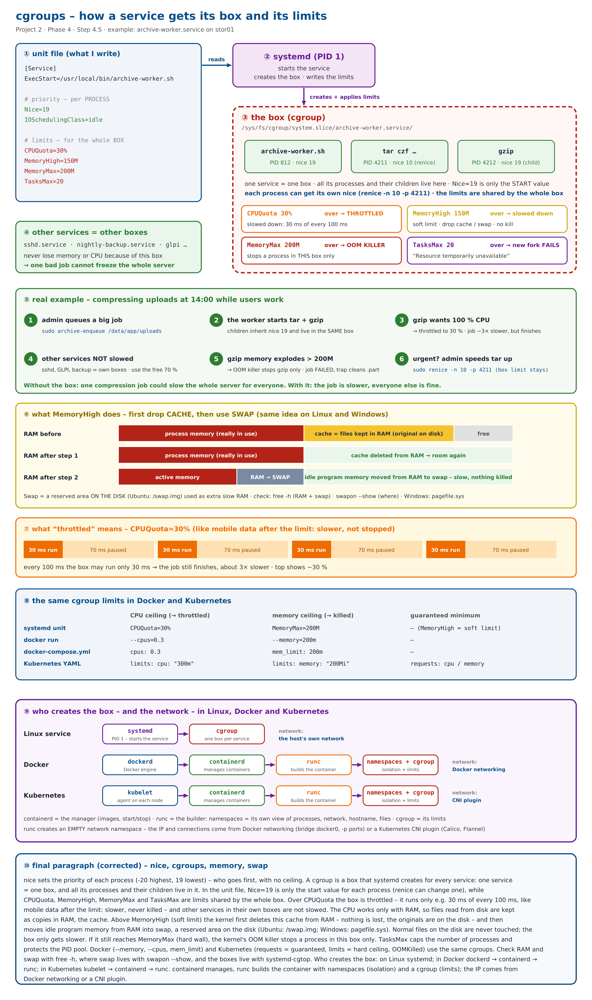
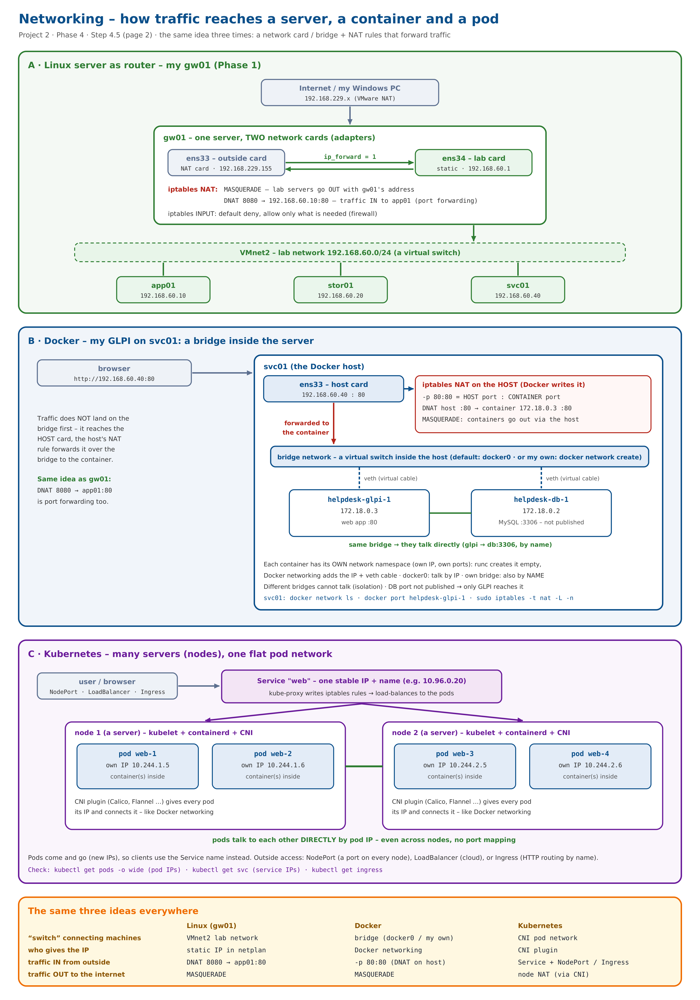

# Day 10 – 2026-11-01: Phase 4 – Step 4.5 concept: cgroups (CPU and memory limits), cache and swap, and container networking

| | |
|---|---|
| **Project** | Acme Analytics – hardened, observable and recoverable Linux platform |
| **Phase** | 4 – Processes, signals and limits |
| **Hosts worked on** | gw01 (PID pool check) · concept day – the cgroups lab on app01 and stor01 is next |
| **Status** | Phase 4 🟡 – Steps 4.1–4.4 ✅ · Step 4.5 🟡 concept ✅ (cgroups, nice vs limits, throttling, MemoryHigh/MemoryMax, cache and swap, Docker/Kubernetes limits, who creates the box, container networking) – hands-on lab next |
| **Print copy** | [Project-2-Day-10-study.pdf](Project-2-Day-10-study.pdf) |
| **Author** | Muhammad Bilal Javed |

> **How to read this report.** 💡 **In plain words** – the idea for any reader. 🔧 **Technical** – the settings and commands. 📸 **Evidence** – the real screenshot or diagram. Terms are explained in the [glossary](../glossary.md). Previous day: [Day 9](day-09-2026-10-26.md).

---

## 1. Warm-up – the PID pool on gw01

```bash
cat /proc/sys/kernel/pid_max      # 4194304 – size of the PID pool
cat /proc/loadavg                 # 0.01 0.07 0.03 1/238 1823
ps -e --no-headers | wc -l        # 209 processes
```

`/proc/loadavg` = load over 1 / 5 / 15 minutes (almost zero – gw01 is idle) · **1/238** = 1 task running out of 238 (threads included) · **1823** = the PID handed out most recently. `ps -e` counts **processes** only (209), so it is lower than 238.

---

## 2. Step 4.5 – the concept: cgroups

💡 **In plain words:** `nice` decides **who goes first**; a **cgroup** decides **how much at most**. Every service runs in its own **box**, and a limit on the box is a hard ceiling for every process inside it – so one bad job cannot freeze the whole server.

### 2.1 nice vs cgroup limits

| | nice | cgroup limits |
|---|---|---|
| **works on** | each **process** | the whole **box** (service) |
| **means** | priority – who goes first, no ceiling | hard ceiling – how much at most |
| **in a unit file** | `Nice=19` = start value for every process of the service (children inherit it; `renice -n 10 -p <PID>` changes one) | `CPUQuota=` · `MemoryHigh=` · `MemoryMax=` · `TasksMax=` – shared by all processes in the box |

### 2.2 Who creates the box

- **Linux service:** **systemd** reads the unit file, starts the service, creates its box (`/sys/fs/cgroup/system.slice/<name>.service/`) and writes the limits. **One service = one box.**
- **Docker:** `dockerd` → `containerd` (the manager) → `runc` (the builder: **namespaces** = isolation, **cgroup** = limits).
- **Kubernetes:** `kubelet` → `containerd` → `runc` – the same Linux cgroups underneath.

### 2.3 What each limit does when it is exceeded

| Limit | Over the limit |
|---|---|
| `CPUQuota=30%` | **throttled** – the box runs only 30 ms of every 100 ms, like mobile data after the monthly limit: slower, never killed. Other services in their own boxes are **not** slowed. |
| `MemoryHigh=150M` (soft) | the box is **slowed down**: step 1 – the **cache** (copies of files kept in RAM; originals on disk) is deleted from RAM · step 2 – idle **program memory** is moved from RAM to **swap**, a reserved area **on the disk** (Ubuntu `/swap.img`, Windows `pagefile.sys`). Normal files on the disk are never touched; nothing is killed. |
| `MemoryMax=200M` (hard) | the kernel's **OOM killer** stops a process **in this box only** |
| `TasksMax=20` | a new fork **fails** inside this box only (“Resource temporarily unavailable”) – protects the PID pool |
| `MemoryMin=` / `MemoryLow=` | the opposite: a **guaranteed / protected** minimum for the box |

### 2.4 The archive worker as an example (stor01)

```ini
[Service]
ExecStart=/usr/local/bin/archive-worker.sh
Nice=19                 # priority – per process
IOSchedulingClass=idle
CPUQuota=30%            # limits – for the whole box
MemoryHigh=150M
MemoryMax=200M
TasksMax=20
```

Set them in the unit file (`daemon-reload` + `restart`) or with `sudo systemctl set-property archive-worker CPUQuota=30% MemoryMax=200M`; check with `systemctl show archive-worker -p Nice -p CPUQuotaPerSecUSec -p MemoryMax -p TasksMax`.

📸 **Diagram:**



### 2.5 The same limits in Docker and Kubernetes

| | CPU ceiling (→ throttled) | memory ceiling (→ killed) | minimum / soft |
|---|---|---|---|
| systemd unit | `CPUQuota=30%` | `MemoryMax=200M` | `MemoryMin=` guaranteed · `MemoryHigh=` soft |
| `docker run` | `--cpus=0.3` | `--memory=200m` | `--memory-reservation` (soft only – no guarantee) |
| docker-compose.yml | `cpus: 0.3` | `mem_limit: 200m` | `deploy.resources.reservations` |
| Kubernetes YAML | `limits: cpu: "300m"` | `limits: memory: "200Mi"` (→ `OOMKilled`) | `requests:` = guaranteed, used to choose the node |

The Dockerfile only builds the image – limits are set when the container runs. `300m` = 300 millicores (0.3 of a core); `200Mi` ≈ 200 MB.

---

## 3. Container networking – the same idea as gw01

- **Linux (gw01):** two network cards (ens33 outside, ens34 lab), `ip_forward = 1`, **MASQUERADE** for traffic out, **DNAT 8080 → app01:80** for traffic in.
- **Docker (GLPI on svc01):** traffic reaches the **host card** first; the host's iptables NAT rule written by Docker (`-p 80:80` = HOST port : CONTAINER port) forwards it over a **bridge** (default `docker0` or my own `docker network create`) and a **veth** virtual cable to the container's own IP. Containers on the same bridge talk directly (on my own bridge also by name); the MySQL port is not published, so only GLPI reaches it.
- **Kubernetes:** a **CNI plugin** gives every pod its own IP; pods talk directly, even across nodes. A **Service** gives one stable IP/name and **kube-proxy** load-balances to the pods; outside access via NodePort, LoadBalancer or Ingress.

📸 **Diagram:**



---

## 4. Key understanding (in my own words)

> **nice** sets the priority of each process (-20 highest, 19 lowest) – who goes first, with no ceiling. A **cgroup** is a box that **systemd** creates for every service: one service = one box, and all its processes and their children live in it. In the unit file, `Nice=19` is only the start value for each process (`renice` can change one), while `CPUQuota`, `MemoryHigh`, `MemoryMax` and `TasksMax` are limits shared by the whole box. Over **CPUQuota** the box is **throttled** – it runs only e.g. 30 ms of every 100 ms, like mobile data after the limit: slower, never killed – and other services in their own boxes are not slowed. The CPU works only with **RAM**, so files read from disk are kept as copies in RAM, the **cache**. Above **MemoryHigh** (soft limit) the kernel first deletes this cache from RAM – nothing is lost, the originals are on the disk – and then moves idle program memory from RAM into **swap**, a reserved area on the disk (Ubuntu `/swap.img`, Windows `pagefile.sys`); normal files on the disk are never touched, the box only gets slower. If it still reaches **MemoryMax** (hard wall), the kernel's **OOM killer** stops a process in this box only. **TasksMax** caps the number of processes and protects the PID pool. **Docker** (`--memory`, `--cpus`, `mem_limit`) and **Kubernetes** (requests = guaranteed, limits = hard ceiling, `OOMKilled`) use the same cgroups: on Linux systemd creates the box; in Docker `dockerd → containerd → runc`; in Kubernetes `kubelet → containerd → runc`. containerd manages, runc builds the container with **namespaces** (isolation) and a **cgroup** (limits); the IP comes from Docker networking or a CNI plugin. Traffic to a container always reaches the **host's card** first, and a **NAT rule** forwards it – exactly like my gw01's `DNAT 8080 → app01:80`.

---

## 5. Next – the cgroups lab

1. **Step 1 (app01):** `free -h` · `swapon --show` · install `stress-ng` · `cat /proc/$$/cgroup` · `systemd-cgls`.
2. **Step 2 (app01):** memory limit – `systemd-run --scope -p MemoryMax=100M stress-ng --vm 1 --vm-bytes 300M` → OOM in the journal.
3. **Step 3 (app01):** CPU limit – `CPUQuota=20%` → `top` and `systemd-cgtop` show ~20 %.
4. **Step 4 (stor01):** permanent limits on `archive-worker.service`.
5. Then: first incident drill · L3 Problem in GLPI · snapshot `50-processes`.
