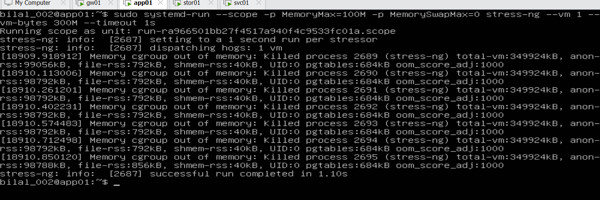
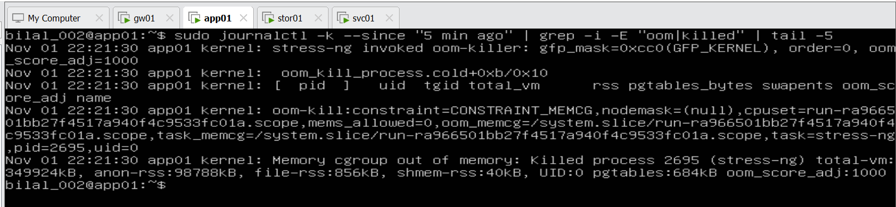
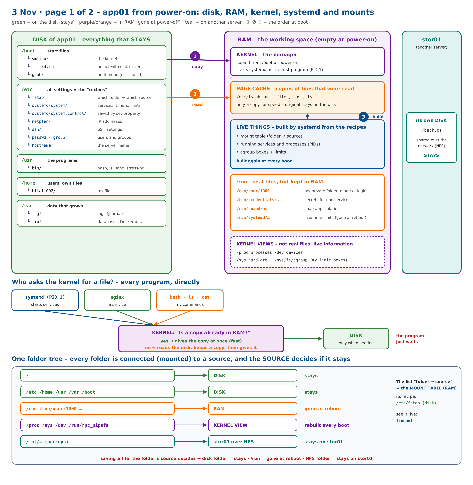
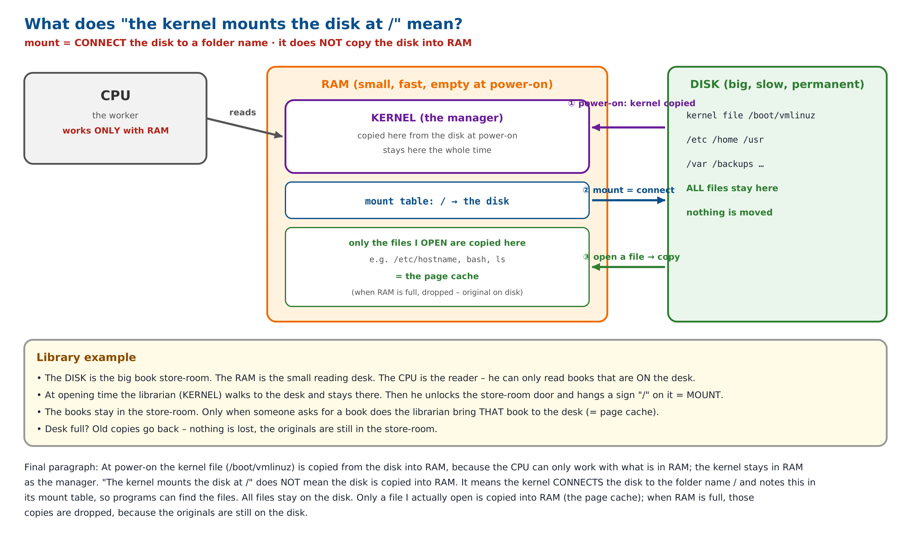
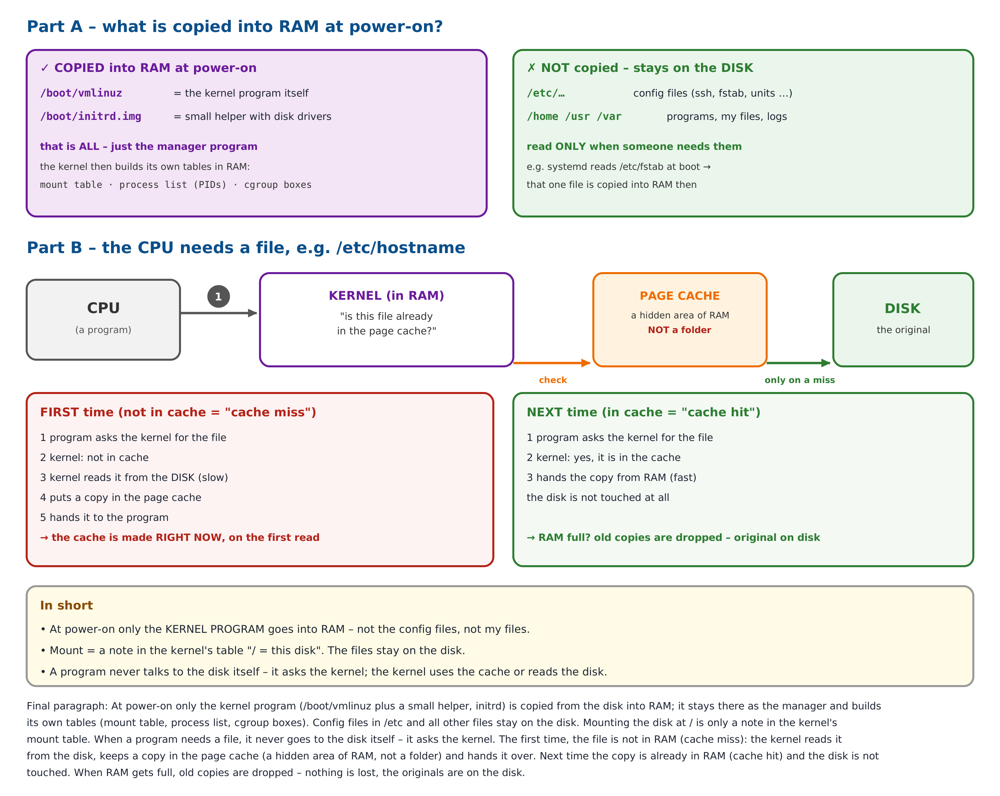
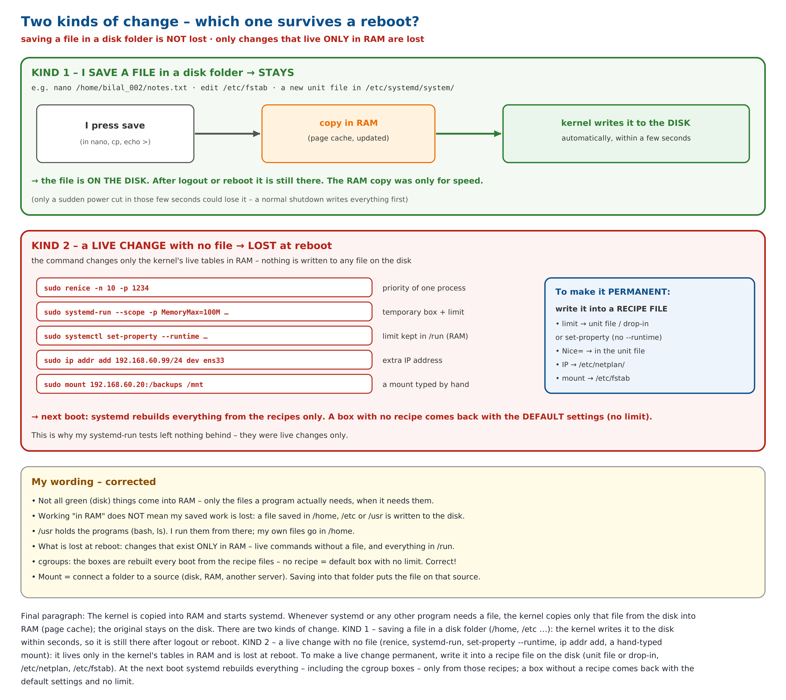
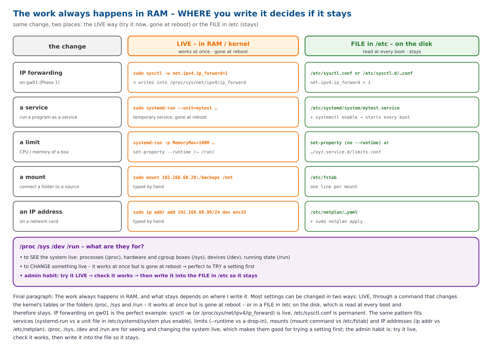
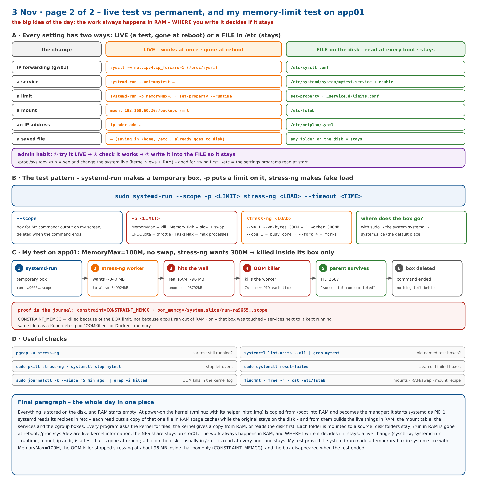

# Day 11 – 2026-11-03: Phase 4 – Step 4.5 lab Step 2 (memory limit + OOM killer) and how Linux uses disk and RAM: boot, page cache, mounts, live vs permanent

| | |
|---|---|
| **Project** | Acme Analytics – hardened, observable and recoverable Linux platform |
| **Phase** | 4 – Processes, signals and limits |
| **Hosts worked on** | app01 (memory-limit test, clean-up check) |
| **Status** | Phase 4 🟡 – Steps 4.1–4.4 ✅ · Step 4.5: concept ✅ · lab Step 1 ✅ · **lab Step 2 ✅ memory limit proved with the OOM killer** · foundations ✅ (boot, page cache, mounts, live vs permanent) – Steps 3–7 next |
| **Print copy** | [Project-2-Day-11-study.pdf](Project-2-Day-11-study.pdf) · 2-page overview: [Project-2-Day-11-overview-2-pages.pdf](Project-2-Day-11-overview-2-pages.pdf) |
| **Author** | Muhammad Bilal Javed |

> **How to read this report.** 💡 **In plain words** – the idea for any reader. 🔧 **Technical** – the settings and commands. 📸 **Evidence** – the real screenshot or diagram. Terms are explained in the [glossary](../glossary.md). Previous day: [Day 10](day-10-2026-11-01.md).

---

## 1. Lab Step 2 (app01) – a hard memory limit and the OOM killer

💡 **In plain words:** I gave a test program a box with a 100 MB memory wall and no swap, then asked it to use 300 MB. The kernel stopped it at the wall – inside its own box only. app01 and every service next to it kept running.

🔧 **Technical:**

```bash
sudo systemd-run --scope -p MemoryMax=100M -p MemorySwapMax=0 stress-ng --vm 1 --vm-bytes 300M --timeout 1s
sudo journalctl -k --since "5 min ago" | grep -i -E "oom|killed" | tail -5
```

**The pattern behind every test:**

```
sudo systemd-run --scope  -p <LIMIT>   stress-ng <LOAD>  --timeout <TIME>
     └─ make a box ──┘  └ the limit ┘  └── fake load to test the limit ──┘
```

| Part | Meaning |
|---|---|
| `systemd-run --scope` | a temporary box for my command – output on my screen, the box is deleted when the command ends |
| `-p MemoryMax=100M` · `-p MemorySwapMax=0` | hard memory wall of 100 MB · no escape to swap |
| `stress-ng --vm 1 --vm-bytes 300M` | 1 memory worker that tries to use 300 MB (`--cpu` = CPU load, `--fork` = new processes) |
| where the box goes | with `sudo` the request goes to the system systemd (PID 1) → default place **system.slice** |

**What happened:**

| Line | Meaning |
|---|---|
| `Running scope as unit: run-ra9665….scope` | systemd made the temporary box |
| `total-vm:349924kB` | the worker wanted about 340 MB |
| `anon-rss:98792kB` | it really got about 96 MB of RAM – right at the 100 MB wall |
| `Killed process 2689 … 2695` (7 times) | the OOM killer stopped the worker; stress-ng restarted it, each time with a new PID |
| `[2687] successful run completed` | the parent was never killed – only its workers |
| `constraint=CONSTRAINT_MEMCG` | killed because of the **box limit**, not because app01 ran out of RAM |
| `oom_memcg=/system.slice/run-ra9665….scope` | the box that hit the limit – only this box was touched |

📸 **Evidence:**





**Clean-up check before the next test:** `pgrep -a stress-ng` (nothing = no test running) · `systemctl list-units --all | grep -E "run-|mytest"` – the `run-….mount` lines are normal mounts under `/run`, not old tests; old test boxes would end in `.scope` or be called `mytest.service`. Leftovers: `sudo pkill stress-ng` · `sudo systemctl stop mytest` · `sudo systemctl reset-failed`.

Same idea in containers: a Kubernetes pod shows `OOMKilled`, Docker kills a container over `--memory`.

---

## 2. How Linux uses the disk and RAM – from power-on

💡 **In plain words:** everything is stored on the disk; RAM starts empty. The kernel is copied into RAM and becomes the manager, systemd reads its settings from `/etc`, and builds the live things in RAM.

1. **① Copy:** two files from `/boot` are copied into RAM – `vmlinuz` (the kernel) and `initrd.img` (a small helper with disk drivers). The rest of `/boot` and all other files stay on the disk.
2. The kernel starts **systemd** as the first program (PID 1).
3. **② Read:** systemd reads its recipes in `/etc` (fstab, unit files, limits). Reading = the kernel puts a **copy of that one file** in RAM (the page cache); the original stays on the disk.
4. **③ Build:** from the recipes systemd builds the live things in RAM – the mount table, the running services and the cgroup boxes. They are built again at every boot.

📸 **Diagram – the whole picture on one page:**



### 2.1 Mount = connect, not copy

A mount connects a **folder** to a **source**. The files stay where they are; the kernel only notes "`/` = this disk" in its mount table (in RAM).



### 2.2 When a program needs a file

Every program – systemd, nginx, or my own `ls` – asks the **kernel**. Copy already in RAM → given at once (fast). Not in RAM → the kernel reads the disk, keeps a copy, then gives it. The program simply waits. The page cache is a hidden area of RAM, not a folder.



### 2.3 One folder tree – the source decides if it stays

| Folders | Source | After reboot |
|---|---|---|
| `/ /etc /home /usr /var /boot` | disk | stays |
| `/run` (e.g. `/run/user/1000`) | RAM (tmpfs) | gone |
| `/proc /sys /dev /run/rpc_pipefs` | kernel view – live information, not real files | rebuilt |
| `/mnt/…` backups | stor01 over NFS | stays on stor01 |

systemd tracks every mount as a `.mount` unit named after its folder with `/` → `-` (a real dash = `\x2d`), e.g. `run-user-1000.mount` = `/run/user/1000`. Check: `findmnt`.

---

## 3. Live test vs permanent – where I write it decides

💡 **In plain words:** the work always happens in RAM. Saving a file in a disk folder is **not** lost – the kernel writes it to the disk within seconds. What is lost at reboot is a **live change with no file**. `/etc` is special because of its job: it holds the settings programs read every time they start.

| The change | Live – works at once, gone at reboot | File on the disk – stays |
|---|---|---|
| IP forwarding (gw01) | `sysctl -w net.ipv4.ip_forward=1` (= `/proc/sys/…`) | `/etc/sysctl.conf` |
| a service | `systemd-run --unit=mytest …` | `/etc/systemd/system/mytest.service` + `enable` |
| a limit | `systemd-run -p …` · `set-property --runtime` | `set-property` · `…service.d/limits.conf` |
| a mount | `mount 192.168.60.20:/backups /mnt` | `/etc/fstab` |
| an IP address | `ip addr add …` | `/etc/netplan/…yaml` |

**Admin habit:** try it live → check it works → write it into the file so it stays. A cgroup box with no recipe file comes back after reboot with the default settings and no limit – that is why my `systemd-run` tests left nothing behind.

📸 **Diagrams:**







---

## 4. Key understanding (in my own words)

> Everything is stored on the disk, and RAM starts empty. At power-on the kernel (`vmlinuz` with its helper `initrd.img`) is copied from `/boot` into RAM and becomes the manager; it starts systemd as PID 1. systemd reads its recipes in `/etc` – each read puts a copy of that one file in RAM (page cache) while the original stays on the disk – and from them builds the live things in RAM: the mount table, the services and the cgroup boxes. Every program asks the kernel for files; the kernel gives a copy from RAM, or reads the disk first. Each folder is mounted to a source: disk folders stay, `/run` in RAM is gone at reboot, `/proc`, `/sys` and `/dev` are live kernel information, the NFS share stays on stor01. The work always happens in RAM, and **where I write it decides if it stays**: a live change (`sysctl -w`, `systemd-run`, `--runtime`, `mount`, `ip addr`) is a test that is gone at reboot; a file on the disk – usually in `/etc` – is read at every boot and stays. My test proved it: `systemd-run` made a temporary box in system.slice with `MemoryMax=100M`, the OOM killer stopped stress-ng at about 96 MB inside that box only (`CONSTRAINT_MEMCG`), and the box disappeared when the test ended.

---

## 5. Next – the rest of the cgroups lab

1. ~~Step 1 (app01): the cgroup tree.~~ ✅ (Day 10)
2. ~~Step 2 (app01): memory limit → OOM killer.~~ ✅
3. **Soft limit (app01):** `sudo systemd-run --scope -p MemoryHigh=100M stress-ng --vm 1 --vm-bytes 200M --timeout 20s` → slowed and swapped, not killed (`free -h` before/during).
4. **Step 3 (app01):** CPU limit – `CPUQuota=20%` → `top` and `systemd-cgtop` show ~20 %.
5. **Step 4 (stor01):** permanent limits on `archive-worker.service`.
6. Then: first incident drill · L3 Problem in GLPI · snapshot `50-processes`.
