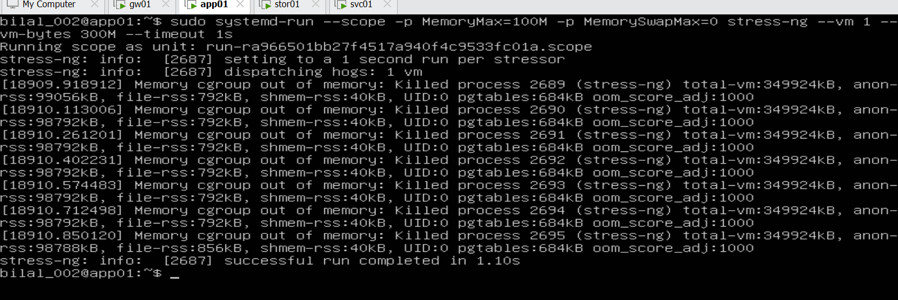
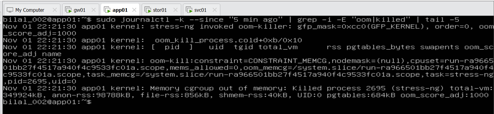
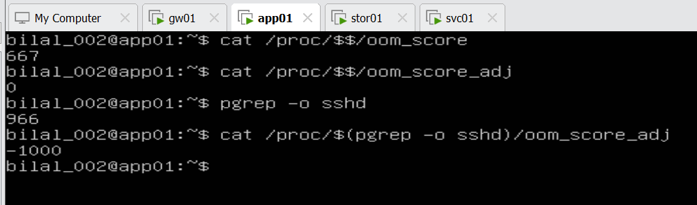
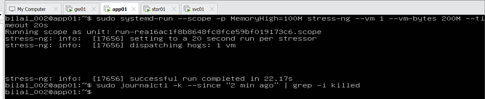
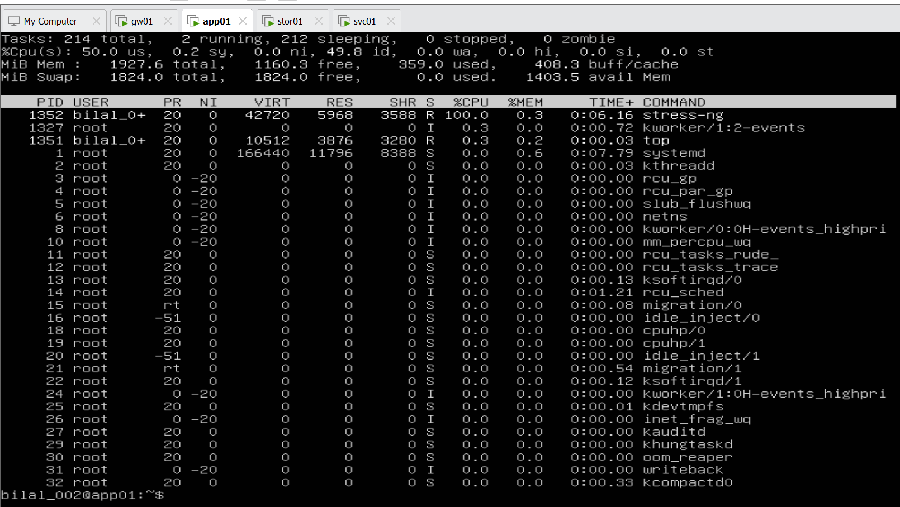
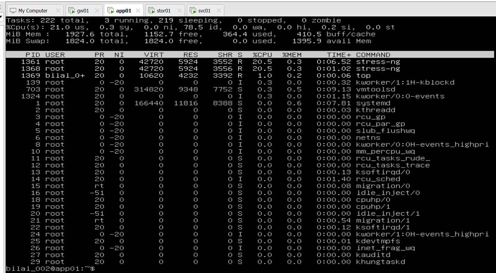
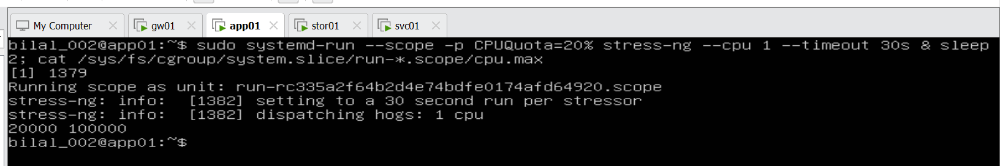
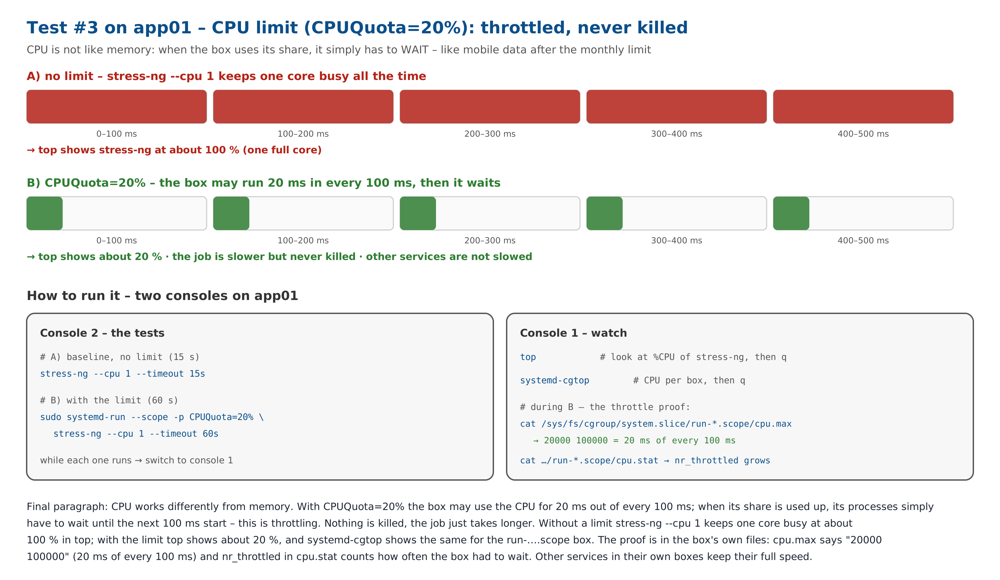
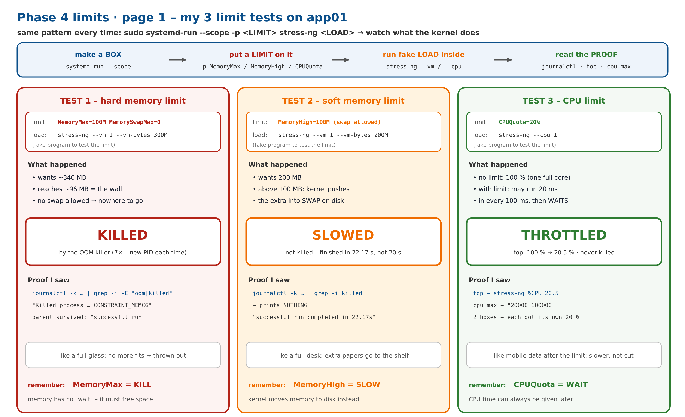
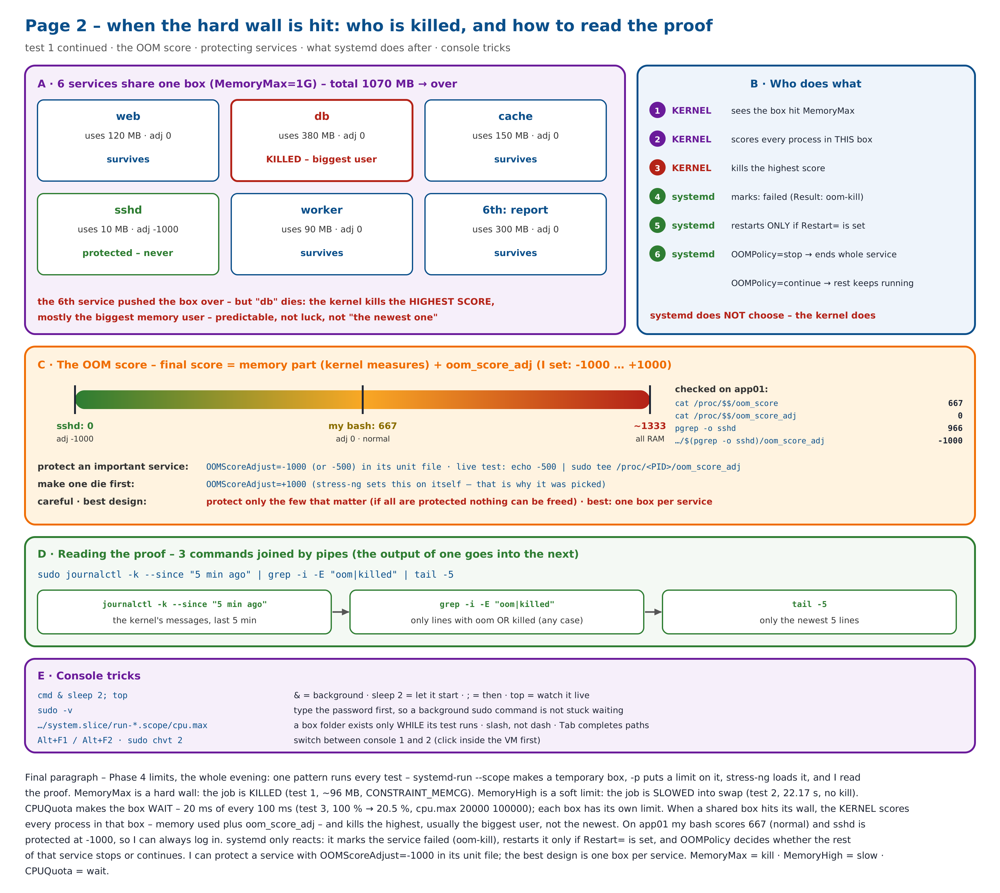

# Day 12 – 2026-11-04: Phase 4 – Step 4.5 lab: CPU limit (CPUQuota) – throttled, never killed · the 3 limit tests on one page

| | |
|---|---|
| **Project** | Acme Analytics – hardened, observable and recoverable Linux platform |
| **Phase** | 4 – Processes, signals and limits |
| **Hosts worked on** | app01 (one session 3 Nov 22:15 → 4 Nov 01:30: hard limit, OOM scores, soft limit, CPU limit) |
| **Status** | Phase 4 🟡 – Steps 4.1–4.4 ✅ · Step 4.5: concept ✅ · lab: cgroup tree ✅ · hard memory limit ✅ · soft memory limit ✅ · **CPU limit ✅** – permanent limits on stor01 next |
| **Print copy** | [Project-2-Day-12-study.pdf](Project-2-Day-12-study.pdf) · revision sheet: [Project-2-Phase-4-limits-2-pages.pdf](Project-2-Phase-4-limits-2-pages.pdf) |
| **Author** | Muhammad Bilal Javed |

> **How to read this report.** 💡 **In plain words** – the idea for any reader. 🔧 **Technical** – the settings and commands. 📸 **Evidence** – the real screenshot or diagram. Terms are explained in the [glossary](../glossary.md). Previous day: [Day 11](day-11-2026-11-03.md).

---

## 0. This session from the start (3 Nov 22:15 → 4 Nov 01:30) – tests 1 and 2

This session began on the evening of 3 November and continued past midnight. Tests 1 and 2 are documented in full in [Day 11, section 4](day-11-2026-11-03.md); the screenshots are repeated here so the whole session is in one place.

**Test #1 – hard limit (MemoryMax=100M, no swap): KILLED**





**Who is killed when a box is full – the OOM score checked on app01** (my bash 667, sshd protected at -1000)



**Test #2 – soft limit (MemoryHigh=100M): SLOWED, not killed** (22.17 s instead of 20 s, no `Killed` line)



---

## 1. Test #3 (app01) – CPU limit: throttled, never killed

💡 **In plain words:** CPU is not like memory. With `CPUQuota=20%` the box may use the CPU for 20 ms in every 100 ms; when its share is used up it simply **waits** for the next 100 ms – like mobile data after the monthly limit: slower, not cut off. Nothing is killed.

🔧 **Technical:**

```bash
# A) baseline – no limit
stress-ng --cpu 1 --timeout 30s & sleep 2; top

# B) with the limit
sudo -v
sudo systemd-run --scope -p CPUQuota=20% stress-ng --cpu 1 --timeout 60s & sleep 2; top

# proof from the box itself (only while the test runs)
sudo systemd-run --scope -p CPUQuota=20% stress-ng --cpu 1 --timeout 30s & sleep 2; cat /sys/fs/cgroup/system.slice/run-*.scope/cpu.max
```

| What I saw | Meaning |
|---|---|
| A: stress-ng **100.0 %**, `%Cpu(s): 50.0 us` | one full core busy – app01 has 2 cores, so one core = 50 % of the whole server |
| B: stress-ng **20.5 %**, `78.5 id` | throttled to the limit – the server is mostly idle, the job waits its turn |
| B: **two** stress-ng (PID 1361, 1368), **each 20.5 %** | test B was started twice → two boxes, each with its **own** 20 % – a limit belongs to its box |
| `cpu.max` → `20000 100000` | 20 000 µs (20 ms) of CPU in every 100 000 µs (100 ms) = 20 % |

📸 **Evidence:**









### 1.1 What went wrong on the way – and the fix

| Problem | Cause | Fix |
|---|---|---|
| `top` showed no stress-ng, 99.8 % idle | `top` was opened after the test had finished – the stress-ng messages printed over the prompt and made it look busy | start and watch in one line: `cmd & sleep 2; top` |
| background `sudo` could get stuck | sudo asks for a password, which a background job cannot read | `sudo -v` first |
| `cat …/system.slice-run-*.scope/cpu.max`: No such file | a dash instead of a slash – and the box folder is deleted when the test ends | `system.slice/run-*.scope` while the test runs · Tab completes paths |
| app01 switched off by accident | – | nothing to clean up: the test box was a live change in RAM and was gone after the restart |
| switching consoles | – | click inside the VM, Alt+F1 / Alt+F2 (or `sudo chvt 2`) |

---

## 2. The 3 limit tests – revision sheet

| | Test 1 | Test 2 | Test 3 |
|---|---|---|---|
| limit | `MemoryMax=100M` + no swap | `MemoryHigh=100M` | `CPUQuota=20%` |
| load | `stress-ng --vm 1 --vm-bytes 300M` | `stress-ng --vm 1 --vm-bytes 200M` | `stress-ng --cpu 1` |
| result | **KILLED** by the OOM killer at ~96 MB | **SLOWED** into swap – 22.17 s instead of 20 s | **THROTTLED** – 100 % → 20.5 % |
| proof | `CONSTRAINT_MEMCG` in the kernel log | no `Killed` line | `top`, `cpu.max` = `20000 100000` |
| remember | MemoryMax = **kill** | MemoryHigh = **slow** | CPUQuota = **wait** |

Memory cannot wait – too much memory must be freed (killed or swapped). CPU time can always be given later – too much CPU only waits.

📸 **The 2-page revision sheet** (page 2: who the OOM killer chooses, the OOM score, reading the proof, console tricks):





---

## 3. Key understanding (in my own words)

> All three tests use one pattern: `systemd-run --scope` makes a temporary box, `-p` puts a limit on it, stress-ng creates fake load inside, and I read the proof. `MemoryMax` is a hard wall – the job is **killed** (test 1). `MemoryHigh` is a soft limit – the job is **slowed** into swap (test 2). `CPUQuota=20%` lets the box run 20 ms in every 100 ms (`cpu.max` = `20000 100000`): without a limit stress-ng used 100 % of one core, with it `top` showed 20.5 % – **throttled**, never killed, and two boxes each got their own 20 % because a limit belongs to its box. When a shared box hits its memory wall, the kernel kills the process with the highest OOM score (memory used + `oom_score_adj`), and systemd only reacts. MemoryMax = kill · MemoryHigh = slow · CPUQuota = wait.

---

## 4. Next

1. **Step 4 (stor01):** permanent limits on `archive-worker.service` – written into a file, so they survive a reboot.
2. First incident drill · L3 Problem in GLPI · snapshot `50-processes` → Phase 4 complete.
