# Day 13 – 2026-11-04: Phase 4 complete – permanent limits on stor01, first incident drill, GLPI Incident + L3 Problem, snapshot

| | |
|---|---|
| **Project** | Acme Analytics – hardened, observable and recoverable Linux platform |
| **Phase** | 4 – Processes, signals and limits |
| **Hosts worked on** | stor01 (permanent limits, reboot test, incident drill) · svc01 (GLPI) · all VMs (snapshot) |
| **Status** | **Phase 4 ✅ complete** – Steps 4.1–4.5 ✅ · permanent limits ✅ · incident drill ✅ · GLPI Incident #4 + L3 Problem ✅ · snapshot `50-processes` ✅ |
| **Print copy** | [Project-2-Day-13-study.pdf](Project-2-Day-13-study.pdf) · all of Phase 4: [Project-2-Phase-4-complete.pdf](Project-2-Phase-4-complete.pdf) |
| **Author** | Muhammad Bilal Javed |

> **How to read this report.** 💡 **In plain words** – the idea for any reader. 🔧 **Technical** – the settings and commands. 📸 **Evidence** – the real screenshot or diagram. Terms are explained in the [glossary](../glossary.md). Previous day: [Day 12](day-12-2026-11-04.md).

---

## 1. Step 4 (stor01) – permanent limits for archive-worker.service

💡 **In plain words:** tests 1–3 were live changes in temporary boxes – gone after each test. A real service needs limits that survive a reboot, so this time they go into **files on the disk** that systemd reads at every boot.

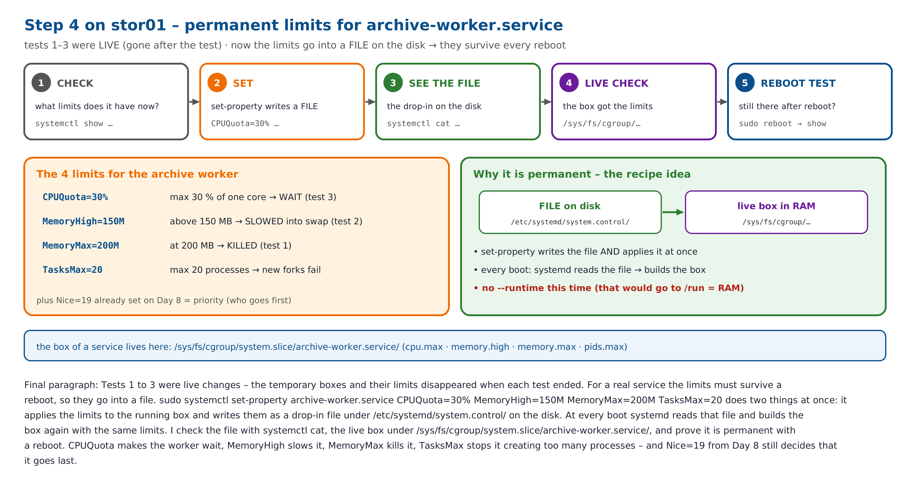

### 1.1 Before

```bash
systemctl status archive-worker --no-pager
```

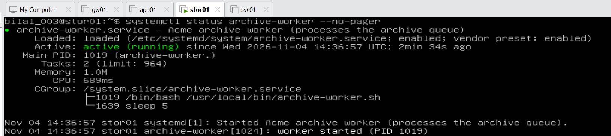

Active (running), its box `/system.slice/archive-worker.service` holds the worker script (PID 1019) and its `sleep 5`. `Tasks: 2 (limit: 964)` – 964 is the default.

```bash
systemctl show archive-worker -p CPUQuotaPerSecUSec -p MemoryHigh -p MemoryMax -p TasksMax -p Nice
```

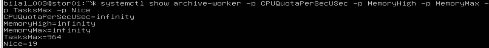

`infinity` = no CPU or memory limit · TasksMax 964 = default · `Nice=19` from Day 8 (priority only – no cap).

### 1.2 Set the limits permanently

```bash
sudo systemctl set-property archive-worker.service CPUQuota=30% MemoryHigh=150M MemoryMax=200M TasksMax=20
```

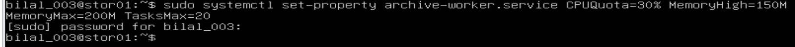

No output = success. **No `--runtime`** – so the limits are applied at once **and** written to disk.

| Limit | For the worker |
|---|---|
| `CPUQuota=30%` | max 30 % of one core – waits above it (test 3) |
| `MemoryHigh=150M` | slowed into swap above 150 MB (test 2) |
| `MemoryMax=200M` | killed at 200 MB (test 1) – `Restart=on-failure` starts it again |
| `TasksMax=20` | max 20 processes – an endless fork cannot fill the PID pool |

### 1.3 The files on the disk

```bash
systemctl cat archive-worker
```

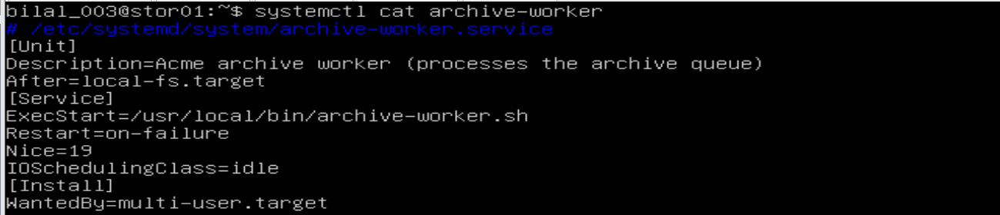

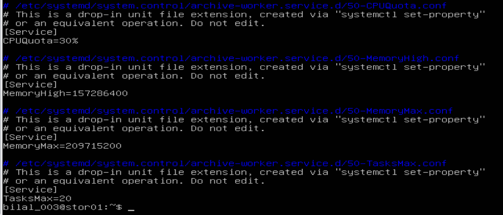

My Day 8 unit file is unchanged; four drop-ins `50-CPUQuota.conf`, `50-MemoryHigh.conf`, `50-MemoryMax.conf`, `50-TasksMax.conf` were added in `/etc/systemd/system.control/archive-worker.service.d/` ("Do not edit" – change them with set-property). Memory is stored in bytes: 157286400 = 150 MB, 209715200 = 200 MB.

### 1.4 The live box

```bash
cd /sys/fs/cgroup/system.slice/archive-worker.service/
cat cpu.max memory.high memory.max pids.max
```

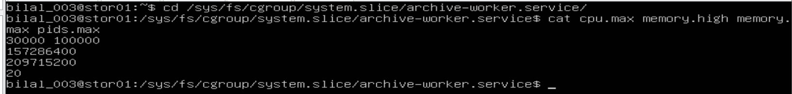

`30000 100000` (30 %) · 150 MB · 200 MB · 20 – the drop-in is the recipe, these values are the live box the kernel enforces.

### 1.5 Reboot test

```bash
sudo reboot
systemctl show archive-worker -p CPUQuotaPerSecUSec -p MemoryHigh -p MemoryMax -p TasksMax -p Nice
cat /sys/fs/cgroup/system.slice/archive-worker.service/cpu.max
```

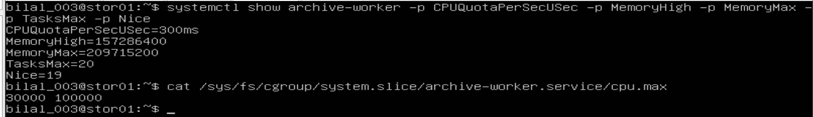

`CPUQuotaPerSecUSec=300ms` (30 %), both memory limits, `TasksMax=20`, `Nice=19`, `cpu.max 30000 100000` – RAM was emptied, yet systemd rebuilt the box from the files. ✅ Permanent.

### 1.6 Step 4 explained – how the limits really work

💡 **CPUQuota=30%:** the kernel cuts CPU time into periods of 100 ms; the box may run 30 ms in each (`cpu.max 30000 100000`), at full speed, then waits only until the next period – the clock refills the budget 10 times per second. The other 70 ms go to whatever else needs the CPU (NFS, backups, any job); if nothing does, the CPU stays idle – CPUQuota is a hard cap. Like pocket money paid every day: the spending speed never changes, only the waiting.

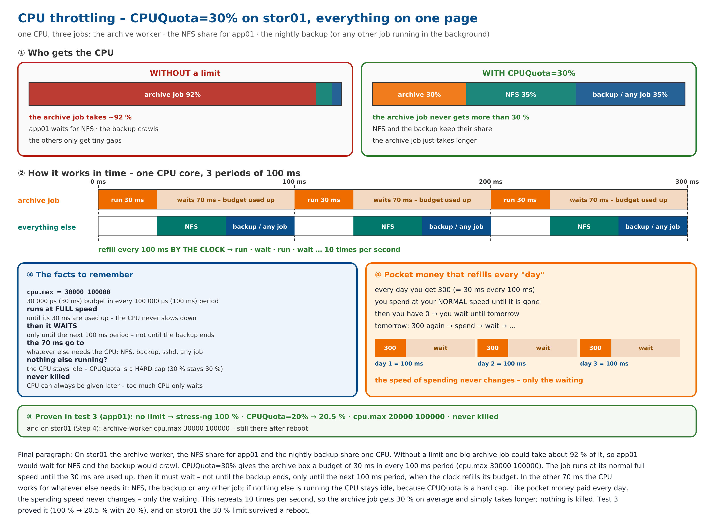

💡 **TasksMax vs restarts:** `TasksMax=20` = at most 20 processes alive in the box **at the same moment** (the 21st fork fails). Restarts are separate: `Restart=on-failure` restarts the service, `StartLimitBurst` / `StartLimitIntervalSec` limit how many starts in how much time (default 5 in 10 s).

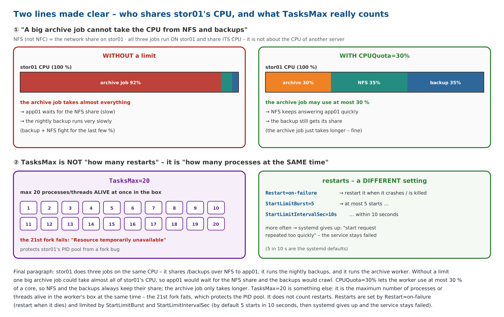

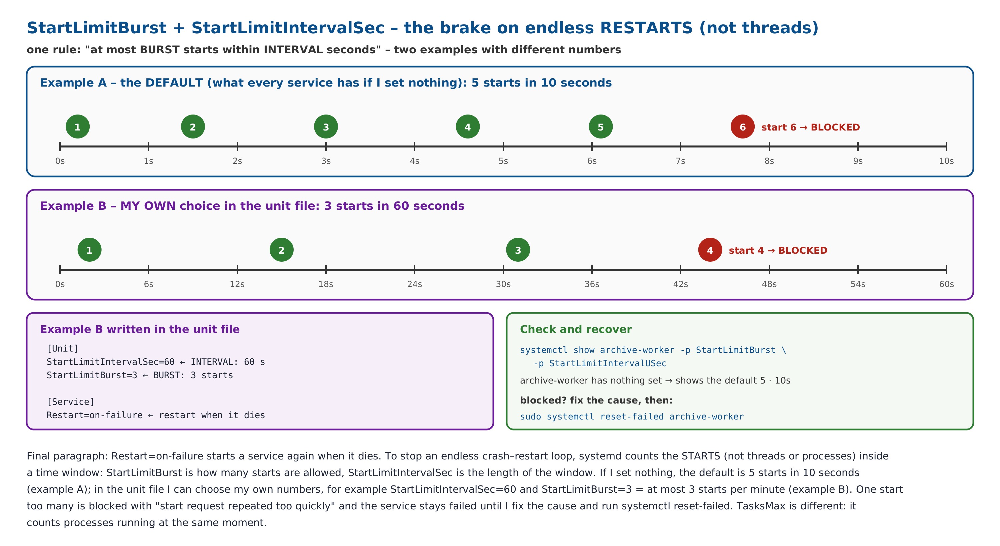

---

## 2. First incident drill (stor01) – "I deleted the file, but the disk is still full"

💡 **In plain words:** `rm` removes only a file's **name**. If a running program still has the file open, its data stays on the disk until that program closes it. `df` counts disk blocks (still full), `du` counts names (looks empty) – when they disagree, think "deleted but still open".

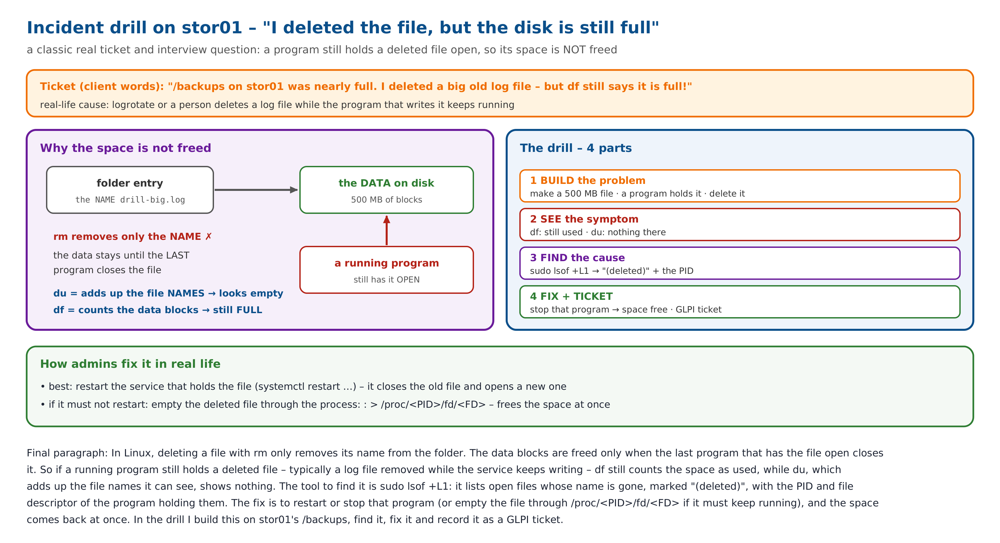

**The drill in plain words – final corrected version** (fallocate = file *allocate*; the **process** has the PID and holds the file open – a file has no PID and no parent; a copy shows the same effect for seconds, a service for weeks):

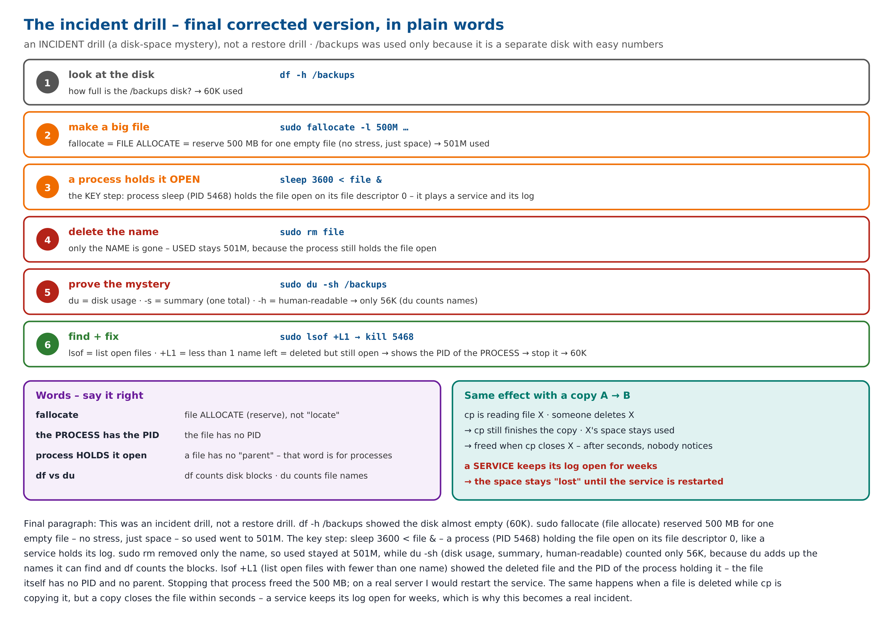

```bash
df -h /backups
```

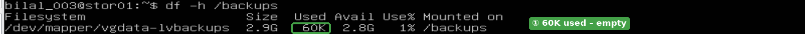

**① Before:** /backups (LVM volume, 2.9 GB) uses only **60K** – empty.

```bash
sudo fallocate -l 500M /backups/drill-big.log
```


No output = success – a 500 MB "log file" is reserved at once.

```bash
df -h /backups
```

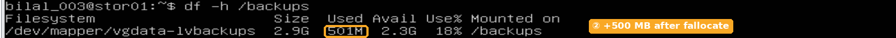

**② After fallocate:** **501M** used, 18 %.

```bash
sleep 3600 < /backups/drill-big.log &
```


**③** a program holds the file open – job [1], **PID 5468** – a stand-in for a service keeping its log open.

```bash
sudo rm /backups/drill-big.log
```


No output = the file **name** is deleted.

```bash
df -h /backups
```

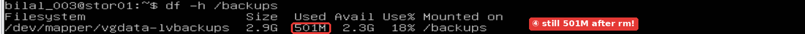

**④ The problem:** still **501M** used after `rm` – df counts the data blocks.

```bash
sudo du -sh /backups
```


**⑤ The contradiction:** du adds up the file names it can find → only **56K**.

```bash
sudo lsof +L1
```


**⑥ The cause:** open files with no name left – `sleep`, **PID 5468**, **524288000** bytes, NLINK 0, **(deleted)**.

```bash
kill 5468
```


Stop the program that holds the file.

```bash
df -h /backups
```

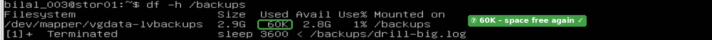

**⑦ Fixed:** back to **60K** – the 500 MB were freed when the last program closed the file.

**On a real server:** restart the service holding the file (`sudo systemctl restart <service>`), or empty it in place with `: > /proc/<PID>/fd/<FD>` if it must keep running. Prevention: logrotate with `copytruncate` or a service reload – never delete open log files by hand.

📸 **The whole run, marked:**

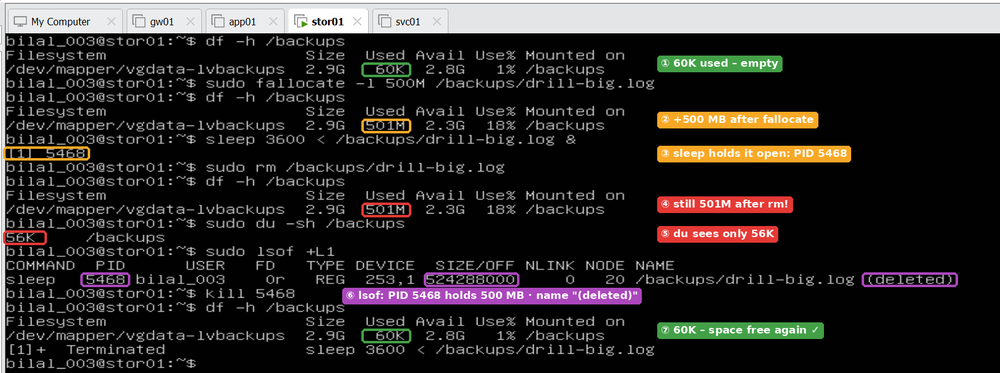

---

## 3. Closing Phase 4 in GLPI – Incident, Problem, snapshot

💡 **In plain words (ITIL):** an **Incident** = one thing broke, fix it now · a **Problem** = why does it happen? find the root cause and fix it for good.

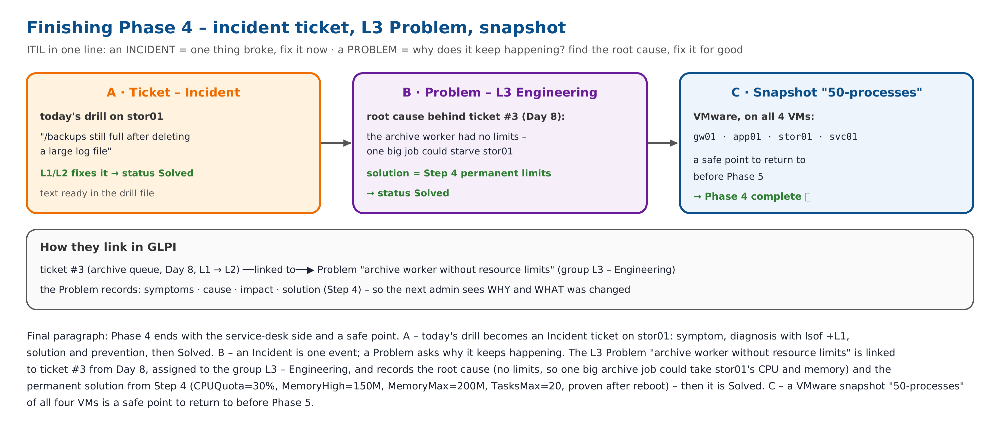

### 3.1 Incident ticket #4 – the drill

Requester **alice** (who reported it) · group **L2 – Linux Storage** · item **stor01** (what is broken) · Storage & Backup · symptom, lsof diagnosis, solution and prevention → solution accepted, ticket closed.

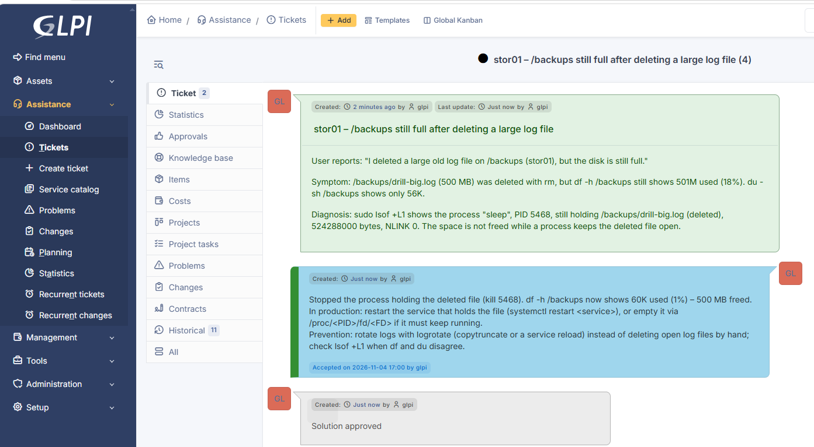

### 3.2 L3 Problem – "Archive worker on stor01 without resource limits"

The root cause behind **ticket #3** (Day 8, archive queue, L1 → L2), assigned to **L3-Admin**, created under **Assistance → Problems** (the same text under Tickets would create a ticket).

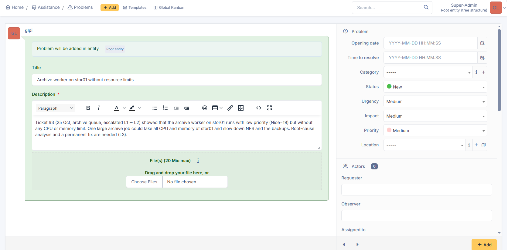

| Analysis | |
|---|---|
| Impacts | NFS share and nightly backups on stor01 could become slow or fail during a large archive job |
| Causes | archive-worker.service had no cgroup limits – only Nice=19 |
| Symptoms | high CPU and memory use while the worker processes a big job (ticket #3) |

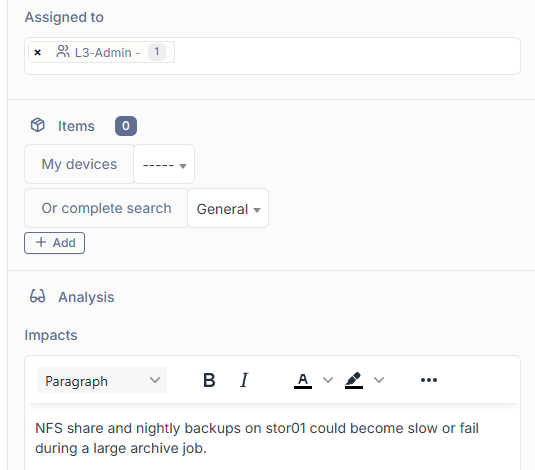

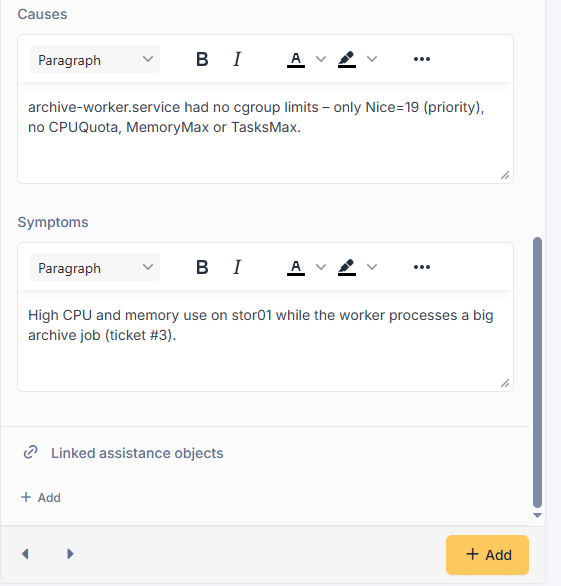

**Solution:** the Step 4 limits (CPUQuota=30%, MemoryHigh=150M, MemoryMax=200M, TasksMax=20) as drop-in files, verified live and after a reboot → approved.

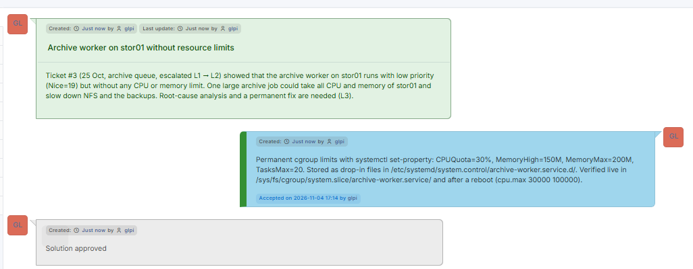

### 3.3 Snapshot

VMware snapshot **`50-processes`** on gw01, app01, stor01 and svc01 – *Phase 4 complete: processes, signals, limits, incident drill, L3 Problem*.

---

## 4. Key understanding (in my own words)

> The archive worker on stor01 now has permanent limits – CPUQuota=30%, MemoryHigh=150M, MemoryMax=200M, TasksMax=20 – written by `systemctl set-property` without `--runtime` as drop-in files in `/etc/systemd/system.control/archive-worker.service.d/`, next to my unchanged unit file; after a reboot every limit was back, because systemd builds the box from those files at every boot. In the incident drill a deleted 500 MB file stayed on the disk because a running process still held it open: `df` showed 501M, `du` only 56K, `lsof +L1` found PID 5468 with "(deleted)", and stopping it freed the space – on a real server I would restart the service and prevent it with proper log rotation. Both went into GLPI the ITIL way: Incident ticket #4 for the drill (fix it now) and an L3 Problem for the root cause behind ticket #3 (fix it for good). A snapshot `50-processes` closes Phase 4.

---

## 5. Next – before Phase 5, a quick revision (Phases 1–4)

💡 **5 minutes:** the six things from Phases 1–4 that come back in Phase 5 (journald, rsyslog, logrotate), and where Phase 5 is going – logs from every server to stor01.

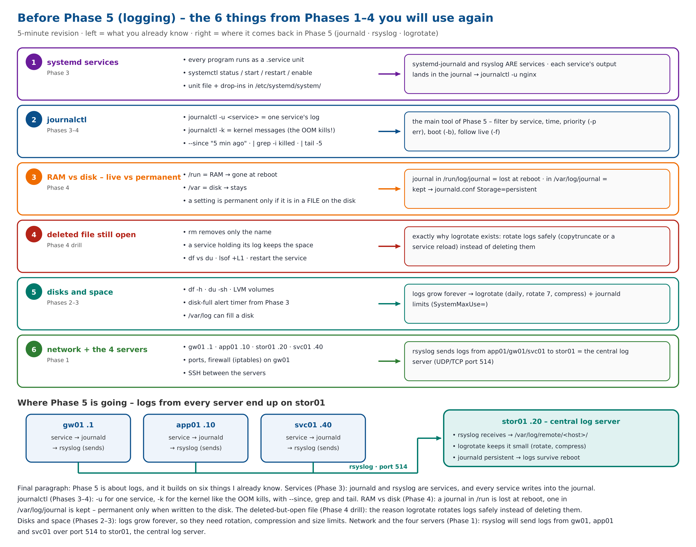
