# Day 14 – 2026-11-06/07: Phase 5 starts – how Linux runs a program and reads a file (Step 5.1 foundations)

| | |
|---|---|
| **Phase** | 5 – Logging (journald, rsyslog, logrotate) · Step 5.1: CPU, memory or disk – where is the bottleneck? |
| **Hosts worked on** | app01 |
| **Status** | Step 5.1 🟡 – foundations ✅ (user/kernel space, system calls, process cards, file tables, inodes, map cache, page cache, CPU states, vmstat columns) · warm-up on app01 ✅ · experiments A, B, C ⏳ |
| **Print copy** | [Day 14 study PDF](Project-2-Day-14-study.pdf) |

**How to read this report:** every section starts with the picture, then the commands with the real output from app01 under them, then a plain-language explanation. Each picture ends with a *final paragraph* that contains all corrections. New terms are in the [glossary](../glossary.md).

---

## 0. Phase 5 – the story, the goal and the plan

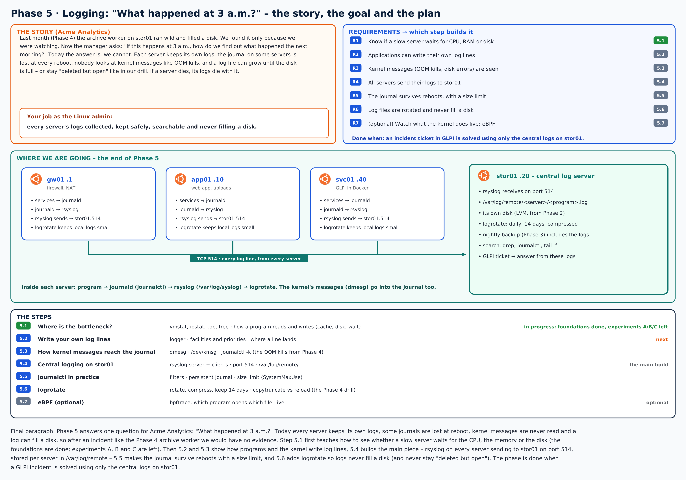

**The story:** after the Phase 4 incident the manager asks: *"If this happens at 3 a.m., how do we find out what happened the next morning?"* Today each server keeps its own logs, some journals are lost at reboot, kernel messages are never read and a log can fill a disk. Phase 5 collects every server's logs on stor01, keeps them safely and stops them from filling a disk. It is done when a GLPI incident is solved using only the central logs.

### Before Phase 5 – quick revision

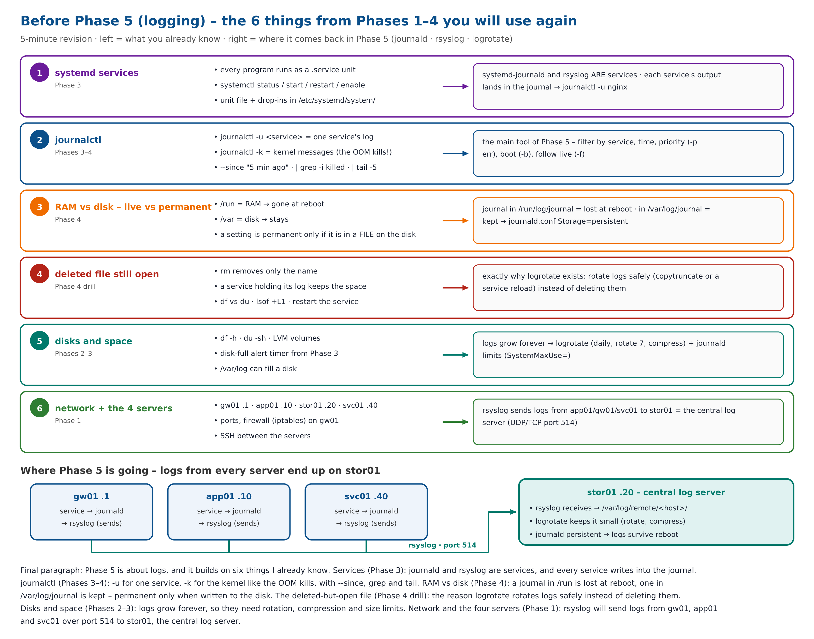

Phase 5 is about logs. Before collecting logs, Step 5.1 answers a simpler question first: **when a server is slow, which part is waiting – the CPU, the memory or the disk?** To read the answer from `vmstat` and `iostat`, you need to know what really happens inside Linux when a program runs and reads a file. That is what this day covers.

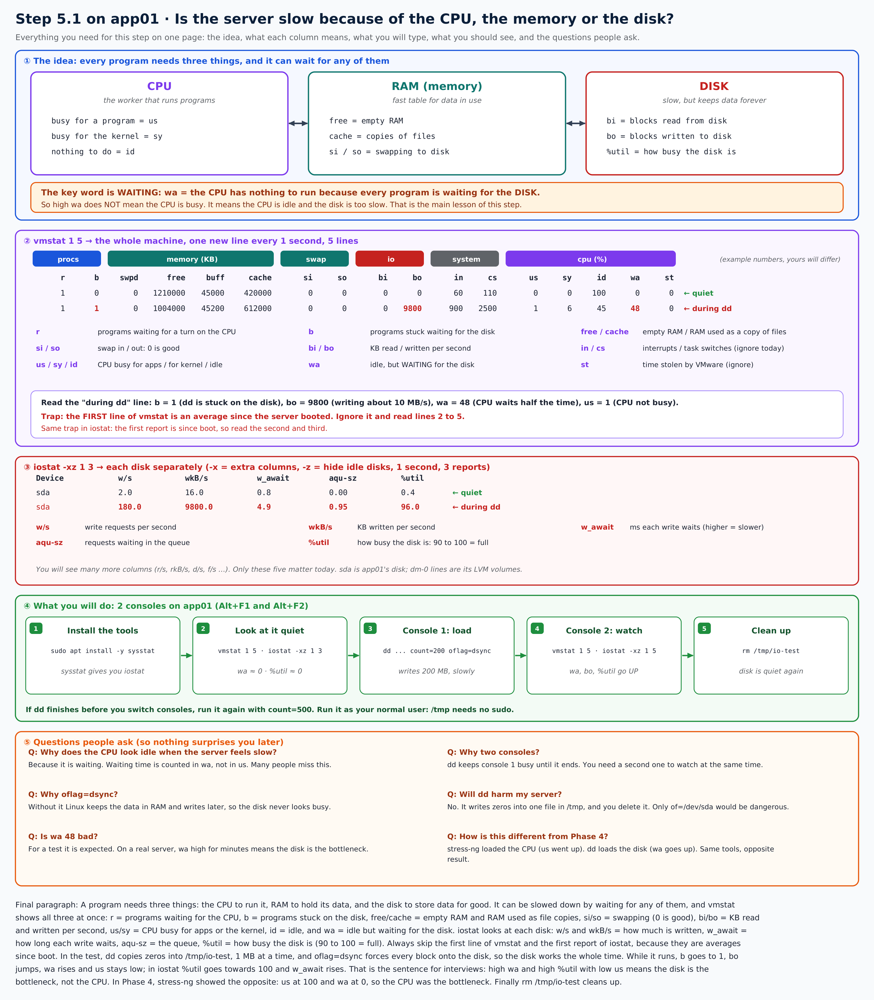

---

## 1. User space, kernel space and the system call

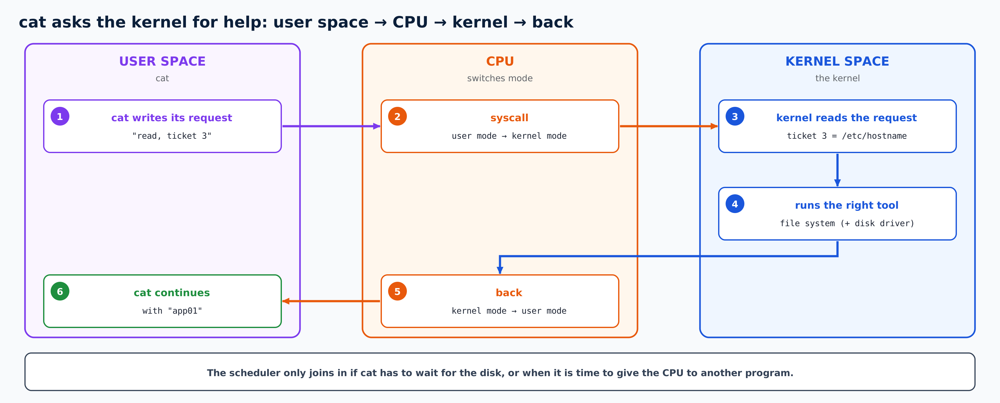

- **User space** is where programs live, each in its own walled room in RAM (its code and its data). The CPU runs them in **user mode** – counted as `us`.
- **Kernel space** is where the kernel lives. Only the kernel may touch the disk, the network or other programs. The CPU runs it in **kernel mode** – counted as `sy`.
- A program can only ask the kernel for help through a **system call** (open, read, write, fork, exec, exit). It writes a request number and the details into the CPU's registers and runs the `syscall` instruction; the CPU switches to kernel mode, the kernel does the job and the CPU switches back.

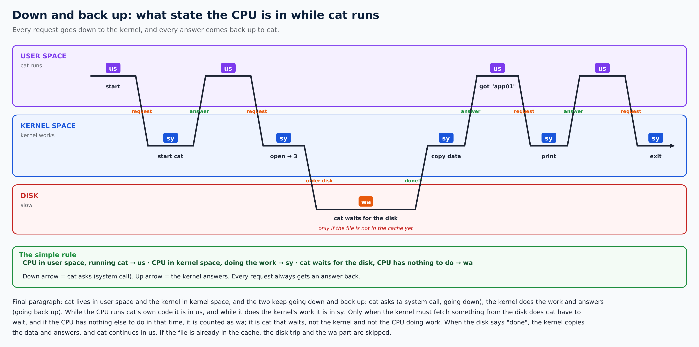

| CPU time | Meaning |
|---|---|
| `us` | running a program's own code (user mode) |
| `sy` | running kernel code for it (kernel mode) |
| `wa` | idle, because a program is waiting for the disk |
| `id` | idle, nothing to do |

Waiting is **never** counted as `us`.

---

## 2. Every program = a card in kernel space + a body in user space

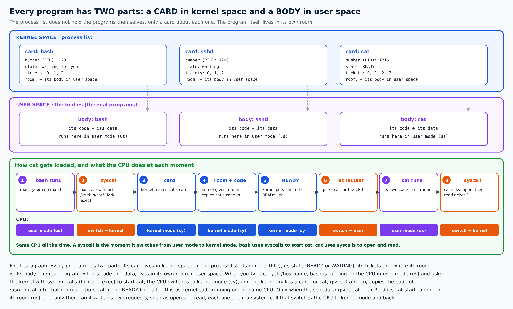

- When you type `cat F1`, **bash** asks the kernel with `fork` + `exec`. `fork` makes a **new card** (a new PID, parent = bash); `exec` puts cat's code into its new room. bash keeps its own card and waits.
- The card (real name: `task_struct`) holds the **PID**, the **parent PID**, the **state** and a pointer to the program's **file table** (fds 0, 1, 2 = keyboard, screen, errors).
- States: **R** = can run · **S** = sleeping (e.g. waiting for typing) · **D** = waiting for the disk.
- Every program and every service (systemd, journald, sshd, bash, cat) has its own card and its own file table.

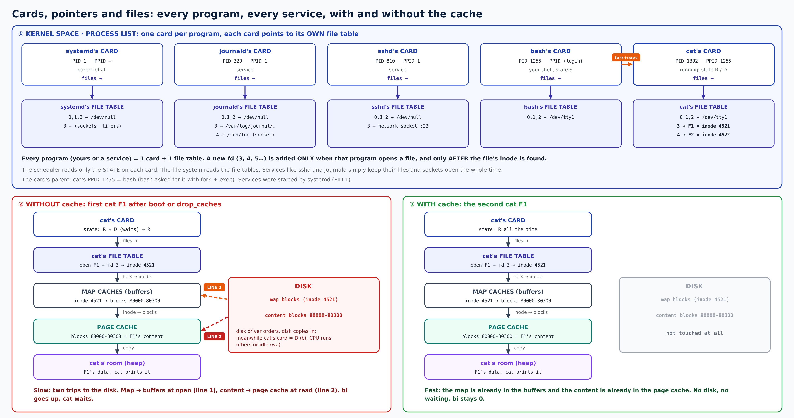

---

## 3. Where everything lives in RAM

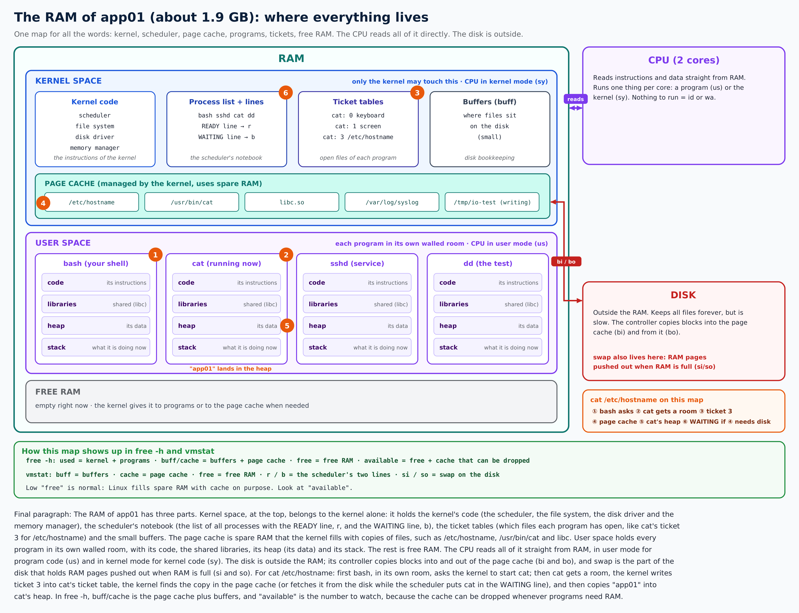

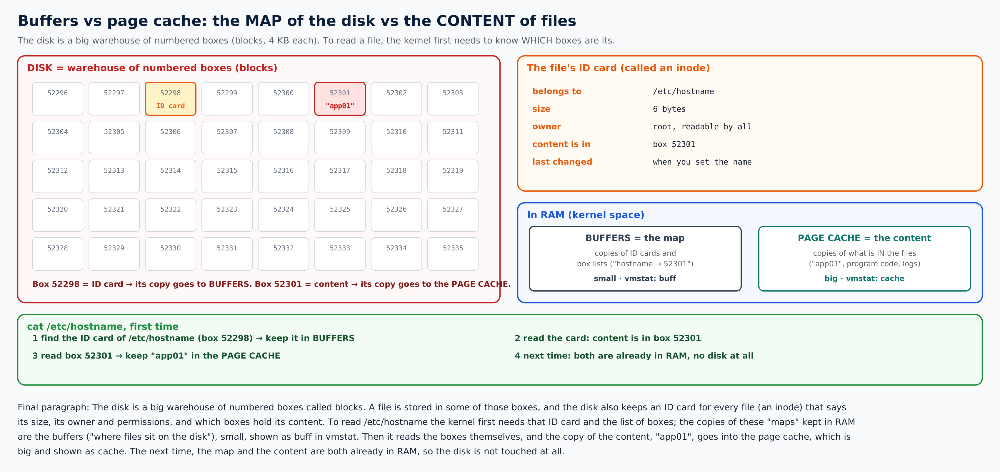

- **Map cache** (buffers, inode cache, dentry cache): RAM copies of the *map* – folder entries (name → inode number) and inodes (owner, size, **list of content blocks**). It holds **where** the content is, never the content.
- **Page cache**: RAM copies of file **content**.
- The disk keeps everything for good; the **disk driver** only fetches what RAM is missing.

---

## 4. `cat F1` from start to end – who does what

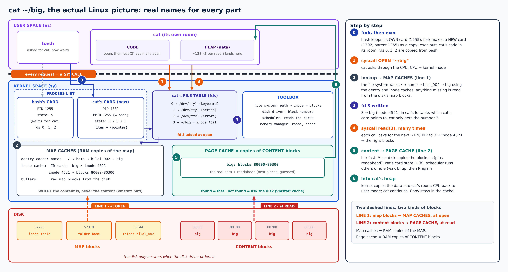

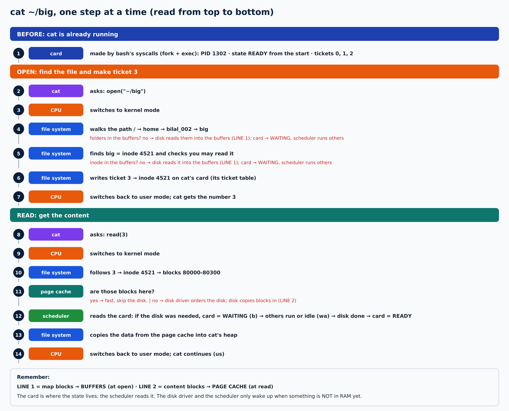

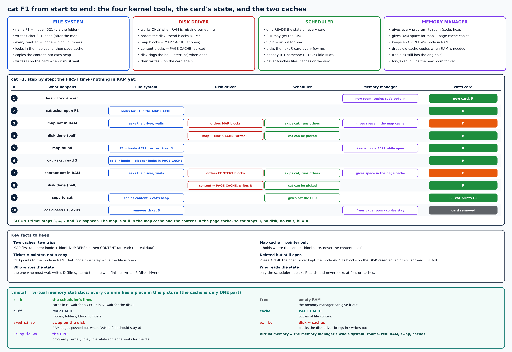

1. **open F1** – the file system looks up the map: folder → `F1 = inode 4521` → inode with the block list. Missing map blocks are fetched from the disk into the map cache (**line 1**).
2. Only **after** the inode is found is the ticket written: `3 → inode 4521` in cat's file table.
3. **read(3)** – fd 3 → inode → block numbers → page cache. Missing content blocks are fetched from the disk into the page cache (**line 2**).
4. While the disk works, the file system writes **D** on cat's card; the scheduler (which only reads the states) runs other programs or the CPU is idle (`wa`). When the disk rings its bell, the disk driver writes **R** again.
5. The content is copied from the page cache into cat's heap and cat continues. The second time, everything is already in RAM: no disk, no wait.

Every read and write crosses the wall as a **copy** – a little `sy` time and the data sits in RAM twice, but each program can only change its own copy:

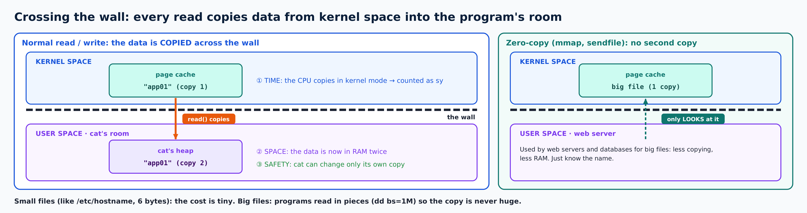

---

## 5. Link to Phase 4: deleted but still open

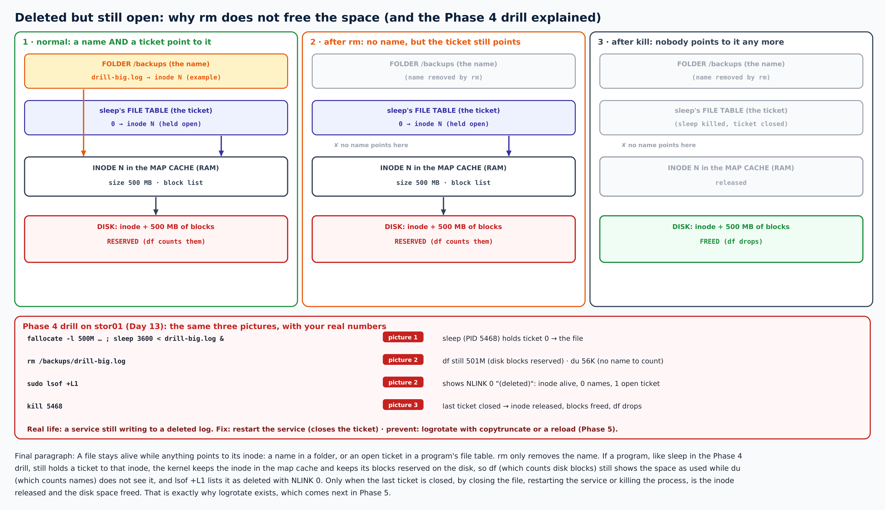

This explains the **first incident drill of Phase 4** ([Day 13, section 2](day-13-2026-11-04.md)):

| Drill step on stor01 | What happened inside |
|---|---|
| `sleep 3600 < /backups/drill-big.log &` | sleep's file table holds a ticket (fd 0) to the file's inode |
| `rm /backups/drill-big.log` | only the **name** is removed; the ticket still points to the inode |
| `df` 501M · `du` 56K | the inode stays in the map cache and its blocks stay **reserved on the disk**; `du` counts names, `df` counts disk blocks |
| `lsof +L1` → NLINK 0 "(deleted)" | the inode is alive with 0 names and 1 open ticket |
| `kill 5468` | the last ticket is closed → inode released, blocks freed, `df` drops |

In real life this is a service still writing to a deleted log – and the reason **logrotate** exists (later in Phase 5).

---

## 6. Warm-up on app01 – seeing it live

```bash
echo $$
grep -E 'Name|State|Pid' /proc/$$/status
ls -l /proc/$$/fd
free -h
sync; echo 3 | sudo tee /proc/sys/vm/drop_caches
free -h
```

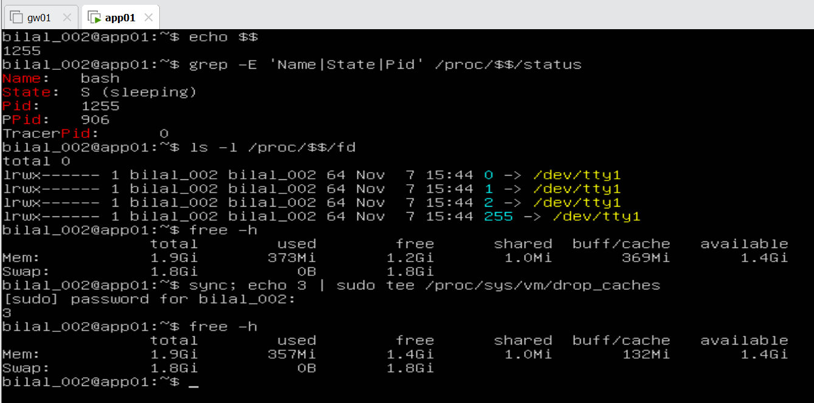

bash = PID 1255, state S (waiting for typing), parent 906 (the login program); tickets 0, 1, 2 point to the console `/dev/tty1` (255 is bash's own extra ticket). Dropping the caches took buff/cache from **369 Mi to 132 Mi** – the rest is in use by running programs.

```bash
time cat /usr/bin/bash > /dev/null     # 4 times
free -h
```

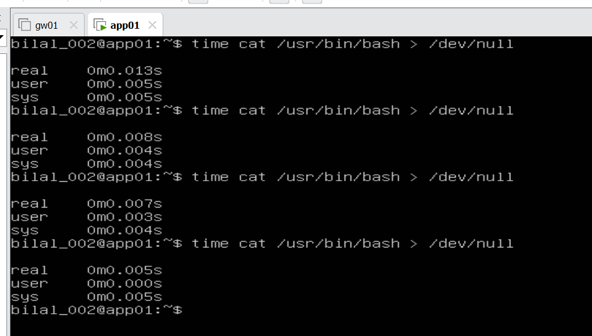

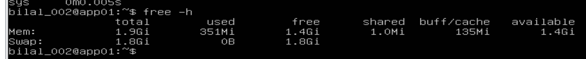

First read **13 ms** (from the disk), then 8, 7, **5 ms** (from the page cache); buff/cache grew from 132 to 135 Mi. The gap is small because the file is small and parts of bash were still in RAM.

```bash
top
```

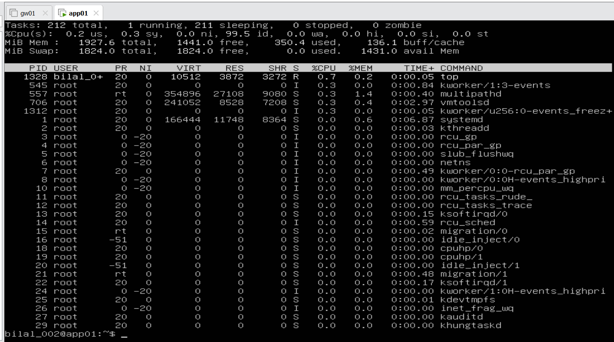

**212 tasks: 1 running, 211 sleeping** – 212 cards in the process list (systemd PID 1, vmtoolsd, multipathd, many kernel `kworker` helpers); CPU **99.5 % id, 0.0 wa**: nobody ready, nobody waiting for the disk.

```bash
dd if=/dev/zero of=~/big bs=1M count=300
sync; echo 3 | sudo tee /proc/sys/vm/drop_caches
vmstat 1          # second console
```

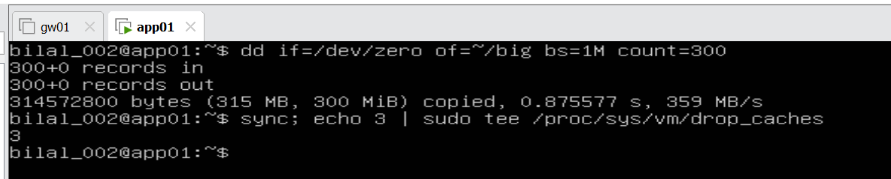

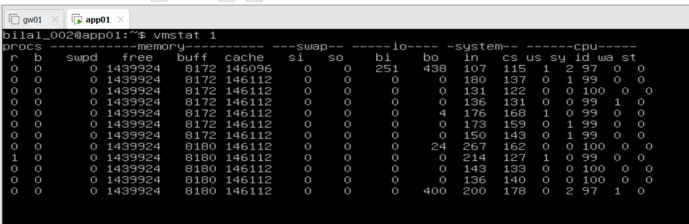

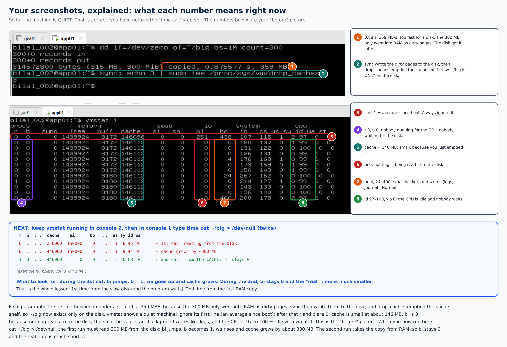

dd wrote 300 MB in 0.88 s (359 MB/s) – only into RAM as dirty pages; `sync` wrote them to the disk and `drop_caches` emptied the cache. vmstat shows the quiet "before" picture: skip line 1 (average since boot), then r 0, b 0, bi 0, small bo from background logs, id 97–100, wa 0.

---

## 7. Writing, compressing and mounts on the same map

**Case 1 – normal write:** RAM first (dirty pages), disk later (`bo` later).

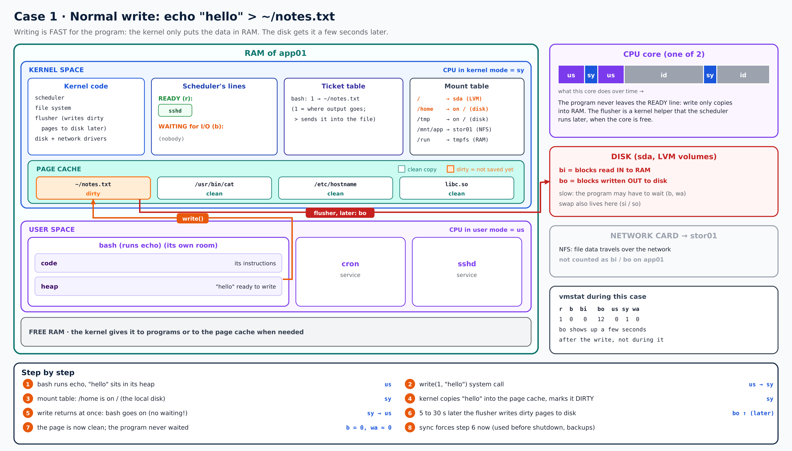

**Case 2 – the dd test:** `oflag=dsync` forces every MB to the disk, so dd waits (`b`, `wa`, `bo`).

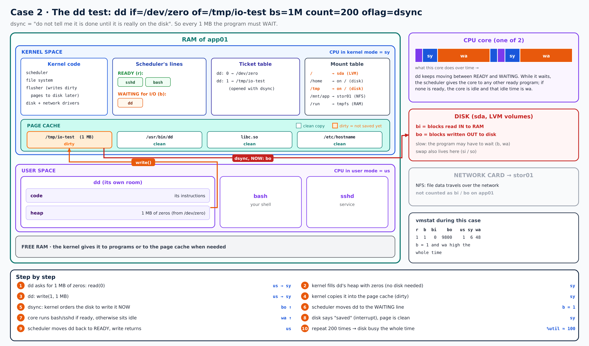

**Case 3 – compress:** the CPU works (`us` high, `r` up), the disk is quiet.

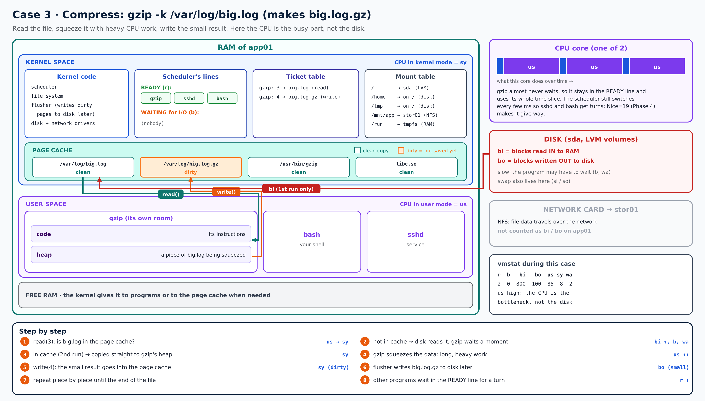

**Case 4 – mounts:** the folder decides the path – local disk, NFS to stor01 (`bo` shows on stor01), or tmpfs (RAM only).

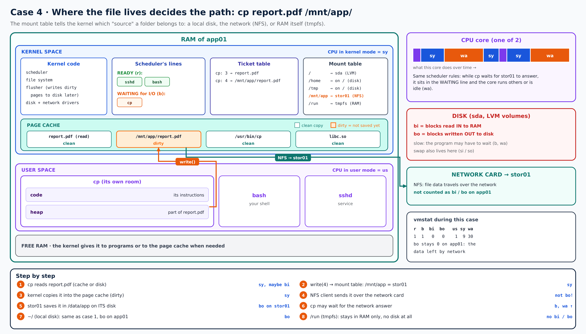

All four cases and the vmstat columns on one page:

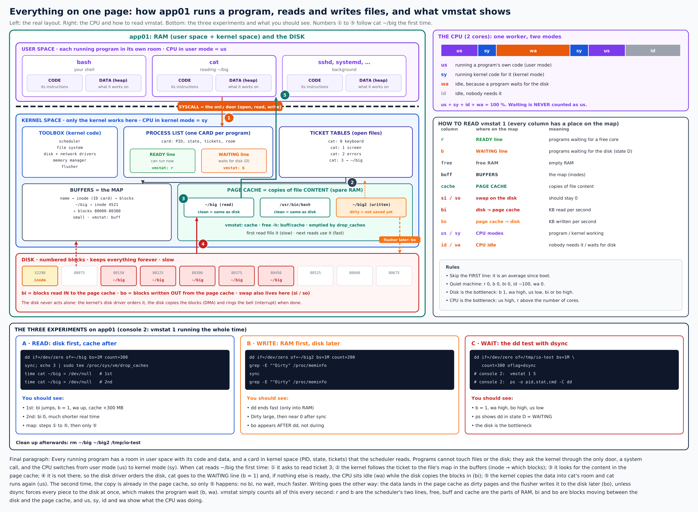

---

## 8. Next – Step 5.1 experiments

With `vmstat 1` running in a second console on app01:

- **A · read:** `time cat ~/big > /dev/null` twice → 1st: `bi` up, `b` = 1, `wa` up, cache +300 MB · 2nd: `bi` 0, much faster.
- **B · write:** `dd` without dsync, `grep ^Dirty /proc/meminfo`, `sync` → dirty pages first, `bo` later.
- **C · wait:** `dd … oflag=dsync` with `vmstat 1 5`, `iostat -xz 1 5` and `ps -o pid,stat,cmd -C dd` → `b` = 1, `wa` high, dd in state **D**.

Clean up afterwards: `rm ~/big ~/big2 /tmp/io-test`.

---

## Final understanding (one paragraph)

Every running program has a body in user space (its code and data) and a card in kernel space (PID, parent, state R/S/D, and a pointer to its own file table); bash makes cat's card with the system calls fork and exec, and every request after that also goes through a system call that switches the CPU from user mode (us) to kernel mode (sy). When cat opens F1, the file system first finds the map – the folder entry (name → inode number) and the inode (owner, size, block list) – from the map cache, or from the disk if it is missing, and only then writes ticket 3 → inode in cat's file table. When cat reads 3, the file system follows the inode to the block numbers and takes the content from the page cache, or, if it is missing, the disk driver fetches the content blocks into the page cache while the file system marks cat's card D, the scheduler (which only reads the states) runs other programs or leaves the CPU idle (wa), and the disk driver marks the card R again when the disk rings its bell; finally the content is copied into cat's heap. The second time, everything is already in RAM. Writes go the other way: into the page cache as dirty pages, to the disk later (bo), unless dsync forces them at once and makes the program wait. A file stays alive while any name or any open ticket points to its inode – which is why, in the Phase 4 drill, the deleted log still filled the disk until the process holding it was killed. vmstat simply counts all of this: r and b are the scheduler's lines, free, buff and cache are parts of RAM, si and so are swap, bi and bo are blocks moving between the disk and the caches, and us, sy, id and wa show what the CPU was doing.
