# Day 15 – 2026-11-08: Ticket #5 – "the sales report is slow the first time" (Step 5.1, part 2)

| | |
|---|---|
| **Phase** | 5 – Logging · Step 5.1: CPU, memory or disk – where is the bottleneck? |
| **Hosts worked on** | app01, stor01 |
| **Status** | Ticket #5 ✅ solved · story and reasons ✅ · check of last night (app01 + stor01) ✅ · Case A (proof) ✅ · solution in GLPI ✅ · vmstat recording during the read ✅ · Ticket #6 (Case B, writing) ✅ solved · Ticket #7 (Case C, waiting for the disk) ✅ solved → **Step 5.1 done** · Step 5.2 ✅ ticket #8 (script diary with logger) |

Step 5.1 continues as a real support case instead of a test for its own sake. The ticket is a practice ticket (a mock-up of the GLPI on svc01); the commands and screenshots are real output from my lab.

---

## ⭐ Start here – the ticket and the evidence

**The ticket in GLPI** (mock-up of the GLPI on svc01; the private follow-up holds the real checks):


**The solution (after Case A):** real numbers from app01, status *Solved*.


**As a reusable case study:** [runbook – "slow the first time, fast after"](../runbooks/slow-first-time-then-fast.md) (the real-life steps, without the lab test file).

**The evidence on one page:**


---

## 1. The ticket


Monday 09:07: Anna from Sales writes that the Daily Sales Report loads for a long time the first time and opens in a second after that, and asks whether app01 needs more CPU or RAM.

---

## 2. The two usual reasons


**Simple rule:** slow the first time, fast after = the file was not in RAM, so it came from the slow disk. Ask: was there a **restart** or a **backup** last night?

- **Reason 1 – update restart:** a restart deletes everything in RAM, so on Monday the report is not cached.
- **Reason 2 – nightly backup (no restart):** the backup copies every file disk → RAM → stor01. RAM gets full and the kernel **drops** the old copies in RAM – the report copy too. The file on the disk is safe. Files never go to swap.

### When RAM gets full – drop, swap, kill


| Step | What | Why |
|---|---|---|
| 1 · drop | copies of files in RAM (cache) are deleted | the original is on the disk |
| 2 · swap | idle program data (e.g. sshd waiting for the next login) is moved to swap on the disk – "cut and paste", nothing is lost | it has no file, so it cannot be dropped |
| 3 · kill | the OOM killer stops a program | last resort, nothing left to free |

This is the same order as `MemoryHigh` / `MemoryMax` for the archive worker in Phase 4.

---

## 3. Check 1 – what happened last night on app01

```bash
uptime
last reboot | head -3
journalctl --list-boots | tail -3
```


| Command | Answer from app01 |
|---|---|
| `uptime` | up 2:27, load 0.00 → the CPU is idle. app01 runs on UTC (Berlin = UTC+1). |
| `last reboot` | starts on Fri 18:08, Sat 15:42 and **Sat 21:31** → RAM was empty after Saturday 21:31 (reason 1). |
| `journalctl --list-boots` | the same starts with numbers: **0** = now, **-1** = the run before → the logs of each run can be opened. |

Notes: "still running" on every line means `last` never saw a clean shutdown – the VMs were stopped with VMware *Power Off* (use `sudo poweroff`). uptime is shorter than the time since 21:31 because a paused VM does not count paused time.

```bash
journalctl -b -1 -p err      # only errors of the previous run
```


Not part of this ticket, so not troubleshot: the SMBus and drive-cache lines appear on every VMware boot; "soft lockup / CPU stuck / watchdog timeout" appeared because Windows went to sleep with all four VMs running; "Failed to mount /mnt/app" means stor01 was not ready when app01 started.

---

## 4. Check 2 – when does the backup run on stor01?

```bash
systemctl list-timers --all | grep -i backups
sudo crontab -l
```


No result: the grep searched for "backup**s**", but the Phase 3 timer is called `nightly-backup.timer`. The root crontab is empty because the backup uses a systemd timer, not cron. Next:

```bash
systemctl list-timers --all | grep -i backup                       # last and next run
journalctl -u nightly-backup.service --since "3 days ago" | tail -5  # its log
```

---

## 5. Case A – the proof on app01

### Test setup (only in the lab)

In a real company the reports folder and the report already exist – the app writes the report every night. In the lab they do not, so for testing we make a folder and a heavy 300 MB file that stands in for the report (`dd` copies zeros from `/dev/zero` as filler: 1 MB × 300), and check it:

```bash
sudo mkdir -p /srv/reports
sudo dd if=/dev/zero of=/srv/reports/daily-sales.csv bs=1M count=300
ls -lh /srv/reports/
```

### The real scenario

**1. The weekend** – emptying the cache plays the restart and backup that push the report out of RAM; `free -h` is the "before" photo.

```bash
sync; echo 3 | sudo tee /proc/sys/vm/drop_caches
free -h
```

**2. The camera** – vmstat records CPU, RAM and disk every second in the background.

```bash
vmstat 1 20 > ~/vm.txt &
```

**3. Monday 09:02 – Anna clicks twice** – `time` measures each read.

```bash
time cat /srv/reports/daily-sales.csv > /dev/null    # 1st click – from the disk
time cat /srv/reports/daily-sales.csv > /dev/null    # 2nd click – from RAM
```

**4. The "after" photo** and **5. the recording**:

```bash
free -h
wait; cat ~/vm.txt
```

### What we saw (yellow = what to look at)


| | Run 1 | Run 2 |
|---|---|---|
| 1st read (disk) | **12.0 s** | **1.2 s** |
| 2nd read (RAM) | **0.086 s** | **0.092 s** |
| buff/cache before → after | 155 → 455 Mi | 155 → 457 Mi |


Both runs show the same pattern: slow the first time (disk), fast after (RAM), and the cache grows by the 300 MB report. The first read was 12 s in run 1 and 1.2 s in run 2 because in a lab the Windows PC also caches the VM's disk file, so the "disk" speed varies. In run 1 almost all the time was `sys` – the VM counts the disk work as kernel time.

The first vmstat file missed the moment (the camera ran while the next command was being typed). The retake starts the camera and the read in **one line**:

```bash
sync; echo 3 | sudo tee /proc/sys/vm/drop_caches
vmstat 1 8 > ~/vm.txt & time cat /srv/reports/daily-sales.csv > /dev/null
cat ~/vm.txt
```

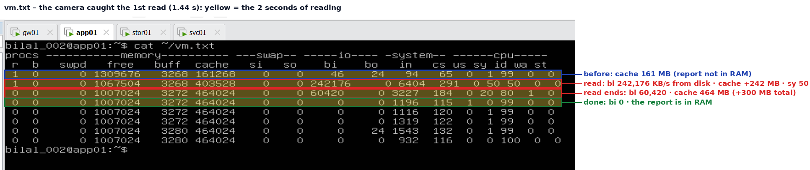

| vmstat line | What it shows |
|---|---|
| before | cache 161 MB – the report is not in RAM |
| 1st second of reading | **bi 242,176** KB/s from the disk · cache +242 MB · **sy 50** |
| 2nd second | bi 60,420 · cache **464 MB** – about +300 MB, the whole report |
| after | bi 0 – the report is in RAM, nothing more comes from the disk |

Together the two `bi` lines are about **300 MB from the disk** – exactly the report. `sy 50 / id 50` means one of app01's two CPUs was busy in the kernel fetching and copying the blocks (this virtual disk is fast, so it shows as `sy`, not as `wa` waiting). Swap stayed 0. The first read took 1.44 s.

A small slip on the way: the first `dd` had `reports-daily-sales.csv` (dash instead of slash), so `cat` found no file; it was moved with `mv` into `/srv/reports/`.

---

## 6. Case B – ticket #6: "Upload says Saved at once – is my file really on the server?"

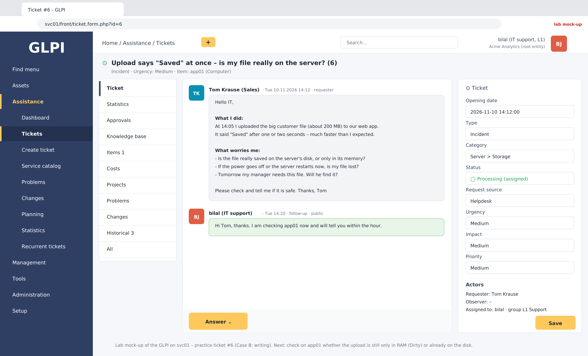

Tom uploaded a 200 MB file and saw "Saved" after a second or two. He worries it is only in the server's memory and could be lost after a power cut or restart.

**Test setup (lab only)** – in a real company the app already has an uploads folder:

```bash
sudo mkdir -p /srv/uploads
```

**Tom's upload** – 200 MB, about 10 % of app01's 2 GB RAM, so the kernel starts writing it to the disk in the background (writeback) while the upload is still running; that is why `dd` took 9.8 s:

```bash
sudo dd if=/dev/zero of=/srv/uploads/tom-upload.bin bs=1M count=200
```


### How the admin checks it (in this order)

**① Where does the folder live – disk or RAM?** A folder under `/` is not automatically on the disk (`/run` and `/dev/shm` live only in RAM). `df` shows the mount: `/srv/uploads` is on `/dev/mapper/ubuntu--vg-ubuntu--lv`, app01's real disk (LVM), mounted on `/`.

```bash
df -h /srv/uploads
```


**② Is the file there?** `ls` shows `tom-upload.bin`, 200M.

```bash
ls -lh /srv/uploads
```


**③ Is anything still waiting in RAM to be written?** Instead of opening the whole file, check Dirty = new data still pending in RAM. **0 kB** → nothing waiting, everything is written to the disk. (Dirty counts the whole server, not one file – 0 means nothing at all is pending, so Tom's file is included.)

```bash
grep -E "^Dirty" /proc/meminfo
```


**④ Only if Dirty is above 0: force it.** `sync` writes all pending data to the disk now; then Dirty drops to 0. Here it was already 0, so `sync` was only a safety step. (`sync` saves new data; `drop_caches` deletes copies – not the same.)

```bash
sync
grep -E "^Dirty" /proc/meminfo
```


**All steps on one page (yellow = what to read):**

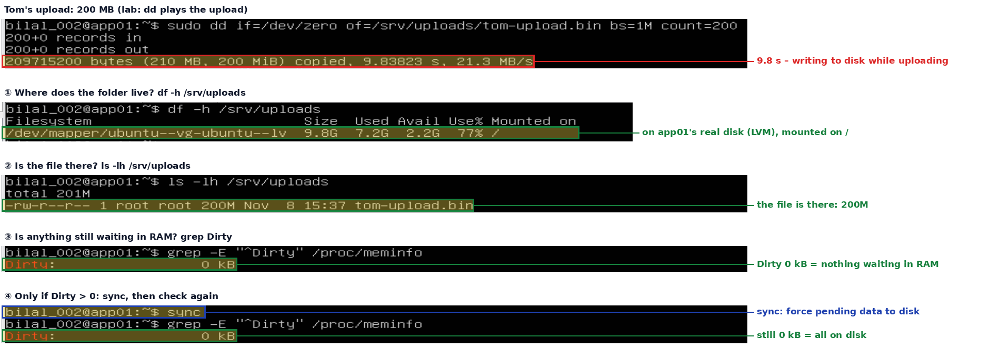

**Answer in GLPI – solved:**


**Optional retake** to *see* data waiting in RAM: a smaller 50 MB upload, checked in the same line – right after, after 10 s, after `sync`:
`sudo dd if=/dev/zero of=/srv/uploads/tom-upload2.bin bs=1M count=50; grep ^Dirty /proc/meminfo; sleep 10; grep ^Dirty /proc/meminfo; sync; grep ^Dirty /proc/meminfo`

---

## 7. Case C – ticket #7: "Saving an order takes 3–5 seconds – is the server too slow?"

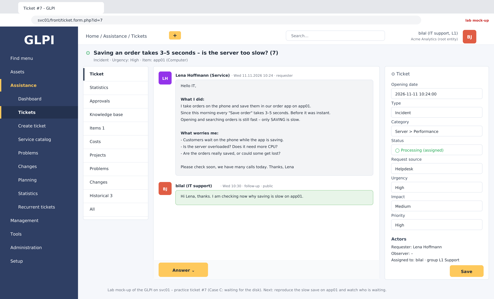

### Tom vs Lena

| | Tom (ticket #6) | Lena (ticket #7) |
|---|---|---|
| What he/she does | **one** big upload, once | saves **many small orders**, all day |
| How the app writes | normal: **RAM first**, disk a few seconds later | **dsync**: each order **straight to the disk**, the app waits until it is there |
| What they see | "Saved" very fast | "Saved" slow (3–5 s) – in the lab: dd prints "copied" and bash shows `[1]+ Done` |
| What they worry about | is my file really on the disk? | is the server / CPU too slow – do we need more CPU? |

### Test setup (lab only)

In real life the order app's user owns its data folder. In the lab we make the folder and give it to our user, so `dd` can run in the background without `sudo` (a background `sudo` asks for a password and gets **Stopped**):

```bash
sudo mkdir -p /srv/orders
sudo chown -R bilal_002: /srv/orders
ls -l /srv/orders
```

### ① Save 3000 small orders the safe way (dsync) and watch who waits – one line

```bash
dd if=/dev/zero of=/srv/orders/orders.db bs=4k count=3000 oflag=dsync & sleep 1; ps -o pid,stat,cmd -C dd; vmstat 1 3; wait
```

`bs=4k count=3000` = 3000 small orders of 4 KB · `oflag=dsync` = each one straight to the disk, wait until it is there · `ps` = the program's state · `vmstat` = the camera.

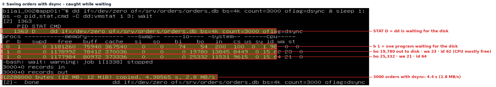

**STAT D** = dd is waiting for the disk · **b 1** = one program waiting · **bo** 19,780 / 25,332 = orders going out to the disk · **wa** 21–23 = the CPU sits idle because of the waiting · **id** 62–64 = the CPU is mostly free · **r** 1 = only dd itself (app01 has 2 CPUs). Result: 12 MB in 4.4 s (2.8 MB/s). In another run `ps` caught dd in **R** – the program switches between running and waiting thousands of times, the camera just catches one moment.

### ② The same 3000 orders the normal way (RAM first) – for comparison

```bash
dd if=/dev/zero of=/srv/orders/orders-normal.db bs=4k count=3000
```

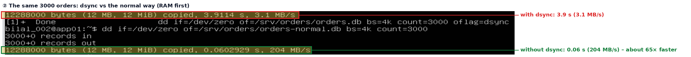

**With dsync 3.9 s (3.1 MB/s) – without dsync 0.06 s (204 MB/s): about 65× faster.** The difference is only the waiting for the disk.

### Where dsync lives in real life

In the lab we typed `oflag=dsync` by hand to see the waiting. In a company nobody types it – the order app's **database** is set once to wait for the disk on every saved order (example settings, not from our lab):

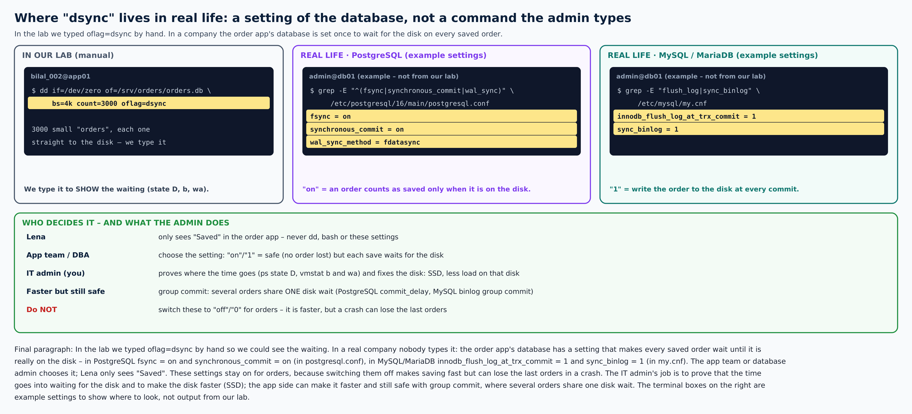

**App server + database server:** in real life the app sends the order to a database server, and the waiting happens on the database's disk:

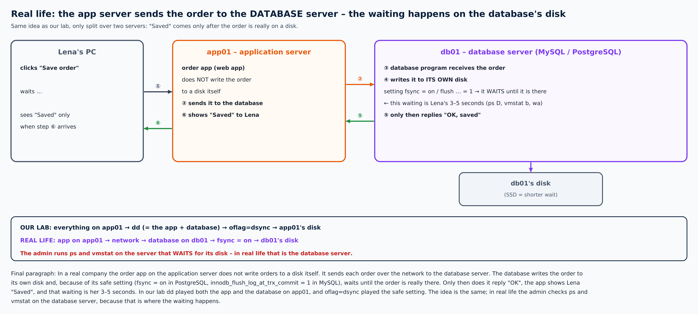

### Ticket #7 in one place – the summary

**The ticket:** Lena takes orders by phone and saves them in the order app. Every save takes 3–5 seconds before she sees "Saved". She thinks the server is overloaded and asks whether app01 needs more CPU.

**Why it is slow:** the order app must never lose an order, so it uses the safe way – each order is written straight to the disk, and the app waits until the disk confirms it. Only then "Saved" appears. Tom's upload (ticket #6) used the normal way – RAM first, disk a few seconds later – so it was fast, and we had to check afterwards that it reached the disk. With the safe way, "Saved" (in the lab: dd's "copied" and `[1]+ Done`) already means "on the disk", so there is nothing more to check.

**How we proved it on app01:** `dd … oflag=dsync` played the order app saving 3000 small orders the safe way. While it ran, `ps -o pid,stat,cmd -C dd` showed dd's state: **D** = waiting for the disk (it switches between D and R – running – thousands of times; `ps` catches one moment). `vmstat 1 3` showed **b 1** (one program waiting for the disk), **wa ~20** (CPU idle because of the waiting) and **id ~60** (CPU mostly free). The same 3000 orders without dsync took 0.06 s instead of about 4 s.

**Answer:** the CPU is not the problem – more CPU would not help. The time is the wait for the disk. Fix: a faster disk (SSD), or the app saves orders in groups (one disk wait for several orders). Do not switch the safe setting off – a crash could lose the last orders.

**Recommendation to the company:** the orders are already safe, so Lena can keep working. To make saving faster *and* keep it safe, the admin opens a **Change request** in GLPI to the IT manager: move the order database to an **SSD**. An SSD has much higher **I/O performance** (I/O = input/output, reading and writing), so each "wait for the disk" is much shorter. After the change, run the same test again and compare the times. The app team can also save orders in groups.

**Recommendation to the company:** the orders are already safe, so Lena can keep working. To make saving faster *and* keep it safe, the admin opens a **Change request** in GLPI to the IT manager: move the order database to an **SSD**. An SSD has much higher **I/O performance** (I/O = input/output, reading and writing), so each "wait for the disk" is much shorter. After the change, run the same test again and compare the times. The app team can also save orders in groups.

**In a real company:** the order app on the application server does not write orders to its own disk. It sends each order from its RAM over the network to the database server. The database program writes it to *its own* disk and waits (setting `fsync = on` in PostgreSQL, `innodb_flush_log_at_trx_commit = 1` in MySQL – nobody types dsync by hand), then answers "OK", and only then the app shows "Saved". So the admin runs `ps` and `vmstat` on the database server – that is where the waiting happens. The application server's own disk holds the app, its configuration and its logs.

### Answer in GLPI – solved

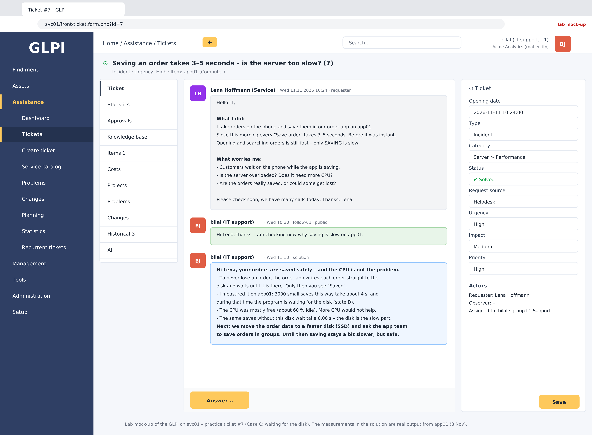

**All steps on one page:**

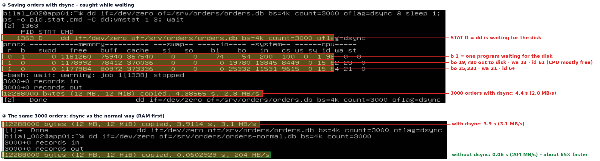

On the way: a background `sudo dd` was **Stopped** (it wanted a password); a `dd` before `chown` got **Permission denied**; old files still belonged to root, so `chown -R`; a stopped job is removed with `kill -9 %1`.

**Final paragraph:** Tom uploaded one big file once; his app used RAM first and the disk a few seconds later, so it was fast and his only worry was whether it reached the disk. Lena saves many small orders all day; her order app uses dsync so no order is ever lost – each order goes straight to the disk and the app waits until it is there before showing "Saved" (in the lab: "copied" and `[1]+ Done`). She thinks the server or CPU is overloaded. If the CPU were busy with other programs, more cores would help – but vmstat showed it mostly free (id 62–64, r 1 on 2 CPUs) while dd sat in state D, b was 1 and wa about 20. The same 3000 orders took about 4 s with dsync and 0.06 s without it, so the slow part is the trip to the disk, which a faster CPU cannot shorten. The fix is a faster disk (SSD) or an app that saves orders in groups – not more CPU.

---

## 8. Step 5.2 – ticket #8: "Black Friday – the stores still show old prices"

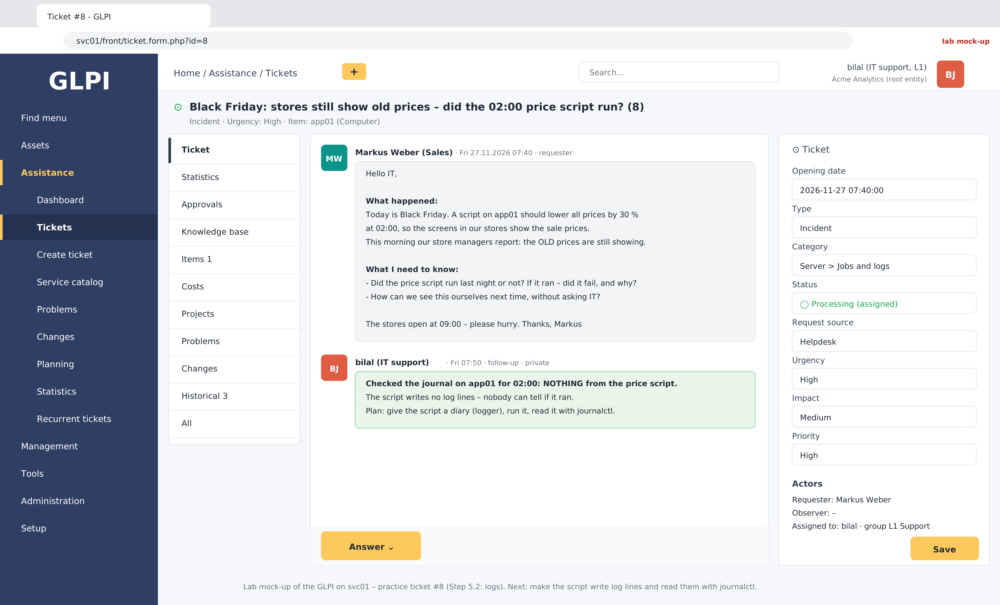

**The story:** a clothing company (Acme Fashion – made-up name) gets its store prices from the company database. For Black Friday a script on app01 should lower all prices by 30 % at 02:00. In the morning the store screens still show the old prices. Markus (Sales) asks: did the script run, did it fail and why – and how can we see it ourselves next time? The journal has **nothing** from the script, because it writes no log lines.

**Goal of Step 5.2:** give the script a diary with `logger`, so that one command – `journalctl -t price-update` – answers "did it run, and did it fail?".

**Before, without a story:** `logger` writes one line into the journal; `-t price-update` gives it a name tag; `-p user.err` marks it as an error (shown in red); `journalctl -t price-update` shows only that script's lines.

### Test setup (lab only)

```bash
sudo mkdir -p /srv/shop-prices
sudo chown -R bilal_002: /srv/shop-prices
df -h /srv/shop-prices      # on app01's disk
```

`/srv/shop-prices/current-prices.csv` = today's prices (the script reads it) · `blackfriday-prices.csv` = 30 % lower (the script writes it).

### A · The script as it was – no log lines

```bash
#!/bin/bash
# Black Friday: lower all prices by 30 % – version 1, no log lines
awk -F, '{ printf "%s,%.2f\n", $1, $2*0.7 }' /srv/shop-prices/current-prices.csv > /srv/shop-prices/blackfriday-prices.csv 2>/dev/null
```

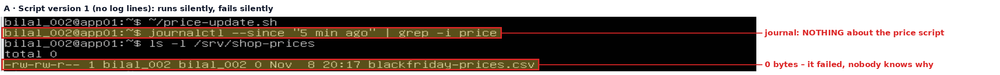

It runs silently, the journal has nothing, and the result file is 0 bytes: it failed, and nobody can say why. (A first try had a typing mistake in a `'` – bash said "unexpected EOF while looking for matching `'`" – fixed in nano.)

### B · The same script with a diary (`logger`)

```bash
#!/bin/bash
# Black Friday: lower all prices by 30 % – version 2, with log lines
logger -t price-update "started"
if [ ! -f /srv/shop-prices/current-prices.csv ]; then
  logger -t price-update -p user.err "FAILED: /srv/shop-prices/current-prices.csv is missing"
  exit 1
fi
awk -F, '{ printf "%s,%.2f\n", $1, $2*0.7 }' /srv/shop-prices/current-prices.csv > /srv/shop-prices/blackfriday-prices.csv
logger -t price-update "done: $(wc -l < /srv/shop-prices/blackfriday-prices.csv) prices changed"
```

| Line | Meaning |
|---|---|
| `logger -t price-update "started"` | write "started" in the diary |
| `if [ ! -f … ]; then … fi` | if the price file does **not** exist: write an error line with the reason and stop (`exit 1`) |
| `awk -F, '…$2*0.7…'` | read each line (columns split by commas), print name and price × 0.7 into the Black Friday file |
| `logger … "done: $(wc -l < …) prices changed"` | write "done" and how many lines (prices) were written |

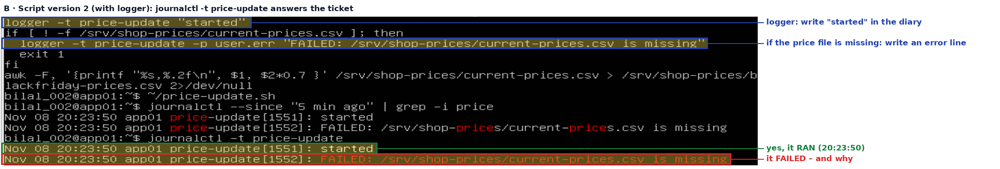

`journalctl -t price-update` now answers Markus: **started** at 20:23:50 (it ran) and **FAILED: … current-prices.csv is missing** in red (why). The numbers in `[1551]`, `[1552]` are PIDs – every `logger` call is its own small program.

### C · Fix the cause and run again

```bash
printf "shirt,20\njeans,50\njacket,120\n" > /srv/shop-prices/current-prices.csv
~/price-update.sh
journalctl -t price-update
cat /srv/shop-prices/blackfriday-prices.csv
```

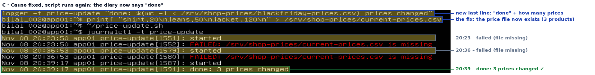

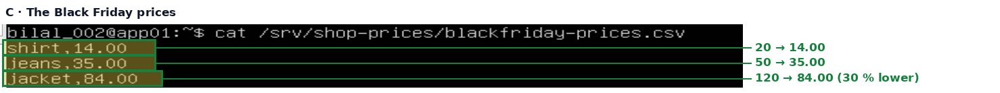

The diary now shows the whole history: two failed runs (file missing) and then **done: 3 prices changed**; the prices are 30 % lower (20 → 14, 50 → 35, 120 → 84).

**All steps on one page:**

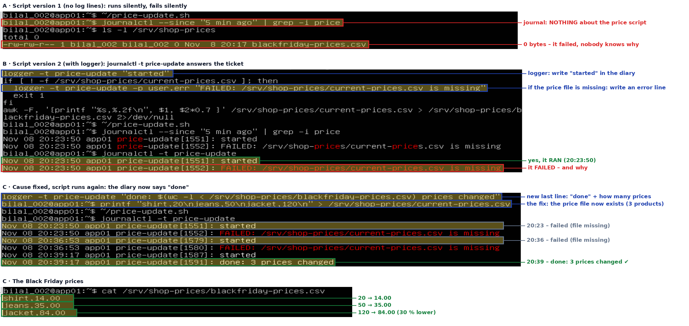

### Answer in GLPI – solved

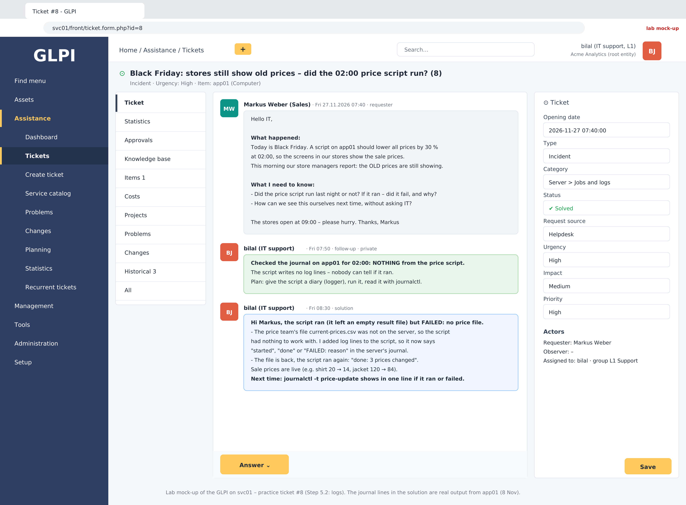

**Final paragraph:** Acme Fashion's Black Friday price script on app01 ran at night, but the stores still showed old prices and nobody could tell why, because the script wrote no log lines – the journal had nothing, only an empty result file hinted that it ran. We gave the script a diary with `logger`: it writes "started" at the beginning, "FAILED" with the reason (in red, as an error) if the price file is missing, and "done" with the number of changed prices at the end. Run without the price file, `journalctl -t price-update` showed "started" and "FAILED: current-prices.csv is missing"; after the price file was put back, it showed "done: 3 prices changed" and the Black Friday file had the prices 30 % lower. From now on one command answers Markus's question – did it run, did it fail, and why.

---

### For revision later

The vmstat columns seen here (`bi`, `bo`, `b`, `wa`, `sy`, `id`, `cache`) also show up in real troubleshooting. They are explained in [Day 14](day-14-2026-11-07.md) (section 4 and the vmstat table) – to be revised later, not needed to close this ticket.

---

## Final understanding – step by step

**Step 1 – think first.** "Slow the first time, fast after" means the file was not in RAM and came from the disk. After a weekend there are two usual reasons: an **update restart** (deletes everything in RAM) or the **nightly backup** (fills RAM with other files, so the kernel drops the report copy). Before guessing, check what happened last night.

**Step 2 – app01: how long has it been on?** `uptime` shows how long the server has run since its last restart and how busy the CPU is (load 0.00 = idle).

**Step 3 – app01: when did it restart?** `last reboot | head -3` shows the last restarts: Fri 18:08, Sat 15:42, **Sat 21:31**.

**Step 4 – app01: the same restarts with numbers.** `journalctl --list-boots` gives each run a number: **0** = now, **-1** = the run before. With that number you can open the logs of a run.


**Step 5 – app01: errors of the run before.** `journalctl -b -1 -p err` – `-b -1` = the run before, `-p err` = only errors. Here they are lab effects (VMware boot messages, Windows sleep), not part of this ticket.


**Step 6 – stor01: when does the backup run?** `systemctl list-timers --all | grep -i backup` shows the last and next run of `nightly-backup.timer` (the first try used "backups" with an s and found nothing). `sudo crontab -l` is empty because the backup uses a systemd timer, not cron.


**Step 7 – stor01: the backup's own log.** `journalctl -u nightly-backup.service --since "3 days ago" | tail -5` shows whether it ran and finished: it ran on **Sun 8 Nov 02:11–02:12 (UTC)**, backed up `/data/app` in about 35 seconds and finished successfully. The line "--link-dest arg does not exist: /backups/latest" only means the "latest" link was missing, so this run made a full copy instead of an incremental one (not part of this ticket).


In this lab the backup runs **on stor01** and reads `/data/app` there, so it fills **stor01's** RAM, not app01's. It would push out the report only if the report lived on the NFS share (`/mnt/app` on app01 = `/data/app` on stor01).

**Result so far:** app01 restarted on Saturday at 21:31, so its RAM started empty – **reason 1**. The backup ran on Sunday at 02:11 on stor01 – **reason 2** for files on the NFS share. The CPU is idle, so more CPU would not help. Next: show it with Case A.

**Continued in [Day 16](day-16-2026-11-09.md):** a new database server db01 and the shop on two servers.
