# Day 15 – 2026-11-08: Ticket #5 – "the sales report is slow the first time" (Step 5.1, part 2)

| | |
|---|---|
| **Phase** | 5 – Logging · Step 5.1: CPU, memory or disk – where is the bottleneck? |
| **Hosts worked on** | app01, stor01 |
| **Status** | Ticket #5 ✅ solved · story and reasons ✅ · check of last night (app01 + stor01) ✅ · Case A (proof) ✅ · solution in GLPI ✅ · vmstat recording during the read ⏳ (retake) |

Step 5.1 continues as a real support case instead of a test for its own sake. The ticket is a practice ticket (a mock-up of the GLPI on svc01); the commands and screenshots are real output from my lab.

---

## ⭐ Start here – the ticket and the evidence

**The ticket in GLPI** (mock-up of the GLPI on svc01; the private follow-up holds the real checks):

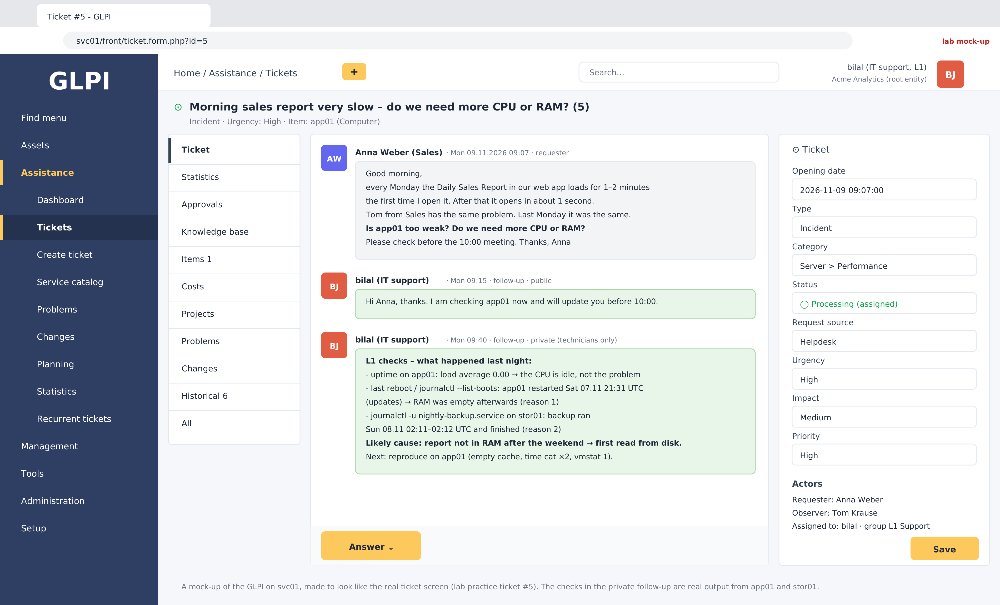

**The solution (after Case A):** real numbers from app01, status *Solved*.

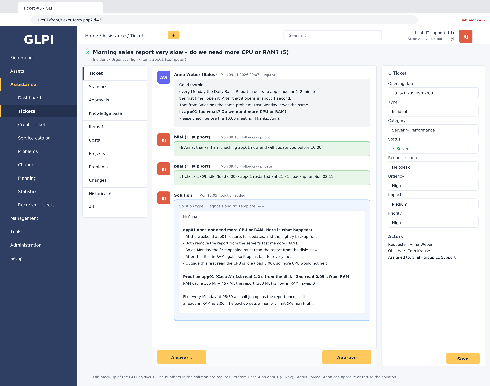

**As a reusable case study:** [runbook – "slow the first time, fast after"](../runbooks/slow-first-time-then-fast.md) (the real-life steps, without the lab test file).

**The evidence on one page:**

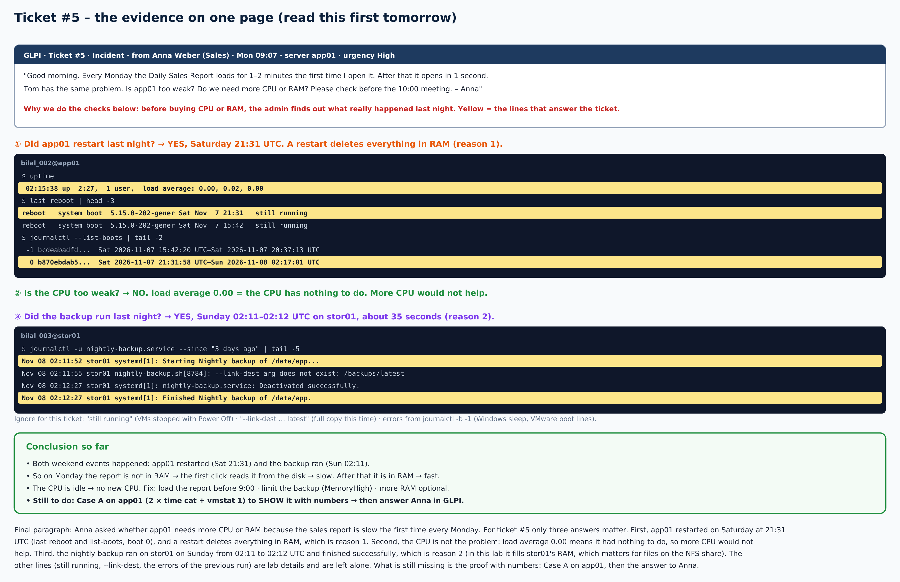

---

## 1. The ticket

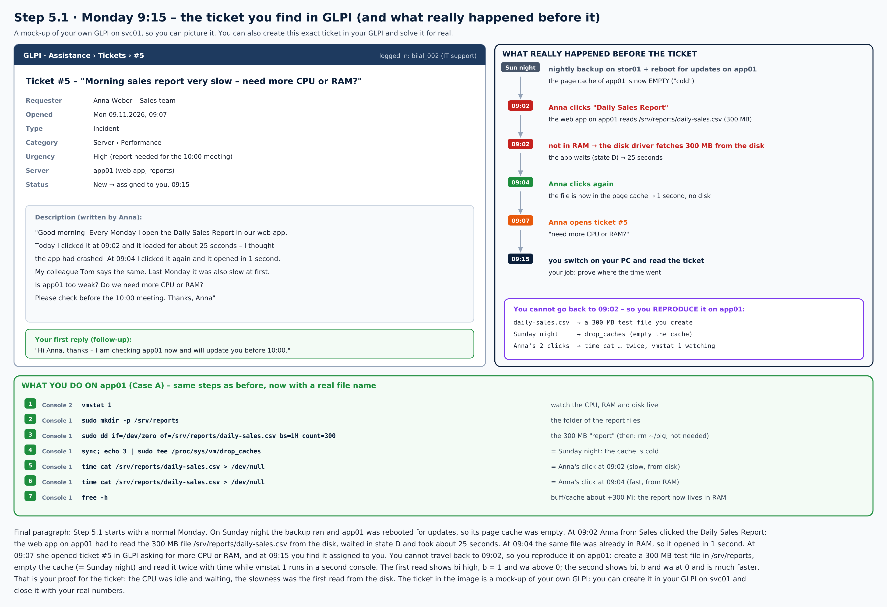

Monday 09:07: Anna from Sales writes that the Daily Sales Report loads for a long time the first time and opens in a second after that, and asks whether app01 needs more CPU or RAM.

---

## 2. The two usual reasons

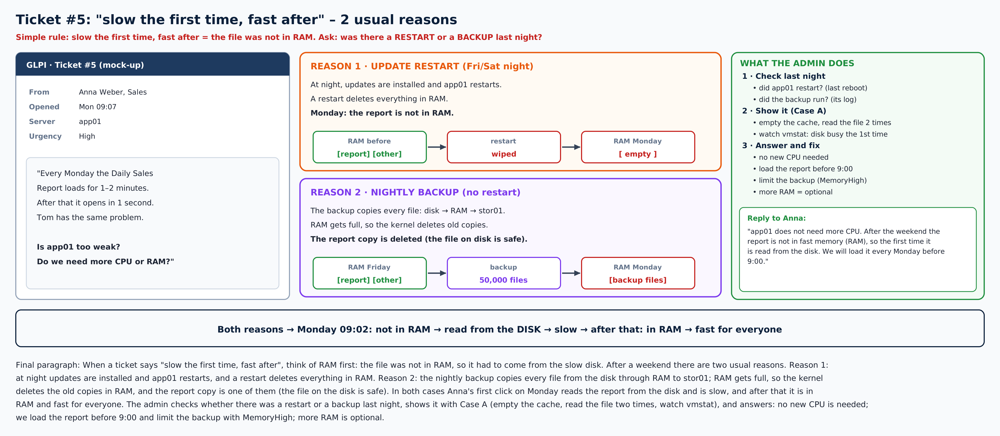

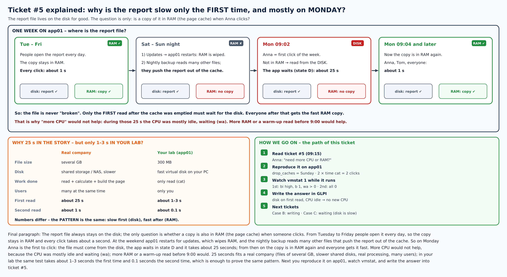

**Simple rule:** slow the first time, fast after = the file was not in RAM, so it came from the slow disk. Ask: was there a **restart** or a **backup** last night?

- **Reason 1 – update restart:** a restart deletes everything in RAM, so on Monday the report is not cached.
- **Reason 2 – nightly backup (no restart):** the backup copies every file disk → RAM → stor01. RAM gets full and the kernel **drops** the old copies in RAM – the report copy too. The file on the disk is safe. Files never go to swap.

### When RAM gets full – drop, swap, kill

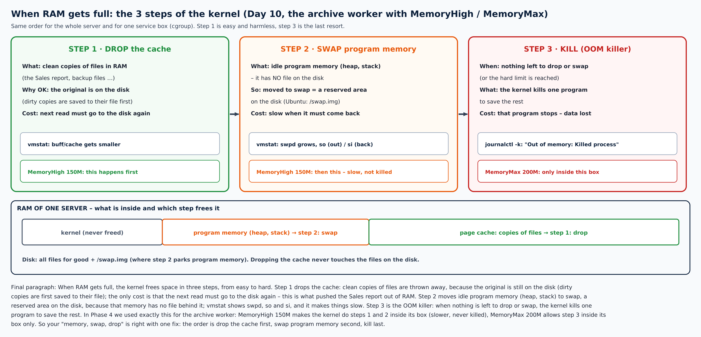

| Step | What | Why |
|---|---|---|
| 1 · drop | copies of files in RAM (cache) are deleted | the original is on the disk |
| 2 · swap | idle program data (e.g. sshd waiting for the next login) is moved to swap on the disk – "cut and paste", nothing is lost | it has no file, so it cannot be dropped |
| 3 · kill | the OOM killer stops a program | last resort, nothing left to free |

This is the same order as `MemoryHigh` / `MemoryMax` for the archive worker in Phase 4.

---

## 3. Check 1 – what happened last night on app01

```bash
uptime
last reboot | head -3
journalctl --list-boots | tail -3
```

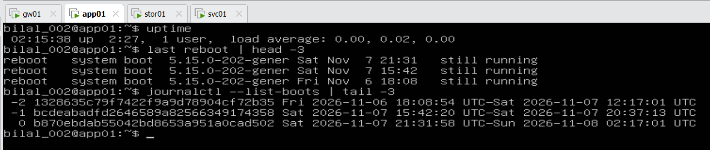

| Command | Answer from app01 |
|---|---|
| `uptime` | up 2:27, load 0.00 → the CPU is idle. app01 runs on UTC (Berlin = UTC+1). |
| `last reboot` | starts on Fri 18:08, Sat 15:42 and **Sat 21:31** → RAM was empty after Saturday 21:31 (reason 1). |
| `journalctl --list-boots` | the same starts with numbers: **0** = now, **-1** = the run before → the logs of each run can be opened. |

Notes: "still running" on every line means `last` never saw a clean shutdown – the VMs were stopped with VMware *Power Off* (use `sudo poweroff`). uptime is shorter than the time since 21:31 because a paused VM does not count paused time.

```bash
journalctl -b -1 -p err      # only errors of the previous run
```

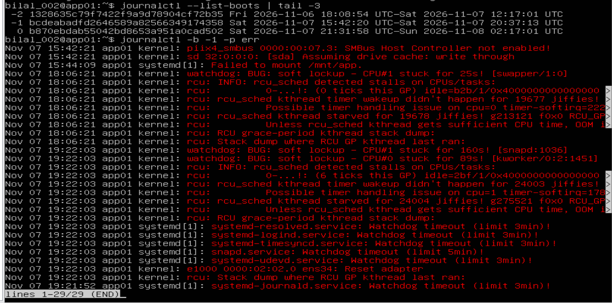

Not part of this ticket, so not troubleshot: the SMBus and drive-cache lines appear on every VMware boot; "soft lockup / CPU stuck / watchdog timeout" appeared because Windows went to sleep with all four VMs running; "Failed to mount /mnt/app" means stor01 was not ready when app01 started.

---

## 4. Check 2 – when does the backup run on stor01?

```bash
systemctl list-timers --all | grep -i backups
sudo crontab -l
```

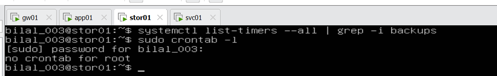

No result: the grep searched for "backup**s**", but the Phase 3 timer is called `nightly-backup.timer`. The root crontab is empty because the backup uses a systemd timer, not cron. Next:

```bash
systemctl list-timers --all | grep -i backup                       # last and next run
journalctl -u nightly-backup.service --since "3 days ago" | tail -5  # its log
```

---

## 5. Case A – the proof on app01

### Test setup (only in the lab)

In a real company the reports folder and the report already exist – the app writes the report every night. In the lab they do not, so for testing we make a folder and a heavy 300 MB file that stands in for the report (`dd` copies zeros from `/dev/zero` as filler: 1 MB × 300), and check it:

```bash
sudo mkdir -p /srv/reports
sudo dd if=/dev/zero of=/srv/reports/daily-sales.csv bs=1M count=300
ls -lh /srv/reports/
```

### The real scenario

**1. The weekend** – emptying the cache plays the restart and backup that push the report out of RAM; `free -h` is the "before" photo.

```bash
sync; echo 3 | sudo tee /proc/sys/vm/drop_caches
free -h
```

**2. The camera** – vmstat records CPU, RAM and disk every second in the background.

```bash
vmstat 1 20 > ~/vm.txt &
```

**3. Monday 09:02 – Anna clicks twice** – `time` measures each read.

```bash
time cat /srv/reports/daily-sales.csv > /dev/null    # 1st click – from the disk
time cat /srv/reports/daily-sales.csv > /dev/null    # 2nd click – from RAM
```

**4. The "after" photo** and **5. the recording**:

```bash
free -h
wait; cat ~/vm.txt
```

### What we saw (yellow = what to look at)

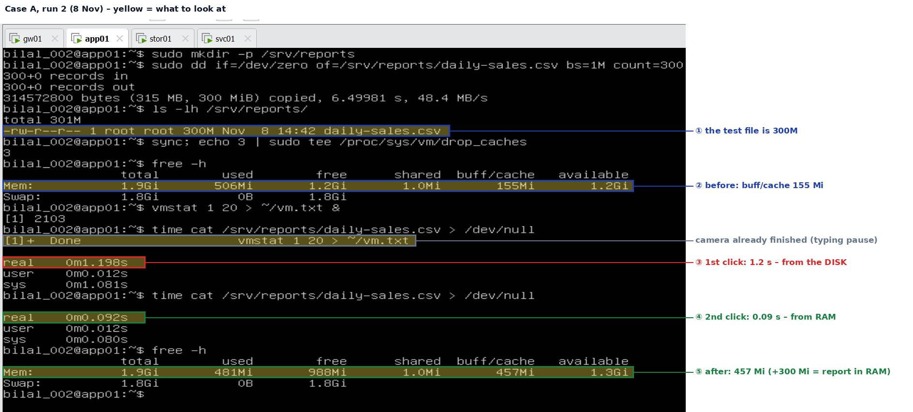

| | Run 1 | Run 2 |
|---|---|---|
| 1st read (disk) | **12.0 s** | **1.2 s** |
| 2nd read (RAM) | **0.086 s** | **0.092 s** |
| buff/cache before → after | 155 → 455 Mi | 155 → 457 Mi |

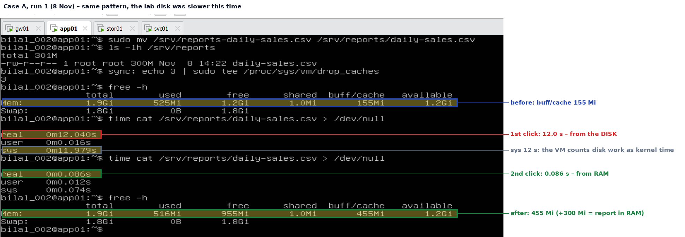

Both runs show the same pattern: slow the first time (disk), fast after (RAM), and the cache grows by the 300 MB report. The first read was 12 s in run 1 and 1.2 s in run 2 because in a lab the Windows PC also caches the VM's disk file, so the "disk" speed varies. In run 1 almost all the time was `sys` – the VM counts the disk work as kernel time.

The vmstat file missed the moment: the camera ran its 20 seconds while the next command was being typed, so the `cache` column never changes. Retake later in one line: `vmstat 1 8 > ~/vm.txt & time cat /srv/reports/daily-sales.csv > /dev/null; wait; cat ~/vm.txt`.

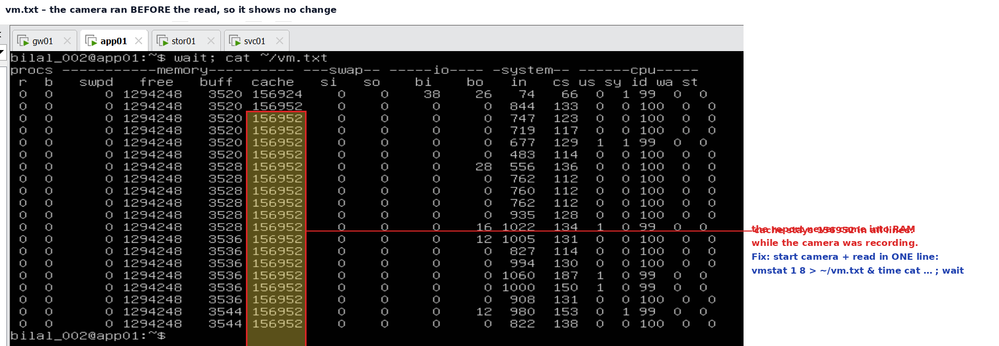

A small slip on the way: the first `dd` had `reports-daily-sales.csv` (dash instead of slash), so `cat` found no file; it was moved with `mv` into `/srv/reports/`.

---

## Final understanding – step by step

**Step 1 – think first.** "Slow the first time, fast after" means the file was not in RAM and came from the disk. After a weekend there are two usual reasons: an **update restart** (deletes everything in RAM) or the **nightly backup** (fills RAM with other files, so the kernel drops the report copy). Before guessing, check what happened last night.

**Step 2 – app01: how long has it been on?** `uptime` shows how long the server has run since its last restart and how busy the CPU is (load 0.00 = idle).

**Step 3 – app01: when did it restart?** `last reboot | head -3` shows the last restarts: Fri 18:08, Sat 15:42, **Sat 21:31**.

**Step 4 – app01: the same restarts with numbers.** `journalctl --list-boots` gives each run a number: **0** = now, **-1** = the run before. With that number you can open the logs of a run.


**Step 5 – app01: errors of the run before.** `journalctl -b -1 -p err` – `-b -1` = the run before, `-p err` = only errors. Here they are lab effects (VMware boot messages, Windows sleep), not part of this ticket.


**Step 6 – stor01: when does the backup run?** `systemctl list-timers --all | grep -i backup` shows the last and next run of `nightly-backup.timer` (the first try used "backups" with an s and found nothing). `sudo crontab -l` is empty because the backup uses a systemd timer, not cron.


**Step 7 – stor01: the backup's own log.** `journalctl -u nightly-backup.service --since "3 days ago" | tail -5` shows whether it ran and finished: it ran on **Sun 8 Nov 02:11–02:12 (UTC)**, backed up `/data/app` in about 35 seconds and finished successfully. The line "--link-dest arg does not exist: /backups/latest" only means the "latest" link was missing, so this run made a full copy instead of an incremental one (not part of this ticket).

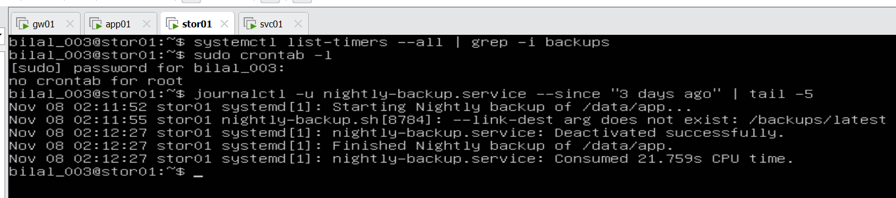

In this lab the backup runs **on stor01** and reads `/data/app` there, so it fills **stor01's** RAM, not app01's. It would push out the report only if the report lived on the NFS share (`/mnt/app` on app01 = `/data/app` on stor01).

**Result so far:** app01 restarted on Saturday at 21:31, so its RAM started empty – **reason 1**. The backup ran on Sunday at 02:11 on stor01 – **reason 2** for files on the NFS share. The CPU is idle, so more CPU would not help. Next: show it with Case A.
