# Day 16 – 2026-11-09: A new database server db01, the shop on two servers (start of ticket #9)

| | |
|---|---|
| **Phase** | 5 – Logging · preparation for Step 5.3 (ticket #9) and Step 5.4 |
| **Hosts worked on** | db01 (new), app01, gw01 |
| **Print copy** | [Day 16 story (2 pages)](Project-2-Day-16-story.pdf) · [Walkthrough – cause → check → the line that matters (7 pages)](Project-2-Day-16-walkthrough.pdf) |
| **Status** | ⓪ db01 built ✅ · ① PostgreSQL on db01 ✅ · ② nginx + psql on app01 ✅ – SQL query app01 → db01 works · ③ ticket #9 ✅ solved – all four cases shown (app log, kernel log, database slow-query log, blocked port) · ④ Step 5.4 central logs ⏳ |

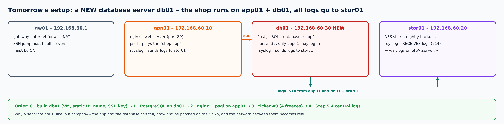

**Why:** ticket #9 ("the web shop froze for 3–4 minutes") can come from four places – the app, the whole server, the database or the network between them. To make all four real, the lab gets a small online shop: **nginx** on app01 and a **PostgreSQL** database on a **new, separate server db01** – like in a company, where the app and the database can fail, grow and be patched on their own.

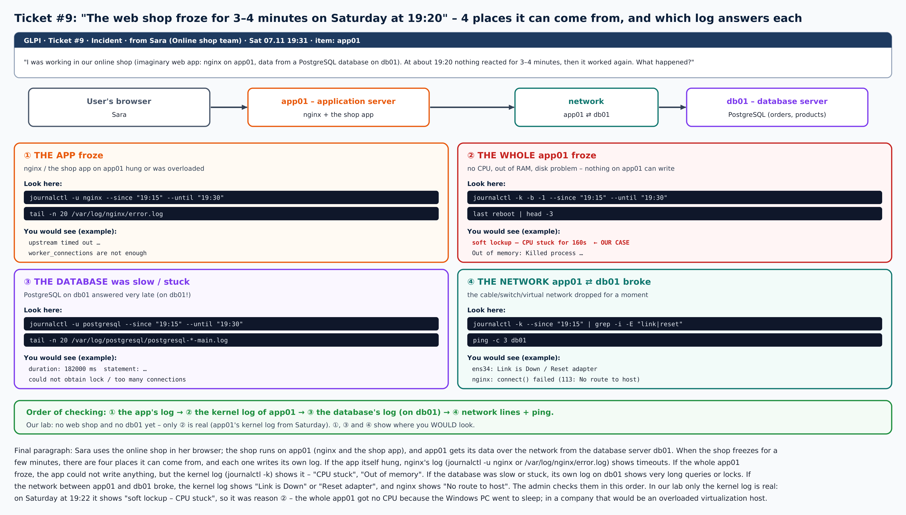

---

## ⓪ Build db01 (revision of Phase 1)

**Change request (ticket #9a):** the shop database gets its own server **db01, 192.168.60.30**, in the lab network.

### VM settings

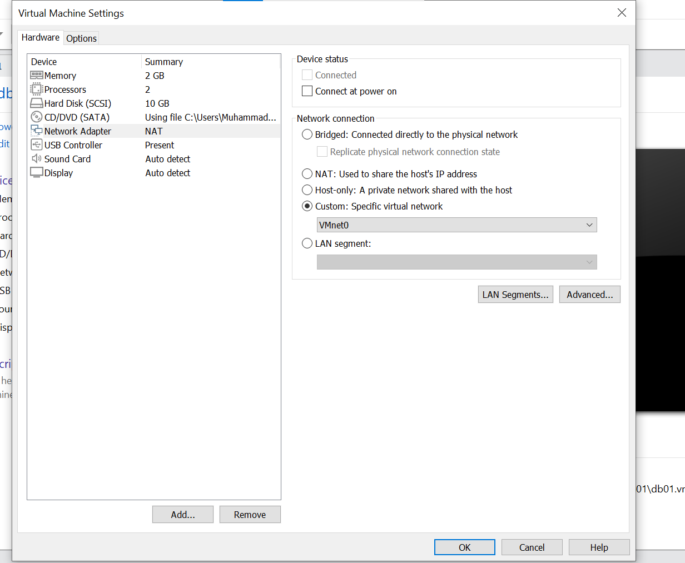

2 GB RAM, 2 CPUs, 10 GB disk. The network adapter first pointed to **VMnet0 – that is "bridged" = the home network**. Corrected to **Custom: VMnet2**, the isolated lab network 192.168.60.0/24 (no DHCP) that app01 and stor01 use, and **Connect at power on** ticked. User on db01: `db005`.

### The network card was DOWN

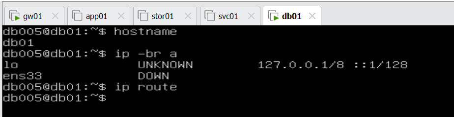

VMnet2 has no DHCP, so after the install `ens33` was **DOWN** with no address and no route. The fixed address is set by hand with netplan:

```bash
sudo tee /etc/netplan/50-cloud-init.yaml >/dev/null <<'EOF'
network:
  version: 2
  ethernets:
    ens33:
      dhcp4: false
      addresses: [192.168.60.30/24]
      routes:
        - to: default
          via: 192.168.60.1
      nameservers:
        addresses: [8.8.8.8]
EOF
sudo chmod 600 /etc/netplan/50-cloud-init.yaml
echo "network: {config: disabled}" | sudo tee /etc/cloud/cloud.cfg.d/99-disable-network-config.cfg
sudo netplan apply
```

Fixed address .30 · the way out goes through gw01 (NAT from Phase 1) · `chmod 600` = only root may read the file · the cloud-init line stops the installer's tool from overwriting it at the next boot.

**A typo on the way:** the file was first written as `50-clound-init.yaml` (extra "n"), so there were two files and netplan warned "Permissions … too open" for the new one. Fixed by renaming it over the old one and `chmod 600` again; `cat` then says *Permission denied* – correct, the file is root-only now (`sudo cat`). The "ovsdb-server … not running" warning is about Open vSwitch, not used here.

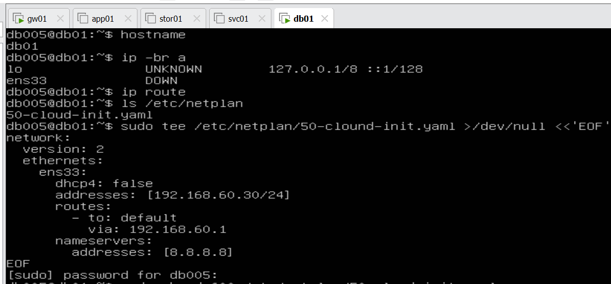

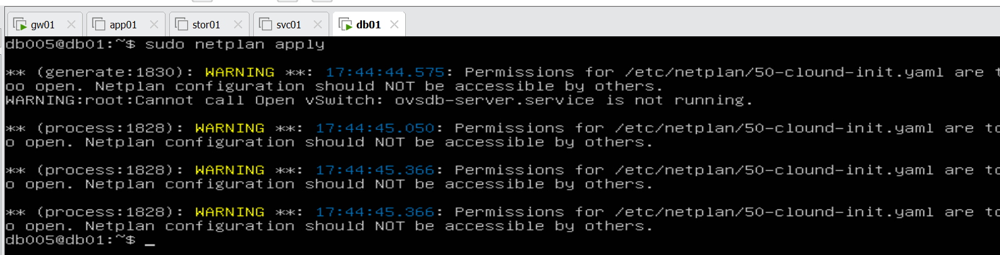

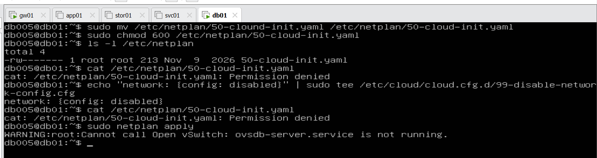

### The network works

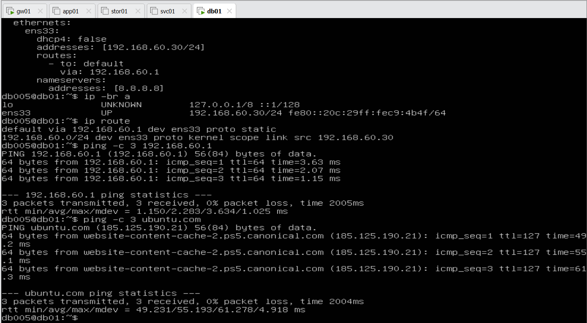

`ens33` UP with 192.168.60.30/24 · `default via 192.168.60.1` · gw01 answers (lab network) · ubuntu.com answers (internet through gw01, DNS works – `apt` will work).

### Names and SSH

```bash
echo "192.168.60.30 db01" | sudo tee -a /etc/hosts          # on gw01 and app01 (stor01 later)
printf "192.168.60.1 gw01\n192.168.60.10 app01\n192.168.60.20 stor01\n" | sudo tee -a /etc/hosts   # on db01
```

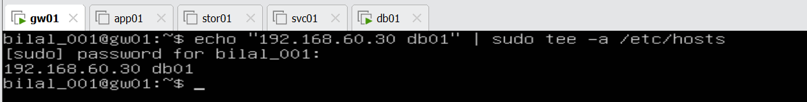

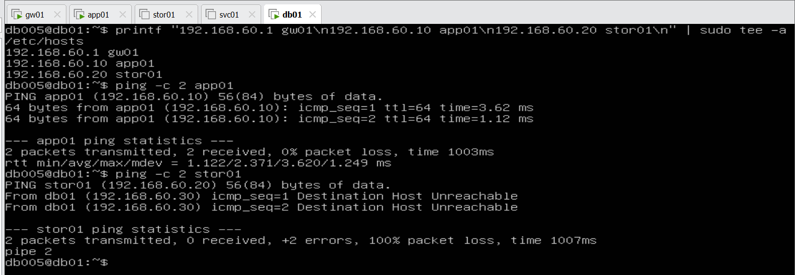

`ping app01` works. `ping stor01` gave **Destination Host Unreachable** – stor01 was simply switched off (no green ▶ in VMware). Lesson: "Host Unreachable" usually means the other machine is off or not on the network, not that your own settings are wrong. stor01 is not needed until Step 5.4.

The OpenSSH server was not ticked during the install, so it was added with `sudo apt install -y openssh-server`, then the key from gw01:

```bash
ssh-copy-id db005@db01      # on gw01
ssh db005@db01 hostname
```

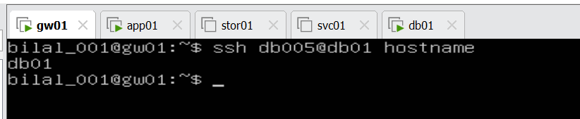

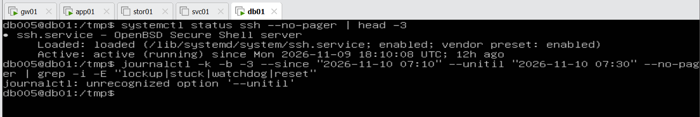

**Checkpoint ⓪:** db01 has .30, reaches gw01 and the internet, knows the names, and gw01 logs in with the key, no password.

---

## ① PostgreSQL on db01

```bash
sudo apt install -y postgresql
ls /etc/postgresql                       # version 14
systemctl status postgresql --no-pager   # active (exited) – the "umbrella" service
systemctl status postgresql@14-main --no-pager   # active (running) – the real database
```

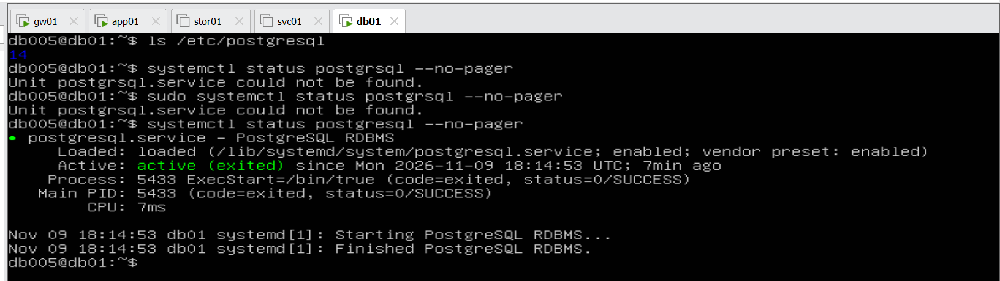

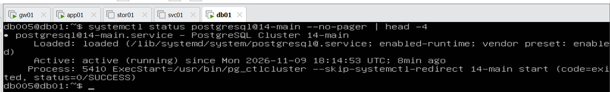

(`postgrsql` without the "e" → "Unit not found" – a typo, not a problem.)

### The shop database and the first SQL

```bash
cd /tmp
sudo -u postgres psql -c "CREATE USER shopapp WITH PASSWORD '…';"   # own password, kept out of GitHub
sudo -u postgres createdb --owner=shopapp shop
sudo -u postgres psql -d shop
```

```sql
CREATE TABLE products (id serial PRIMARY KEY, name text, price numeric(8,2));
INSERT INTO products (name, price) VALUES ('shirt',20), ('jeans',50), ('jacket',120);
ALTER TABLE products OWNER TO shopapp;
SELECT * FROM products;
```

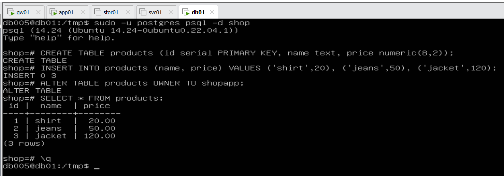

| SQL | Meaning |
|---|---|
| `CREATE TABLE products (…)` | make a table with three columns: id (counted automatically), name, price |
| `INSERT INTO products … VALUES …` | add rows – `INSERT 0 3` = 3 rows added |
| `ALTER TABLE … OWNER TO shopapp` | the shop app's user owns the table |
| `SELECT * FROM products` | show all rows (`*` = all columns) |

On the way: `cd /tmp` stops the harmless "could not change directory to /home/db005" message (the postgres user may not enter your home); `createdb -0` with a **zero** → "invalid option" – the long form `--owner=` avoids the O/0 confusion; a long one-line SQL had typos (`INFO`, `VALUEES`) – typing it line by line inside `psql` was easier. The password screenshot is not published.

### Let app01 connect – and log slow queries

In `/etc/postgresql/14/main/postgresql.conf`: `listen_addresses = '*'` (listen on the network, not only inside db01) and `log_min_duration_statement = 2000` (log every query slower than 2 s – for ticket #9, case ③). In `pg_hba.conf`:

```
host shop shopapp 192.168.60.10/32 scram-sha-256
```

= only app01 may log in to *shop* as *shopapp*, with a password.

```bash
sudo systemctl restart postgresql
ss -tlnp | grep 5432
```

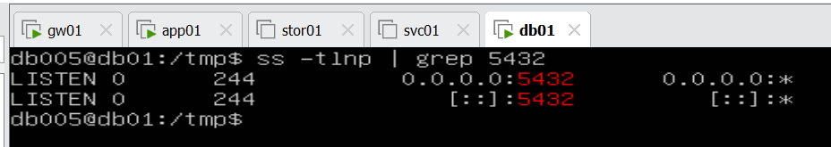

`0.0.0.0:5432` and `[::]:5432` – the database listens on the network; `pg_hba.conf` decides who may log in.

---

## ② nginx and psql on app01

```bash
sudo apt install -y nginx postgresql-client
systemctl status nginx --no-pager | head -3
curl -I http://localhost
psql -h db01 -U shopapp -d shop -c "SELECT * FROM products;"
```

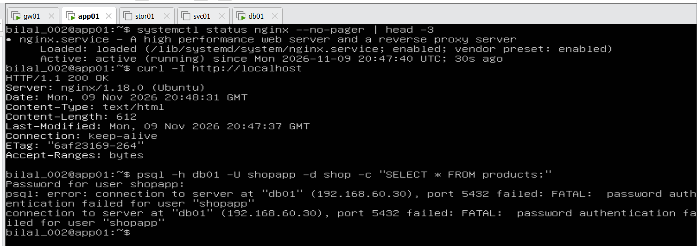

nginx: **active (running)**, `curl` **HTTP/1.1 200 OK**. The first `psql` said **password authentication failed** – read it from left to right: app01 *reached* db01 on 5432 (network ✔), db01 *knew* app01 and asked for the password (pg_hba ✔), only the password typed was wrong (the console keyboard layout makes `-` and special characters easy to mistype). After a new password with letters and digits only:

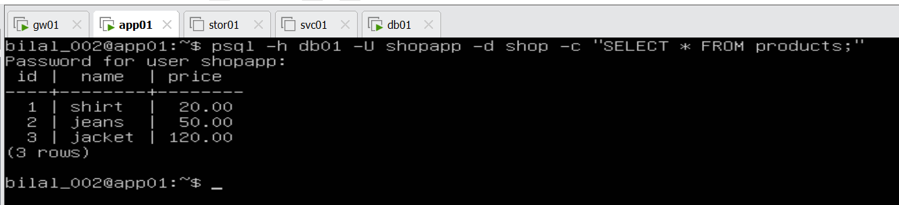

**A real SQL query went from app01 over the network to db01 and back: shirt, jeans, jacket (3 rows).**

**Checkpoint:** nginx answers on app01, the database answers from db01 – the shop exists, and it can now "freeze" in four places.

---

## ③ Ticket #9 – the four freezes

### Case ① · the app froze (nginx on app01)

```bash
sudo systemctl stop nginx
curl -I http://localhost          # Connection refused – what Sara feels
sudo systemctl start nginx
journalctl -u nginx --since "10 min ago" --no-pager
```

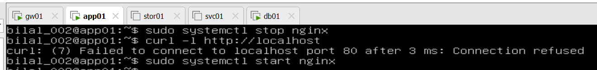

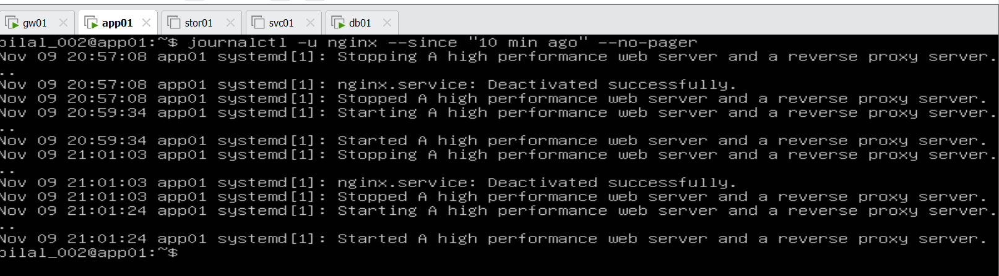

nginx's own log answers case ①: Stopping → Stopped → Starting → Started with the exact times – the shop was down 21:01:03 – 21:01:24.

### Case ② · the whole app01 froze (kernel log of Saturday)

Boot numbers move back after every restart, so first the list – Saturday's run (15:42 – 20:37) is now **-3**:

```bash
journalctl --list-boots | tail -4
journalctl -k -p err -b -3 --no-pager | head -5
journalctl -k -b -3 --since "2026-11-07 19:05" --until "2026-11-07 19:33" --no-pager | grep -i -E "lockup|stuck|watchdog|reset"
```

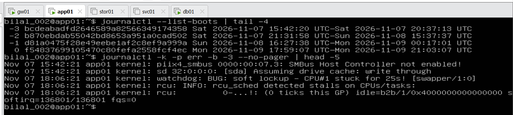

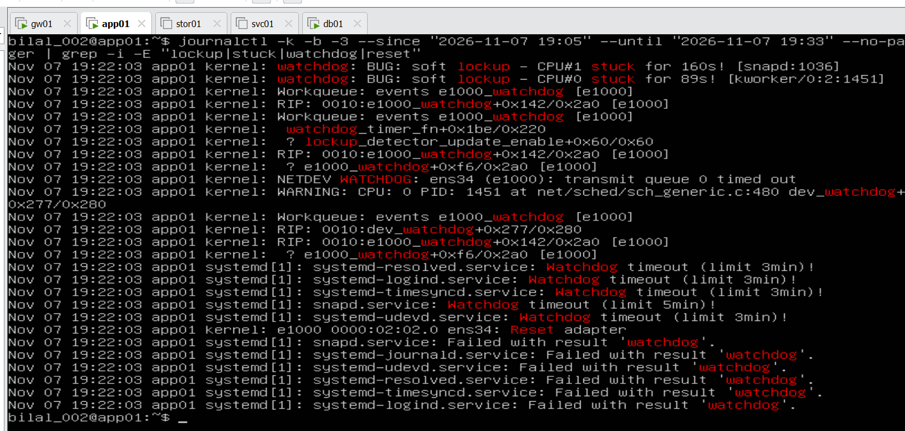

At **19:22:03**: *soft lockup – CPU#1 stuck for 160s*, *CPU#0 stuck for 89s*, *NETDEV WATCHDOG: ens34 transmit queue timed out*, *Reset adapter*, and several services *Watchdog timeout*. **The whole app01 got no CPU for minutes** – the cause of ticket #9 (the host PC went to sleep; in a company: an overloaded virtualization host). On the way: `grep -i E` without the dash before E made grep treat the pattern as a file name ("No such file or directory").

**For every future ticket:** [Linux troubleshooting cheat sheet (2 pages)](../runbooks/linux-troubleshooting-cheat-sheet.pdf) – the first-5-minutes order, the kernel words admins search for, one master filter and the `kcheck` script.

**A full check-up of any server in one file:** [`scripts/server-report.sh`](../../scripts/server-report.sh) – read-only; summary with WARN lines on top, then system, CPU/RAM, disks, network, services, kernel words, errors, logins, security, updates, and extra sections for the roles it finds (nginx, PostgreSQL, NFS, rsyslog, gateway).

### Case ③ · the database was slow (log on db01)

```bash
time psql -h db01 -U shopapp -d shop -c "SELECT pg_sleep(10);"     # on app01 – a query that takes 10 s
sudo tail -n 3 /var/log/postgresql/postgresql-14-main.log           # on db01 – the database's own log
```

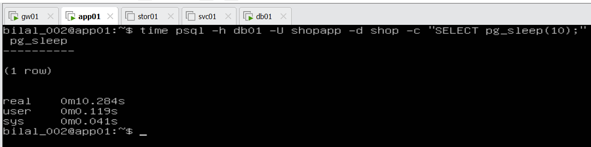

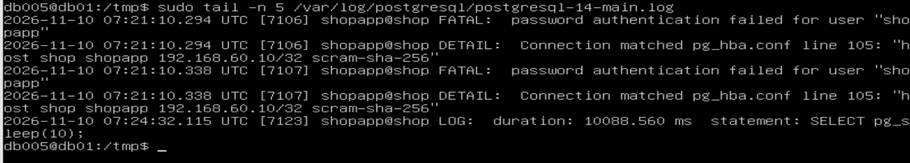

app01 waited **10.28 s**; db01's log says **`duration: 10088.560 ms  statement: SELECT pg_sleep(10);`** – because `log_min_duration_statement = 2000` logs every query slower than 2 s. In real life this line tells you *which* query made the shop wait.

On the way, two useful errors:

- Running the test **on db01 itself** gave *"no pg_hba.conf entry for host 192.168.60.30"* – the rule allows **only app01 (.10)**, so db01's own address was refused. The access rule is proven from both sides.

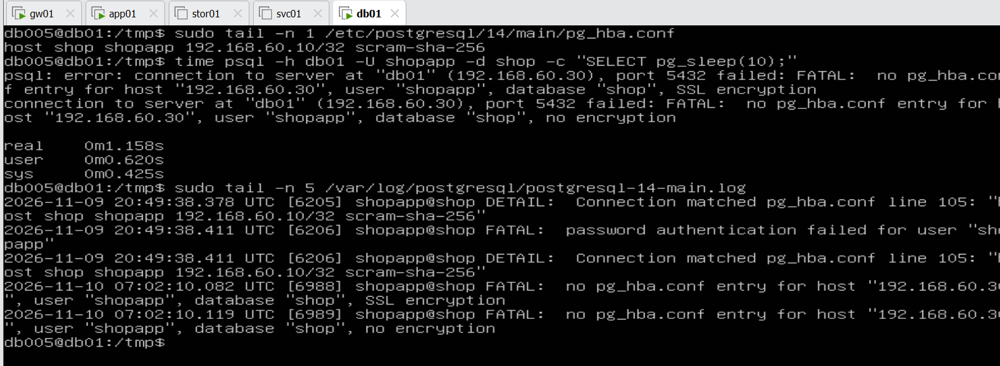

- *"password authentication failed … password retrieved from file .pgpass"* – psql took the password from `~/.pgpass`, and it did not match the one set in the database. Fixed by setting the **same** password in both places (not shown).

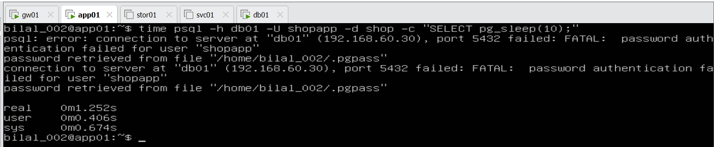

### Case ④ · the network between app01 and db01 broke

```bash
sudo iptables -I INPUT -s 192.168.60.10 -p tcp --dport 5432 -j DROP     # on db01 – block app01 on 5432
PGCONNECT_TIMEOUT=5 psql -h db01 -U shopapp -d shop -c "SELECT * FROM products;"   # on app01
ping -c 3 db01                                                           # on app01
sudo iptables -D INPUT -s 192.168.60.10 -p tcp --dport 5432 -j DROP     # on db01 – remove the block
```

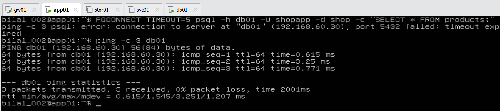

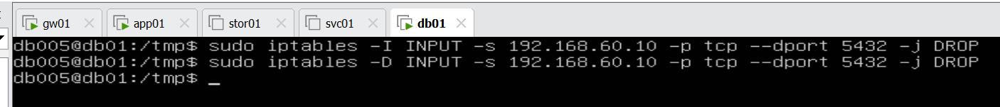

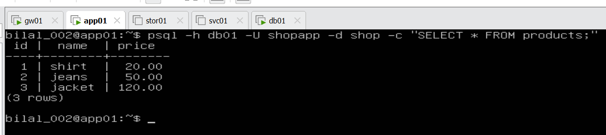

psql: **"timeout expired"** – the shop cannot reach its data – while **ping: 0 % loss**. Lesson: *"ping works" does not mean "the service works"* – only port 5432 was blocked. After `-D` the query returns the 3 rows again, without a password prompt (`.pgpass`).

### Ticket #9 – answer

| Case | Where | Log / proof | Result |
|---|---|---|---|
| ① the app | app01 | `journalctl -u nginx` – stopped / started with times | ✔ shown |
| ② the whole server | app01 | kernel log, run -3: **CPU stuck for 160 s**, watchdog timeout, reset adapter at 19:22 | ✔ **the real cause** |
| ③ the database | db01 | slow-query log: duration 10088 ms | ✔ shown |
| ④ the network | app01 ⇄ db01 | psql timeout expired, ping OK | ✔ shown |

**Solution for Sara:** the shop and the database were fine – at 19:22 the whole server app01 got no CPU for about 2–3 minutes (kernel: *soft lockup – CPU stuck for 160s*). The cause was the virtualization host (in the lab: the host PC went to sleep); in a company this goes to the virtualization team. **Ticket #9 solved.**

## Next

③ Ticket #9 – the four freezes (stop nginx · Saturday's kernel log · a 10-second query and the slow-query log on db01 · block port 5432 for a moment) · ④ Step 5.4 – app01 and db01 send their logs to stor01.

## Final understanding

The shop now runs on two servers. db01 was built like the others: a fresh Ubuntu VM in the isolated lab network VMnet2 (not VMnet0, which is the home network), a fixed address 192.168.60.30 set with netplan because VMnet2 has no DHCP, the way out through gw01, its name in /etc/hosts, the SSH server and a key from gw01. On db01, PostgreSQL 14 runs a small "shop" database with a products table (created with the first SQL: CREATE TABLE, INSERT INTO, SELECT), listens on the network on port 5432 and lets only app01 log in as shopapp with a password; slow queries over 2 seconds will be logged. On app01, nginx answers with 200 OK, and psql – playing the shop app – sends a real SQL query over the network to db01 and gets the three products back. On the way the error messages themselves showed how far each step got: "Host Unreachable" meant stor01 was off, "Permission denied" meant the netplan file was correctly locked, and "password authentication failed" meant the network and the access rule worked and only the password was wrong.
