# Day 17 – 2026-11-11: Central logs on stor01 (Step 5.4, ticket #10)

| | |
|---|---|
| **Phase** | 5 – Logging · Step 5.4 central logs with rsyslog |
| **Hosts worked on** | stor01 (receives), app01 and db01 (send) |
| **Print copy** | [Ticket #10 walkthrough – why → command → screenshot → the line that matters](Project-2-Day-17-ticket-10-walkthrough.pdf) · [Tickets #8 → #9 → #10 in one file (5 pages)](Project-2-Tickets-8-9-10.pdf) – page 1 short version, pages 2–5 full solutions |
| **Status** | A stor01 receives ✅ · B app01 + db01 send ✅ · C tests (test line, ticket #8 price script, ticket #9 slow query) ✅ · D stor01-down test (queue) ✅ · **ticket #10 solved** ✅ |

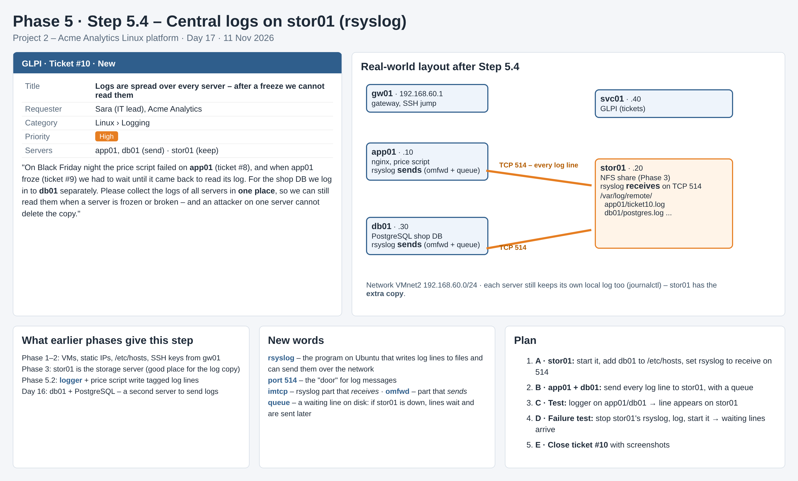

## Why – three tickets in a row

Ticket #8 gave the price script its own log lines – but only on app01. Ticket #9 found the answer in logs spread over app01 (nginx, kernel) and db01 (slow queries), and frozen app01 could not be read at all. Ticket #10: put a copy of all logs in one place, on stor01.

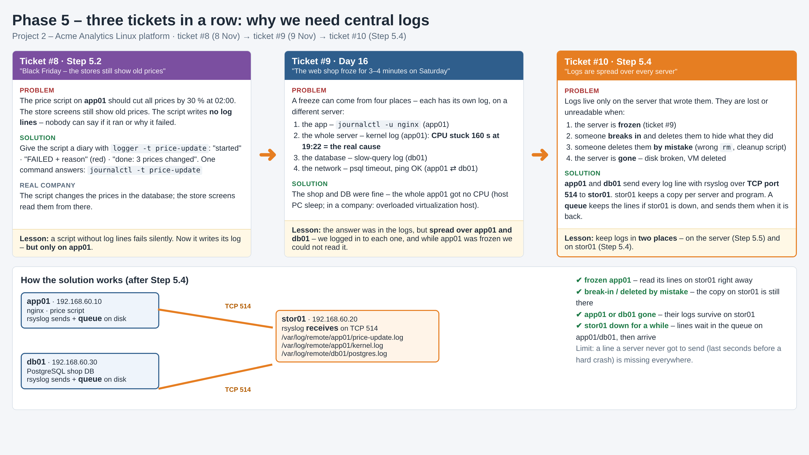

Logs that live only on their own server are lost or unreadable when the server is **frozen** or **gone**, when an **attacker** deletes them to hide an attack, when an **insider** deletes them on purpose, or when someone deletes them **by mistake**. The copy on stor01 survives all of these. *Who* deleted or changed a log file comes in Phase 6 with **auditd**.

---

## A · stor01 receives

```bash
echo "192.168.60.30 db01" | sudo tee -a /etc/hosts
ping -c 2 db01
sudo mkdir -p /var/log/remote
sudo chown syslog:adm /var/log/remote      # on Ubuntu rsyslog runs as the user syslog
ls -ld /var/log/remote
```

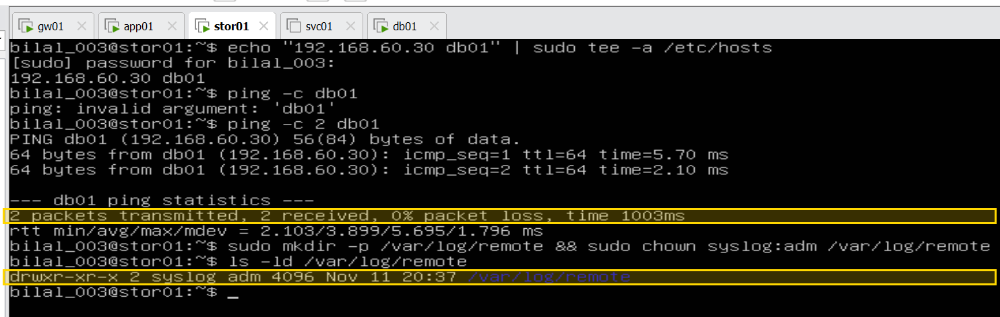

`0% packet loss` → stor01 reaches db01 by name · `syslog adm` → rsyslog may write into the folder.

`/etc/rsyslog.d/10-receive.conf` on stor01:

```
module(load="imtcp")
input(type="imtcp" port="514" ruleset="remote")
template(name="PerHost" type="string" string="/var/log/remote/%HOSTNAME%/%PROGRAMNAME%.log")
ruleset(name="remote") {
  action(type="omfile" dynaFile="PerHost")
  stop
}
```

| Line | Meaning |
|---|---|
| `imtcp` (im = input module), `port="514"` | receive log lines over TCP on port 514 |
| `template … %HOSTNAME%/%PROGRAMNAME%` | one folder per server, one file per program – made automatically when the first line arrives |
| `omfile` (om = output module) | write the line into that file |
| `ruleset … stop` | lines from other servers go only there, not into stor01's own `/var/log/syslog` |

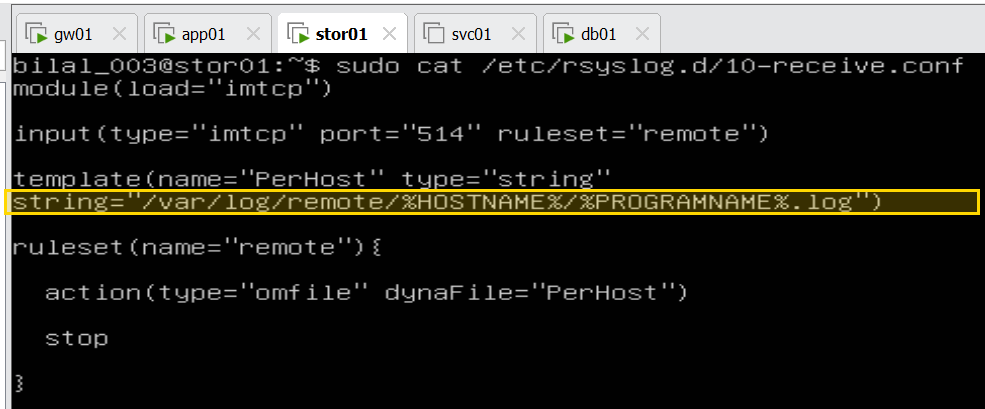

```bash
sudo rsyslogd -N1 && sudo systemctl restart rsyslog && systemctl is-active rsyslog
sudo ss -tlnp | grep 514
sudo ufw status
```

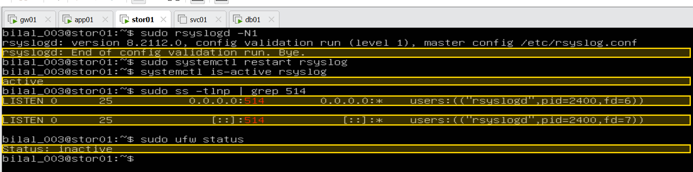

`Bye.` (no typos) · `active` · `0.0.0.0:514` and `[::]:514` rsyslogd → stor01 is waiting for logs · ufw inactive → nothing to open.

## B · app01 sends

`/etc/rsyslog.d/90-forward.conf` on **app01** (later the same file on **db01**; stor01 only receives, so it does not have this file):

```
*.* action(type="omfwd" target="192.168.60.20" port="514" protocol="tcp"
    queue.type="LinkedList" queue.filename="fwd_stor01"
    queue.saveOnShutdown="on" action.resumeRetryCount="-1")
```

| Part | Meaning |
|---|---|
| `*.*` | every log line of every program |
| `omfwd … 192.168.60.20 … 514 … tcp` | send it to stor01; TCP = stor01 confirms each line |
| `queue.type="LinkedList" queue.filename=…` | if stor01 cannot be reached, lines wait in a queue **on the sender** (on disk in `/var/spool/rsyslog` if needed) |
| `saveOnShutdown="on"` | the waiting lines survive a restart of app01 |
| `resumeRetryCount="-1"` | keep trying until stor01 is back – never give up |

```bash
tail -1 /etc/rsyslog.d/90-forward.conf     # the rule ends with )
sudo rsyslogd -N1 && sudo systemctl restart rsyslog && systemctl is-active rsyslog
logger -t ticket10 "hello from app01"
```

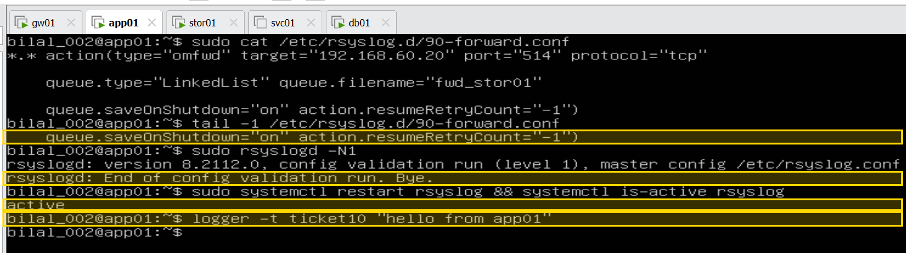

```bash
ls /etc/rsyslog.d                          # on stor01
sudo ls /var/log/remote
sudo tail /var/log/remote/app01/ticket10.log
```

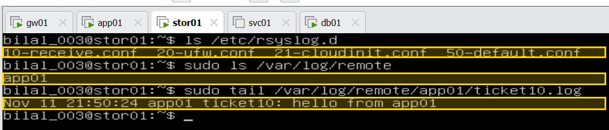

**First proof:** `app01 ticket10: hello from app01` is on stor01. The folder `app01` and the file `ticket10.log` were made by the template (server name + logger tag). Times on the servers are UTC – 1 hour behind German time.

## C · Tests – the logs of tickets #8 and #9 now reach stor01

**Ticket #8 – the price script on app01:**

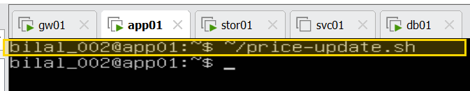

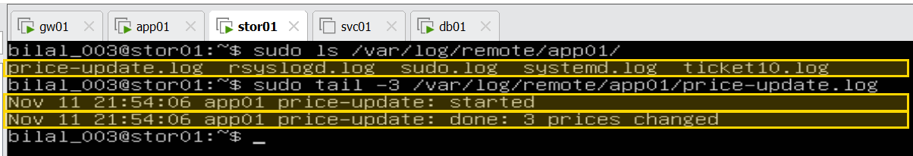

`started` and `done: 3 prices changed` – Markus's question ("did it run?") is answered on stor01 without logging in to app01.

**db01 sends too** – the same `90-forward.conf`, typed on db01:

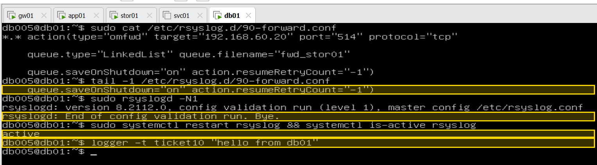

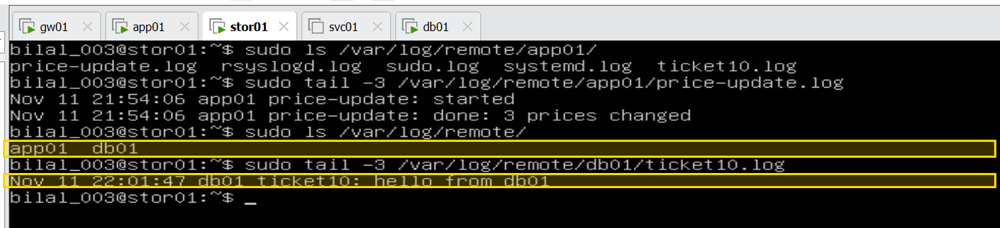

**Ticket #9, case ③ – the slow-query log.** PostgreSQL on Ubuntu writes to its own file, not to rsyslog. One setting changes that, and `reload` applies it without stopping the database:

```bash
sudo sed -i "s/^#\?log_destination.*/log_destination = 'stderr,syslog'/" /etc/postgresql/14/main/postgresql.conf   # on db01
sudo systemctl reload postgresql@14-main
time psql -h db01 -U shopapp -d shop -c "SELECT pg_sleep(3);"                                                       # on app01
sudo tail -3 /var/log/remote/db01/postgres.log                                                                    # on stor01
```

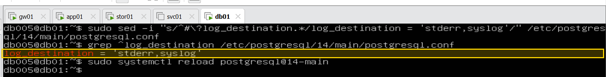

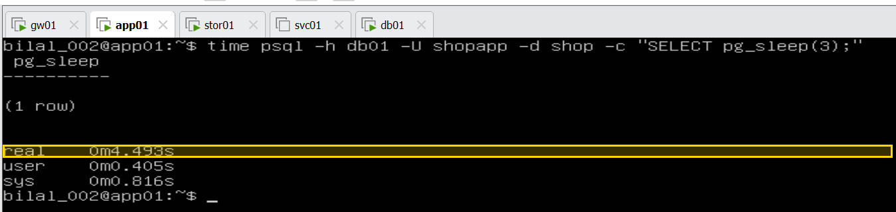

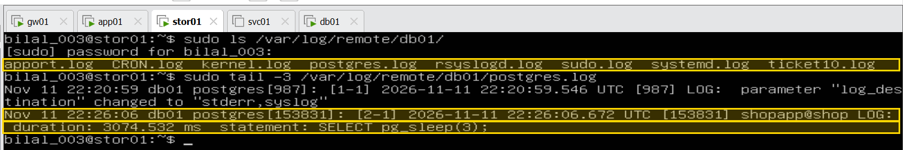

`duration: 3074.532 ms statement: SELECT pg_sleep(3);` – readable on stor01. db01's `kernel.log` is there too, where a "CPU stuck" line like ticket #9's would now land.

## D · Failure test – stor01 down for a while

```bash
sudo systemctl stop syslog.socket rsyslog                       # stor01 – port 514 closed
logger -t ticket10 "sent while stor01 was down"                 # app01 – waits in the queue
sudo grep "was down" /var/log/remote/app01/ticket10.log         # stor01 – nothing yet
sudo systemctl start rsyslog ; sleep 60                         # stor01 – back
sudo grep "was down" /var/log/remote/app01/ticket10.log         # stor01 – the line arrived
```

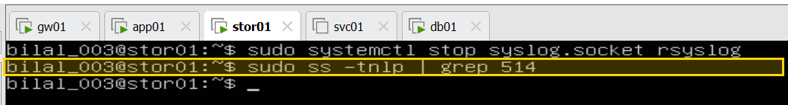

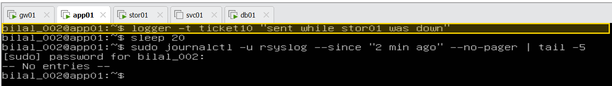

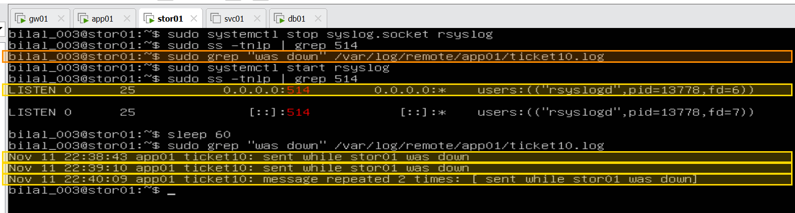

Orange: the first grep found nothing – the line was not on stor01 during the outage. After the start, the lines arrived **with the time they were written** (22:38–22:40), not the time they arrived. `message repeated 2 times` = the same line logged again, folded into one line by rsyslog. **No log line was lost.**

## Ticket #10 – solved

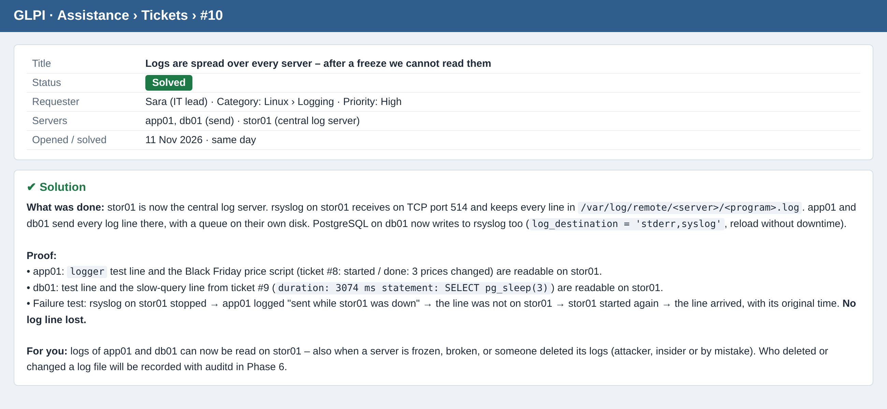

## Summary picture (LinkedIn post)

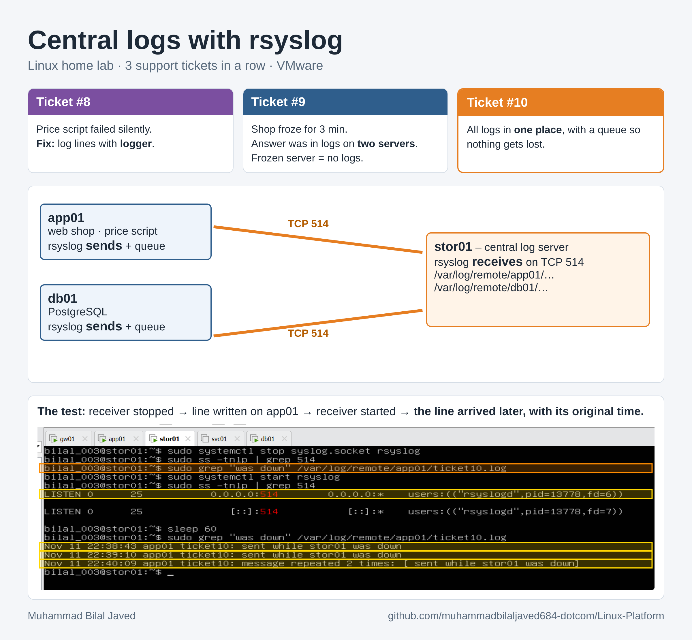

## Final understanding – step by step

**Step 1 – why.** Ticket #8 gave the price script log lines, ticket #9 needed the logs of two servers – but every log lived only on its own server. Frozen, broken, attacked or cleaned up by mistake, the server takes its logs with it. So every server keeps its own log **and** sends a copy to stor01.

**Step 2 – stor01 receives.** rsyslog listens on TCP 514 (`imtcp`) and writes each line into `/var/log/remote/<server>/<program>.log` (`omfile`); the folder belongs to the user `syslog`, because rsyslog runs as that user.

**Step 3 – app01 and db01 send.** One rule (`omfwd`): every line (`*.*`) over TCP to 192.168.60.20 port 514, with a queue on the sender. The receiver has only the receive file, the senders only the send file.

**Step 4 – the proof.** A test line from each server, the price script's started/done lines (ticket #8) and PostgreSQL's slow-query line (ticket #9) are all readable on stor01 without logging in to app01 or db01.

**Step 5 – the queue.** With stor01's rsyslog stopped, app01 kept its new lines and sent them as soon as stor01 was back, with their original time.

**Next:** Step 5.5 – persistent journal (each server keeps its own log safely on disk across restarts) · Step 5.6 – logrotate (old log files are rotated and compressed, so `/var/log/remote` does not fill stor01's disk).
