# Day 18 – 2026-11-13: nginx logs to stor01 + setup script (Step 5.4b, ticket #12) · persistent journal (Step 5.5, ticket #11)

| | |
|---|---|
| **Phase** | 5 – Logging · Step 5.4b (builds on Step 5.4, [Day 17](day-17-2026-11-11.md)) |
| **Hosts worked on** | app01 (nginx), gw01 (new sender), stor01 (central log server) |
| **Print copy** | [Step 5.4b – ticket #12](Project-2-Day-18-step-5.4b-ticket-12.pdf) · [Step 5.5 – ticket #11](Project-2-Day-18-step-5.5-ticket-11.pdf) |
| **Script** | [scripts/enable-central-logs.sh](../../scripts/enable-central-logs.sh) |
| **Status** | 5.4b: nginx to syslog ✅ · script on gw01 ✅ · second run SKIP ✅ · **ticket #12 solved** ✅ · 5.5: app01 + db01 ✅ · stor01 to do · **ticket #11 solved** ✅ |

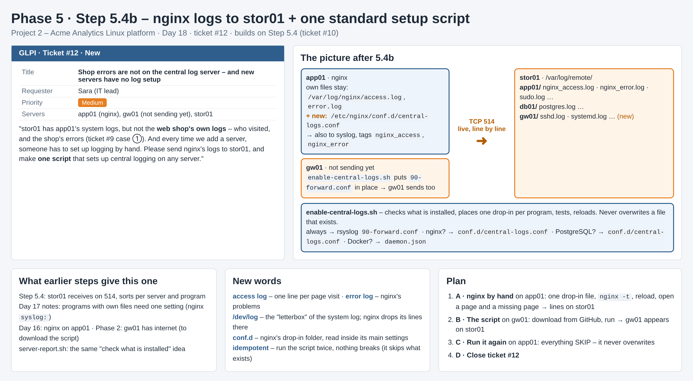

## Why

After Step 5.4, stor01 had app01's **system** logs (sudo, systemd, sshd …) but **not the web shop's own logs** – who visited, and the shop's errors (ticket #9 case ①). nginx writes those only into its own files. And every new server needed its logging set up by hand. So: (1) send nginx's logs to stor01, (2) one script that sets up central logging on any server.

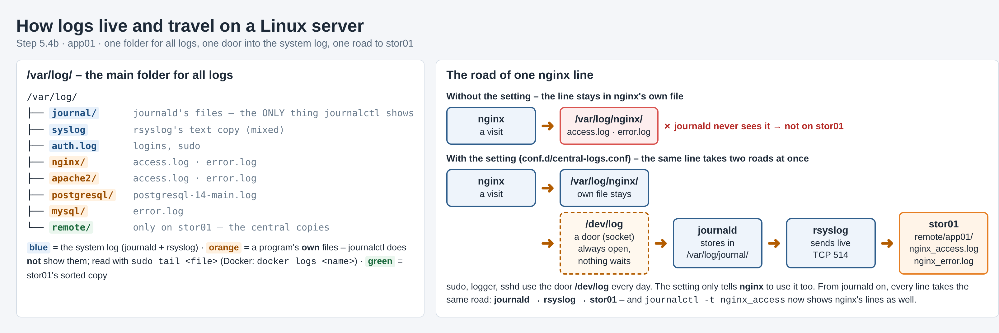

`/var/log/` is the main folder for all logs. `journalctl` shows only `journal/` (journald). A program's **own** files – `nginx/`, `apache2/`, `postgresql/`, `mysql/` – are read with `sudo tail <file>` (Docker: `docker logs <name>`). Without a setting, an nginx line stays in `/var/log/nginx/`. With the setting, nginx writes each line twice: into its own file **and** into `/dev/log` – a door journald always listens at – then **journald → rsyslog → stor01**.

## A · nginx by hand (app01)

Step 0: `systemctl is-active nginx` → `active`, `curl … http://localhost/` → `200` (the shop answers – curl opens the page like a browser; it is not ping).

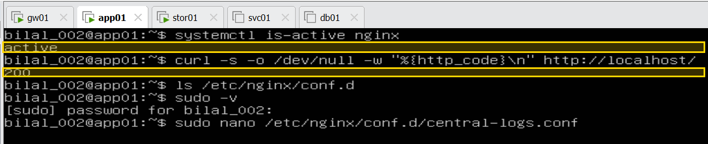

`/etc/nginx/conf.d/central-logs.conf`:

```
access_log syslog:server=unix:/dev/log,tag=nginx_access,nohostname;
error_log  syslog:server=unix:/dev/log,tag=nginx_error,nohostname;
```

| Part | Meaning |
|---|---|
| `access_log` / `error_log` | a second place for nginx's visit / problem lines – its own files stay |
| `syslog:server=unix:/dev/log` | drop each line into the system log's door – journald picks it up at once |
| `tag=nginx_access` | the name on the line – `journalctl -t nginx_access`, and the file name on stor01 |
| `nohostname` | no server name in front, so journald reads the tag as the name |

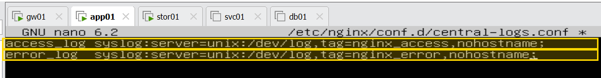

```bash
sudo nginx -t                                                             # check before loading
sudo systemctl reload nginx                                               # load – the shop keeps running
curl -s -o /dev/null -w "%{http_code}\n" http://localhost/                # act as a visitor → 200 + an access line
curl -s -o /dev/null -w "%{http_code}\n" http://localhost/nothing-here    # a missing page → 404
sudo journalctl -t nginx_access -n 2 --no-pager                           # sudo: nginx's lines are system lines
```

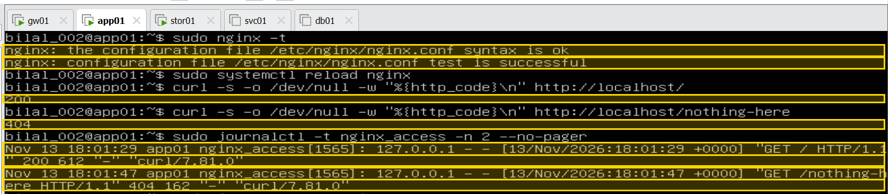

**`nginx_error` shows "No entries"** – not a fault: Ubuntu's default site answers a missing page quietly (`try_files … =404`), so the 404 is only in the access log. The error setting is in place; a real error (e.g. a folder with no page → 403 "directory index … is forbidden") would appear.

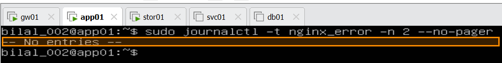

### First try without `nohostname` – what we checked and why we added it

`journalctl -t nginx_access` said "No entries", even with sudo. Checked step by step:

```bash
sudo tail -2 /var/log/nginx/access.log                                    # 1. nginx logged the visits? → yes, in its own file
grep -rn "access_log\|error_log" /etc/nginx/nginx.conf /etc/nginx/sites-enabled/   # 2. a site file overriding? → no
sudo journalctl --since "20 min ago" --no-pager | grep -i "nothing-here"  # 3. in journald under another name? → yes
```

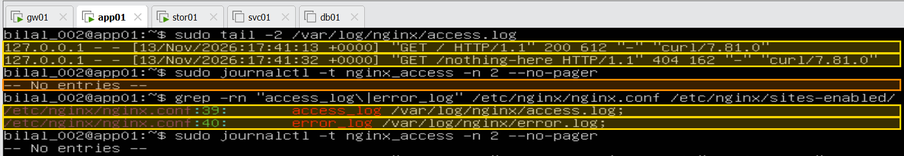

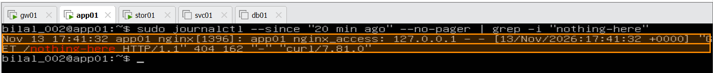

The line **arrived** – but named `nginx`, with our tag hidden inside the text (`app01 nginx[1396]: app01 nginx_access: …`). nginx put the **server name in front** (the network format); journald expects the name first, found `app01`, and fell back to the program name. On stor01 those lines landed in `app01.log`. One word, **`nohostname`**, leaves the server name out → our tag comes first → journald uses it.

**On stor01:**

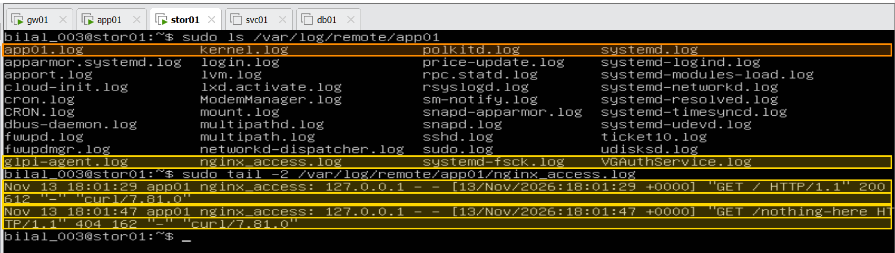

`nginx_access.log` with `GET /` 200 and `GET /nothing-here` 404 – the shop's visits are central. `app01.log` (orange) is the first try's "wrong envelope".

## B · The script on gw01

`enable-central-logs.sh` sets up **the server it runs on**: checks what is installed, places one drop-in per program (rsyslog, nginx, PostgreSQL, Docker), tests (`rsyslogd -N1`, `nginx -t`), reloads, removes its own file if a test fails, never overwrites an existing settings file.

```bash
curl -O https://raw.githubusercontent.com/muhammadbilaljaved684-dotcom/Linux-Platform/main/scripts/enable-central-logs.sh
sudo bash enable-central-logs.sh
logger -t central-test "hello from gw01"
```

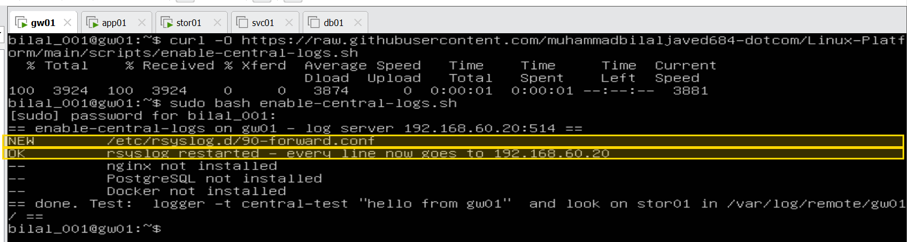

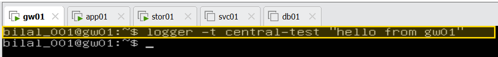

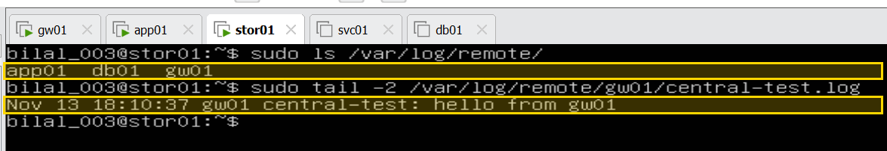

`NEW 90-forward.conf` · `OK rsyslog restarted` · stor01 now has **app01 · db01 · gw01**.

## C · Second run on app01 – nothing breaks

```bash
scp enable-central-logs.sh bilal_002@app01:~     # on gw01
sudo bash enable-central-logs.sh                  # on app01
```

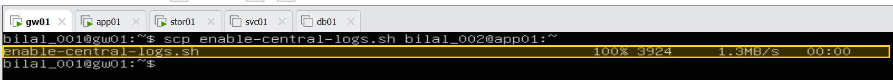

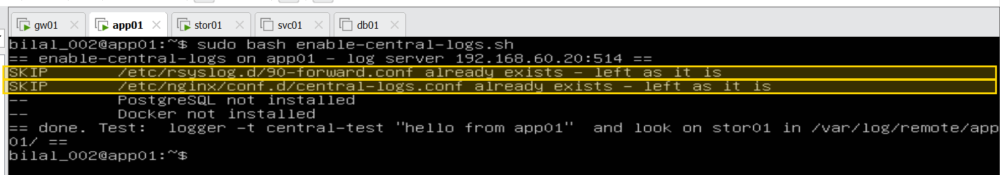

Everything **SKIP** – it never overwrites settings that exist ("idempotent"). Running it on many servers from one place is the job of **Ansible** – a later step.

## Ticket #12 – solved

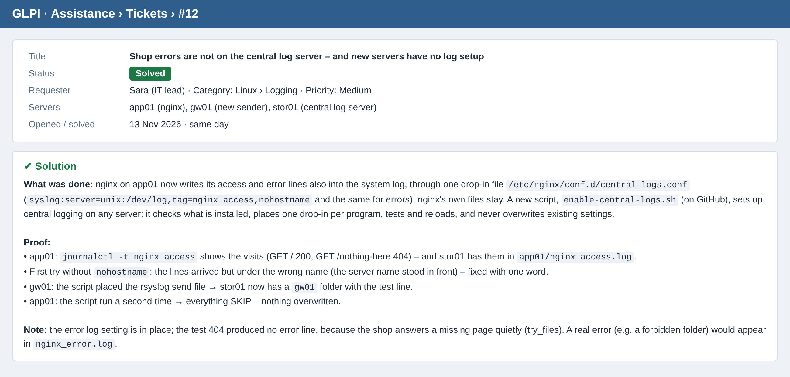

---

# Step 5.5 – Persistent journal (ticket #11)

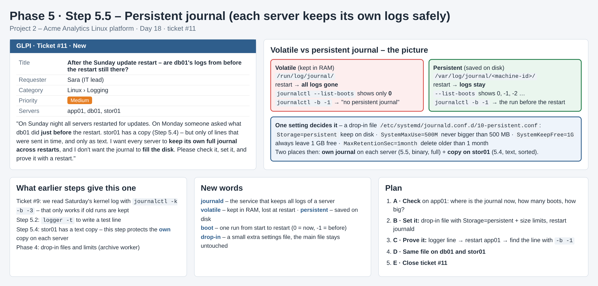

**Why.** rsyslog runs only in the middle of each run – it starts later than journald and stops earlier – so stor01 often misses the **start and the end** of a run, exactly what you need after a restart. **journald** keeps everything, from boot to shutdown, but only survives a restart when it is **persistent** (on the disk, `/var/log/journal`) – and on the disk it must never fill it. Who cleans what: **journald** its own files (rules below) · **logrotate** the text files (`/var/log/syslog`, nginx …, ready-made by Ubuntu in `/etc/logrotate.d/`) · stor01's `/var/log/remote` → Step 5.6.

## A · Check (app01, read-only)

```bash
ls -ld /var/log/journal /run/log/journal     # disk or RAM?
sudo journalctl --list-boots | tail -4       # earlier runs kept?
sudo journalctl --disk-usage                 # size
systemd-analyze cat-config systemd/journald.conf | grep -E "^(Storage|SystemMaxUse|SystemKeepFree|MaxRetentionSec)"   # rules written down?
df -h /var                                   # disk size and use
```

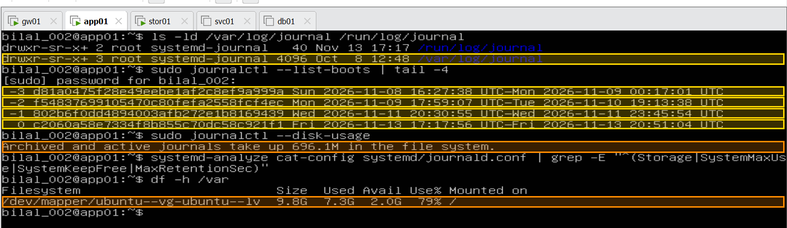

Already on the disk (4 earlier runs kept) – but **696 MB with no limit**, on a disk **79 % full, 2 GB free**.

## B · One drop-in file (app01)

`/etc/systemd/journald.conf.d/10-persistent.conf`:

```
[Journal]
Storage=persistent        # always on the disk
SystemMaxUse=500M         # at most 500 MB – then the oldest lines go
SystemKeepFree=1G         # at least 1 GB of the disk always free
MaxRetentionSec=1month    # lines older than 1 month go
```

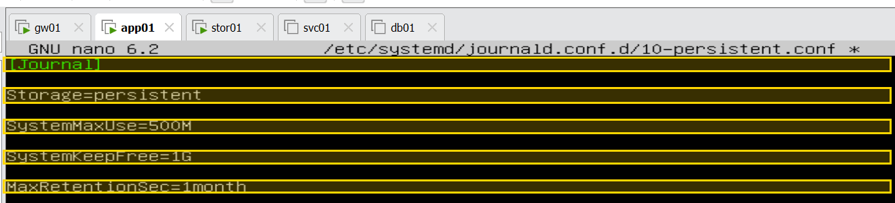

```bash
sudo systemctl restart systemd-journald
systemctl is-active systemd-journald
systemd-analyze cat-config systemd/journald.conf | grep -E "^(Storage|SystemMaxUse|SystemKeepFree|MaxRetentionSec)"
sudo journalctl --disk-usage
```

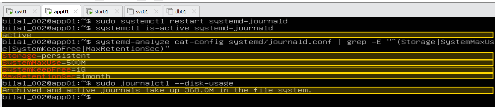

All 4 rules in force · the journal shrank **696.1M → 368.0M** at once – journald deleted its oldest files to get under 500 MB.

## C · Proof with a restart

```bash
logger -t ticket11 "app01 before restart"
sudo journalctl --list-boots | tail -2
sudo reboot
# after the restart
sudo journalctl --list-boots | tail -3
sudo journalctl -b -1 -t ticket11
sudo journalctl -b -1 -n 5 --no-pager
sudo tail -2 /var/log/remote/app01/ticket11.log    # on stor01
```

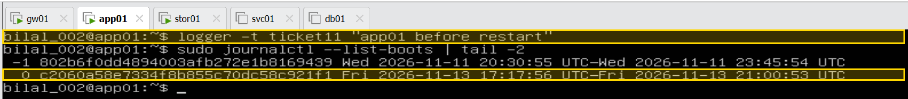

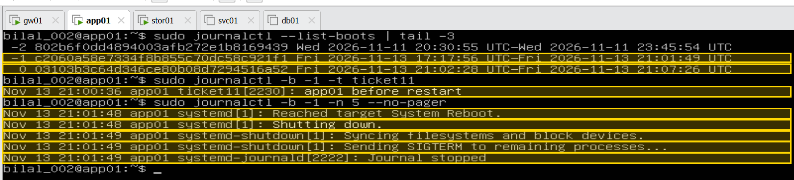

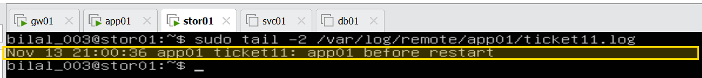

The line written **before** the restart is found with `-b -1` – and the last lines before it (`Shutting down` … `Journal stopped`), which stor01 does not get. The same test line is on stor01 → **two places**.

### Two tests

| | Restart of journald (B, D) | Reboot of the whole server (C) |
|---|---|---|
| What restarts | only the log service – shop and DB keep running | the whole server – about a minute down |
| New boot? | no | yes – old run becomes -1 |
| Checks | rules applied, journald cleans up (696M → 368M) | lines on the disk survive into the next run |

Both load new settings – the difference is the cost. Restart only the service that needs them; the reboot was the proof, once, on app01. Part D is not a third test: it gives db01 the same limits, so its journal can never fill the disk the shop database writes to.

## D · Same file on db01 (no server restart)

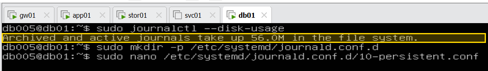

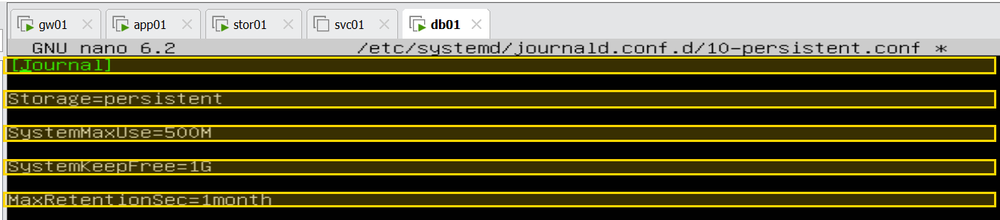

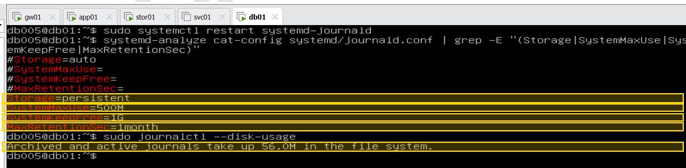

56 MB before and after – already under the limit; the rules now guard it. `#Storage=auto` … are Ubuntu's switched-off defaults (`#` = not active). **stor01: the same file – to do.**

## Ticket #11 – solved

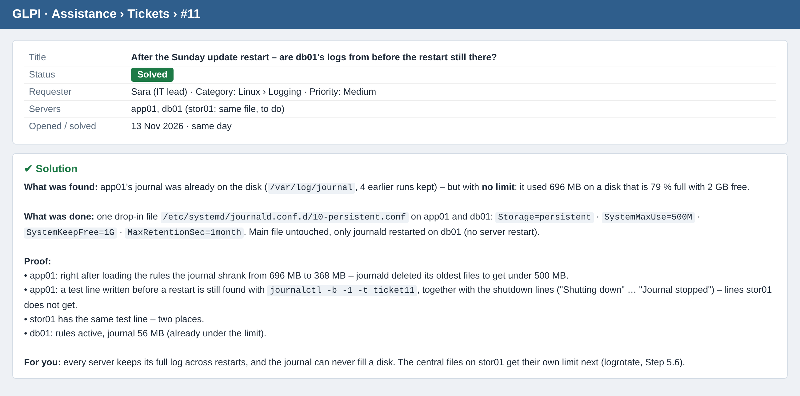

**Next:** stor01 (same file) · Step 5.6 – logrotate for `/var/log/remote` on stor01.
