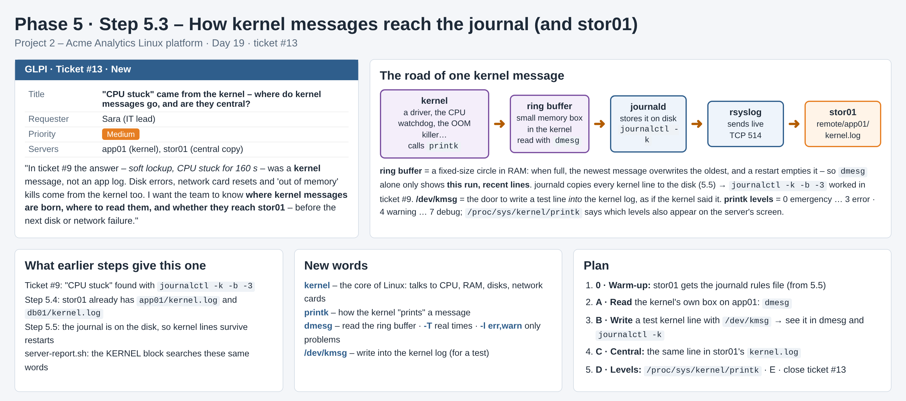
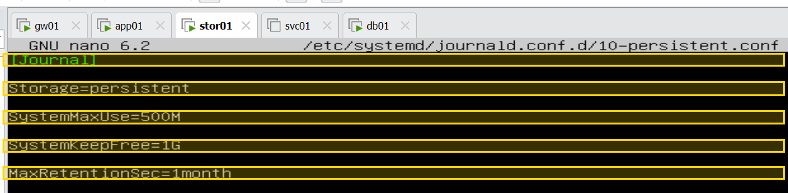
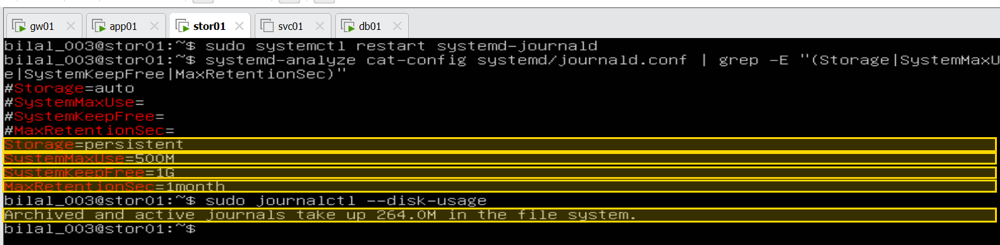
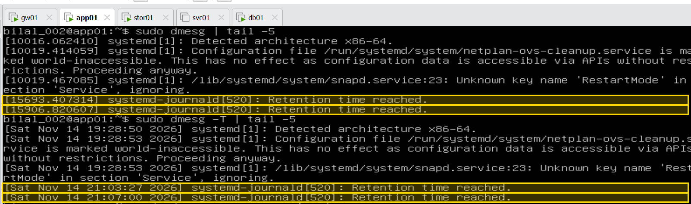
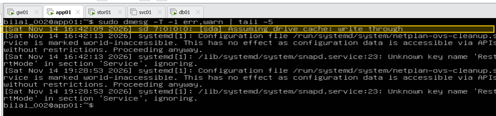
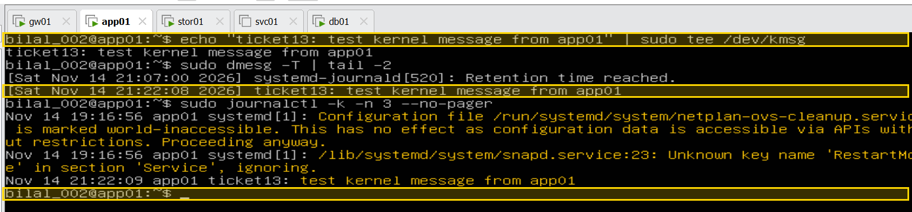
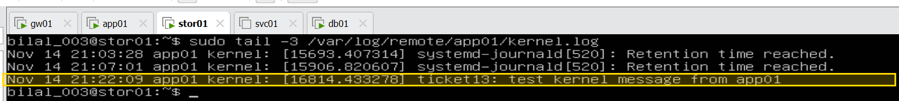
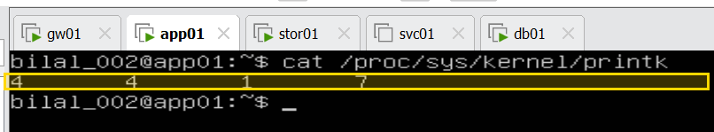
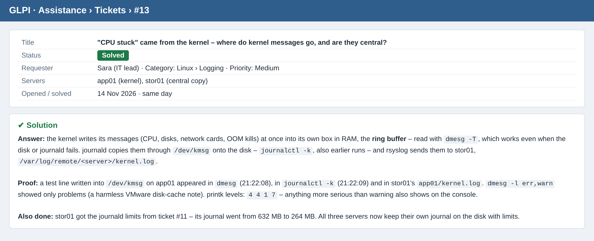

# Day 19 – 2026-11-14: How kernel messages reach the journal (Step 5.3, ticket #13)

| | |
|---|---|
| **Phase** | 5 – Observability · Step 5.3 · finishes Step 5.5 on stor01 |
| **Hosts worked on** | app01 (kernel), stor01 (journald limits + central copy) |
| **Print copy** | [Step 5.3 – ticket #13 with screenshots](Project-2-Day-19-step-5.3-ticket-13.pdf) |
| **Status** | 0 stor01 journald limits ✅ · A dmesg ✅ · B test line via /dev/kmsg ✅ · C stor01 kernel.log ✅ · D printk levels ✅ · **ticket #13 solved** ✅ |

**Ticket #13 (Sara):** "Ticket #9's answer – *CPU stuck* – was a kernel message. Where are kernel messages born, where do we read them, and do they reach stor01?"



## Final paragraph

The **kernel** runs in RAM as the manager of the hardware. Its messages – CPU stuck, disk errors, network card resets, OOM kills – go **at once** into its own box in RAM, the **ring buffer**, read with `sudo dmesg -T`. **Order: printk → ring buffer → `/dev/kmsg` → journald** – the kernel *writes* with printk into the ring buffer; journald *reads* it from there through `/dev/kmsg`. That works even when the disk or journald fails, so it is the first check for **OS and hardware** problems: when a disk breaks, Linux switches it to **read-only**, journald can no longer save, but the reason ("I/O error", "EXT4-fs error") is still in the ring buffer. **journald** copies the kernel's lines through the door **`/dev/kmsg`**; its setting decides where its copy lives – volatile = RAM (`/run/log/journal`), persistent = disk (`/var/log/journal`, Step 5.5) – read with `journalctl -k`, also earlier runs. **rsyslog** sends them to stor01's `kernel.log`. Normal programs like **nginx** use a different door, **`/dev/log`**, straight to journald – never through the ring buffer, so `dmesg` never shows them.

| Door | Who uses it | Where the line goes |
|---|---|---|
| `/dev/kmsg` | the kernel (and us, for a test) | ring buffer → journald copies it |
| `/dev/log` | nginx, logger, sudo | straight to journald |

## 0 · stor01 gets the journald limits (finishes 5.5)





632.1M → **264.0M**. All three servers now keep their own journal on the disk with limits: app01 696 → 368 MB · db01 56 MB · stor01 632 → 264 MB.

## A · Read the kernel's own box (app01)

```bash
sudo dmesg | tail -5                  # time = seconds since boot
sudo dmesg -T | tail -5               # real times
sudo dmesg -T -l err,warn | tail -5   # only problems
```





`systemd[1]` also writes into the kernel log at start · `Retention time reached` = our 5.5 rule `MaxRetentionSec=1month` at work · `[sda] Assuming drive cache: write through` = a disk-driver warning, harmless on VMware · netplan/snapd notes = ignore for this ticket.

## B · A test line through the kernel's door (app01)

```bash
echo "ticket13: test kernel message from app01" | sudo tee /dev/kmsg
sudo dmesg -T | tail -2               # 1. ring buffer (RAM)
sudo journalctl -k -n 3 --no-pager    # 2. journald (disk), -k = kernel only
```



## C · The same line on stor01

```bash
sudo tail -3 /var/log/remote/app01/kernel.log
```



3\. central copy – `app01 kernel: [16814.433278] ticket13: …`.

## D · Levels



`4 4 1 7` – the first 4: emergency, alert, critical, error (0–3) also show on app01's screen. Levels: 0 emergency · 1 alert · 2 critical · 3 error · 4 warning · 5 notice · 6 info · 7 debug.

## Ticket #13 – solved



**Next:** [Day 20](day-20-2026-11-15.md) – Step 5.6, logrotate for stor01's `/var/log/remote/` (finishes Phase 5).
