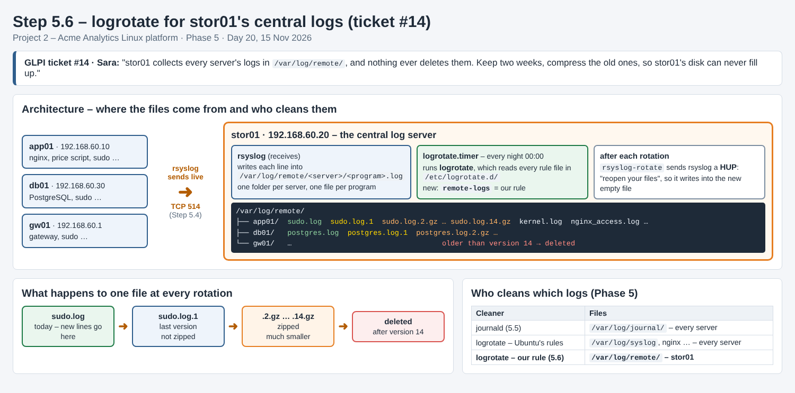
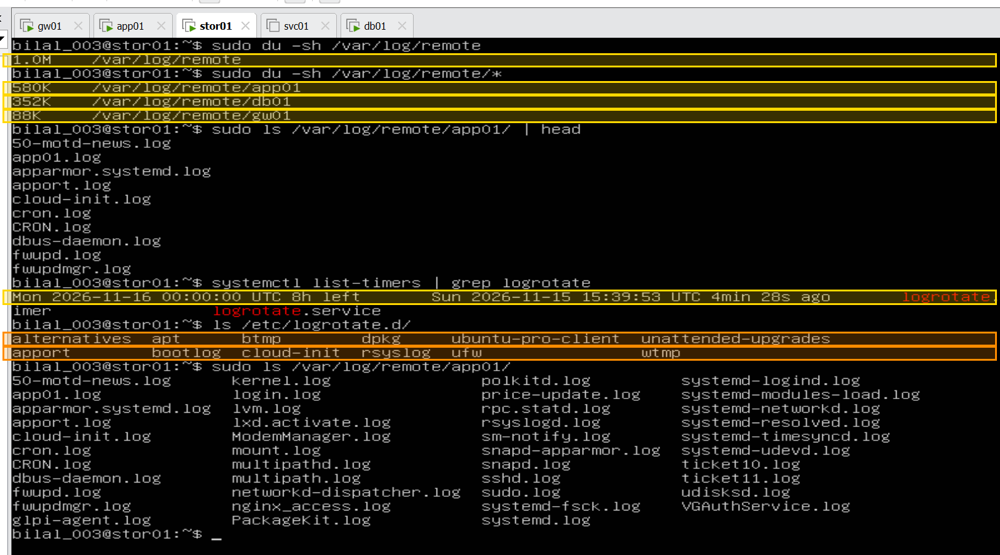
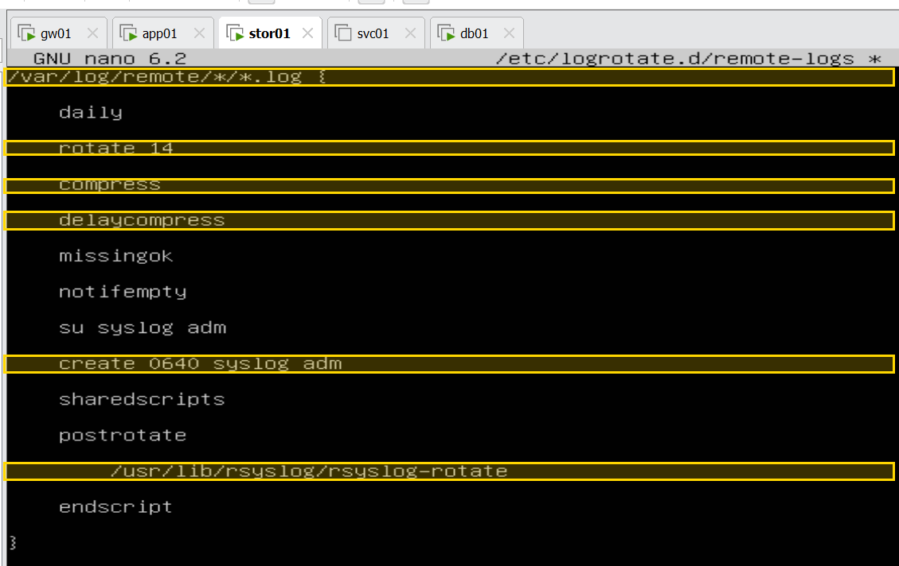
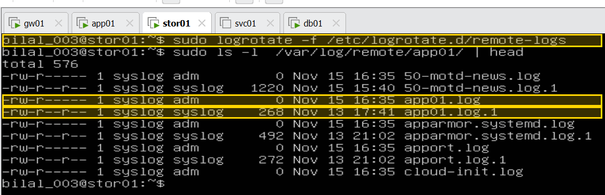
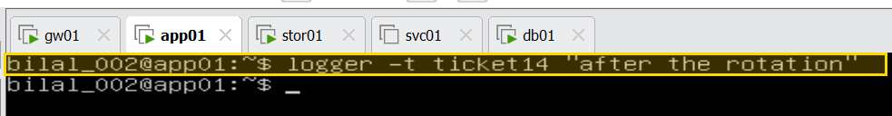
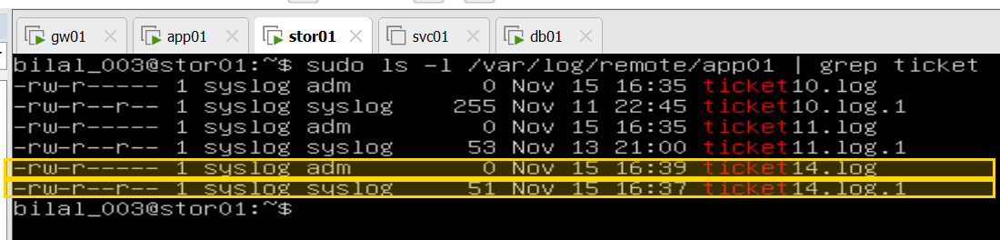
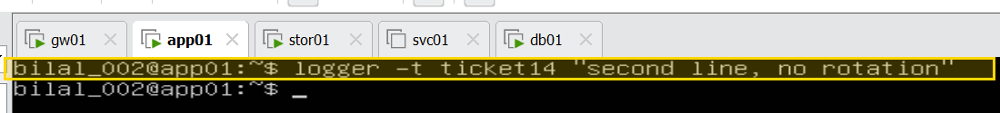
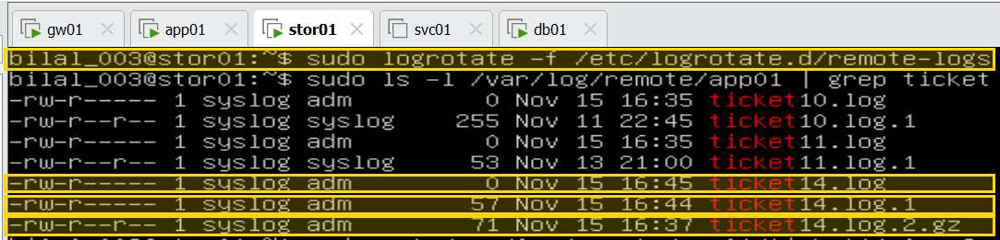
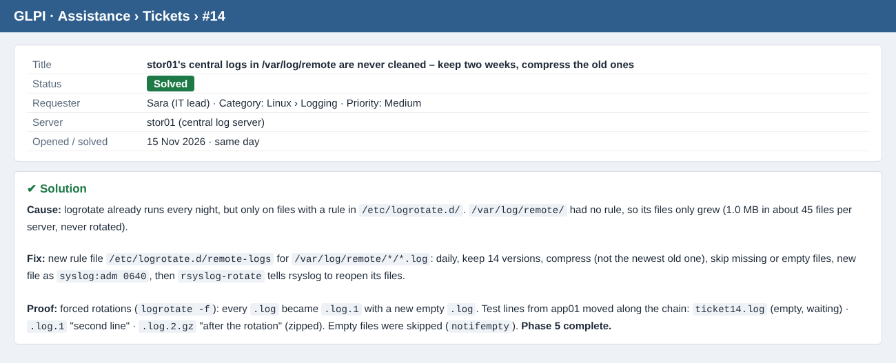
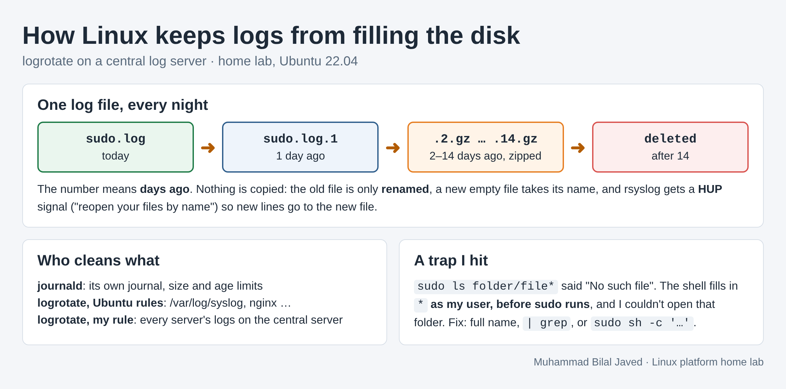

# Day 20 – 2026-11-15: logrotate for stor01's central logs (Step 5.6, ticket #14)

| | |
|---|---|
| **Phase** | 5 – Logging · Step 5.6 · **last step – Phase 5 complete** (5.7 eBPF optional) |
| **Hosts worked on** | stor01 (rule + rotations), app01 (test lines) |
| **Print copy** | [Step 5.6 – ticket #14 with screenshots](Project-2-Day-20-step-5.6-ticket-14.pdf) |
| **Status** | A check ✅ · B rule ✅ · C forced rotation ✅ · D proof chain `.log` → `.log.1` → `.log.2.gz` ✅ · **ticket #14 solved** ✅ |

**Ticket #14 (Sara):** "stor01 collects every server's logs in `/var/log/remote/`, and nothing ever deletes them. Keep two weeks, compress the old ones, so stor01's disk can never fill up."



## Final paragraph

stor01 collects every server's logs in **`/var/log/remote/<server>/<program>.log`** (Step 5.4), and nothing ever cleaned them. The check showed **1.0 MB** (app01 580K, db01 352K, gw01 88K), about 45 files per server, all `.log`, with no `.log.1` and no `.gz`, so nothing had ever been rotated. Small today, but every server adds to it every day. **logrotate** is built into Ubuntu and already runs **by itself every night** (`logrotate.timer`). On each run it reads every **rule file** in **`/etc/logrotate.d/`**, one per program (`apt`, `ufw`, `rsyslog` …), and each rule says which files to rotate, how often and how many old versions to keep. **Our folder had no rule there, so logrotate skipped it**: its files never got versions and only grew. journald's limits from 5.5 don't help, because they clean only journald's own files, and these are text files written by rsyslog. So we added one rule file, **`/etc/logrotate.d/remote-logs`**. On every rotation each file is **renamed** `.log → .log.1`, the older `.1` moves to `.2.gz` (**zipped**), and so on up to **14**. Then the oldest is **deleted**, and a new **empty** `.log` is created as `syslog:adm 0640`. rsyslog gets a **HUP** ("reopen your files"), so new lines go into the fresh file. So there are never more than 14 old versions per file, about two weeks with `daily` (a quiet file is skipped on empty days by `notifempty`, so its 14 versions last longer). `logrotate -f` forced rotations so we could watch it happen. The proof is ticket14: `ticket14.log` is empty and waiting, `.log.1` holds "second line, no rotation", and `.log.2.gz` holds "after the rotation" (zipped). Empty files like `ticket10.log` were left alone. To read the numbers: **number = days ago**, so today's lines are always in plain `sudo.log`; no line is ever moved – only renamed – and **HUP** makes rsyslog open the new file by name. Trap: **bash** (running as you) fills in every `*` **before** `sudo` starts; in a folder you may not open (`app01/` belongs to syslog) the star stays a plain star → "No such file". Use the full name, `| grep`, or `sudo sh -c '…'`. Every log in the lab now has a cleaner: **journald** for the journal (5.5), and **logrotate** for the text files on every server (Ubuntu's rules) and on stor01 (our rule). **No disk can be filled by logs, and Phase 5 is complete.**

## The rule file – commented

```
/var/log/remote/*/*.log {          # every .log file in every server's folder (app01/, db01/, gw01/ …)
    daily                           # rotate once a day
    rotate 14                       # keep 14 old versions (about 2 weeks) – the oldest is deleted
    compress                        # zip old versions (.gz) – much smaller
    delaycompress                   # but leave the newest old one (.1) unzipped – easy to read
    missingok                       # no error if a file is missing
    notifempty                      # skip empty files – no rotation if nothing was written
    su syslog adm                   # work as rsyslog's user, because the folder belongs to syslog
    create 0640 syslog adm          # new empty file: owner syslog, group adm, rw-r----- so rsyslog can write
    sharedscripts                   # run the script below once per run, not once per file
    postrotate                      # after renaming:
        /usr/lib/rsyslog/rsyslog-rotate   # HUP to rsyslog: "reopen your files" → writes into the new file
    endscript
}
```

## How one file moves – sudo.log, day by day

| Day | `sudo.log` | `sudo.log.1` | `sudo.log.2.gz` | What logrotate did at 00:00 |
|---|---|---|---|---|
| Monday | Monday's lines | – | – | nothing yet – rsyslog made `sudo.log` with the first sudo line |
| Tuesday | **Tuesday's** lines | Monday | – | renamed `sudo.log` → `.1`, made a new `sudo.log`, HUP |
| Wednesday | **Wednesday's** lines | Tuesday | Monday (zipped) | `.1` → `.2.gz`, `sudo.log` → `.1`, new `sudo.log`, HUP |

**Number = days ago:** `sudo.log` = today · `.1` = 1 day ago · `.2.gz` = 2 days ago … `.14.gz` = 14 days ago → next night deleted. At most 15 files. **No line is ever moved or copied** – the old file is only **renamed**, its lines stay inside. rsyslog still has that old file open, so without help it would keep writing into `.1`; **HUP** = "close your files, open them again by name" → it opens the new `sudo.log`.

## Trap – the `*` and sudo

```bash
sudo ls -l /var/log/remote/app01/ticket14.log*            # ❌ No such file or directory
echo /etc/*                                               # ✔ long list – everyone may read /etc
echo /var/log/remote/app01/*                              # ❌ prints the * itself – bilal_003 may not look into app01/
sudo ls -l /var/log/remote/app01/ticket14.log.1           # ✔ full name – no * to fill in
sudo ls -l /var/log/remote/app01 | grep ticket14          # ✔ ls (as root) opens the folder, grep filters
sudo sh -c 'ls -l /var/log/remote/app01/ticket14.log*'    # ✔ a root shell fills in the *
```

**Why:** every line is first read by **bash**, running as **you** (bilal_003). bash fills in every `*` – anywhere in the line – by looking into the folder **with your permissions**. Only then does `sudo` start `ls` as root. `app01/` belongs to `syslog`, so bash cannot look inside, leaves the star as a plain star, and `ls` searches for a file literally named `ticket14.log*`. The line still runs – it just finds nothing.

## A · Check (stor01)

```bash
sudo du -sh /var/log/remote                # disk usage, one total, human-readable (K/M/G)
sudo du -sh /var/log/remote/*              # * = one line per server folder
sudo ls /var/log/remote/app01/ | head      # files app01 sent, one per program – head = first 10 only
systemctl list-timers | grep logrotate     # all scheduled jobs, keep only logrotate's line
ls /etc/logrotate.d/                       # the rule files logrotate reads on every run
```



| Command | What it tells us |
|---|---|
| `du -sh /var/log/remote` | **1.0M**: all central logs together |
| `du -sh /var/log/remote/*` | app01 **580K** · db01 **352K** · gw01 **88K**. app01 sends the most. |
| `ls … app01/` | about 45 files, all `.log`, no `.1` and no `.gz`, so **never rotated** |
| `list-timers` | logrotate runs **by itself every night**: last run 15:39, next run 00:00 UTC |
| `ls /etc/logrotate.d/` (orange) | Ubuntu's rules (`rsyslog`, `apt`, `ufw` …), but **no rule for /var/log/remote** |

## B · The rule (stor01)

```bash
sudo nano /etc/logrotate.d/remote-logs     # type the rule (commented above) · Ctrl+O, Enter, Ctrl+X
```



The rule now sits next to Ubuntu's own rules, so from the next nightly run logrotate rotates our folder too.

## C · Force one rotation (stor01)

```bash
sudo logrotate -f /etc/logrotate.d/remote-logs   # -f = force: rotate now, don't wait for tonight
sudo ls -l /var/log/remote/app01/ | head          # -l = size, owner and time of each file
```



`app01.log` **0 bytes, 16:35** = the new empty file · `app01.log.1` **268 bytes** = the old lines. New files are `syslog adm -rw-r-----`, exactly our `create 0640 syslog adm`. The old ones (`syslog syslog -rw-r--r--`) were made by rsyslog.

## D · Proof – lines move along the chain (app01 + stor01)

```bash
logger -t ticket14 "after the rotation"                  # app01 – line 1 into the fresh ticket14.log
sudo logrotate -f /etc/logrotate.d/remote-logs           # stor01 – rotation 2
sudo ls -l /var/log/remote/app01 | grep ticket           # stor01 – only the ticket files
```





`ticket14.log.1` 51 bytes = line 1, already rotated · new empty `ticket14.log` · `ticket10.log` / `ticket11.log` are 0 bytes and their `.1` is unchanged, so **empty files are skipped** (`notifempty`).

```bash
logger -t ticket14 "second line, no rotation"            # app01 – line 2
sudo logrotate -f /etc/logrotate.d/remote-logs           # stor01 – rotation 3
sudo ls -l /var/log/remote/app01 | grep ticket
```





The full chain: `ticket14.log` **0** = waiting for new lines · `.log.1` **57** = "second line" (not zipped, `delaycompress`) · `.log.2.gz` **71** = "after the rotation", **zipped**. The .gz is bigger than the text (51) only because gzip adds a small header; real log files shrink by about 90 %. Read a zipped one with `sudo zcat /var/log/remote/app01/ticket14.log.2.gz`.

## Ticket #14 – solved



## Summary picture (LinkedIn post)



**Phase 5 complete.** Next: Phase 5A – monitoring and alerting (Prometheus + Grafana).
