# Day 21 – 2026-11-16: eBPF – who did what on app01 (Step 5.7, ticket #16)

| | |
|---|---|
| **Phase** | 5 – Observability · Step 5.7 (optional) · start of Phase 5A |
| **Hosts worked on** | app01 (eBPF tools), gw01 (test traffic), db01 (slow query), stor01 (central logs) |
| **Print copy** | [Step 5.7 – ticket #16 with screenshots](Project-2-Day-21-step-5.7-ticket-16.pdf) |
| **Revision** | [eBPF – simple revision (3 pages)](Project-2-eBPF-revision.pdf) |
| **Scripts** | [scripts/tcplife.bt](../../scripts/tcplife.bt) · [scripts/ebpf-report.sh](../../scripts/ebpf-report.sh) · [scripts/deletesnoop.bt](../../scripts/deletesnoop.bt) (to do) |
| **Status** | A install ✅ · B execsnoop ✅ · C opensnoop ✅ · D tcplife (bpftrace) ✅ · E report script ✅ · F top ✅ · G queued logs arrived ✅ · **ticket #16 solved** ✅ |

**Ticket #16 (Sara):** "Metrics show *how much*. When the shop is busy I want to see *who* is doing *what*: which programs start, which files nginx opens, which connections go to db01."

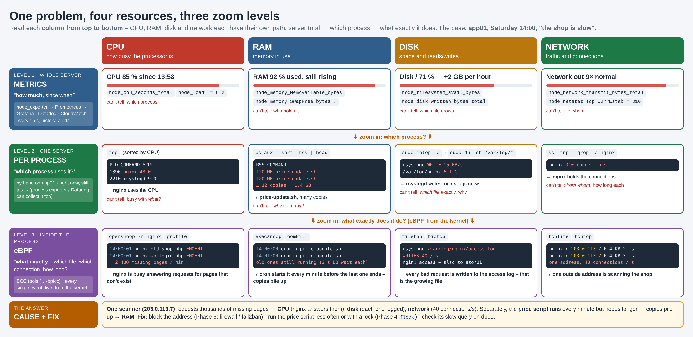

## Final paragraph

Monitoring has three levels. **Metrics** (Prometheus/Grafana, Datadog, CloudWatch) show **how much** for the whole server, with history and alerts. **top / ps / iotop / ss** show **which process** uses how much, right now. **eBPF** shows **what each process actually does**: every program started, file opened and connection made, live from the **kernel**, without changing any program. (Windows has the same: Task Manager → Performance, Task Manager → Processes, and Resource Monitor / Process Monitor on top of ETW.) eBPF programs are small, safety-checked programs that the kernel's **verifier** checks before they run. On app01 we used two front-ends: the ready-made **BCC tools** and **bpftrace**. `execsnoop` showed that two typed commands (`ls`, `date` over ssh) started about **35 programs**, Ubuntu's hidden login scripts, all too short for `top`. `opensnoop` showed nginx opening exactly **one file per visit**; the missing page left no line, because nginx only *checks* (stat) a missing file and never *opens* it, and each eBPF tool sees one kind of action. BCC's `tcplife` **did not compile** (BCC 0.18 is older than the 5.15.0-203 kernel headers), so we wrote our own **`tcplife.bt`** in bpftrace on the stable tracepoint `sock:inet_sock_set_state`. On the way, bpftrace 0.14 failed on `BEGIN`/`END` blocks (removed), and failed connections were added. It showed a web visit at **68 ms**, the **psql query to db01 at 2127 ms**, and, without being asked, **rsyslog failing to reach stor01:514** because stor01 was off. Then **`ebpf-report.sh`** runs nine checks at once: new programs, files, CPU, CPU wait, disk, TCP in/out/duration/failed, retransmits, OOM kills and kill signals. The verifier rejected one big TCP probe, so it was split into five small ones. In 60 seconds it found the **20 visits from gw01 (4–29 ms)**, **psql → db01:5432 = 2044 ms**, the ssh session, **two failed connections and retransmits to stor01:514**, and no OOM kills or kill signals. One "unknown" `grep` in `/usr/local/bin` was only the shell **trying** each PATH folder: `execve` *entered* isn't *succeeded*, so check with `ls` / `which -a` before raising an alarm. `top` at the same time showed load 0.03 and none of this. When stor01 was started again, app01's queued lines arrived (files at 19:09). **Metrics show that something is high, and eBPF shows who is causing it.**

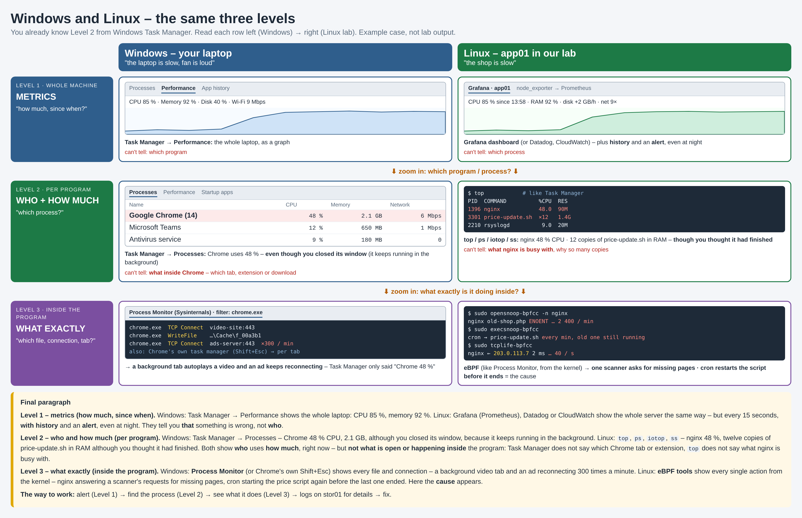

## A · Install (app01)

```bash
uname -r                                                     # kernel version – eBPF needs 4.x+
sudo apt install -y bpfcc-tools linux-headers-$(uname -r)    # BCC tools + kernel headers
ls /usr/sbin/*-bpfcc | wc -l                                 # how many ready-made tools
```

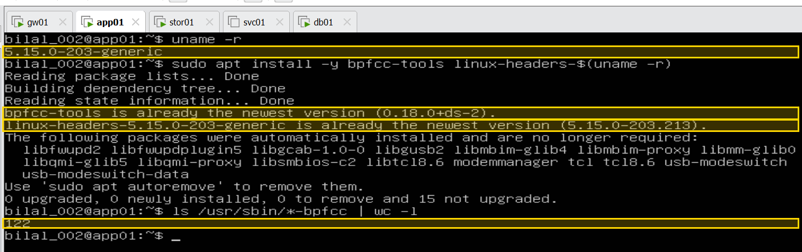

Kernel **5.15.0-203**, both packages already installed, **122** tools.

## B · Every program that starts – execsnoop

```bash
sudo execsnoop-bpfcc                     # app01 – leave it running
ssh bilal_002@app01 'ls /tmp; date'      # gw01 – two commands
```

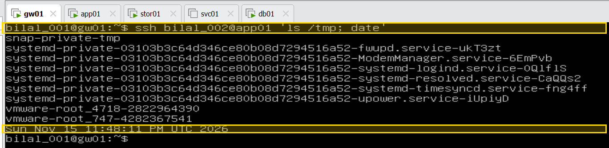

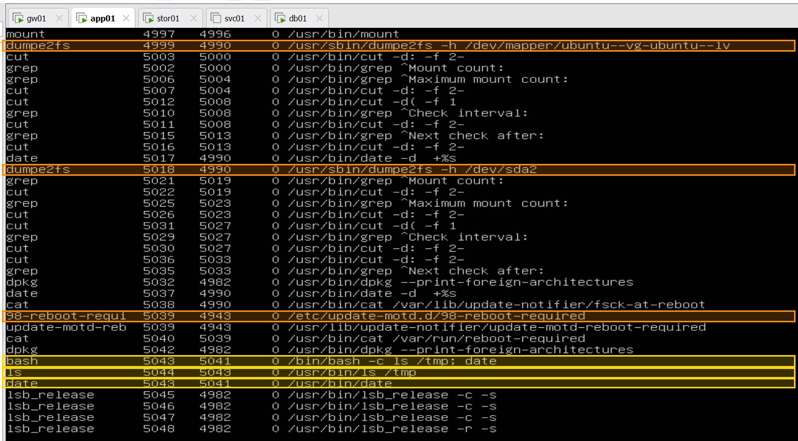

Yellow: **our two commands**, `sshd (5041) → bash (5043) → ls (5044)`, and `date` taking over bash's own PID (exec). Orange: programs we never typed, Ubuntu's login scripts (`dumpe2fs` disk-check counters, `98-reboot-required`). The compile warnings at start are normal (BCC compiles its program each time).

## C · Every file nginx opens – opensnoop

```bash
sudo opensnoop-bpfcc -n nginx                                # app01
curl -s -o /dev/null http://192.168.60.10/                   # gw01 – a visit
curl -s -o /dev/null http://192.168.60.10/nothing-here       # gw01 – a missing page
```

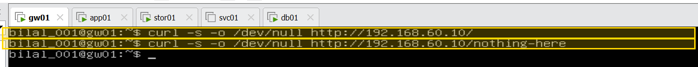

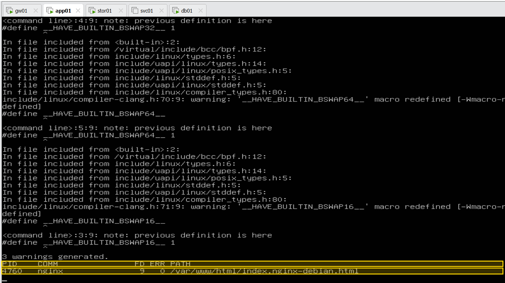

`nginx · FD 9 · ERR 0 · /var/www/html/index.nginx-debian.html`: the exact file that served the visit. No line for the missing page: nginx's `try_files` only **stat**s, it never opens.

## D · Every connection and how long – tcplife

BCC's tcplife failed, and so did bpftrace's BEGIN block:

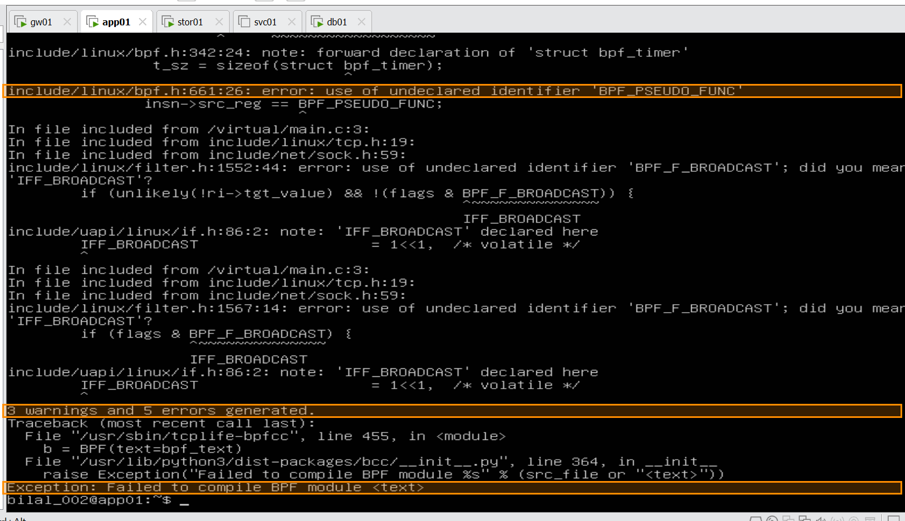

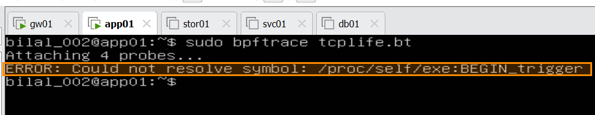

Our own version, on GitHub:

```bash
curl -O https://raw.githubusercontent.com/muhammadbilaljaved684-dotcom/Linux-Platform/main/scripts/tcplife.bt
sudo bpftrace tcplife.bt
```

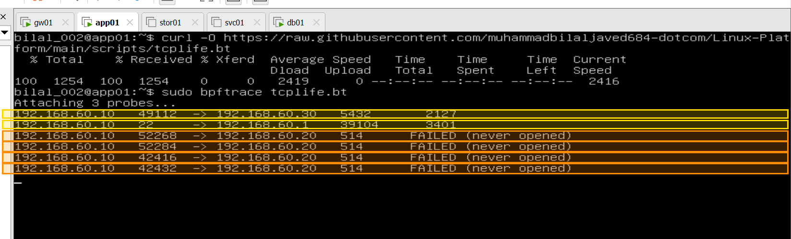

Yellow: **psql → db01:5432 = 2127 ms** and the ssh session. Orange: **FAILED → 192.168.60.20:514**, rsyslog can't reach stor01 (switched off).

## E · All checks at once – ebpf-report.sh

```bash
curl -O https://raw.githubusercontent.com/muhammadbilaljaved684-dotcom/Linux-Platform/main/scripts/ebpf-report.sh
sudo bash ebpf-report.sh 60                                                      # app01
for i in $(seq 20); do curl -s -o /dev/null http://192.168.60.10/; done          # gw01
ssh bilal_002@app01 'psql -h db01 -U shopapp -d shop -c "SELECT pg_sleep(2);"'    # gw01
```

First run – the verifier rejected the big TCP probe (fixed by splitting it into five):

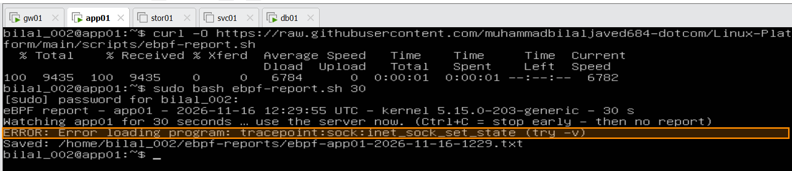

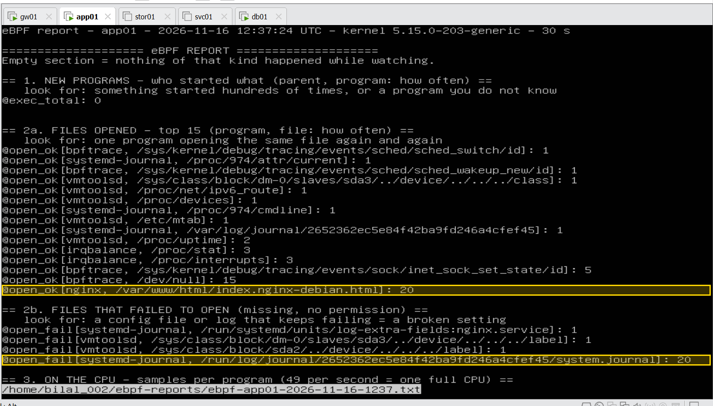

**nginx opened index.nginx-debian.html 20 times** = 20 visits. **systemd-journal /run/log/journal … : 20**: each visit's `nginx_access` line (Step 5.4b) made journald look for its RAM journal first, which is gone since Step 5.5 (persistent). Harmless.

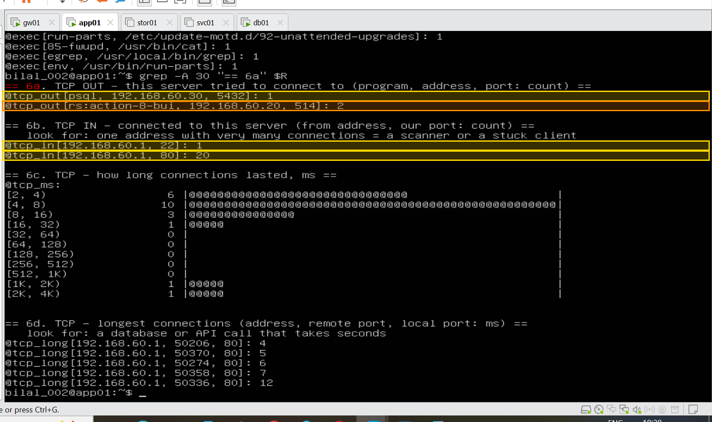

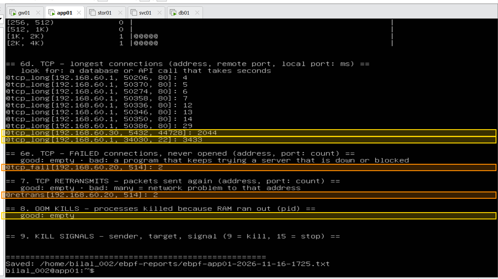

| Section | Result |
|---|---|
| 6a TCP OUT | `psql → 192.168.60.30:5432` · rsyslog → `192.168.60.20:514` ×2 |
| 6b TCP IN | `192.168.60.1 → 80` ×20 · `→ 22` ×1 |
| 6d longest | web 4–29 ms · **db01:5432 = 2044 ms** · ssh 3433 ms |
| 6e failed / 7 retransmits | `192.168.60.20:514` ×2 – stor01 off |
| 8 OOM / 9 kills | empty ✅ |

The `/usr/local/bin/grep` seen in section 1 was the shell trying each PATH folder:

```bash
ls -l /usr/local/bin/grep ; which -a grep     # app01 – no such file; the real grep is /usr/bin/grep
```

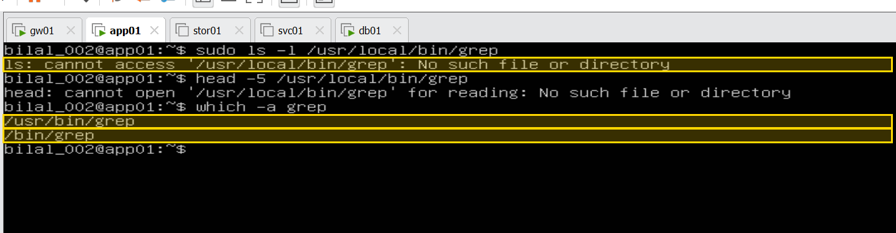

## F · top for comparison

```bash
top -b -n 1 | head -15
```

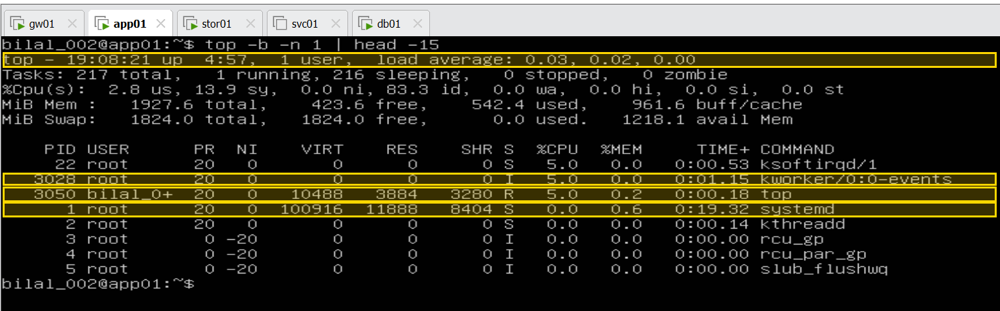

Load 0.03, only kernel threads: **none** of the findings above are visible.

## G · stor01 back – queued logs arrived

```bash
sudo ls -lt /var/log/remote/app01/ | head -5      # stor01
```

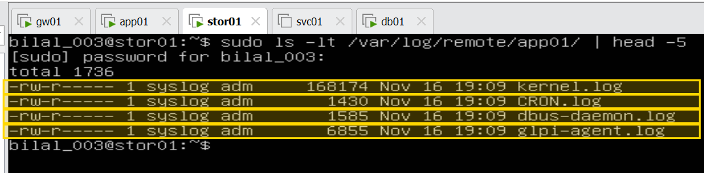

## Ticket #16 – solved

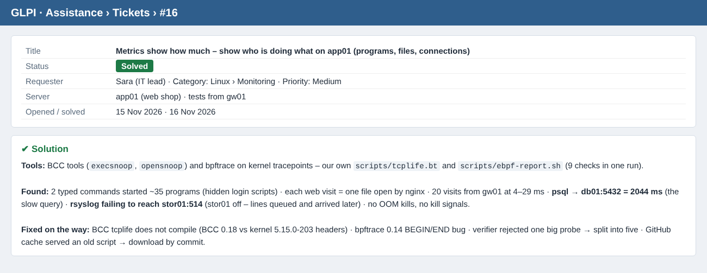

**Next:** Phase 5A – Lab 2, node_exporter on all 5 servers.
