> For fast revision: each step keeps only **why** we did it, the **commands**, the **screenshots** and my **final understanding**. Full details, tables and issue analyses are in the day reports and the complete guide.

# Day 1 – 13 Oct: Phase 0 and the network foundation
> The same story as a document to download: [Project-2-Day-1-story.odt](Project-2-Day-1-story.odt). The detailed technical reports are [part 1](day-01-2026-10-13.md) and [part 2](day-01-2026-10-13-part2-network.md).

## The story in one paragraph

Acme Analytics is a small company whose server setup has grown messily: nobody controls what reaches the internet, nothing is documented, and nobody could rebuild a server the same way twice. My job is to build a clean, controlled platform. On Day 1 I first **recorded how the servers looked** before touching anything. Then I built the **network foundation**: every server got a fixed address, the two internal servers lost their own internet connection, and the gateway server gw01 became the **one and only door** to the internet. At the end of the day, app01 – a server with no internet card of its own – could reach the internet through gw01, the outside world saw only gw01's address, and the servers could find each other by name. Along the way I hit and solved ten real problems.

## Chapter 0 – The plan and the machines

### Where are we?


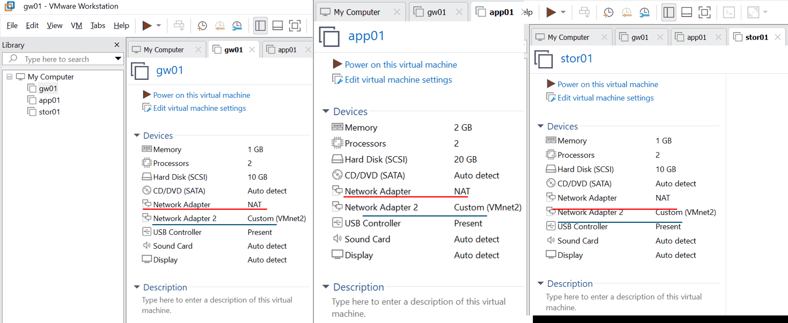

### Why do we go to the next step?

Before changing anything, a good engineer writes down how the system looks *now*. Otherwise, when something breaks later, there is nothing to compare against.

## Chapter 1 – Know the system (Phase 0)

### Step 0.1 – Engine, drivers and memory

**What I did and why.** The **kernel** is the engine of Linux. **Modules** are drivers – small add-ons that let the engine use hardware. I recorded the engine version, the loaded drivers, the memory, and one important switch: whether gw01 may pass traffic between networks.

```
uname -r                     # kernel version only
uname -a                     # everything: name, kernel, build date, CPU type
cat /proc/version            # the kernel's own description (compiler, build)
lsmod | head                 # first 10 loaded drivers
free -h                      # memory and swap, in human-readable units
sysctl net.ipv4.ip_forward   # may this machine route traffic? (0 = no, 1 = yes)
```

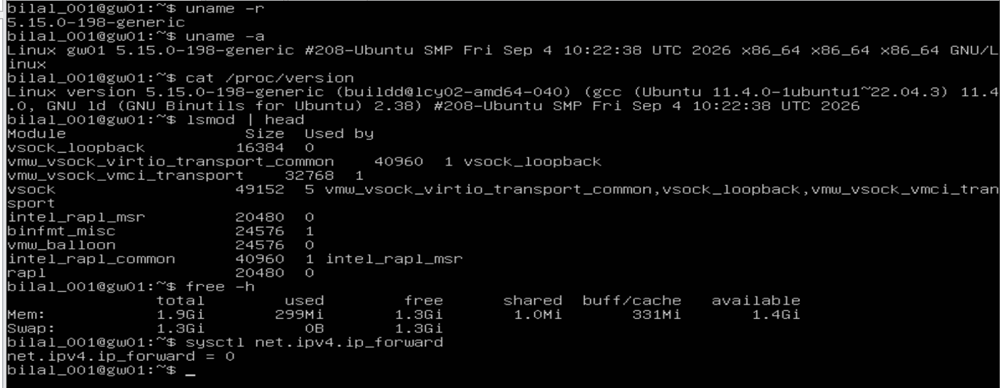

### Step 0.2 – How the machine starts

**What I did and why.** Starting a computer is a relay race: firmware → bootloader (GRUB) → kernel → systemd (the manager) → services → login. I measured how long it takes and saved the details to files as evidence.

```
systemd-analyze                               # total boot time
systemd-analyze blame >> boot-gw01.txt        # time per service, saved to a file
journalctl -b | head -15 >> journal-gw01.txt  # first log lines of this boot, saved
ls /boot                                      # the files used to start Linux
```

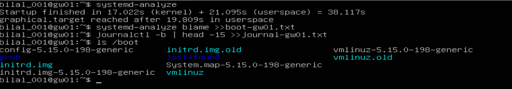

### Step 0.3 – Server mode instead of desktop mode

**What I did and why.** Linux can start in different modes, called **targets**. A desktop (`graphical.target`) is wasted on a server nobody sits in front of. Server mode (`multi-user.target`) runs everything needed – network, services, logins – without the desktop: faster, lighter and with fewer things an attacker could abuse.

```
systemctl get-default                          # which mode now?
sudo systemctl set-default multi-user.target   # switch to server mode
systemctl get-default                          # check
```

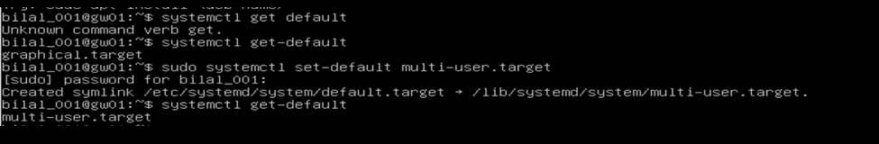

### Why do we go to the next step?

I now know how gw01 looks. The next question is: **how are the three machines connected?** That is the network – and without a working network nothing else in the project (storage, monitoring, VPN, automation) can work.

## Chapter 2 – The starting point of the network

### Where are we?

```
hostname    # which machine am I on?
ip -br a    # network cards: name, state, address (brief form)
lsblk       # disks and partitions
```

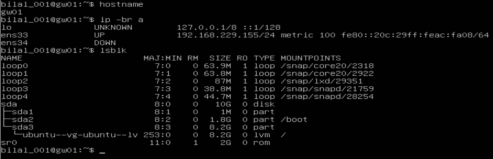

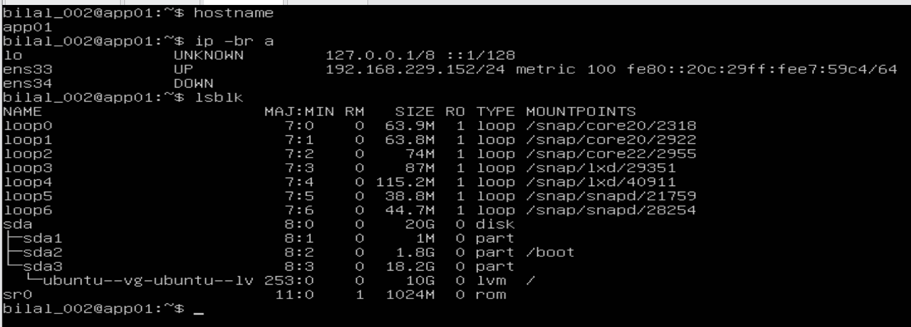

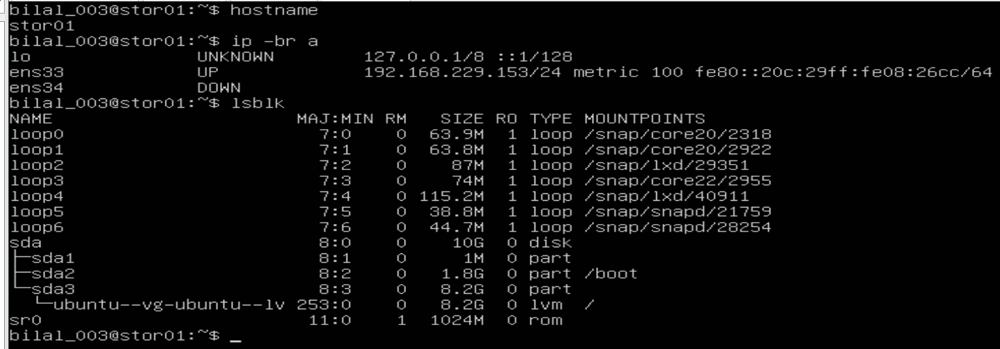

### Why do we go to the next step?

The servers need **fixed addresses** on the lab network, like permanent desk-phone numbers. Every later part of the project – firewall rules, file sharing, monitoring, automation – refers to these numbers. If they changed, everything would break.

## Chapter 3 – Fixed addresses for every server (Step 1.1)

### 3.1 gw01 – the gatekeeper gets its inside address

```
ls /etc/netplan                                                # -> 50-cloud-init.yaml
sudo cp /etc/netplan/50-cloud-init.yaml ~/netplan-backup.yaml  # backup
echo "network: {config: disabled}" | sudo tee /etc/cloud/cloud.cfg.d/99-disable-network-config.cfg
```

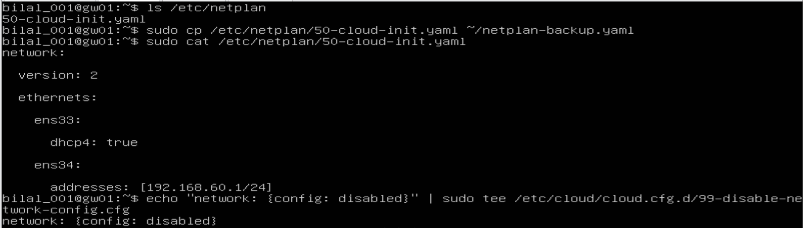

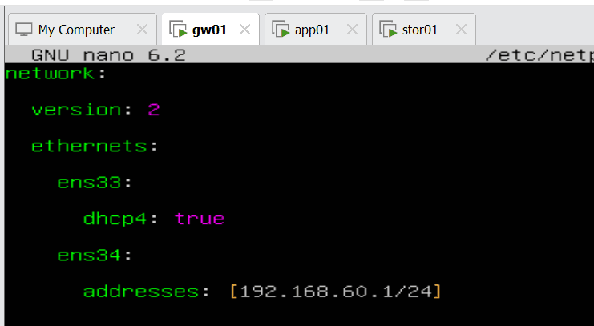

```
sudo chmod 600 /etc/netplan/50-cloud-init.yaml   # only the administrator may read/write it
sudo netplan try                                 # apply with automatic undo; Enter = keep
ip -br a                                         # check
```

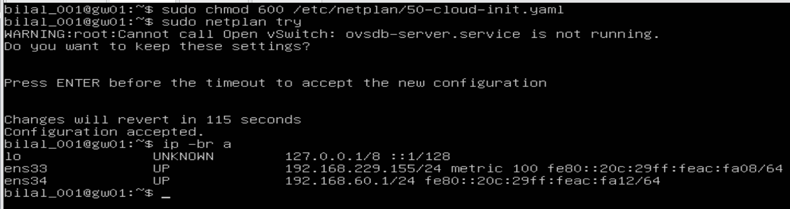

### 3.2 app01 – the shop window, and an unplugged cable

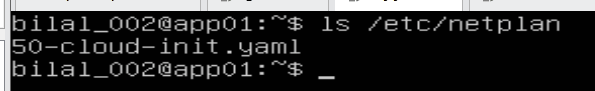

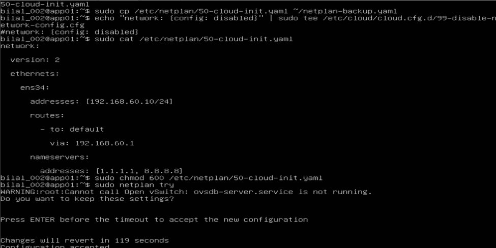

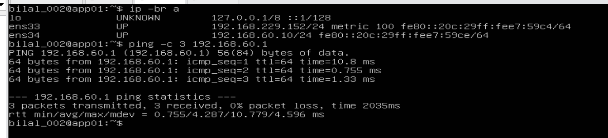

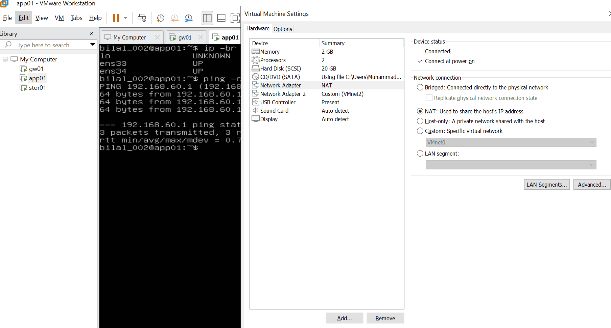

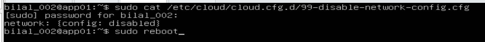

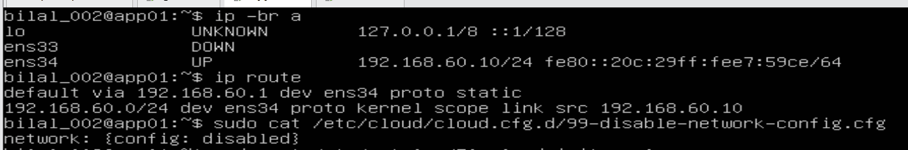

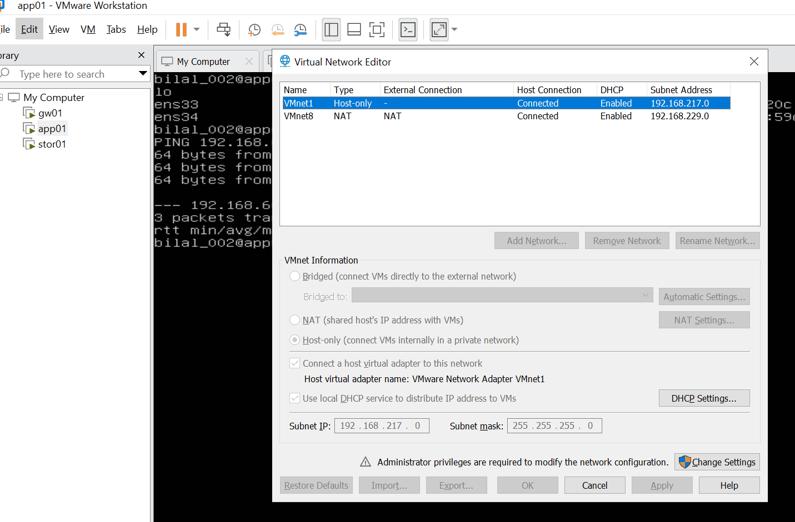

### 3.3 stor01 – the archive room, and the missing disks

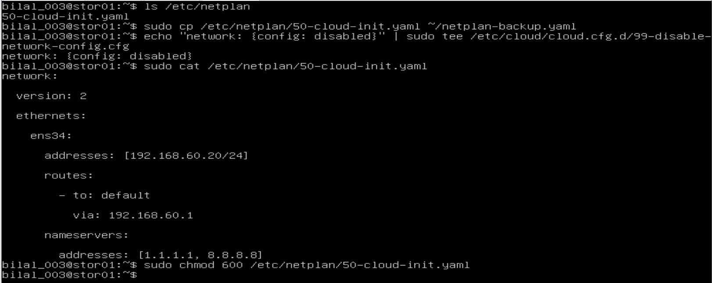

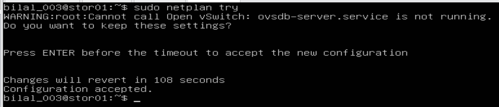

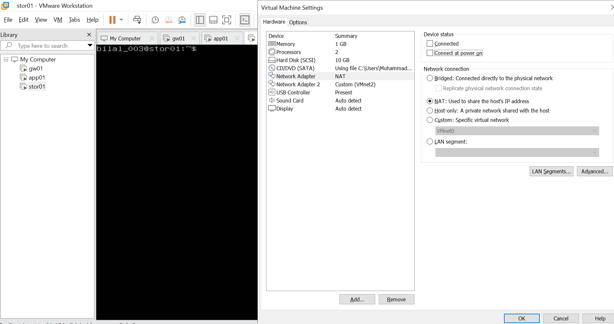

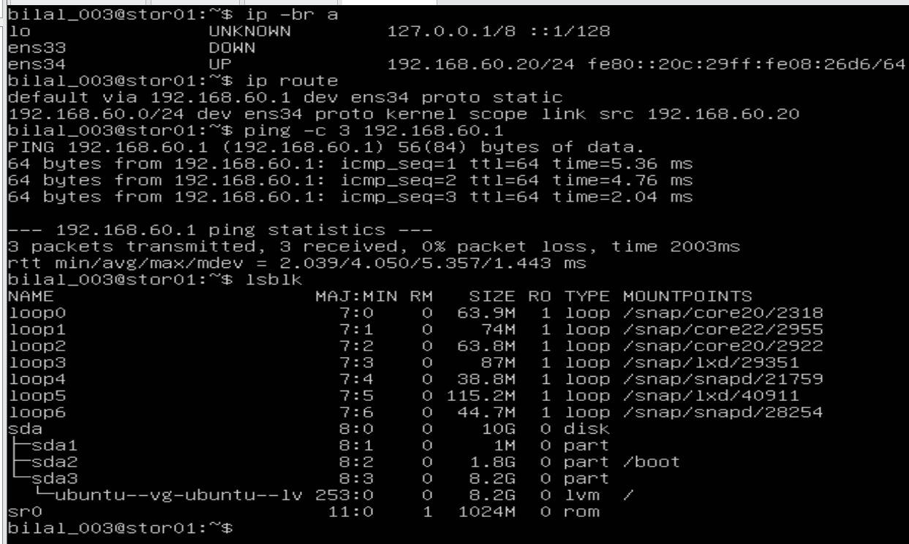

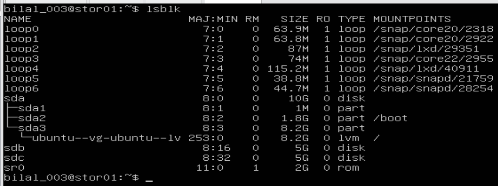

### Why do we go to the next step?

All three servers now have fixed addresses and can reach gw01. app01 and stor01 have **no internet line of their own** – so right now they have **no internet at all**. They know they should ask gw01, but gw01 does not pass anything on yet (`ip_forward = 0`, Figure 3). That is the next step.

## Chapter 4 – gw01 becomes a router (Step 1.2)

**What I did and why.** By default, Linux refuses to pass on traffic that is not meant for itself – like a receptionist who only answers her own calls. Switching **IP forwarding** on turns gw01 into a switchboard between the lab and the internet.

```
echo "net.ipv4.ip_forward=1" | sudo tee /etc/sysctl.d/99-forward.conf  # permanent setting
sudo sysctl --system                                                   # load it now
sysctl net.ipv4.ip_forward                                             # check: must be 1
```

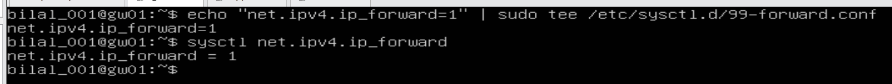

### Why do we go to the next step?

gw01 now *passes traffic on*, but the internet still cannot answer app01. Addresses like 192.168.60.10 are **private**: they are not valid on the internet, so replies would have nowhere to go. gw01 must translate them – that is NAT.

## Chapter 5 – Sharing the internet safely: NAT (Step 1.3)

**What I did and why.** **NAT (Network Address Translation)** works like a company mailroom. When app01 sends a letter out, gw01 crosses out the sender "Room 10" and writes the **company's street address** – its own. When the reply arrives, gw01 remembers who asked and delivers it to app01. The firewall rules decide **who may pass**: the lab may go out, and replies come back in. (Strictly blocking everything else needs a DROP default policy, which follows in Phase 6; today the lab is protected because its private addresses cannot be reached from the internet.)

```
# NAT: lab traffic leaving through ens33 gets gw01's address as sender
sudo iptables -t nat -A POSTROUTING -o ens33 -s 192.168.60.0/24 -j MASQUERADE
# allow: lab -> internet
sudo iptables -A FORWARD -i ens34 -o ens33 -j ACCEPT
# allow back in ONLY replies to conversations the lab started
sudo iptables -A FORWARD -i ens33 -o ens34 -m state --state ESTABLISHED,RELATED -j ACCEPT
# keep the rules after a reboot
sudo apt install -y iptables-persistent
sudo netfilter-persistent save
```

### The proof – from a server that has no internet card

```
ping -c 3 8.8.8.8      # can app01 reach a server on the internet?
curl -s ifconfig.me    # ask a website: which address do you see me coming from?
```

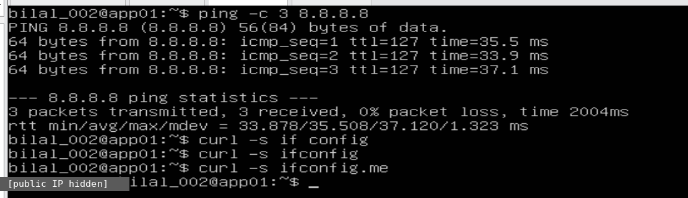

```
sudo iptables -t nat -L -n -v --line-numbers   # list NAT rules with packet counters
```

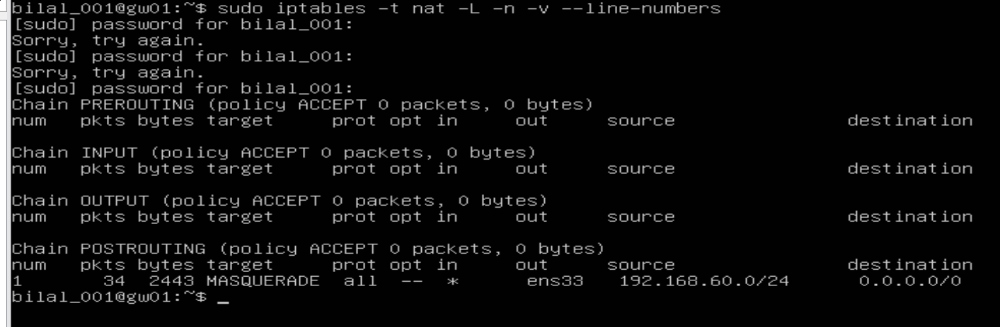

### Why do we go to the next step?

The servers can now talk to each other and to the internet – but only by **number**. People and tools (SSH, file sharing, automation) use **names** like `stor01`. The next step teaches the servers to find each other by name.

## Chapter 6 – Names instead of numbers (Step 1.4)

**What I did and why.** Computers connect only to numbers. Before connecting to a name, Linux looks it up – like a phone looking up a contact before dialing. It checks two places, in this order:

```
getent hosts stor01                                   # unknown -> prints nothing
echo "192.168.60.20 stor01" | sudo tee -a /etc/hosts  # add stor01 to app01's contact list
getent hosts stor01                                   # now: 192.168.60.20
ping -c 1 stor01                                      # reach the server BY NAME
```

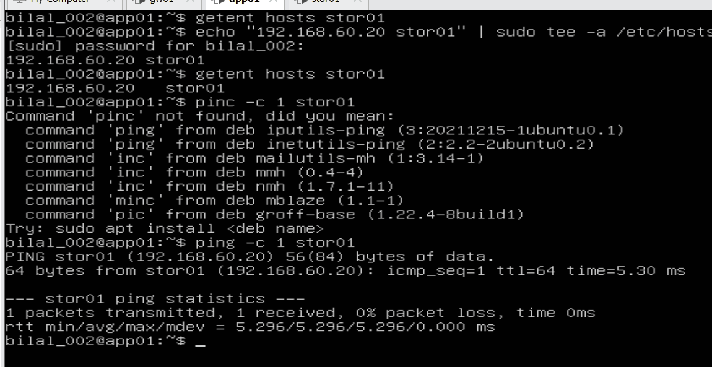

```
grep '^hosts' /etc/nsswitch.conf   # the lookup ORDER
dig +short google.com              # ask DNS directly
```

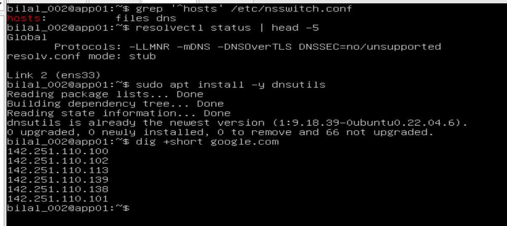

### Every server gets the same contact list

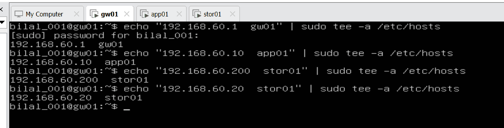

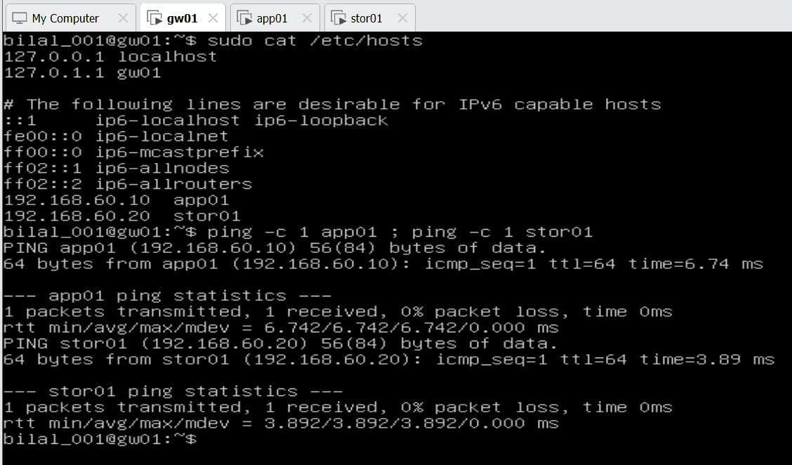

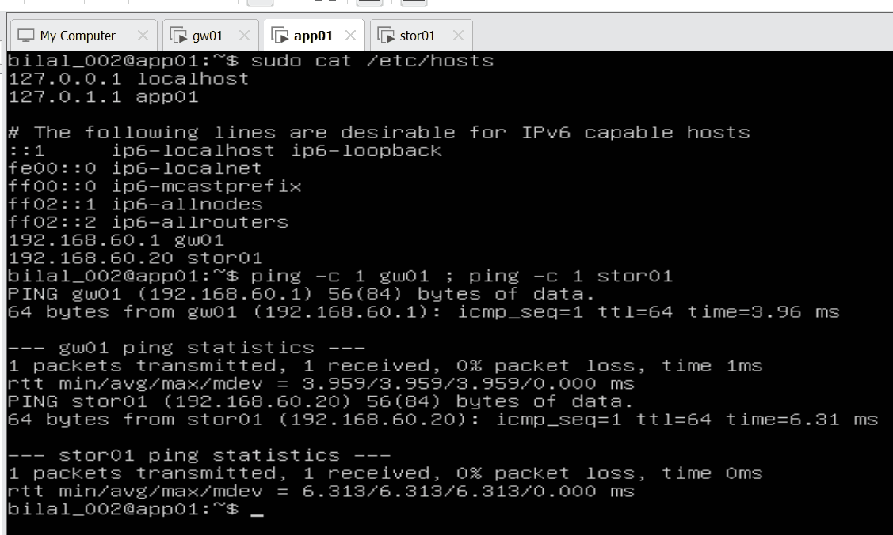

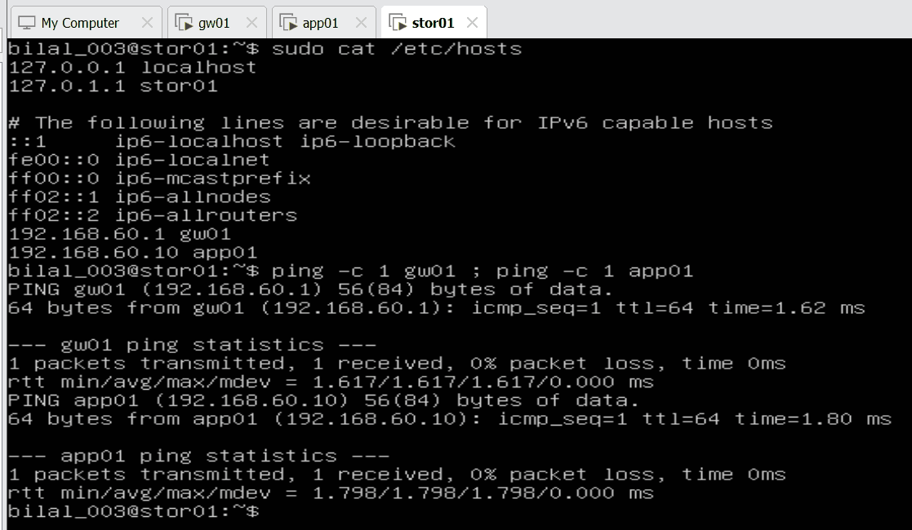

## Chapter 7 – Problems I met and how I solved them

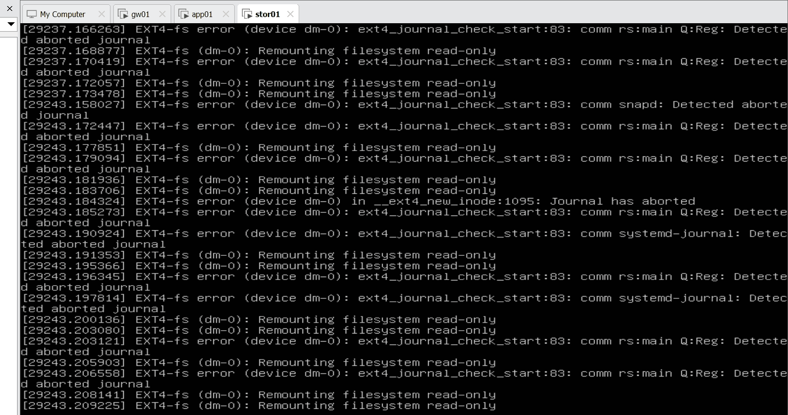

## Chapter 8 – Where we stand at the end of Day 1

```
Morning:   3 separate machines, each with its own internet line, lab network unused
              |
Step 1.1:  fixed addresses  ->  gw01 .1   app01 .10   stor01 .20
           internet cables of app01 and stor01 unplugged
              |
Step 1.2:  gw01 becomes a router (ip_forward 0 -> 1)
              |
Step 1.3:  gw01 translates addresses (NAT) and lets only replies back in
              |
Step 1.4:  servers find each other by name
              |
Evening:   one controlled door to the internet - gw01
```

## Chapter 9 – Key understanding (in my own words)

These are the conclusions I reached by questioning each step until it made sense. They are written so I can explain them in an interview.

### 1. The network file and cloud-init

- `/etc/netplan/50-cloud-init.yaml` is the main network settings file: IP address, gateway and DNS. It was written once by **cloud-init** when Ubuntu was installed. At every boot **netplan reads it** and configures the network cards.
- cloud-init is the **writer**, netplan is the **reader**. cloud-init could rewrite the file on a later boot and erase my settings.
- So I created `/etc/cloud/cloud.cfg.d/99-disable-network-config.cfg` with `network: {config: disabled}`. This only stops **cloud-init from managing the network** – the network itself and netplan keep working.
- Files in a `.d` folder are read in alphabetical order and **the last one wins**, so a `99-` file has the final word. The numbers only matter between files in the **same folder** – 50 (netplan) and 99 (cloud-init) are never compared.
- In Proxmox or the cloud, cloud-init is used the other way round: the admin enters IP, user and SSH key in the hypervisor, and cloud-init writes them into the server at first boot – ideal for cloned templates. In my VMware lab nothing feeds cloud-init, so I configure netplan by hand and keep cloud-init away from the network.

### 2. What the network file says

- `addresses: [192.168.60.10/24]` – **I am** 192.168.60.10; `/24` means 192.168.60.0–255 are my direct neighbours.
- `routes: - to: default via: 192.168.60.1` – "default" is not a machine, it means **everything I don't know**; `via` names who to hand it to: gw01.
- `nameservers: [1.1.1.1, 8.8.8.8]` – the internet's phone books. A name is first looked up in `/etc/hosts` (my own contact list – that is how `stor01` is found), and only then asked from DNS (that is how `google.com` is found).
- netplan only sets **addresses, gateway and DNS**. Being a router (ip_forward), NAT and firewall (iptables) and VPN (WireGuard) are set elsewhere.

### 3. The path to the internet

> app01 is 192.168.60.10 and has no internet adapter. For anything outside the lab it goes via gw01 (192.168.60.1), its default gateway. gw01 translates app01's private address into its own (NAT) and passes the traffic on through VMware and the home router to the internet. stor01 works the same way with 192.168.60.20.

### 4. NAT, forwarding and conntrack

> NAT recognises lab traffic by its IP range (`-s 192.168.60.0/24`) and changes the sender address as it leaves via `-o ens33`. Forwarding decides who may pass using the cards (`-i ens34 -o ens33`). Replies are let back in only if conntrack – gw01's memory of every conversation – confirms they are ESTABLISHED or RELATED to a conversation the lab started. conntrack also remembers which lab machine asked, so NAT can return each reply to the right one.

- **Two jobs, two tables:** the NAT table *changes the address* (`-j MASQUERADE`); the filter table's FORWARD chain *gives permission* (`-j ACCEPT`). A packet is checked by FORWARD first and rewritten in POSTROUTING just before it leaves – whatever order the commands were typed in.
- **`-s`/`-d` take IP addresses, `-i`/`-o` take card names.** `-s ens34` is always wrong. In POSTROUTING only the exit card is known, so `-i` is not allowed there – the lab must be identified by its IP range.
- **States:** NEW = someone starts a conversation; ESTABLISHED = a reply in a conversation the lab started; RELATED = a helper message (e.g. an error) belonging to it. `sudo conntrack -L` on gw01 shows the live list.
- **Honest limit today:** Ubuntu's default FORWARD policy is still ACCEPT, so the "only replies come back" rule is not yet enforced strictly. Right now the lab is protected because its private addresses sit behind two layers of NAT and cannot be reached from the internet. The strict version comes in Phase 6, when the default policy becomes DROP.
- `netfilter-persistent save` must run **last** – it saves only the rules that exist at that moment.

### 5. Names: /etc/hosts, DNS, getent and ping

> **getent** ("get entries") is like searching the phone book. It looks up a name or IP first in `/etc/hosts`, then in **DNS** if one is configured. It works both ways: name → IP (forward lookup) and IP → name (reverse lookup, e.g. `getent hosts 192.168.60.20` → `stor01`). It only **reads** – it never contacts the machine.
>
> **ping** is like calling. It uses the **same lookup** (`/etc/hosts`, then DNS) to find the number, then really contacts the machine with **ICMP** messages – "are you there?" (echo request) and "yes, I'm here" (echo reply). ICMP has **no ports**. So getent can succeed while ping fails – if the machine is off, the network is broken, or a **firewall blocks ICMP**.
>
> In our lab there is no internal DNS server, so we put the names in `/etc/hosts`. The servers could already reach each other **by IP**; `/etc/hosts` lets them reach each other **by name**.

- **Phone picture:** the contacts app inside the phone = the system resolver (`/etc/hosts` → DNS); getent = opening the contacts and reading a number; ping = pressing *call* – it looks up the same contact, then dials; ICMP = the phone network that carries the call.
- **Troubleshooting rule:** getent fails → a **name** problem (missing/wrong entry or DNS). getent works but ping fails → a **network** problem (machine off, cabling, firewall).
- `/etc/hosts` is a file on **each** machine – fine for a small lab, but 100 servers means 100 files to edit. Companies use an **internal DNS server** for their own names (as the Windows Server does in Project 1) and **public DNS** (1.1.1.1, 8.8.8.8) for internet names.
- **The DNS helper and loopback:** on Ubuntu, programs do not ask 1.1.1.1 directly – they ask a small helper on the same machine, **systemd-resolved**, at **127.0.0.53**. Every **127.x.x.x** address is **loopback** – the machine talking to itself, like putting a note in your own pocket: the traffic never leaves the machine (`lo` in `ip -br a`). The helper answers from its **DNS cache** – short-term memory of name lookups for the whole machine – or asks the real DNS servers through gw01. The cache speeds things up, expires by itself (**TTL**), and can be cleared with `sudo resolvectl flush-caches`. `resolvectl status` shows which DNS servers are in use.
- **DNS troubleshooting in three commands:** `getent hosts <name>` (does the name resolve at all?) → `resolvectl status` (which DNS servers?) → `dig +short <name>` (does DNS itself answer? dig skips `/etc/hosts`).
- `hostname` shows the machine's own name; `getent hosts <name>` asks what address a name has; `tee -a /etc/hosts` appends a new entry.

<div style="page-break-before: always"></div>

# Day 2 – 15 Oct: SSH keys, links, users, end of Phase 1

## 1. Objective

💡 **In plain words:** an IP address is the **address of a building** (which machine). A **port** is a **door number** inside that building (which program). Every service waits behind its own numbered door: SSH behind door 22, DNS behind door 53, a website behind door 80. Before opening new doors, I made an inventory of which doors app01 already has open – and to whom.

## 2. Procedure

```bash
sudo ss -tulpn   # ss = socket statistics
#  -t  TCP sockets        -u  UDP sockets
#  -l  only listening      -p  show the owning process
#  -n  numbers, not names  (memory aid: "tulpn" = tulip)
```

📸 **Evidence:**

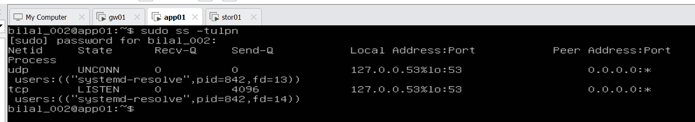

## 5. Final verdict

> **Before:** app01 exposed no network services at all – only the local DNS resolver on 127.0.0.53:53, reachable from inside the machine. The SSH package was installed but its service was not running, so it had to be enabled for remote administration.

## 6. Fix: enable SSH on app01

```bash
sudo apt install -y openssh-server   # make sure the SSH server package is installed
sudo systemctl enable --now ssh      # start it now (--now) AND at every boot (enable)
sudo ss -tulpn | grep :22            # verify: is anything listening on door 22?
```

📸 **Evidence:**

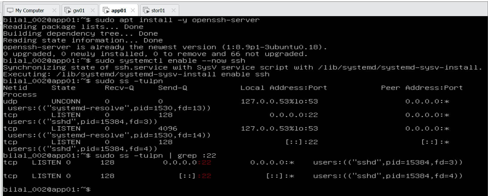

## 7. Testing a port: `nc -zv` and the binding address

💡 **In plain words:** ping only proves a machine is alive. To prove a **service** answers, you knock on its **door** (port). `nc` (netcat) does exactly that – the admin's standard check when "ping works but the application doesn't".

```bash
nc -zv app01 22        # -z: only check the door, send no data · -v: print the result
nc -zv app01 53        # same for door 53
nc -zv 127.0.0.53 53   # door 53 at the DNS helper's own address
cat /etc/hosts         # where the name "app01" points to
```

📸 **Evidence:**

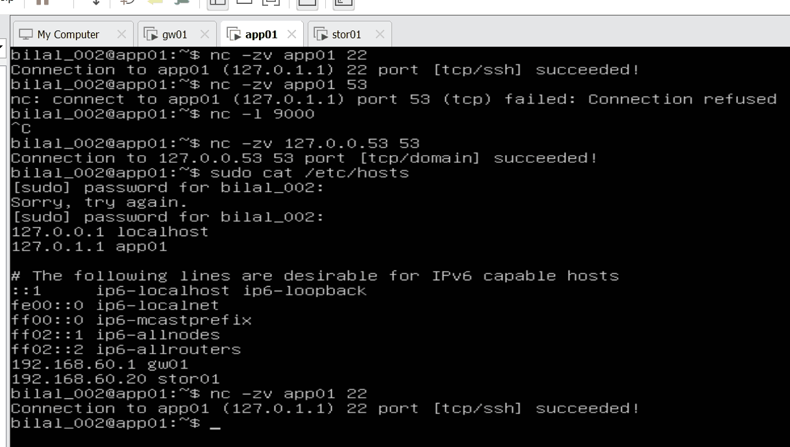

## 8. Key understanding (in my own words)

> **Netid** is the protocol, TCP or UDP. **TCP** starts every conversation with a 3-way handshake (SYN, SYN-ACK, ACK); after that the connection is **ESTAB**. **UDP** has no handshake – it just sends.
>
> **Every port leads directly to its own program.** The port number decides which program receives the traffic: port **22** → **sshd** (SSH), port **53** → the **DNS helper**, port **80** → a web server. Traffic does **not** pass through the DNS helper first. A port with no program behind it is closed – nobody answers.
>
> **LISTEN** = a TCP door is open and waiting. **UNCONN** = a UDP door is open.
> **Recv-Q** = data received but not read yet (0 = nothing waiting). **Send-Q** on a LISTEN socket = how many visitors may wait in the queue (4096 for the DNS helper's TCP socket).
> **Local address** = this machine's address and door, e.g. `127.0.0.53%lo:53` = the DNS helper on the loopback card, port 53, reachable only from inside app01. **Peer address** = who is visiting – `0.0.0.0:*` = nobody yet; in a real connection it shows the visitor's IP and its random port, e.g. `192.168.60.1:51234` = gw01.
>
> **A server can test itself by calling its own address – loopback (127.x.x.x).** `localhost` (127.0.0.1) and `app01` (127.0.1.1) both mean "myself". SSH listens on **all** addresses (`0.0.0.0`), so `localhost:22` and `app01:22` both work. The DNS helper listens on **one fixed address only, 127.0.0.53**, so only `127.0.0.53:53` works – any other address gets "connection refused". **The binding address matters:** `0.0.0.0` = the door is open at every entrance of the building; `127.0.0.53` = the door exists at one entrance only.
>
> **A port is a door number; a socket is a program standing at that door on a specific machine (IP + port + protocol); a connection is two sockets talking to each other.**
>
> **DNS has one job: translate a name into an IP address** – the phone book, not the phone line. Lookup order on app01: **`/etc/hosts`** (own contact list) → **local DNS helper** `127.0.0.53` (answers from its cache) → **outside DNS server** `1.1.1.1` / `8.8.8.8` through gw01. Once the IP is known, the real traffic goes directly to that IP and port. In a company, an **internal DNS server** answers internal names; in our lab `/etc/hosts` does that job.
>
> **Before the fix**, the only open port on app01 was 53, used by the local DNS helper, and only from inside app01 – it accepted **no connections from the network**. Next: enable SSH so port 22 opens.

## 9. Step 1.5 finished – SSH reachable across the lab network

```bash
sudo apt install -y openssh-server && sudo systemctl enable --now ssh
sudo ss -tulpn | grep :22     # LISTEN 0.0.0.0:22 = door 22 open to the network
nc -zv app01 22               # knock on app01's SSH door over the lab network
```

📸 **Evidence – stor01:** SSH listening, and app01 reached at **192.168.60.10** (not loopback):

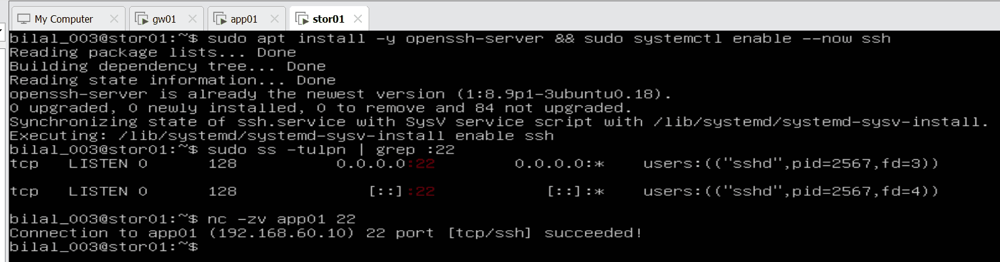

📸 **Evidence – gw01:** SSH listening, both servers reachable on port 22:

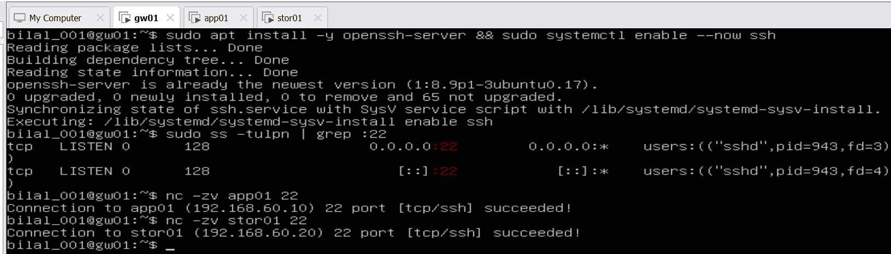

## 10. Step 1.6 – SSH keys: log in without a password

💡 **In plain words:** a password is something you **type**; an SSH key is a **pair of files** – a private key that never leaves gw01 (like a house key in your pocket) and a public key that is copied to each server (like a lock fitted to the door). If the key fits the lock, the door opens – no password. gw01 needs this because it becomes the **Ansible control node** in Phase 7A and must reach every server automatically.

```bash
ssh-keygen -t ed25519 -C "acme-lab"   # create the key pair (Enter 3×: default path, no passphrase for the lab)
ssh-copy-id bilal_002@app01           # copy the PUBLIC key to app01 (asks the password once)
ssh-copy-id bilal_003@stor01          # same for stor01
```

### Issue: key first created for root

📸 The first attempt ran as root – the key landed in `/root/.ssh/`, so password-free login would only work with `sudo ssh …`:

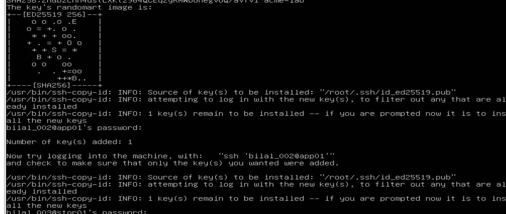

📸 **Evidence – correct key for bilal_001:**

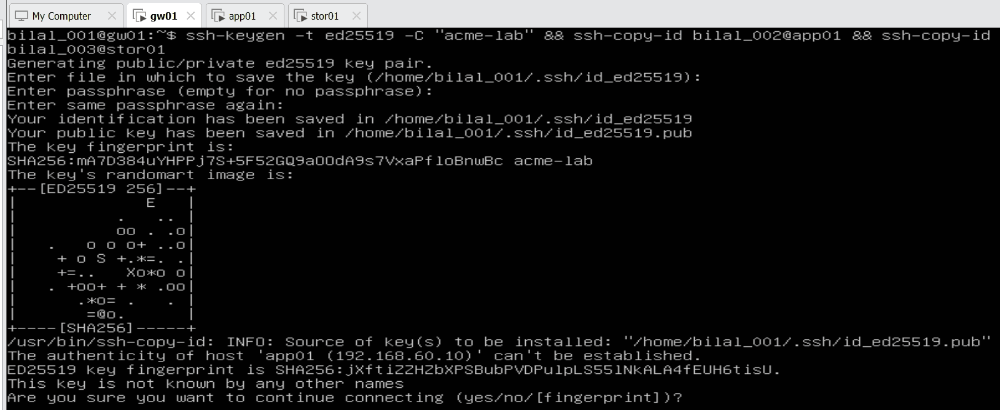

📸 **Evidence – key added to stor01 ("Number of key(s) added: 1"):**

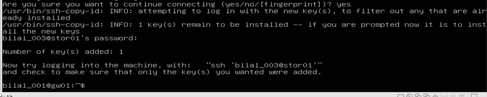

### The proof: login without a password

```bash
ssh bilal_002@app01     # log in to app01 – no password prompt
exit                    # close the session, back to gw01
ssh bilal_003@stor01    # log in to stor01 – no password prompt
exit                    # back to gw01
```

📸 **app01** – logged in with no password; the welcome screen confirms `IPv4 address for ens34: 192.168.60.10`:

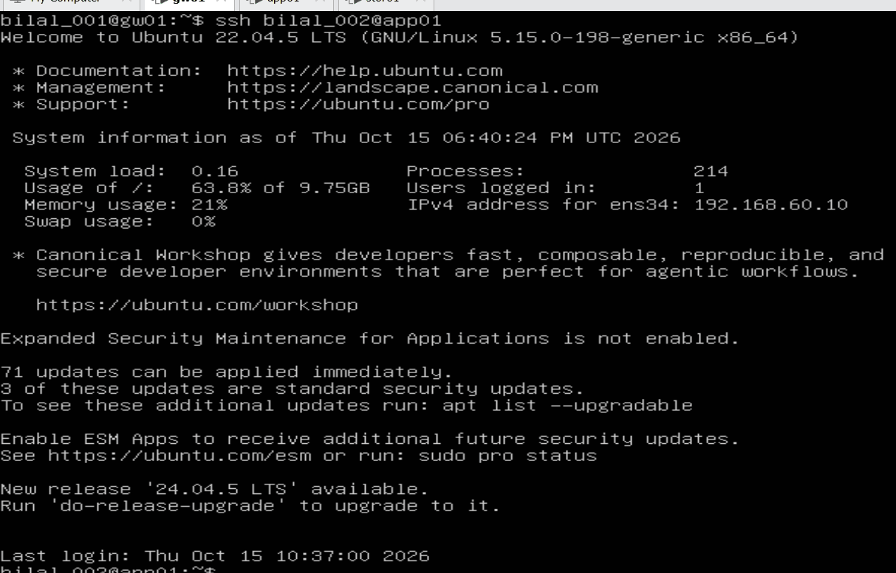

📸 **stor01** – same; note `Last login … from 192.168.60.1` – Linux records who logged in from where (the start of an audit trail):

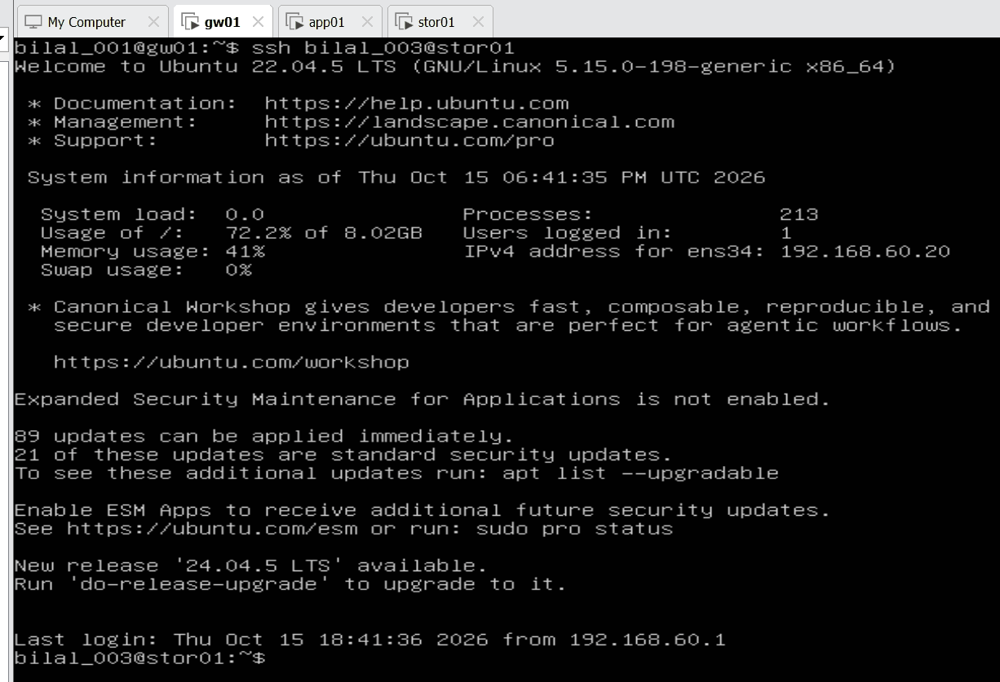

📸 **`exit`** closes the remote session – the prompt `bilal_001@gw01:~$` shows I am back on gw01:

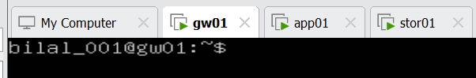

### Copying a file over SSH: `scp`

💡 **In plain words:** `scp` (secure copy) sends a file to another server through the same encrypted SSH door – and because the key is installed, no password is needed. Instead of a throw-away test file I created a short **platform runbook** – the kind of handover note admins keep.

```bash
cat > Acme_Platform_Runbook.txt << 'EOF'      # write the lines below into the file …
Acme Analytics - Platform Runbook
gw01   192.168.60.1   gateway, NAT, firewall
app01  192.168.60.10  application server
stor01 192.168.60.20  storage and logs
Admin access: SSH keys from gw01 only
EOF                                            # … until the end marker EOF ("End Of File")
scp Acme_Platform_Runbook.txt bilal_002@app01:/tmp/        # copy it to app01's /tmp folder
ssh bilal_002@app01 cat /tmp/Acme_Platform_Runbook.txt     # run ONE command on app01 and show the result
```

📸 **Evidence – file created and copied (`100% 199 bytes`, no password):**

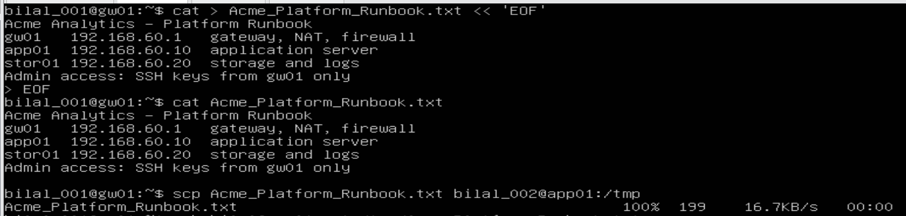

📸 **Evidence – read back on app01 with a one-shot SSH command:**

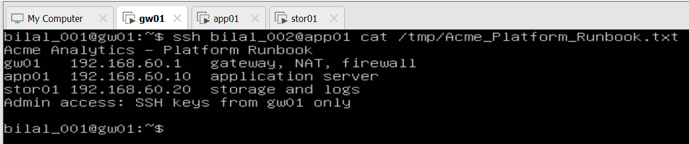

### SSH shortcuts: `~/.ssh/config`

💡 **In plain words:** a personal address book for SSH – type `ssh app01` instead of `ssh bilal_002@192.168.60.10`.

```bash
cat > ~/.ssh/config << 'EOF'
Host app01
    HostName 192.168.60.10
    User bilal_002
Host stor01
    HostName 192.168.60.20
    User bilal_003
EOF
chmod 600 ~/.ssh/config   # only the owner may read it – SSH refuses a config others can read
ssh app01                 # log in by short name – no user, no password
exit
ssh stor01
exit
```

📸 **Evidence – the shortcut file:**

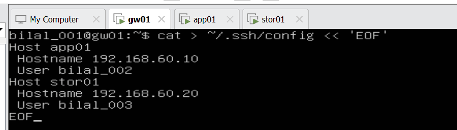

📸 **Evidence – `ssh app01` logs in as bilal_002 without a password:**

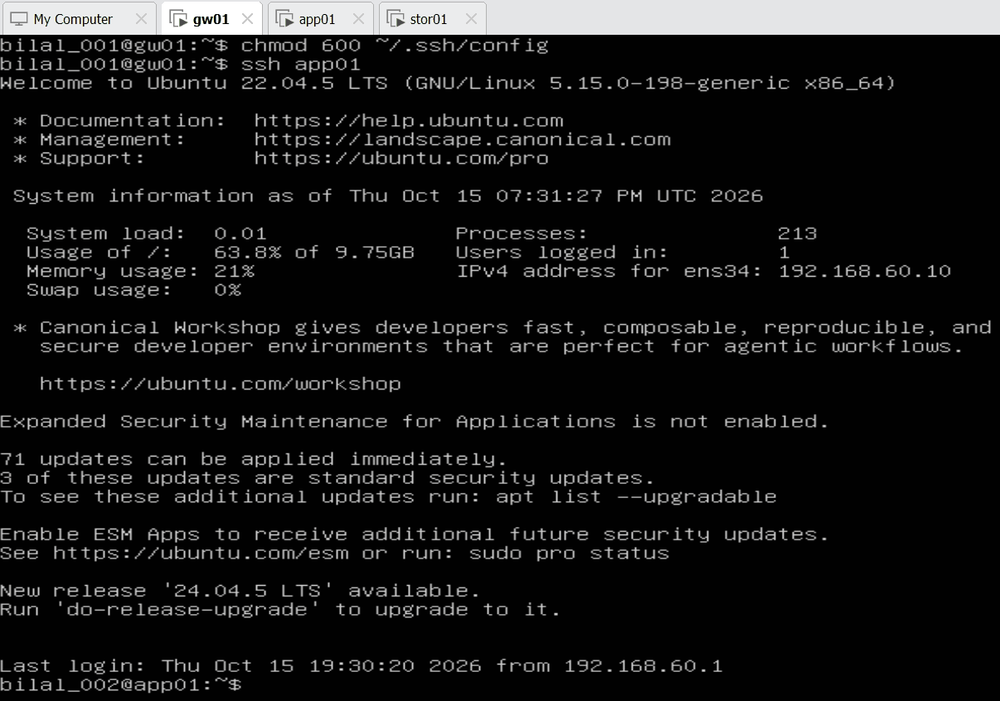

📸 **Evidence – `exit` ("Connection to 192.168.60.10 closed"), then `ssh stor01`:**

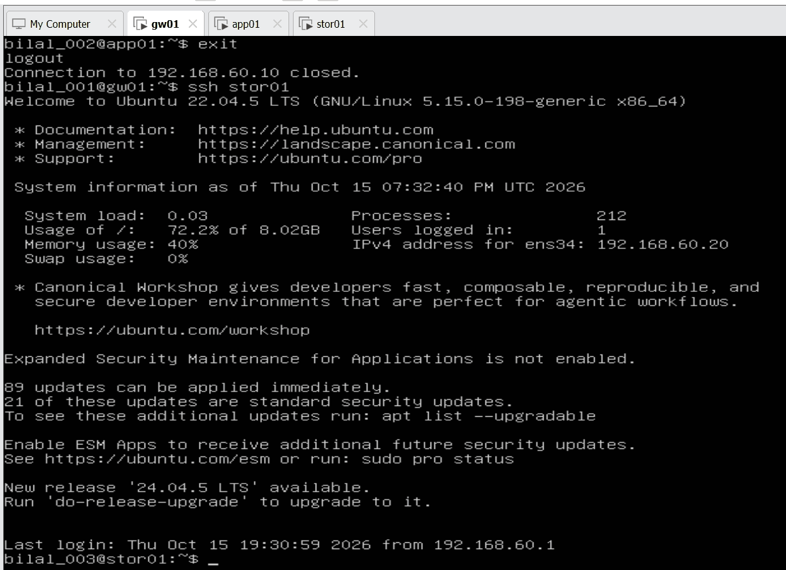

### Interactive transfer: `sftp`

```bash
sftp app01                          # open a file session over SSH
sftp> ls                            # list files in the home folder on app01
sftp> cd /tmp                       # change folder on app01
sftp> get Acme_Platform_Runbook.txt # download to gw01
sftp> exit
```

📸 **Evidence – runbook downloaded from app01 to gw01 (100 %):**

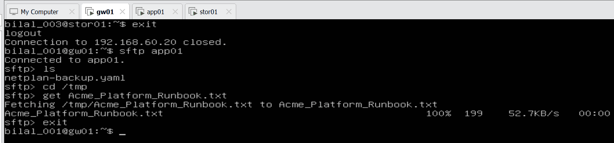

### Why not FTP?

> **FTP sends usernames, passwords and files in clear text** – anyone listening on the network can read them. **SCP and SFTP run inside SSH**, so everything is **encrypted**, and with keys no password crosses the network at all. Companies do not use plain FTP for administration.

## 11. Step 1.7 – Hard links, soft links and inodes

💡 **In plain words:** every file has an **ID card** (the *inode*) holding its owner, permissions, size, dates and where the data sits on disk. The **file name is only a label** in a folder pointing to that ID card.

### Procedure (on app01, as bilal_002)

```bash
mkdir -p ~/acme && cd ~/acme
echo "APP_PORT=8080" > app.conf          # an Acme config file
ln app.conf app.conf.backup              # hard link: second name, same inode
ln -s app.conf current.conf              # soft link: signpost holding the path "app.conf"
ls -li                                   # first column = inode number, third = link count
echo "LOG_LEVEL=info" >> app.conf.backup # write through the hard link
cat app.conf                             # the change appears here too – same file
stat app.conf | head -3                  # Inode and Links: 2
```

📸 **Evidence – same inode 276722 and link count 2 for both names; the soft link has its own inode 276727; an edit via the hard link shows in the original:**

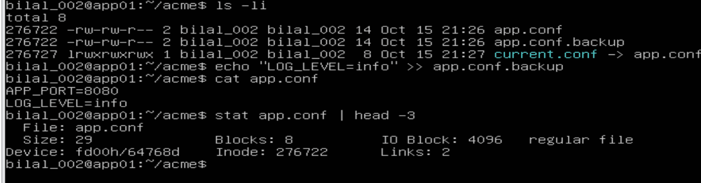

### The "accidental delete" test

```bash
rm app.conf            # simulate a colleague deleting the file
cat app.conf.backup    # data is still there
cat current.conf       # "No such file or directory" – the signpost is broken
ls -li                 # link count of the survivor is now 1; current.conf shown in red
df -i /                # inode capacity of the root file system
```

📸 **Evidence – hard link survives, soft link broken, inode usage 19 %:**


### Key understanding (in my own words)

> Linux works with inode numbers; the name I type is only a label in a folder. A **hard link** is a second label on the same inode – deleting one name loses nothing, but it does **not** protect against bad edits, because it is the same file. A **soft link** has its own inode and only holds a path – deleting it never harms the original, but deleting the original breaks it. Hard links protect important files against accidental deletion; real protection against bad changes still needs backups (Phase 2).

**Step 1.7 complete.** `~/acme` stays on app01 as sample data.

## 12. Step 1.8 – Users, groups and a service account (continued 2026-10-16)

💡 **In plain words:** every person gets their own account, people who do the same job share a **group**, and every **program** gets its own low-rights account that nobody can log in to. When someone leaves, their account is **locked**, not shared or forgotten.

### Procedure (on app01)

```bash
sudo groupadd devs                                   # team group (it already existed)
sudo useradd -m -s /bin/bash -G devs alice           # -m home folder, -s shell, -G extra group
sudo useradd -m -s /bin/bash -G devs bob
sudo useradd -r -s /usr/sbin/nologin svc-app         # -r system account, nobody can log in
sudo passwd alice                                    # give alice a password
id alice                                             # uid, primary group, secondary groups
getent group devs                                    # members of devs
sudo chage -l alice                                  # password aging ("change age")
sudo usermod -L bob                                  # lock (leaver)
sudo passwd -S bob                                   # status: L = locked, P = password, NP = none
sudo usermod -U bob                                  # unlock (returner)
```

📸 **Evidence – svc-app has the shell `/usr/sbin/nologin` and system uid 998; alice's password aging:**


📸 **Evidence – devs = alice, bob; svc-app in its own group only; bob locked (L):**


📸 **Evidence – unlock refused, because bob has no password yet:**


### Key understanding – final summary

> On app01, the server where the Acme application runs, we created named accounts for each developer – alice and bob – each with their own home folder (`-m`) and login shell (`-s`), and put both in a shared team group `devs`, so rights are given to the team instead of to each person; each user has a primary group (their own) and a secondary group (devs). We then created `svc-app` as a **system account** (`-r`, uid 998, below 1000) with the shell `nologin` and no password: no human can log in as it, it exists only so a program can run under it. Every service runs as some user – the main sshd as root with its pre-login part as `sshd`, nginx as `www-data` – and giving each service its own low-rights account means a hacked service reaches only that account's own files, not root. `chage` shows and sets the password-aging rules, and `usermod -L` / `-U` lock and unlock an account – the leaver/returner process. Linux refused to unlock bob while he had no password, because a human account must have a password or key before it is opened. This step answers the Acme customer's security question "who can log in, and with which rights?", and it is the base for later phases: in Phase 3 the app runs as `svc-app`, in Phase 6 groups control `sudo` and Docker access, and in Phase 7A Ansible automates joiners and leavers.

**Step 1.8 complete.**

## 13. Step 1.9 – Linux NAT vs Cloud NAT


## 14. End of Phase 1 – updates and snapshot

📸 **Evidence – disk usage on gw01, app01, stor01 before the snapshot:**


💡 **Why:** a snapshot taken while the VM is **off** is clean and small (no memory saved). If Phase 2 (storage) breaks something, I return to this point in one click instead of rebuilding the network. stor01's root disk is the fullest, which is fine: backups will go to its separate data disks (`sdb`, `sdc`) with LVM in Phase 2.

<div style="page-break-before: always"></div>

# Day 3 – 16–17 Oct: Phase 1A – svc01, GLPI, inventory

## 1. The story – why a service desk, and why now

💡 **In plain words:** until now I fixed problems and wrote them down in these reports. A real IT team does not work like that: every problem, every change and every "please give me access" goes into a **ticket system**, so anyone can see *what happened, who fixed it, how, and when*. Phase 1A gives Acme that system.


> In the IT industry a problem is an **incident**, and handling them is **incident management**. When someone asks for a routine thing – a new user, a password reset, access to a server – it is a **request**. When I modify a system itself – grow a disk, enable a firewall, upgrade software – it is a **change**, which needs a plan, approval and a way back. All three are **tickets** in GLPI, and every ticket moves through the same steps: new → assigned → in progress → solved → closed; a solved fix is written down in the **knowledge base**. The **asset inventory** is not a ticket: it is the list of every machine and what is on it, filled automatically by the GLPI agent on each server, so a ticket can say which server it is about. GLPI follows **ITIL**, the common rule book for running IT services, and is used by many European companies and public bodies.

## 2a. How people reach svc01 – and where gw01 comes in

💡 **In plain words:** gw01 is the **only door** between the private network and the internet. People already **inside** (in the office) go straight to svc01. People **outside** (at home) must come in through the door with a **VPN** – like a company badge for remote workers. Strangers and customers never get in.

```
                       INTERNET
                           │
   Team lead at home ──[WireGuard VPN tunnel]──┐
   (laptop with VPN app)                       ▼
                                   ┌──────── gw01 ────────┐  ← the only door (NAT out, VPN in)
                                   │  192.168.60.1        │
                                   └──────────┬───────────┘
              PRIVATE NETWORK 192.168.60.0/24 │
   ┌──────────────┬──────────────┬────────────┴──┬────────────────┐
 app01 .10     stor01 .20     svc01 .40 (GLPI)   Admin / L1 PC in the office
                                                 (directly on the inside network)
```

## 3. VM settings

📸 **Evidence – VMware's default settings: 2 GB, 2 CPUs, 25 GB, but the network adapter is on NAT:**


### Issue: network adapter on NAT

📸 **Evidence – Network Adapter 2 on Custom (VMnet2), connect at power on:**


## 4. Installation and first boot

### 4.1 No network after the install

📸 **Evidence – two cards, both DOWN, no IP address; only one netplan file:**


```bash
echo "network: {config: disabled}" | sudo tee /etc/cloud/cloud.cfg.d/99-disable-network-config.cfg
sudo tee /etc/netplan/50-cloud-init.yaml > /dev/null << 'EOF'
network:
  version: 2
  ethernets:
    ens34:
      dhcp4: false
      addresses: [192.168.60.40/24]
      routes:
        - to: default
          via: 192.168.60.1
      nameservers:
        addresses: [8.8.8.8, 1.1.1.1]
EOF
sudo chmod 600 /etc/netplan/50-cloud-init.yaml   # only root may read it
sudo netplan try                                 # applies it; reverts after 120 s unless I press Enter
```

📸 **Evidence – the netplan file:**


### 4.2 Address works – but gw01 was off

📸 **Evidence – `ens34 UP 192.168.60.40/24`, default route via .1, but "Destination Host Unreachable":**


📸 **Evidence – after starting gw01: google.com resolves and answers:**


### 4.3 Names: `/etc/hosts` on all four servers

```bash
echo "192.168.60.40 svc01" | sudo tee -a /etc/hosts      # on gw01, app01, stor01
echo "192.168.60.1 gw01"    | sudo tee -a /etc/hosts     # on svc01 (one line per echo)
echo "192.168.60.10 app01"  | sudo tee -a /etc/hosts
echo "192.168.60.20 stor01" | sudo tee -a /etc/hosts
```

📸 **Evidence – svc01 added on gw01, app01 and stor01:**


📸 **Evidence – svc01's list and ping by name to all three (`ttl=64` = same network, no router in between; `&&` = run the next command only if this one worked):**


### 4.4 SSH: package list out of date

📸 **Evidence – the 404 (note `jammy` = Ubuntu 22.04):**


```bash
sudo apt update
sudo apt install -y openssh-server
sudo systemctl enable --now ssh
sudo ss -tlnp | grep :22
```

📸 **Evidence – sshd listening on 0.0.0.0:22 and [::]:22:**


### 4.5 Key login and shortcut from gw01

```bash
nc -zv svc01 22                 # door open?
ssh-copy-id bilal_004@svc01     # copy bilal_001's public key
cat >> ~/.ssh/config << 'EOF'
Host svc01
    HostName 192.168.60.40
    User bilal_004
EOF
ssh svc01
```

📸 **Evidence – port 22 open, key already present:**


📸 **Evidence – gw01's SSH address book now has app01, stor01 and svc01 (keywords are not case-sensitive: `Hostname` = `HostName`):**


📸 **Evidence – `ssh svc01` logs in as bilal_004 without a password:**


### Key understanding (in my own words)

> svc01 joined the lab like app01 and stor01: one card on VMnet2, a fixed address set in netplan, and the default route pointing to gw01. Because gw01 is the only door, svc01 has no internet and no DNS while gw01 is off. Every machine has its own `/etc/hosts`, so a new server must be added to the others' lists and learn theirs. On a fresh server, `apt update` comes before `apt install`. With the key and the SSH shortcut, gw01 now manages all three servers by name, without passwords.

## 5. Growing the disk before Docker (LVM) – 2026-10-17

💡 **In plain words:** the welcome screen showed the system using only **11.5 GB of the 25 GB disk**. GLPI is about to move in – Docker images, a MySQL database with every ticket, user and inventory record, and ticket attachments – and all of it grows every day. A full disk makes MySQL crash, which would take the service desk itself down: exactly the Acme problem *"disks fill up without warning"*. So the disk was grown **before** installing anything. The system was also fully patched first, because GLPI will open a web service on port 80.

```bash
ip -br a                                                # ens34 192.168.60.40 (ens33 = old NAT adapter, to be removed)
sudo vgs                                                # the pool: VSize 23 GB, VFree 11.5 GB unused
sudo lvextend -r -l +100%FREE /dev/ubuntu-vg/ubuntu-lv  # give the volume all free space; -r grows the file system too
df -h /                                                 # 23 GB, 28 % used
sudo apt update && sudo apt upgrade -y                  # patch before opening a service
```

📸 **Evidence – `vgs` shows 11.5 GB free in the pool; `lvextend` grows the volume from 11.5 to 23 GB while running; `df` shows 23 GB:**


📸 **Evidence – all packages up to date:**


### The picture – boxes inside boxes


### Same layers in Windows


📸 **On my own PC (Disk Management, `diskmgmt.msc`): a "Basic" disk – Disk 0 cut into partitions with drive letters (C:, D:), no pool layer:**


### Key understanding (in my own words)

> When I created svc01, I gave it one 25 GB virtual disk, **sda**. A disk can be divided into **partitions**, like C: and D: in Windows. Here, sda1 and sda2 are for booting, and **sda3** (23 GB) is used as a **physical volume (PV)**. On its own, a PV is just raw space. It is never divided: once it is added to a **volume group (VG)**, a pool of space, it belongs to that VG only. One VG can be built from one or several PVs. Here there is one VG, `ubuntu-vg` (23 GB), made from one PV. For a second VG, I would first create another partition on the disk, which becomes its own PV.
>
> Inside a VG I can create many **logical volumes (LVs)**. Here there was one, `ubuntu-lv`, with 11.5 GB, and the other 11.5 GB were free. I could have used the free space for more LVs; separate LVs give **isolation of space**: if one fills up (for example `/var/log` with logs), the others are not affected, and each LV can be grown, backed up or snapshotted on its own. This is about disk space, not security; data is protected by permissions, firewalls and encryption. On svc01 I chose to grow the single LV to the full 23 GB with `lvextend -r -l +100%FREE` while the system was running, and `-r` grew the file system too.
>
> An LV is only usable once it is **formatted** (ext4) and **mounted**; this one is mounted as `/`, the umbrella for every folder (`/etc`, `/home`, `/var/log`, `/var/lib/docker`, `/opt`).
>
> The same idea in Windows: physical disks (≈ PVs) are added to a **Storage Pool** (≈ VG) in Storage Spaces. The pool is cut into **virtual disks** (≈ LVs), which are formatted with NTFS or ReFS (≈ ext4) and given a drive letter such as D: (≈ mounting). Extend Volume in Disk Management grows a volume live, like `lvextend -r`. Linux uses one folder tree under `/`, while Windows uses drive letters, but the layers are the same: disk → pool → volume → file system → mount point. On a normal PC like mine the disk is "Basic": only partitions with drive letters, no pool – storage pools are used on servers with several disks.
>
> For the service desk, Docker takes **images** (the installers for GLPI and MySQL) and runs them as **containers**. Their data is saved in **mounted folders** on svc01, for example `/opt/helpdesk/storage/mysql`, which appears inside MySQL as `/var/lib/mysql`. So tickets, users and inventory stay safe on `/` even if a container is deleted or upgraded, and that is why I grew the disk before installing GLPI.

## 6. The network story – from the first picture to today

💡 **Read this section alone and you have the whole network in your head – no need to go back to Day 1.**


> **Key understanding (in my own words).**
> Every server has a network card. VMware calls it a "Network Adapter". Inside Linux the card is called `ens34` or `ens33`.
>
> A virtual switch is like an extension board. VMnet2 is the lab board. VMnet8 is the board for the way out.
>
> app01, stor01 and svc01 are plugged into VMnet2. gw01 is also plugged into VMnet2 with its inside card. All of them have an address in the same network. So they talk to each other directly by IP. This worked from the first day.
>
> To use names, Linux looks in two places. First it checks `/etc/hosts`. Then it asks DNS. Our lab names are written in `/etc/hosts`, so they are found in the first place. Internet names like google.com are not in `/etc/hosts`. So Linux asks DNS. The helper 127.0.0.53 forwards the question to 8.8.8.8 and keeps the answer in a cache.
>
> For the internet, the servers send their traffic to gw01. gw01 has a second card on VMnet8. The address is changed three times on the way out. First gw01 changes it to its own address on VMnet8. Then VMware's NAT changes it to my Wi-Fi card's address. Then my home router changes it to my public IP. The DNS question to 8.8.8.8 also takes this way. So nothing on the internet works while gw01 is off.
>
> My Windows PC had a card on VMnet8 but no card on VMnet2. So my browser could not reach svc01. Now I give my PC a card on VMnet2 with the tick "Connect a host virtual adapter". The card gets the address 192.168.60.250. My browser can now open GLPI on svc01 directly. Nothing changes for the servers.

## 7. Step 1A.2 – Docker and GLPI running, opened in the browser

💡 **In plain words:** GLPI and its MySQL database run as two **containers** on svc01, described in one small file (`compose.yaml`). Their data lives in folders on svc01, so it survives updates. Then my Windows PC got a plug on the lab switch so the browser can open GLPI.

### 7.1 Install Docker

```bash
sudo apt update && sudo apt install -y docker.io docker-compose-v2   # Docker engine + "docker compose"
sudo systemctl enable --now docker                                   # start now and at every boot
sudo docker version | head -5
```

📸 **Evidence – Docker 29.1.3 installed:**


### 7.2 Settings file and compose file

```bash
sudo mkdir -p /opt/helpdesk && cd /opt/helpdesk
sudo tee /opt/helpdesk/.env > /dev/null << 'EOF'
GLPI_DB_HOST=db
GLPI_DB_PORT=3306
GLPI_DB_NAME=glpi
GLPI_DB_USER=glpi
GLPI_DB_PASSWORD=<lab-db-password>
MYSQL_RANDOM_ROOT_PASSWORD=yes
MYSQL_DATABASE=glpi
MYSQL_USER=glpi
MYSQL_PASSWORD=<lab-db-password>
EOF
sudo chmod 600 /opt/helpdesk/.env       # passwords inside – only root may read it
```

```yaml
# /opt/helpdesk/compose.yaml – which containers to run
services:
  glpi:
    image: glpi/glpi:latest          # the GLPI installer (image)
    restart: unless-stopped          # start again after a crash or reboot
    env_file: .env
    volumes:
      - ./storage/glpi:/var/glpi     # svc01 folder shown inside the container
    depends_on: [db]                 # start the database first
    ports:
      - "80:80"                      # svc01 port 80 → container port 80
  db:
    image: mysql:8.0
    restart: unless-stopped
    env_file: .env
    volumes:
      - ./storage/mysql:/var/lib/mysql
```

📸 **Evidence – the compose file:**


**Lesson – YAML is strict.** My first attempts failed: `Services:` instead of `services:` (keywords are lowercase), `glpi:Latest` instead of `latest` (the tag is case-sensitive), `mysql: 8.0` with a space (YAML reads it as a new key → *"mapping values are not allowed"*), and `var/glpi` without the leading `/`. Check a file before starting it: `sudo docker compose config --quiet && echo "YAML OK"`.

### 7.3 Start – and the permission problem

```bash
sudo docker compose up -d      # download images, create network, start both containers
sudo docker compose ps
```

📸 **Evidence – images pulled (~3 min), db "Up", but glpi "Restarting (1)":**


📸 **Evidence – the log:**


```bash
sudo docker compose down
sudo chown -R 33:33 /opt/helpdesk/storage/glpi    # 33 = www-data inside the container
sudo docker compose up -d
sudo docker compose ps
```

📸 **Evidence – both containers "Up"; port 0.0.0.0:80 → 80:**


### 7.4 Test from svc01 and from gw01

```bash
sudo docker compose logs glpi --tail 15   # apache2 and glpi-cron "RUNNING"
curl -I http://localhost                   # on svc01
curl -I http://svc01                       # on gw01 – name from /etc/hosts
```

📸 **Evidence – Apache and GLPI cron running; `HTTP/1.1 200 OK` on svc01:**


📸 **Evidence – `200 OK` from gw01 over the lab network:**


### 7.5 My PC on the lab switch – the VMnet2 host adapter

📸 **Evidence – VMnet2 in the Virtual Network Editor:**


📸 **Evidence – Windows adapter VMnet2 set to 192.168.60.250:**


📸 **Evidence – GLPI login page in the browser at http://192.168.60.40 ("Not secure" = plain HTTP, fine inside the lab):**


### 7.6 First login and default passwords

📸 **Evidence – first login as Super-Admin with the warning (the numbers are GLPI demonstration data, not mine – "Disable demonstration" removes them):**


📸 **Evidence – `glpi` no longer in the warning; `tech`, `normal`, `post-only` to be disabled next:**


### Key understanding (in my own words)

> GLPI runs on svc01 as two containers – the GLPI web application and its MySQL database – described in one `compose.yaml`. Their data is kept in folders on svc01, so it survives updates. The first start failed because GLPI runs inside the container as user 33 and could not write to a folder owned by root; the container log showed it, and `chown 33:33` fixed it. GLPI then answered `200 OK` on svc01 and from gw01. My Windows PC had no plug on the lab switch, so I added a VMnet2 host adapter with the free address 192.168.60.250 and opened GLPI in the browser. The default passwords are being changed first, because everybody knows them.

## 8. Step 1A.4 – GLPI agent: automatic asset inventory – 2026-10-17

💡 **In plain words:** a small program, the **GLPI agent**, now runs on every server. Once a day it collects what the machine is made of – hardware, operating system, serial number, installed software, network cards – and sends it to GLPI on svc01. So the asset list fills itself and stays up to date; nobody types it in. The agent is not a person and creates no tickets. (The guide puts Step 1A.4 after 1A.3; I did the inventory first because it only needs GLPI running.)

### 8.1 Switch the inventory on in GLPI

📸 **Evidence – inventory enabled, no authentication (GLPI shows the warning itself):**


### 8.2 Install the agent on every server

```bash
cd /tmp && V=1.21                                       # agent version
wget https://github.com/glpi-project/glpi-agent/releases/download/$V/glpi-agent-$V-linux-installer.pl
sudo perl glpi-agent-$V-linux-installer.pl --server="http://192.168.60.40/" --runnow
#   --server = where GLPI lives (svc01)   --runnow = send the first inventory immediately
systemctl status glpi-agent --no-pager                  # service running, enabled at boot
```

📸 **Evidence – app01, stor01 and svc01 sent their first inventory:**


### 8.3 Issue – gw01 sent to the wrong address

📸 **Evidence – the error:**


```bash
grep -r "server" /etc/glpi-agent/conf.d/                                    # shows server = http://192.168.60.20/
sudo sed -i 's/192.168.60.20/192.168.60.40/' /etc/glpi-agent/conf.d/*.cfg   # .20 → .40
grep -r "server" /etc/glpi-agent/conf.d/                                    # check: now .40
sudo systemctl restart glpi-agent                                           # load the new setting
sudo glpi-agent --force                                                     # send the inventory now, don't wait
```

📸 **Evidence – setting changed to .40, agent restarted:**


### 8.4 The result – Assets → Computers

📸 **Evidence – first 3 of 4 (gw01 still missing):**


📸 **Evidence – all 4 servers, after `glpi-agent --force` on gw01:**


### 8.5 Status and location for all 4 at once

📸 **Evidence – Status "In use" on all 4 ("Operation successful"):**


📸 **Evidence – Location "Acme Lab" on all 4:**


### Key understanding (in my own words)

> The GLPI agent is a small program on each server. It reads the machine's hardware, operating system, serial number and software and sends this to GLPI on svc01 at 192.168.60.40, about once a day. So the asset list fills itself and stays correct. I switched the inventory on in GLPI without authentication, which is fine inside the private lab; in Phase 6 I will add Basic Authentication. Three servers reported at once. gw01 failed with "connection refused" because I had typed .20 – that is stor01, which has no web server. The log showed the address, I corrected it in the agent's settings file, and gw01 reported too. Now all four servers are listed. The agent fills the technical facts; I added the business facts – Status "In use" and Location "Acme Lab" – for all four at once with Actions → Update.

<div style="page-break-before: always"></div>

# Day 4 – 18 Oct: GLPI wrap-up, LVM, NFS, backups, restore

## 1. Start of the day – does GLPI survive a full power-off?

💡 **In plain words:** last night all four VMs were shut down. Today they were started again, gw01 first (it is the router). GLPI came back by itself – nobody had to start it.

```bash
cd /opt/helpdesk && sudo docker compose ps     # both containers "Up"
```

📸 **Evidence – containers created 20 hours ago, "Up about an hour" (since svc01 booted):**


### Issue – "An unexpected error occurred"

📸 **Evidence:**


## 2. Clean-up – default accounts and demo data

💡 **In plain words:** GLPI ships with four accounts whose passwords are printed in every guide on the internet. The `glpi` password was changed on Day 3; the other three are not needed, so they are switched off. The dashboard was also full of invented sample numbers.

📸 **Evidence – before: GLPI warns about the default passwords; "You are viewing demonstration data" (5.4K computers, 1.5K tickets – none of it real):**


📸 **Evidence – before: all five accounts Active:**


📸 **Evidence – the mass update:**


## 3. The first ticket – Change #1

💡 **In plain words:** from now on, every piece of work is recorded in GLPI. The first record describes the service desk itself, written as a **Change**, because it was planned work with a way back.

📸 **Evidence – Change #1 created:**


📸 **Evidence – svc01 linked to the change (status In use, location Acme Lab – from the inventory):**


📸 **Evidence – Changes list, ID 1:**


## 4. ITIL basics – three ticket types and the SLA

### Key understanding (in my own words)

> In GLPI every piece of work is recorded as one of three types: an **Incident** when something is broken, a **Request** when someone asks for something, and a **Change** for planned work. A change carries extra boxes – impact, deployment plan and backout plan – so another engineer can see what was changed and how to undo it. My first change records the service desk itself, linked to svc01.
>
> An **SLA** (Service Level Agreement) is a written promise of how fast IT will react to a problem and fix it, depending on how serious it is. Every ticket gets a priority. For a high-priority problem, like the app being down, Acme promises that a technician takes the ticket within 1 hour (time to own) and fixes it within 8 hours (time to resolve); a medium problem gets 4 hours and 3 days. GLPI starts both clocks when the ticket is created and shows it as late when a promise is missed. So technicians know what to work on first and when to escalate, and managers can report how many tickets were solved on time. "Work according to SLAs" in a job ad means picking up tickets on time, handling the most urgent ones first, and escalating early before a deadline is missed.

## 5. Phase 2 – storage on stor01: LVM from empty disks

💡 **In plain words:** Acme's application runs on **app01**, its data and backups live on **stor01**. stor01 needs storage that can **grow** when it fills up – without stopping anything. LVM gives exactly that: disks go into a pool, and volumes are cut from the pool and grown later.

```
sdb + sdc  →  pvcreate  →  PV, PV          (disks handed to LVM)
           →  vgcreate  →  VG "vgdata"     (one 10 GB pool)
           →  lvcreate  →  LV, LV          (slices: lvdata, lvbackups)
           →  mkfs.ext4 →  file system     (format)
           →  mount     →  /data, /backups (usable folders)
```

### 5.1 The disks

```bash
lsblk
```

📸 **Evidence – sda = system disk (sda1/sda2 boot, sda3 = the system's own LVM); sdb and sdc = two empty 5 GB disks; loop0–6 are snap images, sr0 the CD drive:**


### 5.2 Disks → physical volumes → volume group (the pool)

```bash
sudo pvcreate /dev/sdb /dev/sdc            # hand both disks to LVM (wipes them – check lsblk first)
sudo vgcreate vgdata /dev/sdb /dev/sdc     # one pool from both
sudo pvs                                   # the PVs
sudo vgs                                   # vgdata: 2 PVs, 0 LVs, 9.99 GB, all free
```

📸 **Evidence:**


### 5.3 Cut, format, mount

```bash
sudo lvcreate -L 3G -n lvdata vgdata       # 3 GB for app data
sudo lvcreate -L 3G -n lvbackup vgdata     # 3 GB for backups – about 4 GB stay free
sudo mkfs.ext4 /dev/vgdata/lvdata          # format
sudo mkfs.ext4 /dev/vgdata/lvbackup
```

📸 **Evidence – 786,432 blocks × 4 KB = 3 GB; 196,608 inodes = the most files this volume can hold; the UUID is its permanent ID:**


```bash
sudo umount /backup                          # rmdir before this failed: "Device or resource busy"
sudo lvrename vgdata lvbackup lvbackups      # renaming does not change the UUID
sudo rmdir /backup && sudo mkdir -p /backups
sudo mount /dev/vgdata/lvbackups /backups
df -h /data /backups                         # 2.9 GB each (ext4 keeps room for its journal, inode tables and 5 % for root)
```

📸 **Evidence:**


**Lesson:** a folder with a volume mounted on it is "busy" – `umount` first, then remove it. Separate volumes give isolation of space: full backups cannot fill the app's `/data`.

### 5.4 Make the mounts permanent – `/etc/fstab`

```bash
sudo blkid /dev/vgdata/lvdata /dev/vgdata/lvbackups      # the UUIDs
sudo cp /etc/fstab /etc/fstab.bak                        # backup = way back
echo 'UUID=a973da7a-5455-42c7-8608-58b604d1317c  /data     ext4  defaults  0 2' | sudo tee -a /etc/fstab
echo 'UUID=cf760933-4488-4253-b6d3-59a6555d2732  /backups  ext4  defaults  0 2' | sudo tee -a /etc/fstab
```

📸 **Evidence – the UUIDs:**


### Issue – one wrong character in a UUID

📸 **Evidence – the wrong line:**


📸 **Evidence – fixed; both UUIDs match `blkid`:**


```bash
sudo umount /data /backups
sudo mount -a              # no output = fstab is correct
df -h /data /backups
```

📸 **Evidence – mounted again from fstab alone:**


### 5.5 Grow /data while it is running

💡 **The story:** a month later Acme's data has grown and `/data` is almost full. Without LVM: stop the app, add a disk, copy data. With LVM: take free space from the pool, live.

```bash
sudo vgs vgdata                               # VFree 3.99 GB
sudo lvextend -L +1G -r /dev/vgdata/lvdata    # +1 GB; -r grows ext4 too
df -h /data                                   # 3.9 GB, no unmount, no downtime
sudo vgs vgdata                               # VFree 2.99 GB
```

📸 **Evidence – 3.00 GiB (768 extents) → 4.00 GiB (1024 extents); "on-line resizing"; the pool's free space drops by 1 GB:**


## 6. Phase 2 – NFS: app01 uses a folder on stor01

💡 **In plain words:** the app runs on app01, but its files should live on stor01, where the storage and backups are. **NFS** (Network File System) lets app01 use a stor01 folder over the network as if it were its own disk.

```
stor01 /data/app  ──NFS over the lab network──►  app01 /mnt/app
   (server: shares the folder)                  (client: mounts it)
```

### 6.1 stor01 – the server

```bash
sudo apt install -y nfs-kernel-server                       # already installed – nothing to download
sudo mkdir -p /data/app
sudo chown nobody:nogroup /data/app                         # neutral owner (see root_squash)
echo "/data/app 192.168.60.10(rw,sync,no_subtree_check)" | sudo tee -a /etc/exports
sudo exportfs -ra                                           # apply the share list
sudo exportfs -v                                            # what is shared, to whom
```

📸 **Evidence – shared with app01 only:**


### 6.2 app01 – the client, and the proof

```bash
sudo apt install -y nfs-common
showmount -e stor01                                    # what does stor01 share?
sudo mkdir -p /mnt/app
sudo mount -t nfs stor01:/data/app /mnt/app
df -h /mnt/app                                         # stor01:/data/app, 3.9 GB
echo "hello from app01" | sudo tee /mnt/app/test.txt   # write on app01
```

📸 **Evidence – app01:**


```bash
cat /data/app/test.txt     # on stor01 – the same text
ls -l /data/app            # owner nobody:nogroup – root_squash at work
```

📸 **Evidence – stor01 sees the file at once:**


### 6.3 Permanent on app01

```bash
sudo cp /etc/fstab /etc/fstab.bak
echo 'stor01:/data/app  /mnt/app  nfs  defaults,_netdev,nofail  0 0' | sudo tee -a /etc/fstab
sudo umount /mnt/app
sudo mount -a
df -h /mnt/app
```

📸 **Evidence – mounted from fstab:**


**Lesson:** a server must never fail to boot because **another** server is down.

### Key understanding (in my own words)

> Acme's application runs on app01, and its data and backups live on stor01. stor01 needed storage that can **grow** and an easy way to **share** files with app01.
>
> **LVM.** `lsblk` showed two empty 5 GB disks, sdb and sdc. A raw disk cannot be used directly, so I built LVM layer by layer: `pvcreate` made both disks **physical volumes**; `vgcreate` put them into one **volume group**, `vgdata` – a 10 GB **pool** (a VG can be built from one or many PVs); `lvcreate` cut two 3 GB **logical volumes** from the pool, `lvdata` and `lvbackups`, so full backups cannot fill the app's space; `mkfs.ext4` formatted them and `mount` attached them to `/data` and `/backups`. Mounts disappear after a reboot, so I backed up `/etc/fstab` and added each volume's **UUID** from `blkid`. One wrong character in a UUID taught me to always test with `mount -a` before a reboot. Finally `lvextend -L +1G -r` grew `/data` from 3 to 4 GB while it was mounted – the main reason LVM exists.
>
> **NFS.** On stor01 I installed the NFS server, created `/data/app` owned by `nobody:nogroup`, and shared it in `/etc/exports` with **only app01**, read/write. `root_squash` treats root from app01 as "nobody" on stor01. On app01 I installed the NFS client, checked the share with `showmount -e stor01` and mounted it on `/mnt/app`; a file written on app01 appeared at once on stor01. In app01's fstab I used `_netdev` (wait for the network) and `nofail` (boot even if stor01 is down).
>
> **In one line:** stor01 now has storage that grows without downtime (LVM) and shares it with app01 over the network (NFS).

## 7. Phase 2 – backups: archive, mirror, versions, restore

💡 **In plain words:** a backup is a copy kept somewhere safe, so a lost file can come back. I made three kinds, all in `/backups` on stor01 (the `lvbackups` volume), and then proved they work by restoring a deleted file – through a real ticket.

```
stor01
/data/app/                      ← the original (shared with app01 over NFS)
/backups/
├── data-2026-10-18.tar.gz      ← ARCHIVE: one compressed file per day          (file)
├── mirror/                     ← MIRROR: exact copy of /data/app, only "now"   (real folder)
├── v1/  v2/  v3/  2026-10-19/  ← VERSIONS: one folder per run, history        (real folders)
└── latest -> 2026-10-19        ← shortcut to the newest version               (soft link)
```

### 7.1 Archive (tar) and mirror (rsync)

```bash
sudo tar -czf /backups/data-$(date +%F).tar.gz -C / data/app   # pack /data/app into ONE dated, compressed file
tar -tzf /backups/data-$(date +%F).tar.gz                      # LIST what is inside – nothing is unpacked
sudo mkdir -p /backups/mirror                                   # a new, empty real folder
sudo rsync -avh --delete /data/app/ /backups/mirror/            # make it an exact copy of /data/app
```

📸 **Evidence – the archive lists `data/app/test.txt`; rsync copies `test.txt`, keeping owner `nobody` and the original time:**


📸 **Evidence – run again with nothing changed: rsync copies nothing (only "sent 83 bytes"). Then the first versioned run warns `--link-dest arg does not exist` – normal, there is no previous version yet:**


### 7.2 Versions with hard links – history without wasting space

```bash
sudo rsync -a --delete --link-dest=/backups/latest /data/app/ /backups/v1/   # FROM /data/app  TO v1  COMPARE WITH latest
sudo ln -sfn /backups/v1 /backups/latest                                     # latest → v1
echo "new file" | sudo tee /data/app/new.txt                                 # a change
sudo rsync -a --delete --link-dest=/backups/latest /data/app/ /backups/v2/
sudo ln -sfn /backups/v2 /backups/latest                                     # latest → v2
sudo rm /data/app/test.txt                                                   # the "accident"
sudo rsync -a --delete --link-dest=/backups/latest /data/app/ /backups/v3/
sudo ln -sfn /backups/v3 /backups/latest                                     # latest → v3
ls -l /backups
ls -li /backups/v1 /backups/v2 /backups/v3
```

📸 **Evidence – v1, then a new file, then v2:**


📸 **Evidence – after deleting test.txt, v3; `latest -> /backups/v3`; in v2 `test.txt` has inode 16 with link count 2 (shared with v1 – one copy on disk), `new.txt` inode 19 count 2 (shared with v3); v3 has no test.txt, but **v1 and v2 still do**:**


📸 **Evidence – a real dated version, `/backups/2026-10-19`, and `latest` moved to it:**


### 7.3 Restore drill – through a ticket

💡 **The story:** Alice deletes `test.txt` by mistake and opens a ticket. Normal employees cannot touch `/backups` – it belongs to root and is handled by IT. The technician picks the version taken **before** the deletion and restores it.

📸 **Evidence – Request ticket created (category *Storage & Backup*):**


```bash
ls /backups/v2                                  # v3 no longer has the file – v2 does
sudo cp /backups/v2/test.txt /data/app          # restore: OUT of the backup, BACK to /data/app
cat /data/app/test.txt                          # "hello from app01"
```

📸 **Evidence – restored and readable:**


📸 **Evidence – ticket #1, Request, Storage & Backup, **Closed**:**


### Key understanding (in my own words)

> In `/backups` I keep three kinds of backup. The **archive** (`tar`) is one compressed **file** per day, for example `data-2026-10-18.tar.gz`; `tar -tzf` only lists what is inside. The **mirror**, `/backups/mirror`, is a **real folder**: `rsync -avh --delete` fills it with independent copies of `/data/app`. It is not live – it is updated only when rsync runs, and then copies only what is new or changed, like a patch; with `--delete`, files removed from the original are also removed from the mirror, so it only knows "now".
>
> For **history**, each rsync run creates a **new version folder** (v1, v2, v3, or one per date). It takes the files **from** `/data/app`, writes them **to** the new folder, and **compares with** `/backups/latest`, the previous version. Changed or new files are really copied; unchanged files become **hard links** to the previous version, so every version looks complete but only the changes use space. Old versions are never changed. `/backups/latest` is the only **shortcut** (soft link); after each run `ln -sfn` moves it to the newest version, so the next run always compares with the most recent one.
>
> A backup only counts once it has been restored. Alice deleted `test.txt` by mistake and opened a ticket. Normal employees cannot touch `/backups` – IT handles it at the administrative level. As the technician I found that v3, taken after the deletion, no longer had the file, but v2 did. I restored it with `sudo cp /backups/v2/test.txt /data/app/`, checked it with `cat`, wrote the solution in the ticket and closed it. The drill proves that the backups hold real files, that I can pick the right version, and that a lost file comes back working.

> 🧾 All the files that make changes survive a reboot in this project: [persistence cheat sheet](../persistence-cheatsheet.md).

<div style="page-break-before: always"></div>

# Day 5 – 20 Oct: snapshot rollback, job control, systemd timer and socket

## 1. Break test – reachable is not allowed (Step 2.2)

💡 **In plain words:** gw01 has stor01 in `/etc/hosts` and can ping it – but it is not listed in stor01's `/etc/exports`. Can it use the share anyway?

```bash
# on gw01
sudo apt install -y nfs-common                   # NFS client tools (already installed)
sudo mount -t nfs stor01:/data/app /mnt          # /mnt = standard empty folder for temporary mounts
```

📸 **Evidence – `access denied by server`:**


**Lesson:** being able to reach a server is not permission to use its shares. Only the IPs listed in `/etc/exports` (here only app01, 192.168.60.10) may mount `/data/app`.

## 2. Where the app's data really lives

```
app01: /mnt/app  ══ NFS ══►  stor01: /data/app  ──inside──►  /data  ──mounted from──►  lvdata (logical volume)
                                                           /backups ──mounted from──►  lvbackups
```

📸 **Evidence – app01: `stor01:/data/app` on `/mnt/app`:**


📸 **Evidence – stor01: `lvdata` on `/data`, `lvbackups` on `/backups`:**


## 3. LVM snapshot – the undo button (Step 2.4)

💡 **The story:** a risky change is coming to `/data` (an update, a cleanup). A mistake made from app01 lands directly on `lvdata`, and the rsync mirror – which keeps only the current state – would copy it at its next run. The dated versions still hold good files, but restoring file by file is slow. So **before** the change: take a snapshot – a frozen state of the whole volume – and roll back in seconds if it goes wrong.

### 3.1 Take the snapshot, make the "mistakes"

```bash
# on app01 – release the share first (see the issue below)
sudo umount /mnt/app

# on stor01
ls /data/app                                          # lab.txt new.txt test.txt
sudo lvcreate -s -n snap1 -L 1G /dev/vgdata/lvdata    # -s snapshot of lvdata; 1 GB room for changes
sudo lvs
echo "bad change" | sudo tee /data/app/oops.txt       # mistake 1
sudo rm /data/app/test.txt                            # mistake 2
ls /data/app                                          # lab.txt new.txt oops.txt
```

📸 **Evidence:**


### 3.2 Roll back

```bash
# on stor01
sudo exportfs -ua                                     # stop sharing /data/app
sudo umount /data                                     # nobody may use the volume during the merge
sudo lvconvert --merge /dev/vgdata/snap1              # back to the frozen state
sudo lvchange -an /dev/vgdata/lvdata && sudo lvchange -ay /dev/vgdata/lvdata   # deactivate / activate
sudo mount /data
sudo exportfs -ra                                     # share again
ls /data/app                                          # lab.txt new.txt test.txt – oops.txt gone
sudo lvs                                              # snap1 gone – merged into lvdata
```

📸 **Evidence – `Merged: 100.00%`; test.txt back, oops.txt gone; snap1 gone:**


### 3.3 Issue – app01 hangs after the rollback (stale NFS mount)

📸 **Evidence – app01 still mounted during the rollback (oops.txt visible):**


📸 **Evidence – the mount hangs:**


📸 **Evidence – after the fix, app01 sees the rolled-back files:**


## 5. VMware snapshots

### Key understanding (in my own words)

> On app01, `/mnt/app` is a folder. On stor01, `/data/app` is a folder. They are connected over NFS, so everything done in `/mnt/app` on app01 really happens in `/data/app` on stor01. On stor01, the logical volume `lvdata` is mounted on `/data`, so every file in `/data`, including `/data/app`, is stored on `lvdata`. The work happens on `lvdata`; the backups are stored on another logical volume, `lvbackups`, mounted on `/backups`.
>
> If someone on app01 makes a wrong or risky change in `/mnt/app`, the mistake lands directly on `lvdata`. The rsync mirror only keeps the current state, so at its next run it would copy the mistake too. A backup is a set of separate copies of the files on `lvbackups`: from it I can restore files one by one, from any day, but that is slow for a big mistake.
>
> So before a risky change I take an **LVM snapshot**: a frozen state of the whole `lvdata` volume, taken at the moment I create it. If the change goes wrong, I roll back the whole volume at once. To roll back, nobody may be using the volume: first app01 unmounts `/mnt/app`, then stor01 stops sharing (`exportfs -ua`) and unmounts `/data`. I learned this the hard way – app01 was still mounted during my rollback, was left with a stale mount and hung, until I restarted the NFS server and force-unmounted the client.
>
> Both survive a reboot, but a snapshot lives on the same disks and becomes invalid if its room fills up: **snapshot = quick undo, short-term, same disks; backup = recovery, long-term, separate volume.** And gw01 showed that being able to reach a server is not permission to use its shares.

## 6. Phase 3 starts – automation (Step 3.1: job control)

💡 **The story:** so far every command ran by hand, and long commands blocked the terminal. Acme's customers upload large files from **app01**; through NFS they land in `/data/app/uploads` on **stor01**, where they must be backed up. Long jobs like these should **not block my terminal**, **not slow down the app**, and **not die when my connection drops**.

```
app01: /mnt/app/uploads  ══ NFS ══►  stor01: /data/app/uploads (lvdata)  ──backup──►  /backups (lvbackups)
       "customers upload"                                                 nohup tar from an SSH session
```

### 6.1 Customer uploads on app01 – foreground, background, pause, priority, kill

```bash
# app01
sudo rm -rf /mnt/app/uploads && sudo mkdir -p /mnt/app/uploads   # clean start (really /data/app/uploads on stor01)
sudo -v                                                          # cache the password – background sudo jobs cannot ask for it

# batch-1: in the background
sudo dd if=/dev/urandom of=/mnt/app/uploads/batch-1.dat bs=1M count=100 &
jobs                                                             # [1]+ Running – the prompt is free
ls -lh /mnt/app/uploads                                          # keep working while it uploads

# batch-2: forgot the & – pause and send to the background
sudo dd if=/dev/urandom of=/mnt/app/uploads/batch-2.dat bs=1M count=200 status=progress
#   Ctrl+Z → [1]+ Stopped
jobs; bg; jobs                                                   # Stopped → Running → Done
```

📸 **Evidence – batch-1 in the background (`Running` → `Done`), batch-2 paused with Ctrl+Z (`Stopped`):**


📸 **Evidence – `bg`: it continues in the background and finishes:**


### Issue – Ctrl+Z and Ctrl+C seemed to do nothing

📸 **Evidence:**


```bash
# batch-3: low priority – start dd and check its nice value in the same line
sudo nice -n 19 dd if=/dev/urandom of=/mnt/app/uploads/batch-3.dat bs=1M count=400 & sleep 3; ps -o pid,ni,cmd -C dd

# wrong.dat: started by mistake – stop only that job
sudo dd if=/dev/urandom of=/mnt/app/uploads/wrong.dat bs=1M count=500 &
jobs                                   # [1] batch-3 Running, [2] wrong.dat Running
kill %2                                # [2] Terminated – batch-3 keeps running
sudo rm -f /mnt/app/uploads/wrong.dat
ls -lh /mnt/app/uploads                # batch-1 100M, batch-2 200M, batch-3 400M
```

📸 **Evidence – `NI 19`; two jobs at once, only `%2` killed; the three batches, owned by `nobody` (root_squash):**


### 6.2 On stor01 – the uploads arrived; a backup that survives a logout

```bash
# stor01
ls -lh /data/app/uploads          # the three batches, 701 MB
df -h /data                       # 19 % used
```

📸 **Evidence:**


### Issue – the background backup went "Stopped"

📸 **Evidence:**


```bash
# gw01 – plays "my laptop"
ssh stor01
sudo -v
sudo nohup tar -czf /backups/full-$(date +%F).tar.gz -C / data > /tmp/backup.log 2>&1 &
exit                                        # really logged out: "Connection to 192.168.60.20 closed."
ssh stor01
pgrep -a tar                                # nothing – finished
ls -lh /backups/full-*.tar.gz               # 701M, finished at 19:56 – after I had left
sudo rm -f /backups/full-*.tar.gz           # free the space again
```

📸 **Evidence – started, logged out:**


📸 **Evidence – the archive was finished while I was gone:**


### Key understanding (in my own words)

> Acme's customers upload files from app01 through `/mnt/app`, which NFS stores in `/data/app/uploads` on stor01. Long jobs like these uploads and backups should not block my terminal or slow down the app.
>
> **Foreground and background:** any command can run in the foreground or the background. In the foreground, the terminal is busy until the command finishes. With `&` it runs in the background, and I get the prompt back at once. If I forget the `&`, `Ctrl+Z` pauses the job and `bg` lets it continue in the background; `fg` brings it back. `jobs` lists my jobs with their numbers. A wrong job is stopped with `kill %number` (job number, same terminal) or `kill PID` (process ID, from anywhere). On a network disk (NFS), a job waiting for a write reacts to Ctrl+Z or kill only after that write finishes.
>
> **Priority:** `nice` and `renice` set a job's priority from -20 (most important) to 19 (politest). All jobs run at the same time, but when the CPU is busy, lower numbers get more CPU time. `nice` sets it at the start; `renice` changes it while the job runs. That is how a backup can run during the day without slowing down the app.
>
> **Surviving a logout:** a job started from an SSH session is normally killed when the connection closes. With `nohup … &` it keeps running on the server after I log out. I started a 700 MB backup on stor01 from gw01, logged out, came back, and the archive had been finished while I was gone. Two lessons: run `sudo -v` first, because a background job cannot answer a password prompt (it becomes "Stopped"); and check `jobs` before `exit`, because Bash will not log out while a job is stopped. The archive was as big as the data (701 MB), because random files like customer uploads hardly compress.

## 7. Step 3.2 – disk-full alert: a systemd service and timer

💡 **The story:** files uploaded on app01 – today by me as a simulation, later by customers once the app is published through gw01 (Phase 7) – land in `/mnt/app`, which is really `/data` on stor01 (`lvdata`). If `/data` fills up, uploads fail and the app breaks, often before anyone in IT notices. In Phase 2 I can grow `/data` with LVM – but only if someone knows it is filling up. So, like a phone warning "storage almost full", stor01 must **watch its own disk and warn by itself** – no human, no manual command.

```
disk-alert.timer ──every 5 min──► disk-alert.service ──runs──► disk-alert.sh ──if too full──► journal (system log)
     WHEN                             HOW                         WHAT
```

### 7.1 The script – WHAT to check

```bash
sudo tee /usr/local/bin/disk-alert.sh > /dev/null <<'EOF'
#!/bin/bash
# Warn when /data is fuller than THRESHOLD percent
THRESHOLD="${THRESHOLD:-80}"
USAGE=$(df --output=pcent /data | tail -1 | tr -dc '0-9')
if [ "$USAGE" -ge "$THRESHOLD" ]; then
  logger -p user.warning -t disk-alert "/data is ${USAGE}% full (threshold ${THRESHOLD}%)"
fi
EOF
sudo chmod +x /usr/local/bin/disk-alert.sh
bash -n /usr/local/bin/disk-alert.sh               # syntax check without running – no output = OK
sudo THRESHOLD=15 /usr/local/bin/disk-alert.sh     # one manual run with a low test limit
journalctl -t disk-alert -n 2
```

📸 **Evidence – syntax OK; manual run: `/data is 19% full (threshold 15%)`:**


**Lesson:** my first version had two typing mistakes (a `)` inside the quotes, no spaces inside `[ ]`). `bash -n` checks a script **before** it runs – use it every time.

### 7.2 The service (HOW) and the timer (WHEN)

```bash
sudo tee /etc/systemd/system/disk-alert.service > /dev/null <<'EOF'
[Unit]
Description=Warn when /data is nearly full
[Service]
Type=oneshot
Environment=THRESHOLD=15
ExecStart=/usr/local/bin/disk-alert.sh
EOF

sudo tee /etc/systemd/system/disk-alert.timer > /dev/null <<'EOF'
[Unit]
Description=Run disk-alert every 5 minutes
[Timer]
OnBootSec=2min
OnUnitActiveSec=5min
[Install]
WantedBy=timers.target
EOF

sudo systemctl daemon-reload                       # systemd reads the new files
sudo systemctl enable --now disk-alert.timer       # start now + at every boot
systemctl list-timers | grep disk-alert
systemctl status disk-alert.service --no-pager
```

📸 **Evidence – units created, timer enabled:**


📸 **Evidence – `list-timers`: NEXT in 4 min, LAST 48 s ago; `status`: **TriggeredBy: disk-alert.timer**, `status=0/SUCCESS`, then `inactive (dead)` until the next run:**


### 7.3 The real limit – silent when fine, loud when full

```bash
sudo sed -i 's/THRESHOLD=15/THRESHOLD=80/' /etc/systemd/system/disk-alert.service
sudo systemctl daemon-reload                       # always after changing a unit file
sudo systemctl start disk-alert.service            # 19 % < 80 % → no new line: no news is good news
journalctl -t disk-alert -n 3                      # 22:51, 22:56, 23:07 – runs by the timer, by themselves
sudo fallocate -l 2500M /data/app/uploads/huge-upload.dat    # simulate a huge upload – reserves 2.5 GB instantly
df -h /data                                        # 86 %
sudo systemctl start disk-alert.service
journalctl -t disk-alert -n 3                      # "/data is 86% full (threshold 80%)"
sudo rm /data/app/uploads/huge-upload.dat
df -h /data                                        # back to 19 %
```

📸 **Evidence – limit 80 %, silent at 19 %; the timer's own runs; the "huge upload" takes `/data` to 86 %:**


📸 **Evidence – the alert fires: `/data is 86% full (threshold 80%)`; after clean-up 19 %:**


### Key understanding (in my own words)

> Files uploaded on app01 (today by me as a simulation, later by customers once the app is published through gw01) go into `/mnt/app`, which is really `/data` on stor01, the `lvdata` volume. If `/data` fills up, new uploads fail and the app breaks, often before anyone in IT notices. In Phase 2 I could grow `/data` with LVM, but only if someone knows it is filling up. So, like a phone that warns "storage almost full", stor01 should **watch its own disk and warn us by itself**, without a human running a command. The script `/usr/local/bin/disk-alert.sh` reads how full `/data` is with `df`, keeps only the number with `tr -dc '0-9'` (so `19%` becomes `19`), and compares it with a threshold: 80 % normally, 15 % for my test. If the usage is greater than or equal to the threshold, `logger` writes a **warning to the system log**, tagged `disk-alert`, which I read with `journalctl -t disk-alert`. I checked the script with `bash -n` and ran it once by hand.
>
> Then I turned it into automation: `disk-alert.service` says *how* to run it (`Type=oneshot` – run once and finish), and `disk-alert.timer` says *when* – 2 minutes after boot and then every 5 minutes. `systemctl enable --now` started the timer and made it survive reboots; `status` showed *TriggeredBy: disk-alert.timer* and *SUCCESS*. The timer wakes the service, the service runs the script, and the script writes a warning only if `/data` is too full. With the test limit, warnings appeared every few minutes by themselves. With the real limit of 80 % (`sed` + `daemon-reload`) the script stayed silent at 19 %; a simulated 2.5 GB upload (`fallocate`) pushed `/data` to 86 %, and the alert *"/data is 86% full (threshold 80%)"* appeared. stor01 now watches its own disk, and the warning comes early enough to grow the volume or clean up.

## 8. Step 3.3 – socket activation: start a service only when someone connects

💡 **The story:** a rarely used service does not need to run all day and use memory. Instead, **systemd itself listens on the port** and starts the program only when a client connects – then it ends again. Real systems use this: `ssh.socket` (newer Ubuntu), `docker.socket`, `cups.socket` (printing).

```
client connects to :9999 ──► hello.socket (systemd listens)
                               │ same name "hello" → template hello@.service
                               ▼
                      one copy starts → echo → output back to the client → ends
```

```bash
sudo tee /etc/systemd/system/hello.socket > /dev/null <<'EOF'
[Socket]
ListenStream=9999
Accept=yes
[Install]
WantedBy=sockets.target
EOF
sudo tee /etc/systemd/system/hello@.service > /dev/null <<'EOF'
[Service]
ExecStart=/bin/sh -c 'echo "hello from stor01 – started on demand"'
StandardOutput=socket
EOF
sudo systemd-analyze verify /etc/systemd/system/hello@.service   # check the unit before testing
sudo systemctl daemon-reload
sudo systemctl enable --now hello.socket
ss -tlnp | grep 9999                                             # LISTEN *:9999 – systemd holds the port
nc localhost 9999                                                # → hello from stor01 – started on demand
```

📸 **Evidence – the socket unit:**


📸 **Evidence – enabled; `LISTEN *:9999`:**


📸 **Evidence – the greeting on connect; `systemd-analyze verify` shows no error for my file (the yellow line is about Ubuntu's own `snapd.service`):**


**Lessons from my mistakes:** the service was first named `hello.service` (with `Accept=yes` it must be the template `hello@.service`), the section was misspelled (`[Servuce]`), and `ExecStart` lacked the leading `/` – each time `nc` just waited. `ExecStart` needs a full path, `cat` the unit once, and `systemd-analyze verify` catches such mistakes before testing.

### Key understanding (in my own words)

> In systemd, everything it manages is a **unit**: a small text file in `/etc/systemd/system/` that describes one thing, and the ending of the name says what kind. A **`.service`** says *how* to run a program, a **`.timer`** says *when* to start a service, a **`.socket`** says *which network port* to listen on, and a **`.target`** is a *group* of units, like `multi-user.target` (server mode). After creating or changing a unit, `systemctl daemon-reload` makes systemd read it; `enable` starts it at every boot and `--now` also starts it immediately. In Step 3.2 I used a service plus a timer for the disk alert. In Step 3.3 I used a **socket**: a rarely used service does not need to run all day, so systemd itself listens on the port (`hello.socket`, port 9999) and starts the program **only when someone connects**. The socket and the service are linked by their name (`hello`). With `Accept=yes`, each connection gets its own short-lived copy of the template `hello@.service` (the `@` means template), and `StandardOutput=socket` sends the program's output straight back through the connection to the client. `nc localhost 9999` returned *"hello from stor01 – started on demand"*; before and after, nothing was running. Real systems use the same idea, for example `ssh.socket`, `docker.socket` and `cups.socket`. My mistakes taught me three checks: the template needs the `@`, `ExecStart` needs a full path starting with `/`, and `systemd-analyze verify` checks a unit file before testing – like `bash -n` for scripts.

<div style="page-break-before: always"></div>

# Day 6 – 21 Oct: custom target, cron vs timer, nightly backup – Phase 3 complete

## 1. Revision – what a systemd unit really is

💡 **In plain words:** before going on, I explained Steps 3.2 and 3.3 again in my own words and corrected what I had misunderstood.

```
TIMER:   disk-alert.timer ──same name──► disk-alert.service ──ExecStart──► disk-alert.sh ──logger──► journal
            WHEN                             HOW                              WHAT
SOCKET:  client connects :9999 ──► hello.socket ──same name──► one copy of hello@.service ──► answer to client ──► copy ends
```

### Key understanding (in my own words)

> **systemd** is the program that starts and manages services on a Linux server. Everything it manages (SSH, Docker, my disk alert) is a **unit**: a small settings file that says how something should run. Linux's own units are in `/lib/systemd/system/` (for example `ssh.service` and `ssh.socket`), and the units I create for automation go in `/etc/systemd/system/`. The ending of the name says the type: **`.service`** = **how** to run a program, **`.timer`** = **when** to run it, **`.socket`** = **which port** to listen on, and **`.target`** = a **group** of units that start together. After creating or changing a unit I run `systemctl daemon-reload`, and `enable --now` starts it now and at every boot.
>
> **Timer (Step 3.2):** the script `/usr/local/bin/disk-alert.sh` checks how full `/data` is and writes a warning to the journal only if usage reaches the threshold (80 %). `disk-alert.service` says **how** to run it (`Type=oneshot`, `ExecStart=` the script), and `disk-alert.timer` says **when** – 2 minutes after boot, then every 5 minutes. The timer finds its service **by the same first name** (`disk-alert`); `WantedBy=timers.target` only makes the timer start at every boot. The chain is **timer → service → script → journal**.
>
> **Socket (Step 3.3):** here the trigger is a **connection**, not a time. A rarely used service does not need to run all day, so **systemd itself listens on the port** and starts the program only when someone connects. `hello.socket` says `ListenStream=9999` and finds its service by the same first name, `hello`. With **`Accept=yes`**, every connection gets **its own short-lived copy** of the service – that is why the service is a **template**, `hello@.service`: the `@` means one file, many copies, one per connection. `ExecStart=/bin/sh -c 'echo …'` is the program, and **`StandardOutput=socket`** sends its output straight back through the connection to the client. I tested it with `nc localhost 9999` and got *"hello from stor01 – started on demand"*; the copy ended, so nothing was running before or after. The chain is **client connects → socket → one copy of the service → answer → copy ends**. Real servers use this too: with `ssh.socket`, systemd holds port 22 and starts `ssh.service` on the first connection (with `Accept=no`, one sshd handles all connections itself – no template). On stor01, `ssh.socket` is disabled and `ssh.service` runs all the time – the classic choice for a server admins use daily. My three lessons: a per-connection service needs the `@`, `ExecStart` needs a full path starting with `/`, and `systemd-analyze verify` checks a unit before I use it.

## 2. Step 3.4 – a custom target: one command for the whole Acme stack

💡 **The story:** stor01 now has several Acme units of my own – the disk alert, the hello socket, later the nightly backup. During maintenance an admin should not have to remember every name. One group, **`acme-stack.target`**, starts them all with one command – the same idea as `multi-user.target`, but for Acme.

```bash
sudo tee /etc/systemd/system/acme-stack.target > /dev/null <<'EOF'
[Unit]
Description=Acme services group
Wants=disk-alert.timer hello.socket
AllowIsolate=yes
EOF
sudo systemd-analyze verify /etc/systemd/system/acme-stack.target
sudo systemctl daemon-reload

# test: stop both members, then start the whole group with ONE command
sudo systemctl stop disk-alert.timer hello.socket
systemctl is-active disk-alert.timer hello.socket      # inactive inactive
sudo systemctl start acme-stack.target
systemctl is-active disk-alert.timer hello.socket      # active active
systemctl list-dependencies acme-stack.target          # the group as a tree
```

📸 **Evidence – both members stopped, one `start` of the target, both active again; the group tree (the yellow line is Ubuntu's own `snapd.service`, not my file):**


### Key understanding (in my own words)

> A **target** is a unit that **groups other units** – services, timers or sockets – so that starting the target starts all its members with one command. Linux's own targets are in `/lib/systemd/system/`: `timers.target` holds all the timers (that is why each timer has `WantedBy=timers.target`), and `multi-user.target` is the normal **server state** – networking, SSH and all other services, with text login and no desktop. `graphical.target` is `multi-user.target` plus the graphical desktop, so targets can contain other targets; my servers boot to `multi-user.target`. On stor01 I created my own group, `acme-stack.target`, and `Wants=disk-alert.timer hello.socket` made both units its members. To test it, I stopped both (`inactive inactive`), started only `acme-stack.target`, and both became `active` again; `systemctl list-dependencies acme-stack.target` showed the group as a tree. In a real company this is how an admin brings a whole application stack back after maintenance with one command – for example `company-app.target` – instead of remembering every service name.

## 3. Reference – looking inside the real server

💡 **In plain words:** to see that these ideas are not only lab examples, I looked at how Ubuntu itself uses sockets, targets and timers on stor01.

```bash
# stor01
systemctl list-sockets                                         # 29 sockets held by systemd – hello.socket on [::]:9999
sudo systemctl status ssh.socket ssh.service                   # socket mode or always-on?
systemctl list-dependencies multi-user.target --no-pager       # what "server mode" contains
ls /etc/systemd/system/multi-user.target.wants/                # members I or packages enabled
ls /etc/systemd/system/timers.target.wants/
ls /etc/systemd/system/sockets.target.wants/
```

📸 **Evidence – `ssh.socket` disabled and inactive, `ssh.service` enabled and running since boot (5.2 MB); `ExecStartPre=/usr/sbin/sshd -t` tests the configuration before starting:**


📸 **Evidence – `multi-user.target` contains other targets: `timers.target` with my `disk-alert.timer` next to Ubuntu's own timers (`apt-daily`, `logrotate`, `fstrim`), `getty.target` with the console login `getty@tty1.service` (a template again), and `nfs-client.target` / `remote-fs.target`:**


📸 **Evidence – `enable` = a link in a `….wants/` folder: `ssh.service`, `nfs-server.service`, `glpi-agent.service` in `multi-user.target.wants/`; `disk-alert.timer` in `timers.target.wants/`; `hello.socket` in `sockets.target.wants/`:**


### Key understanding (in my own words)

> `systemctl list-dependencies multi-user.target` showed me what "server mode" really is: a tree of units. Its direct members are services like `cron`, `rsyslog`, `nfs-server`, `rpcbind`, `ssh`, `glpi-agent` and `open-vm-tools`, plus `.mount` units – mounts are units too. It also contains **other targets**: `timers.target`, where my `disk-alert.timer` sits next to Ubuntu's own timers (`apt-daily`, `logrotate`, `fstrim`); `sockets.target` with `hello.socket`; `getty.target`, whose `getty@tty1.service` is the console login and also a template with `@`; and `remote-fs.target` for NFS. The `….wants/` folders in `/etc/systemd/system/` show how membership works: `enable` simply creates a link in the folder of the target named in `WantedBy=`. On stor01, `ssh.socket` is disabled and `ssh.service` always runs, and its `ExecStartPre=sshd -t` tests the configuration before every start. So a target is a group, groups can contain groups, `enable` adds a member, and booting the server simply means systemd starting this whole tree.

## 4. Step 3.5 part A – cron, the old way

💡 **The story:** before systemd timers, Linux ran scheduled jobs with **cron**. Many companies still have hundreds of cron jobs – backups, reports, clean-ups – so an admin must be able to read and write them. I ran the disk check with cron for a few minutes, compared it with the timer, then removed it.

```bash
crontab -e                       # my job list – first time: choose 1 (nano)
# added at the bottom:
*/2 * * * * THRESHOLD=15 /usr/local/bin/disk-alert.sh

crontab -l                                   # the line is there
grep CRON /var/log/syslog | tail -3          # cron started the job
journalctl -t disk-alert -n 3                # the warnings the script wrote
crontab -e                                   # afterwards: line deleted again
```

```
*/2    *     *     *      *        command
min   hour   day  month  weekday          * = every · */2 = every 2 · 0 2 * * * = daily at 02:00
```

📸 **Evidence – my crontab line; `syslog`: cron started it as `bilal_003` at 20:08, next to Ubuntu's own hourly cron jobs run as root:**


📸 **Evidence – the script's warnings at 20:08 and 20:10 – exactly every 2 minutes (the 86 % line is yesterday's test, before a reboot):**


```
cron (every 2 min) ──runs──► disk-alert.sh ──THRESHOLD=15 given──► 19 ≥ 15? yes ──logger──► journal
```

**Lesson:** the crontab line only says **when** to run the script – not where warnings go. The **script** decides that: `THRESHOLD="${THRESHOLD:-80}"` takes the value I pass (15), and only if usage ≥ threshold does `logger` write to the journal. That is why the same script works unchanged with cron and with a systemd timer. The server clock is UTC, so 20:08 is 22:08 Berlin time.

### Key understanding (in my own words)

> Before systemd timers, Linux ran scheduled jobs with **cron**, and many companies still use it, so an admin must be able to read it. Each user has their own job list, the **crontab**. `crontab -e` opens it in an editor (nano), and every job is **one line**: five time fields (minute, hour, day of month, month, weekday) followed by the command. On stor01 I added `*/2 * * * * THRESHOLD=15 /usr/local/bin/disk-alert.sh`. `*/2` means every 2 minutes, and each `*` means every hour, day, month and weekday. Cron, like a timer, only **runs** the script; the crontab line does not say where warnings go. The **script** decides that. `THRESHOLD="${THRESHOLD:-80}"` takes the value I pass (15), or 80 if none is given. `df` reads how full `/data` is (19 %), and only if 19 ≥ 15 does `logger` write the warning to the journal. The chain is **cron → script → logger → journal**. `crontab -l` showed my line. `grep CRON /var/log/syslog` proved that cron started the job as `bilal_003` at 20:08, next to Ubuntu's own hourly cron jobs run as root. `journalctl -t disk-alert` showed *"/data is 19% full (threshold 15%)"* at 20:08 and 20:10, exactly every 2 minutes. So the same script works unchanged with cron and with a systemd timer. Cron is simple, one line, but it has two weaknesses. First, **the logs are split**: the start of the job is in `/var/log/syslog`, and the script's warning is in the journal. Second, **missed runs are lost**: if the server is off at the scheduled time, cron simply skips that run and nothing tells me. A systemd timer solves both. `journalctl -u <name>.service` shows the start, the output and the result in one place, and `Persistent=true` runs a missed job at the next boot. Then I removed the cron line again with `crontab -e`.

## 5. Step 3.5 part B – the nightly backup runs by itself

💡 **The story:** in Phase 2 I made versioned backups by hand. A backup that depends on someone remembering it will one day be forgotten. Now stor01 backs up `/data/app` **every night at 02:00**, while nobody uploads – and if the server was off at 02:00, it **catches up at the next boot**.

```
nightly-backup.timer ──02:00──► nightly-backup.service ──runs──► nightly-backup.sh ──► /backups/<date> + latest + "finished" in journal
      WHEN                            HOW                            WHAT
```

```bash
# 1. The script – WHAT
sudo tee /usr/local/bin/nightly-backup.sh > /dev/null <<'EOF'
#!/bin/bash
# Nightly versioned backup of /data/app, keep 7 days
TODAY=$(date +%F)
rsync -a --delete --link-dest=/backups/latest /data/app/ /backups/$TODAY/
ln -sfn /backups/$TODAY /backups/latest
find /backups -maxdepth 1 -type d -name '20*' -mtime +7 -exec rm -rf {} +
logger -t nightly-backup "backup of /data/app to /backups/$TODAY finished"
EOF
sudo chmod +x /usr/local/bin/nightly-backup.sh      # sudo – the file belongs to root
bash -n /usr/local/bin/nightly-backup.sh            # syntax check – for scripts only

# 2. The service – HOW
sudo tee /etc/systemd/system/nightly-backup.service > /dev/null <<'EOF'
[Unit]
Description=Nightly backup of /data/app
[Service]
Type=oneshot
ExecStart=/usr/local/bin/nightly-backup.sh
EOF

# 3. The timer – WHEN
sudo tee /etc/systemd/system/nightly-backup.timer > /dev/null <<'EOF'
[Unit]
Description=Nightly backup at 02:00
[Timer]
OnCalendar=*-*-* 02:00:00
Persistent=true
[Install]
WantedBy=timers.target
EOF

sudo systemd-analyze verify /etc/systemd/system/nightly-backup.*   # check unit files
sudo systemctl daemon-reload
sudo systemctl enable --now nightly-backup.timer
systemctl list-timers | grep nightly

# 4. Test now – don't wait until 02:00
sudo systemctl start nightly-backup.service
ls -l /backups
journalctl -u nightly-backup.service -n 5

# 5. Add the trigger to the Acme group
sudo systemctl add-wants acme-stack.target nightly-backup.timer
systemctl list-dependencies acme-stack.target
```

📸 **Evidence – the timer unit:**


📸 **Evidence – `enable --now` creates the link in `timers.target.wants/`; `verify` shows no error for my files; next run Thu 02:00 UTC:**


📸 **Evidence – `/backups/2026-10-21` created, `latest → /backups/2026-10-21`; the journal shows start, "finished" and *Deactivated successfully* in one place; the timer added to `acme-stack.target`:**


📸 **Evidence – the Acme group now has three members:**


**Lessons:** `bash -n` is for **scripts** only – a `.service` or `.timer` file is checked with `systemd-analyze verify`. A heredoc must end with exactly the word it started with (`<<'EOF'` … `EOF`); a mistyped start word leaves the shell waiting at `>` – press Ctrl+C and type it again. The first run copied the 700 MB of new uploads (5.3 s CPU); a second run was instant because nothing had changed – the hard-link idea at work.

### Key understanding (in my own words)

> The nightly backup now runs by itself on stor01, with the pattern **timer → service → script → journal**. The script `/usr/local/bin/nightly-backup.sh` does what I did by hand in Phase 2. `rsync -a --delete --link-dest=/backups/latest` copies `/data/app` into a folder named with today's date, and unchanged files become hard links that take no extra space. `ln -sfn` moves the `latest` link to the new folder, `find … -mtime +7` deletes versions older than 7 days, and `logger` writes "finished" to the journal. `nightly-backup.service` says **how** (`Type=oneshot`), and `nightly-backup.timer` says **when**: `OnCalendar=*-*-* 02:00:00`, every night, plus `Persistent=true`, which runs a missed backup at the next boot if the server was off. `systemd-analyze verify` checked the unit files (`bash -n` is only for scripts), and `enable --now` created the link in `timers.target.wants/`. `list-timers` shows the next run at 02:00 UTC (04:00 in Berlin, because the server runs on UTC). I didn't wait for the night: `systemctl start nightly-backup.service` created `/backups/2026-10-21`, moved `latest` to it, and `journalctl -u nightly-backup.service` showed the start, the "finished" message and *Deactivated successfully* all in one place. That is the advantage over cron, together with the catch-up. Finally, `systemctl add-wants acme-stack.target nightly-backup.timer` made the backup the third member of the Acme group, next to `disk-alert.timer` and `hello.socket`. A target can hold **any kind of unit**: services, timers, sockets, mounts or other targets. What I add depends on how the job should run. A service that must run **all the time**, like the NFS server or a web server, goes into the target **as a service**; `multi-user.target` holds `ssh.service` and `nfs-server.service` this way. A job that runs **at a time** or **on a connection** goes in through its **trigger**, the timer or socket, which starts the service with the same name only when needed. That is why I added `nightly-backup.timer` and not `nightly-backup.service`. If the service were in the target, every start of the target would run a backup immediately, for example in the middle of the day after maintenance.

<div style="page-break-before: always"></div>

# Day 7 – 24 Oct: Phase 4 – slow app, runaway process, pipes

## 1. A question from industry – too many backups, and backup logs that grow too big

💡 **In plain words:** a friend who works as a Linux administrator asked: in a real company backups are taken all the time – what happens when the backups, and the backup **logs**, become huge? These are two different problems with two different fixes.

## 2. Real-world troubleshooting practice – how the incident drills fit in

💡 **In plain words:** to train like an on-call administrator, each phase will end with an **incident drill on my own Acme servers**: something realistic breaks, and I fix it like a real ticket – triage → hypotheses → commands → fix → verify → write-up in GLPI. The scenarios come from a hands-on troubleshooting lab (SadLab) and an L2/L3 incident workbook; only the cases that match this platform are used.

## 3. Phase 4 starts – Step 4.1: where a slow application comes from

💡 **The story:** app01 is Acme's application server. In real companies the most common daily problems are a **process that eats all the CPU**, a **job that hangs**, or a program that **won't stop properly**. Phase 4 teaches how to **find** the guilty process, **stop it the right way**, and finally **cap** what a service may use, so one bad program cannot freeze the whole server. Before touching commands, I worked out where such a process comes from in a real company and in Acme.

📸 **Architecture – where the data lives, how reports are made (primary → replica → job server → data warehouse → Power BI), files vs records, Acme, the order of work on app01, the process family and the load average:**


```
Real company:  Users → App server ⇄ PRIMARY DB → (WAL/binlog stream) → REPLICA → Job server (ETL) → Data warehouse → Power BI
Replication:   the app writes SQL only to the primary; the primary logs every change and streams the log to the replica, which replays it
Acme:          Users → app01 (runs the app) ⇄ NFS (files) ⇄ stor01 (stores files + backups)  ·  svc01: GLPI ⇄ SQL ⇄ MySQL 8.0
Step 4.1:      Simulate → Look → Identify → Stop politely → Check → (kill -9 last) → Record
```

```bash
sudo apt install -y htop stress-ng
nproc                                                       # how many CPU cores
yes > /dev/null &                                           # simulate a runaway job
ps aux --sort=-%cpu | head -5                               # who uses most CPU
top                                                         # load average, %CPU, STAT – q to quit
htop                                                        # same, clearer – q to quit
ps -eo user,pid,ppid,stat,%cpu,cmd --sort=-%cpu | head -5   # owner, parent, state, command
ps -o user= -p $(pgrep yes)                                 # who owns it
ps -ef --forest | less                                      # the process family tree
kill -15 $(pgrep yes)                                       # SIGTERM – graceful stop
pgrep yes || echo "gone"                                    # check
```

### Issue – `apt install` hangs at `0% [Working]`

📸 **Evidence:**


📸 **Evidence – 2 CPU cores; the runaway job started as job [1], PID 1918:**


📸 **Evidence – Look: `yes` at the top with 99.9 % CPU, state R, owner `bilal_002` (shown cut as `bilal_0+`); without the minus in `--sort=-%cpu`, ps sorts lowest first:**


📸 **Evidence – `htop`: core 0 at 100 %, core 1 at 0 % – `yes` fills exactly one of the two cores; load average 1.09:**


📸 **Evidence – `top`: load average `1.06, 0.63, 0.26` – about 1.0 over the last minute and still rising over 5 and 15 minutes; `2 running, 0 zombie`:**


📸 **Evidence – Identify: PID 1918, PPID 1295; `echo $$` = 1295, so the parent is my bash; the family tree: `/bin/login` (console tty1) → `-bash` → `yes`. Over SSH, the parent of bash would be `sshd`:**


📸 **Evidence – Stop politely with SIGTERM:**


📸 **Evidence – Check: "gone", no jobs left, the load average falling (`0.25`, 0.64, 0.43 – the 1-minute value drops first):**


**Lesson:** read the output **above** a success message. When `pgrep` was typed without a name it failed with an error – and `||` printed "gone" anyway. Only `pgrep yes || echo "gone"` is real proof.

### 3.2 Record – GLPI ticket #2

📸 **Evidence – GLPI runs as an app + database pair on svc01: `glpi/glpi` publishes port 80 to the network; the database `mysql:8.0` shows only `3306/tcp` – not published, reachable only by GLPI inside Docker:**


📸 **Evidence – Incident ticket #2 created (Type Incident, Urgency/Impact Medium):**


📸 **Evidence – solution added and approved, ticket closed (opened 19:23:40, solved 19:24:51, closed 19:25:10 UTC):**


**Lesson:** in a ticket, **Requester = who** reported it (a person), **Items = what** is broken (a computer from the inventory). In a company everyone works under a personal named account, not the built-in `glpi` super-admin.

### Key understanding – the lab result (in my own words)

> On app01 I first installed `htop` and `stress-ng`. The first attempt hung at `0% [Working]` with repeated `Ign:` lines because **gw01 was switched off**: gw01 is app01's only gateway to the internet (default route 192.168.60.1, NAT), so it is a single point of failure, and after powering it on the install worked. `nproc` showed **2 cores**. I created a runaway job with `yes > /dev/null &` (job [1], PID 1918). `ps aux --sort=-%cpu | head -5` put `yes` at the top with 99.9 % CPU, owner `bilal_002` (shown as `bilal_0+` because the name was cut off), state `R` (running), almost no memory (a CPU problem, not a memory problem) and a growing CPU TIME; without the minus in `--sort=-%cpu`, ps sorts lowest first and shows only idle processes. `htop` showed one core at 100 % and the other at 0 %, so `yes` fills exactly one of the two cores. `top` showed a load average of `1.06, 0.63, 0.26`: about 1.0 over the last minute (one core fully busy) and still rising over 5 and 15 minutes. `ps -eo user,pid,ppid,stat,%cpu,cmd` showed PID 1918 with PPID 1295, and `echo $$` printed 1295, so the parent of `yes` was my bash. `ps -ef --forest` showed the whole family: systemd (PID 1) → `/bin/login` (911, because I worked on the VMware console tty1; over SSH it would be `sshd`) → `-bash` (1295) → `yes` (1918). I stopped it gracefully with `kill -15` (SIGTERM): bash reported `[1]+ Terminated`, `pgrep yes || echo "gone"` printed "gone", `jobs` was empty, and `uptime` showed the load falling to `0.25, 0.64, 0.43`, the 1-minute value dropping first. I also learned to read the output above a success message: when I mistyped `pgrep` without a name, it failed with an error, and `||` printed "gone" anyway. Finally I recorded the incident in GLPI as ticket #2 – Type Incident, Requester = the person who reported it, Items = the computer that is broken – with the findings, the solution and a prevention note (low priority with `nice`, limits with cgroups), and closed it. `docker ps` on svc01 showed that GLPI is a real app + database pair: the `glpi/glpi` container publishes port 80, while its **MySQL 8.0** database shows only `3306/tcp`, not published, so users reach the app and only the app reaches the database.

### Key understanding – the concept (in my own words)

> **1. The problem.** The most common complaint about an application server is *"the application is slow"*. Very often the cause is one program using all of the server's CPU. To fix it, I must understand where the data lives, which job can cause the problem, and how to find and stop that job safely.
>
> **2. Where the data lives: files and records.** Applications use two kinds of data. **Files** (uploads, photos, PDFs, CSV exports, backups) are kept on a **file server** and shared over the network with **NFS** (SMB on Windows); the application opens them as if they were on its own disk. **Records** (orders, customers, tickets) are rows in tables inside a **database**, such as MariaDB or PostgreSQL. The application always talks to a database with **SQL**, both to write ("save this order") and to read ("show me today's orders"), and never with NFS. A server whose main job is running database software is called a **database server**. One database program can hold many separate databases (for example `shop`, `hr` and `glpi`), and two different database programs can even run on the same server, because each uses its own port (MariaDB 3306, PostgreSQL 5432). Most applications come as an **app + database pair**: the app contains the pages, buttons and **business logic** (the rules of what happens, for example "when an order is placed, reduce the stock"), and the database stores the data.
>
> **3. How a real company makes reports, and how it goes wrong.** Users work in the application (a web shop, ERP or MES) on the **application server**. It writes and reads the live data in the **primary database**, always with SQL and only on the primary. The primary first writes every change into its **change log**, a numbered diary on disk (PostgreSQL: the **WAL**, write-ahead log; MariaDB: the **binlog**), and then changes the table. It streams that log **continuously over the network** to a **replica**, a read-only copy of the **same kind** of database (PostgreSQL → PostgreSQL, MariaDB → MariaDB), which **replays** the same changes on its copy, normally less than a second behind. This is **replication**. Every night an automatic **ETL job** (Extract, Transform, Load), started by a timer or cron, runs on a separate **job server**. It **extracts** millions of rows from the **replica**, **transforms** them (cleans and combines them) and **loads** them into a **data warehouse**, a separate database used only for reports. Moving data between different kinds of database like this is ETL, not replication. **Power BI** reads the data warehouse and shows dashboards to managers, such as sales, stock and KPIs. Typical jobs: *"export today's orders to a CSV file for accounting"*, *"create the monthly sales report"*, *"send new customers to another system every hour"*. This design keeps the heavy job away from the live system, so users feel nothing. If a company skips it, the heavy job slows the application in one of two ways. With a **direct effect**, the job runs **on the application server itself** and uses its CPU. With an **indirect effect**, the job reads the **primary database**, which becomes so busy that the application waits for its answers. A replica protects performance but is **not a backup**: if someone deletes data by mistake, the deletion is copied to the replica within seconds as well.
>
> **4. The Acme platform.** Acme is smaller. **stor01 is a file and backup server, not a database server**: it holds `/data/app` (the customer uploads, on the LVM volume `lvdata`) and `/backups` (copies made by the nightly backup timer). app01 reads and writes these files through the NFS mount `/mnt/app`. The application and any export job **run on app01**, so a stuck job there is a **direct effect**: it uses app01's CPU, and the application becomes slow. Acme's real app + database pair is GLPI on **svc01**: every ticket, user and inventoried computer is a row in its **MySQL 8.0** database (a close relative of MariaDB), and GLPI reads and writes them with SQL. Only GLPI's port 80 is published to the network; the database port 3306 is reachable only by the GLPI container inside Docker, so users reach the app and only the app reaches the database.
>
> **5. Runaway job, hung job and the load average.** A job causes trouble when it is **stuck in a loop**. A loop is a part of a program that repeats the same steps, such as "read the next row, write it, repeat", until it reaches its stop point, for example the last row. Because of a bug, the stop point never comes, so the job repeats forever at 100 % CPU, like a nightly export still running at 10 a.m. That is a **runaway job**: busy and out of control. A **hung job** is different: it uses almost no CPU because it is stuck **waiting**, like my Ctrl+Z waiting on NFS in Phase 3. A normal scheduled job, like my nightly backup, starts, finishes and stops. One **CPU core** runs one process at a time, and `nproc` shows how many cores a server has. The **load average** is the number of processes that want the CPU at the same moment, both running and waiting. `top` shows it as three numbers, the averages over the last **1, 5 and 15 minutes**. With 1 core, a load of 1.0 means fully busy, and 2.0 means one process is working while another waits. `3.0, 1.0, 0.2` means "busy only since a minute ago"; `3.0, 3.0, 3.0` means "busy for at least 15 minutes".
>
> **6. Processes, PID and PPID.** Every running program is a **process** with its own number, the **PID**. The **PPID** is the PID of the process that **started** it, its parent. Processes form a family tree, shown by `ps -ef --forest`. **systemd** (PID 1) starts all services at boot, so services such as `sshd` have PPID 1 and no shell. When I log in over SSH, sshd starts a copy of itself for my session, and that copy starts my **shell**, bash, the program that reads the commands I type and runs them. Every command I start, for example `yes` or `systemctl restart sshd`, gets its **own PID**, and its **PPID is my bash**. Processes started by the same bash therefore share the same PPID.
>
> **7. Finding and stopping the job on app01, always in this order.** **Simulate → Look → Identify → Stop politely → Check → (kill -9 only as a last resort) → Record.** **Simulate:** I first installed `htop` (a clearer live process viewer) and `stress-ng` (a test tool that creates CPU, memory or disk load on purpose, used later for limits). `yes > /dev/null &` creates a runaway job: `yes` prints the letter "y" without end, so it alone uses one full core; `>` sends this output to `/dev/null`, a special file where everything disappears and nothing is stored (it is not the `/bin` folder, which holds programs); and `&` runs it in the background. **Look:** `nproc` shows the number of cores, and `ps aux --sort=-%cpu | head -5`, `top` and `htop` list the processes using the most CPU. `yes` appears at the top with about 100 %, and the load average rises. **Identify:** `ps -eo user,pid,ppid,stat,%cpu,cmd` shows the **owner** (the user who started it), the PID, the PPID, the state (`R` = running), the CPU use and the **command** (`cmd`, the command line that started it, which shows what the program is). `ps -o user= -p $(pgrep yes)` shows only the owner, and `pgrep yes` shows only the PID. **Stop politely:** `kill -15` sends **SIGTERM**, a **graceful** stop: the program is asked to finish and clean up. **Check:** `pgrep yes || echo "gone"` prints "gone" when nothing is left (`||` means "if the first command finds nothing, run the second"). **Last resort:** `kill -9` sends **SIGKILL**, a **forceful** stop. The kernel removes the process at once and its clean-up never runs, so leftovers such as a lock file or a half-written file can remain; I use it only if a process ignores SIGTERM. **Record:** in a company, before stopping anything, I check who owns the process and whether it is important, asking the owner if needed. Afterwards I write a GLPI ticket: what happened, who owned the process, what I did and the result.

## 4. Step 4.2 – pipes: output → input → output

💡 **The story:** a pipe (`|`) passes the output of one program straight into the next as its input – no file in between. Admins use it every day, and it saves real disk space when moving big data: compress and send in one go, instead of first writing a temporary archive.

```
command 1 ──output──► | ──input──► command 2 ──output──► | ──input──► command 3 ──output──► screen
```

### 4.1 Hands-on – stream a compressed copy to another server (gw01 → stor01)

```bash
# gw01
sudo apt install -y pv
tar czf - /etc 2>/dev/null | pv | ssh stor01 "tar tzf - | wc -l"
```

📸 **Evidence – 548 KiB streamed in 1 s; stor01 counted 1,563 files; nothing was stored on either server. `pv` shows `<=>` instead of % because a stream's size is not known in advance:**


```bash
ps aux | sort -k3 -nr | head -3            # top 3 CPU users
grep bash /etc/passwd | wc -l              # how many users have a bash shell
pv shop.sql.gz | gunzip | mysql shop       # restore a dump with progress, no unpacked temp file
```

### 4.2 Reference only – named pipe (FIFO)

```bash
mkfifo /tmp/jobs                                                   # create the named pipe
ls -l /tmp/jobs                                                    # prw-r--r-- … 0 … /tmp/jobs
while read job < /tmp/jobs; do echo "processing: $job"; done       # terminal 1: the reader (worker)
echo "build-report" > /tmp/jobs                                    # terminal 2: the writer
rm /tmp/jobs                                                       # remove it

# the same transfer as above, as two separately started parts
mkfifo /tmp/stream
tar czf /tmp/stream /etc &                                         # writes "a file" – really the pipe
pv /tmp/stream | ssh stor01 "tar tzf - | wc -l"                    # reads it
rm /tmp/stream
```

### Key understanding (in my own words)

> A **pipe** (`|`) makes the output of one command the input of the next – **output → input → output** – with no file in between, like an assembly line, and only the last output reaches the screen. In `ps aux | sort -k3 -nr | head -3`, `ps` lists all processes, `sort` orders them by CPU and `head` keeps the top three. In real work pipes save time and disk space: on gw01, `tar czf - /etc | pv | ssh stor01 "tar tzf - | wc -l"` packed and compressed `/etc` into the pipe (`tar` packs many files into one stream: **c** create, **x** extract, **t** list, **z** gzip, **f -** = the pipe instead of a file), `pv` (**pipe viewer**) showed how much data passed and how fast (548 KiB in 1 second; a moving `<=>` instead of a percentage, because a stream's size is not known in advance), `ssh` carried the stream to stor01, and there `tar tzf -` listed what arrived and `wc -l` counted 1,563 files – nothing was stored on either server. With `tar xzf - -C /data` instead, stor01 would have unpacked it, which is a real copy to a new server without any temporary archive; the pipe saves the temporary copy, but the target still needs space for what is finally stored there. `pv` is also used to show progress and time left for long jobs like restoring a database dump (`pv shop.sql.gz | gunzip | mysql shop`). One bar `|` is a pipe; two bars `||` mean "or" – run the second command only if the first fails. A **named pipe (FIFO)** is a pipe with a name in the filesystem: a tube between two programs on the same server that stores nothing (size 0, type `p` in `ls -l`), hands data over in order and only once, and makes the writer wait until a reader is there. It is needed only when two programs cannot be joined with `|` in one command line – for example a tool that accepts only a file name, or two programs started separately. It is rare in daily admin work, so I kept it as a reference: when I see a `p` at the start of an `ls -l` line, I know it is a pipe, not a normal file.
