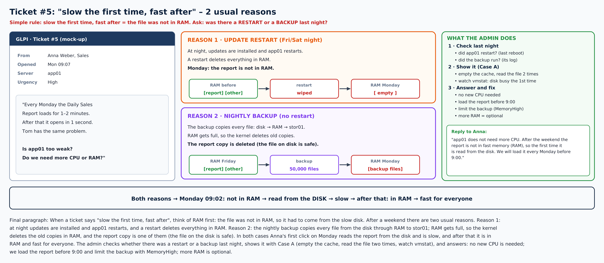
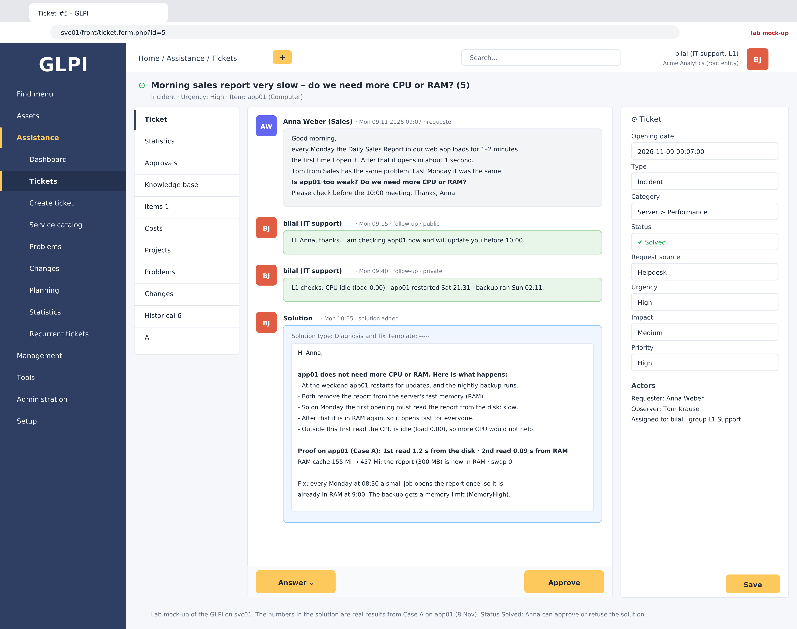

# Case study / runbook: "slow the first time, fast after"

**Use it when** a user says: *"The report (or page, or file) takes very long the first time – after that it is fast. Do we need more CPU or RAM?"* – often on a Monday or after maintenance.

**Learned from:** [ticket #5 in Day 15](../progress/day-15-2026-11-08.md) (practice ticket in the lab).



**The idea in one line:** slow the first time and fast after = the file was not in RAM (page cache), so it came from the slow disk. Something emptied the cache – usually a **restart** or a **big job like the backup**.

> In a real company you do **not** create a test file with `dd` – the report already exists. You go straight to the steps below on the real server and the real file.

---

## Step 1 – Ask the user two short questions

- Which report / file / page, and on which server?
- When exactly was it slow, and was it only the first time?

Write the answers in the ticket. Reply: *"I am checking it now."*

## Step 2 – What happened last night?

On the app server:

```bash
uptime                               # how long since the last restart + CPU load
last reboot | head -3                # when it restarted
journalctl --list-boots | tail -3    # the same restarts, with numbers (0 = now, -1 = before)
```

On the server that runs the backup:

```bash
systemctl list-timers --all | grep -i backup                     # when the backup ran / runs next
journalctl -u nightly-backup.service --since yesterday | tail -5  # did it run and finish?
```

✔ A restart or a backup last night → the cache was probably emptied.

## Step 3 – Find the file and check if it is in RAM now

```bash
ls -lh /srv/reports/daily-sales.csv     # how big is it? (big file = long first read)
fincore /srv/reports/daily-sales.csv    # how much of it is in RAM right now (RES / PAGES)
```

`fincore` (part of util-linux) shows how much of a file is in the page cache. Right after the user's first click it should be almost all of the file.

## Step 4 – Watch it happen (only if you need proof)

Ask the user to open the report again tomorrow morning, or open it yourself before them, and record it in one line:

```bash
vmstat 1 10 > ~/vm.txt & time cat /srv/reports/daily-sales.csv > /dev/null; wait; cat ~/vm.txt
free -h
```

Look at: first read slow · `bi` (blocks from the disk) up · buff/cache grows by the file size · second read fast.

> On a real server you do **not** run `drop_caches` – it slows down everybody. You only use it in a lab to play "the weekend".

## Step 5 – Fix

| Fix | How | When |
|---|---|---|
| **Warm-up read** | a small systemd timer opens the report at 08:30, e.g. `cat /srv/reports/daily-sales.csv > /dev/null`, so it is in RAM at 9:00 | first choice, costs nothing |
| **Limit the backup** | give the backup service `MemoryHigh=` (like the archive worker in Phase 4) so it cannot push other files out of RAM | if the backup runs on the same server |
| **More RAM** | only if RAM is too small for the files people use every day | if the cache is always full |
| **Faster disk** | SSD instead of HDD/NAS | if the first read must be fast too |

**Not** the fix: more CPU – the time goes into reading the disk, not into calculating.

## Step 6 – Answer and close in GLPI

Write the solution in plain words (what happened, the proof, the fix), set the ticket to **Solved**. If it comes back every week, open a **Problem** and link the ticket (as in Phase 4).


